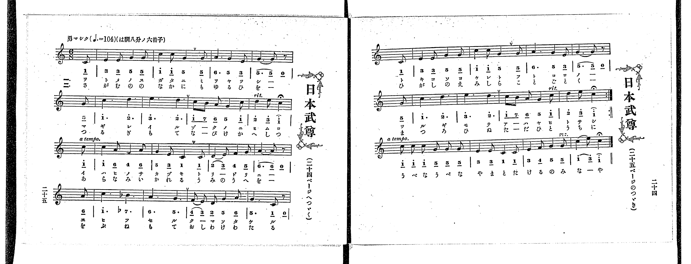

# 日本武尊

> Re:Shoka 使用 AI 辨識樂譜，可能會有錯誤。歡迎回報。

<audio controls src="yamato_takeru_no_mikoto.mp3"></audio>

- 出處：共益商社樂器店《唱歌教科書 教師用 巻四》第二十二～二十五頁（第二學期第五曲）
- NDL Digital Collections PID 854865（https://dl.ndl.go.jp/pid/854865）掃描 P017.jpg, P018.jpg

## 說明

原書資訊與歌詞全文（NDL PID 854865《唱歌教科書 教師用 巻四》第二十二～二十五頁，掃描 P017.jpg, P018.jpg）：
調性與拍號：は調八分ノ六拍子（C 大調 6/8 拍），♩.=104，「勇マシク」，弱起一拍（八分音符）
註記：單聲部，二節分節歌加四小節尾聲（跨第二十四～二十五頁：第二十五頁為前十六小節，第二十四頁為第十七～二十四小節及反覆記號，其後接第二十四頁第三行四小節尾聲「うべなうべな 日本武の御名や。」）。第八、二十四小節標有「rit.」與延長記號（fermata），第九、二十五小節標有「a tempo.」，第二十七小節末標有「rit.」，最末音標有延長記號。第十三小節第二大拍為降 B4（b7.，TMD 記為 7,）。右頁僅印歌詞（第一節漢字旁附小字註解：少女、身、賊、祝、醉、劍），未附演奏注意與語釋。

## 歌詞

```text
一、
をとめのすがたに、みをやつし、
まぎれいる、ぞくのにひむろ、
いはひのさかづき、とりぐに、
ゑひふせる、くまそたける、
ときこそよけれと、ふところの、
つるぎもて、あはやひとさし。

二、
さがむの野なかに、もゆる火を、
つるぎもて、なびけかへしつ、
あらなみいかれる、うみのうへを、
小舟もて、おしわけわたる、
ひがしのえみしら、ことぐく、
まつろひぬ、たゞひとうちに、
うべなうべな、日本武の御名や。
```

## ABC

```abc
X:1
T:日本武尊
M:6/8
L:1/16
Q:3/8=69
K:C
V:V1 name="Voice" snm="Voi"
[V:V1]
z2 z2 z2 z2 z2 C2 | E4 E2 G4 G2 | c4 c2 G4 G2 | A6 G4 E2 |
G8 z2 G2 | c6 d6 | e6 d6 | c2 B2 A2 G4 c2 |
d4 e2 c4 c2 | c4 A2 F4 A2 | G4 E2 C4 C2 | D4 E2 F4 G2 |
A8 z2 A2 | c6 _B6 | A6 G6 | F2 E2 D2 G4 A2 |
G6 C2 z2 C2 | E4 E2 G4 G2 | c4 c2 G4 G2 | A6 G4 E2 |
G8 z2 G2 | c6 d6 | e6 d6 | c2 B2 A2 G4 c2 |
d4 e2 c4 z2 | z2 z2 z2 z2 z2 C2 | E4 E2 G4 G2 | c4 c2 G4 G2 |
A6 G4 E2 | G8 z2 G2 | c6 d6 | e6 d6 |
c2 B2 A2 G4 c2 | d4 e2 c4 c2 | c4 A2 F4 A2 | G4 E2 C4 C2 |
D4 E2 F4 G2 | A8 z2 A2 | c6 _B6 | A6 G6 |
F2 E2 D2 G4 A2 | G6 C2 z2 C2 | E4 E2 G4 G2 | c4 c2 G4 G2 |
A6 G4 E2 | G8 z2 G2 | c6 d6 | e6 d6 |
c2 B2 A2 G4 c2 | d4 e2 c4 z2 | c2 c2 c2 G2 G2 G2 | E4 E2 C4 C2 |
E4 F2 G4 G2 | c4 e2 c6 |
```

## TMD 檔案連結

- [主旋律 TMD 檔案](yamato_takeru_no_mikoto.tmd) [[在 TMD Studio 編輯](https://tmdlang.github.io/Tmd-TS/#tmd=s7IKdvYPcrWy4qpTUCpJTLdSSM7PyUlNLsnMz7PKrsxPzc6ML87Iz05Ugisoy88pzU21yk7MizeJtzA1sTAzRUgW55cWJadaFSdn5OfnxJekVpQk5edno8vHFySmp1oFGBiaI2QKivLLUvMS84C6C4oy80pSU8DaEQpSyzJTUkHSxclAq8tSizLTMlNTkNyVWlQMcjXUipKixLzi5KLMApBXEKrSU_OKUq2SMzJzUopS8-KL8_PSEZJp-UW5VsUlRfkFGZnJCOGSjFSghzMyi0vyiyrRhdPyc7Jz8otS0cVzM3MySxJB6rW0FJ5NX_pszppna5c93dCloKXFpWirYGhgwmVvq-DMZWOmb2EH0vy0fdeLmVPf75n1tHXj89ldT6e2PV-y79mKpqczVzzdNf1xQ9fTKRufre15NnXm8-UTn83eoQBkPd2x-vmUFQpPt-9-Onv244bu52vWPNnV87S3EUi-3zsPxp7yckHj-z0dUNm1O57NmQ9mT3k2e9P7PZ1gt_u5-Ci4ZKYDHZ2j4AxPBMUKAZ4uCpBoBpqQUVJSUGylr5-So5cHxOn5elkF-gWZKfowFZ3P-pqf9fcrgCIXKJeuA2JZgFhKXFz6Wgq21AJcCgoKT_vmA8Phxeb2Fyu6XnS0AwPnxcp5T1tXPJvWDnQryEMIx1Mh_Hpw-g3ob2C8gZz0YtX-Zw3LQY7p7n0xcz5Q9HHjeqDg09bVTzvaHjf3PW1dC5R6unYC0IXOCk-XLAdKKgCTgAJQFGxMz6OZK_VsgckDyHzc0PO0u_1x87zHTdsfN61_3ABU0vN0z8YXW7c_2dEA1tEBMfnl_M3P1ywDGgB2xIrdL1bMAKWkaeteNG562bwCqA3ol-frG4BKgSQwGJ52LQB6-emGfpDghn1AZUCzXmxfAQ8BoCxGCMxCCh-QyPOmXU87e0GKW9dCjAJahGwCRA1QBKRlRzPcQITV_V1P-3tfLGsDOhgcXj1PW7c93QcM6qXo5gC5OzpfLOxBczYwjB43tj1u3Pm4cRWcgchxjxvXPd238OmE3sdNLY8bmsBB2AlkgNzUuvpxAyimkR30bMXMZ3OACnqKMkv0gKqBUfl097aXU7fDHNiRllqUm1iSCIkskKt2zoUbAwwWNGMSFUpScwvyQUYhhw0wMKAK56xGtxKU0uaAJICRCpFDdgHU7SAjOiFGQA1dshyYIICh_XJmr4ITMPV0JJnrAY0K8XUBJogZQAkFcx2I35_2bwYG6NPm1qe9GyCZBlo47GgAuWjPoqdrpz-b3vhyZgvQAiAblJ6WLwalpw0Tny7dDPTti12goHuxuQtIPl8K8v_LNqDJjU-7oIn42ZxVQO3P9kx5urT_2eYVz1r6gQH5YtW8l-3dQAdwgVIp0DagDhDrcdOkx40rHjc1AiPrcePMx43AGJ3_uBFkxePG_SBZYNw1LnncCCwFIRoa9z1u7HvcBFTX8rgJaCJQ3bzHjf1g_asfAxNFU8Pjpl64aqDu9SBRkPTUx43djxuXPm4ESYOt7XrcOAFiG8QxE8FKtz5unA0zG2gw0MK5YFdNhAhCDF4BMqZxMkiuqQMsB3TSCrAeoH6g7GSQM4DWwjQsAekGOb3pceMysDogYz3Yf0A7gRqAzgP6EhpCu4AlAFQjULwH5KvGdS_b-8BJHWgOOISARjW1AY19DuQCgwq3TUA9m0FuBOncAbIGqAamGmhGJ1jFfnBodYM8AvU8MEsBBYEhB2TsQNgATBovOuYjGQ8MxumPm4BBBQwFIAmUQoQT0G_AgAHaCDQGGE5A84BKQQkGHHhAbwMjoB85coGuB4YbUNsasCKgYcD4hYQQ0BkLkaILI-8DJXDlfpAGyqseKFDQ0ufiCgO2OlKtwvIzk1MdagxqFKpBVijYWGjZgRnAGk8DUl5rglK5Qg0ozQBZjUB6HRDPBIv0APF8IF4NxPtBIkCVQAeDIhEsP13hcfMeULiArAQZW6NgAIeGQJ6xgi4QmwJJUyDPMA7IABIwvhmQBrFAamrANAgagORgjgQmFKCNPWDbgPY2dYNZ86D29kNduxosugko3wDEvWC1cBeBbdVVMIJQQDeh8YHy5kCngKwHMmsgEkBFMNciuWU9xBawnVPBdnYD8VIgBtm5AhxCXVC3TQCzQWqAoQcSaZqI5iYzBRMwCfG6MTDAgPaBHADmgeQQgQQKFqBKhFNAztgKNn42PFiAwQGNDmC-B0cdSHQiWB7kPPQgMdeBBgEiIkA8E6DtRmAezG0gd4EjFGE_yMOTIfY0dcDtASUYYDKCugzEAqoBRgiIBww0sOuWINxBefIA-6wPHPBNQNYysE1AFtgmYHSBE-smuGumghMtdZKGAdAZtVxcrnkpmXnpeHMasAQA4p1AvAqFDXI1yH2g-AK5bgFKfIESGTjTgXSBExBqooYgUzCEBSUsCYF4JqgBC3M20F8gZ-vaKYCLCAVkBsQvIJYyFwA)]

## 分析

```text
================================================================================
📊 TMD Song Profile: [ 日本武尊 ]
================================================================================
⏱  Duration:       1:33 (93.5s), 54 measures total
🎼 Key & Tempo:    首調基準 C, != 104.0 BPM, <6/8>
   - 分析範圍：      由實際發聲的音符與和弦推測調性；播放脈絡另行呈現
🎤 人聲音域:    C4 (MIDI 60) – E5 (MIDI 76) [跨度: 16 個半音 / 1.3 個八度, 難度: moderate]
   - 最低音:  C4 in [Verse #1 @ m.1, 0:01]
   - 最高音: E5 in [Verse #1 @ m.7, 0:10]
   - 適合: soprano, mezzo-soprano, contralto, tenor, baritone, bass
🏛  結構:      Verse (43.3s) -> Verse (43.3s) -> Ending (6.9s)
⚡ 編曲密度:        Peak 1 軌道同時演奏
🗝  調性診斷：       C 大調（純淨自然大調，未偵測到可信轉調）
   - 風格氣質:    純淨自然大調（陽光明朗、易唱易記，無明顯調外色彩）
   - 轉調歷程:    全曲維持單一推測調性（未偵測到可信轉調）
   - 核心骨幹音:  G, C, E, D, A
   - 調性數值:    C 大調 [相關度: 0.90, 穩定度: High, 自然音純度: 98.0%]
   - 候選調性 (K-S): C 大調 (0.90), G 大調 (0.78), E 小調 (0.60)
   - 五度圈歷程:   +0 -> +0 -> +0
   - 各段落調性細節:
     • [Verse #1]: C 大調 (r: 0.88, 自然音純度: 97.9%, 調外音: A#)
     • [Verse #2]: C 大調 (r: 0.88, 自然音純度: 97.9%, 調外音: A#)
     • [Ending #1]: C 大調 (r: 0.90, 自然音純度: 100.0%)

  [ 五度圈游移軌跡 ]
              [C ]*
         F            G  
      Bb               D  
      Eb               A  
         Ab           E  
            Db       B  
               F# 
     (* = active key center)

  [ 十二半音累積音高分佈 ]
     C  : ████████████████████      24.7%
     C# :                            0.0%
     D  : ██████████                12.5%
     D# :                            0.0%
     E  : ████████████              14.5%
     F  : ███                        3.6%
     F# :                            0.0%
     G  : ████████████████████████  28.9%
     G# :                            0.0%
     A  : ██████████                12.5%
     A# : ██                         2.0%
     B  : █                          1.3%
--------------------------------------------------------------------------------
Assignment 軌道音域：
  - Voice         : C4 – E5 (16 個半音 / 1.3 個八度, 173 個音符)
================================================================================
```


## 原書掃描頁




