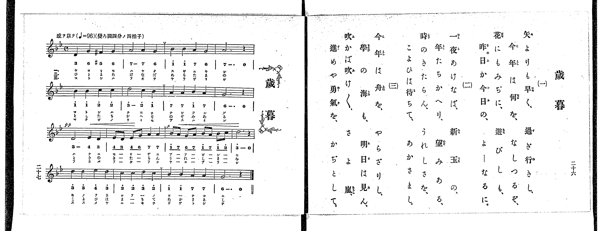

# 歳暮

> Re:Shōka 使用 AI 協助辨識與重建樂譜，可能會有錯誤。歡迎回報。

- **鋼琴伴奏版**：<br><audio controls src="seibo.mp3"></audio>
- **NEUTRINO 歌聲合成版**：<br><audio controls src="seibo_neutrino.mp3"></audio>

- 出處：共益商社樂器店《唱歌教科書 教師用 巻四》第二十六～二十七頁（第二學期第六曲）
- NDL Digital Collections PID 854865（https://dl.ndl.go.jp/pid/854865）掃描 P019.jpg

## 說明

原書資訊與歌詞全文（NDL PID 854865《唱歌教科書 教師用 巻四》第二十六～二十七頁，掃描 P019.jpg）：
調性與拍號：變ろ調四分ノ四拍子（調號二降記號，實為 g 小調 4/4 拍），♩=96，「感ヲ以テ」
註記：單聲部，三節分節歌。第一小節第三拍為升 F 音（五線譜標 #、簡譜標 #5）。第三行（第九小節）開頭標 pp，第十小節起有漸強記號，第十一小節開頭標 p。原書第二十六頁僅印歌詞三節，未附語釋與演奏注意欄。


## 歌詞

```text
一、
矢よりも早く、過ぎ行きし、
今年は何を、なしつるぞ、
花にもみぢに、遊びしも、
昨日か今日の、よーなるに。

二、
一夜あけなば、新玉の、
年たちかへり、望みある、
時のきたらん、うれしさを、
こよひは待ちて、あかさまし。

三、
今年は舟を、やらざりし、
學の海も、明日は見ん、
吹かば吹け〲、さよ嵐、
進めや勇氣を、かぢとして。
```

## ABC

<div class="abc-score" data-abc-src="seibo.abc" aria-label="五線譜載入中"></div>

[下載 ABC 原始檔](seibo.abc)

## TMD 檔案連結

- [主旋律 TMD 檔案](seibo.tmd) [[在 TMD Studio 編輯](https://tmdlang.github.io/Tmd-TS/#tmd=s7IKdvYPcrWy4qpTUCpJTLdSSM7PyUlNLsnMz7PKrsxPzc6ML87Iz05Ugisoy88pzU21yk7MizeJtzA1sTAzRUgW55cWJadaFSdn5OfnxJekVpQk5edno8vHFySmp1oFGBhaImQKivLLUvMS84C6C4oy80pSU8DaEQpSyzJTUkHSxclAq8tSizLTMlNTkNyVWlQMcjXUipKixLzi5KLMApBXEKrSU_OKUq2SMzJzUopS8-KL8_PSEZJp-UW5VsUlRfkFGZnJCOGSjFSgh4tTE4GqizGEIV7NyUxLRUgl5iXmVBZnFlvlZublFyHE84sy0zPzrHJTM7MykUJHS0vh2drNz2atU9DS4lK0VbA047K3VXDS4bIx0TexA-l-2r7rxcyp7_fMetq68fnsrqdT254v2fdsRdPTmSue7pr-uKHr6ZSNz9b2PJs68_nyic9m71AAsp7uWP18ygqFp9t3P509-3FD9_M1a57s6nna2_i0de37vfMg7Cc7ml8uaHy_pwMqu3bHsznzgWygmmezN73f0wl2vJ-Lj4IL0OkliTkKzvAEUqwQ4OmiAEkCQBMySkoKiq309VNy9PKAOD1fL6tAvyAzRR-movNZX_Oz_n4FUMQD5YABz6WvpWBLLcCloKDwtG8-0PcvNre_WNH1oqMdGCQvVs572rri2bR2oAtB3kA4mQqh1oPmI6AfgXEEcsiLVfufNSwHOaG798XM-UDRF-u6Hjf1AsWB5j7taHvc3AdkAGWfrp0AdBpQHKgMaPrLmb0vVswAa-l5un7Z86ZdCukKTzf0AxUoAFODAlAH2JaeRzNX2lqaARmPG3qetcx_3Lzpye6lj5vbHjf0gh2wYjfQHFCKmbbuReOml80rgEqf7Oh8vr4BaDuQBHr8cUMTyHs7GoDmA0XA7E6gBUBLn_a2K7gpvJy_Gei2J7umPN8-68XaOc9WzFRQftzQ-HzDQhgPFK0wYzpfLOyBpqSdcyFGAmVfTut-uWAtSHFBAdAJoLQFDEyw7Iut25_N6Xy2Z8fTPdvhnoYogDsKSTvQHkj8IscJMB6eNrc-7d0AiWuID0ExM2fVy5ktL1bNe9neDYqGPVOeLu1_tnnFs5b-Z2tagEZxgUIJaA3QPyDW8_mLHjd1PG4CRlLTs-krHzf2AyVeNvY9buwDeutxY-_jRmA-Ayt9srvr6c4tjxvXP9k79XHTJKDo48ZVIOnGJY-buh83zoOqe9G18XHjaqB5jxv3P25cBGKDjOx63LgZpBooDlH3bMaKZ9OXPm7sBhoMZqwDGQl0TPMekMEgI4E6oQ7eBYw1iCuAIbRkzuNGoOkTwfZvAEo8m7bheV8nxARwfgC5c_7jxoVA0x837gB5D6hozmywi5pARkOdMBNozDqwL-c_bup83DQZ7Ku2x01ArwM9BvUnSOnjxskgtzVuAgbA032tYLOXgVUDjQBaMvVx4z5wWMFCGJg-UIPtRQfQDnCwNbWALGucBnIXPHiBZRDQLc-2boeE0LMZfeBAWf9iWTfEXWBFE3aCbdsAZkx83LAJ7ASgOzuebp0AVfQSKNoEsuVpd_uzDYthcQXUBoyMFWCPAV3eBFJKefEDBQpa-lxcwamZSflWYfmZyakONQY11SAbFGwstOzADGCh97h5CRCvAOJVQLxIoQZI9kNEm9aDeE07gXgdUGQZkF4LFtkOMhqkv0bBOF5BV8EMRJiqw5k1CuYgCgTBDKigIZAEYWQxuEIQNAAJgQ32MQTZ0wLkA4MRTHaBySawJmAUQHVA1TT2Q8Vngnl9YJk2MLsXKjMdyR6w1RB7jEBym8AqVyBsa4TZMxFmT-MqMLkBKg6SByYYsNh8MLkPKrMOuz3GILnJCHvA7oH4AySzFW7PWrDJkyDi0BCA2DMNHg64_QOK0KbNwMjqAEcTKCpBEdoFxN1AvAnGA8u1APFqsDX7EBEKiyQjKAZGMdQWEA8kA400MAGPzhpIhOKISTw-B4UrxOerkX0ODW-I2iVgmW6ozDzsIQyOSWQbIPGyEKoLpBtizw6UcATFF8RMYEkEJqFxD7YPV0yCYhvmxs1gEmQOSAaU6iD2gE2Dp1hwioGmT5DfIfIge0Bhg2lPdUFBLSKPgnIkJBJBEbgIiPcA8Xwo3QSTaYLKNO2FykyG8kHRvQeqFzXvgqAJiAHm1YDYQBaQBMYnIp5rgO6pBcY2kAMRBzMNgWkCkT6wxTs8n0LDChTHIHdCQgMS3ouQZaDhNBcpZEGxCdODL94h9oDyOyI2IDxwSoDkInBow-IJWKfAbQCW2FB7QCkQV7wj8ikodSDKA5A4pLRAZoNkQKYilyoQdxDIwWuBEdUHxFOBbEgO3QjhgSO1DxyRoCIbxAMlC7AaYBJARC3QPBA2gdI18PwM4kHyNUpxTEwmRgQtzJOwLInwOCRwoMEP9jZS9MOzMCiycUUluKiABhikYIYVFZBMB8rQEDOXQcUhSQYSIeDghhfGOAp9cFRCsiKYbGoEk6DCFuRqRBYG-xheJEFsgCRXREEDkgG5BNWeWi4uXTsFcO2rAGQocwEA)]
- [鋼琴伴奏 TMD 檔案](seibo_piano.tmd) [[在 TMD Studio 編輯](https://tmdlang.github.io/Tmd-TS/#tmd=s7IKdvYPcrWy4tLSUni2dvOzWeve7-l42b3n-YQtT_Zsebq0_3lnx_s9nQpaWlyKtgqWZlz2tgpOOlw2Jvomdlx1CkpP23e9mDn1_Z5ZT1s3Pp_d9XRq2_Ml-56taHo6c8XTXdMfN3Q9nbLx2dqeZ1NnPl8-8dnsHQpA1tMdq59PWaHwdPvup7NnP27ofr5mzZNdPU97G5-2rn2_dx6E_WRH88sFjUDHQGXX7ng2Zz6QDVTzbPYmoJOUQNb7ufgouGSmZ5Yk5ig45-fkpCaXZObnFSsEeLooWJiaWJiZAk3IKCkpKLbS10_J0csD4vR8vawC_YLMFH2Yis5nfc3P-vsVAgwMLYFy6UpcXMGpmUn5VgGZiXn5QR4ONQY11VwKQGBjoWUHZuhrKTxuXgLEK4B4FRAvUqgBkv0Q0ab1IF7TTiBeBxRZBqTXgkW2K2jpg_XXKBjHK-gqmIEIU3U4s0bBHESBIJgBFTQEkiCMLAZXCIIGICGwwT6GIHtagPzHTR1gsgtMNoE1PW5cD9UBVdPYDxWfCeb1gWXawOxeqMx0JHvAVkPsMQLJbQKrXIGwrRFmz0SYPY2rwOQGqDhI_nFTJ1hsPpjcB5VZh90eY5DcZIQ9YPdA_AGS2Qq3Zy3Y5EkQcWgIQOyZBg8H3P4BRWjTZmBkdYCjCRSVoAjtAuJuIN4E44HlWoB4NdiafYgIhUWSERQDoxhqC4gHkoFGGpiAR2cNJEJxxCQen4PCFeLz1cg-h4Y3RO0SsEw3VGYe9hAGxySyDZB4WQjVBdINsWcHSjiC4gti5uPG_WASGvdg-3DFJCi2YW7cDCZB5oBkQKkOYg_YNHiKBacYaPoE-R0iD7IHFDaY9lQXFNQi8igoR0IiERSBi4B4DxDPh9JNMJkmqEzTXqjMZCgfFN17oHpR8y4ImoAYYF4NiA1kAUlgfCLiuQbonlpgbAM5EHEw0xCYJhDpA1u8w_MpNKxAcQxyJyQ0IOG9CFkGGk5zkUIWFJswPfjiHWIPKL8jYgPCA6cESC4ChzYsnh439cBteNw4FWoPKAXiindEPgWlDkR5ABKHlBbIbJAMyFTkUgXiDgI5eC0wovqAeCqQDcmhGyE8cKT2gSMSVGSDeKBkAVYDTAKIqAWaB8ImULoGnp9BPEi-RimOicnEiKCFeRKWJREehwQONPjB3kaKfngWBkU2rqgEFxXQAIMUzLCiApLpQBkaYuYyqDgkyUAiBBzc8MIYR6EPjkpIVgSTTY1gElTYglyNyMJgH8OLJIgNkOSKKGhAMiCXoNpTi1L5-iBXviaIyvdFX9fL9t6nrTtezm6FNFQQUQjMgtEmsTCqBghN44Fs0_hYBAPiH2BUAvmGyOIkq8YQg6rFYgqm21DNRXIxlEmkqVD9UAq3qWT5DEgZQOJF104BHDXRPkBhBMcImWMM5ihzAQA)]

## 分析

```text
================================================================================
📊 TMD Song Profile: [ 歳暮 ]
================================================================================
⏱  Duration:       0:40 (40.0s), 16 measures total
🎼 Key & Tempo:    首調基準 B,, != 96.0 BPM, <4/4>
   - 分析範圍：      由實際發聲的音符與和弦推測調性；播放脈絡另行呈現
🎤 人聲音域:    D4 (MIDI 62) – D#5 (MIDI 75) [跨度: 13 個半音 / 1.1 個八度, 難度: moderate]
   - 最低音:  D4 in [Seibo #1 @ m.1, 0:00]
   - 最高音: D#5 in [Seibo #1 @ m.13, 0:31]
   - 適合: soprano, mezzo-soprano, contralto, tenor, baritone, bass
🏛  結構:      Seibo (40.0s)
⚡ 編曲密度:        Peak 1 軌道同時演奏
🗝  調性診斷：       G 小調（純淨自然小調，未偵測到可信轉調）
   - 風格氣質:    純淨自然小調（陰鬱抒情、旋律集中，無明顯調外色彩）
   - 轉調歷程:    全曲維持單一推測調性（未偵測到可信轉調）
   - 核心骨幹音:  A, D, G, A#, C
   - 調性數值:    G 小調 [相關度: 0.70, 穩定度: Moderate, 自然音純度: 98.3%]
   - 候選調性 (K-S): G 小調 (0.70), D 大調 (0.59), D 小調 (0.58)
   - 五度圈歷程:   +1
   - 各段落調性細節:
     • [Seibo #1]: G 小調 (r: 0.70, 自然音純度: 98.3%, 調外音: F#)

  [ 五度圈游移軌跡 ]
               C  
         F           [G ]*
      Bb               D  
      Eb               A  
         Ab           E  
            Db       B  
               F# 
     (* = active key center)

  [ 十二半音累積音高分佈 ]
     C  : ██████████                10.8%
     C# :                            0.0%
     D  : █████████████████████     22.5%
     D# : █████                      5.0%
     E  :                            0.0%
     F  :                            0.0%
     F# : ██                         1.7%
     G  : █████████████████         18.3%
     G# :                            0.0%
     A  : ████████████████████████  25.8%
     A# : ███████████████           15.8%
     B  :                            0.0%
--------------------------------------------------------------------------------
Assignment 軌道音域：
  - Voice         : D4 – D#5 (13 個半音 / 1.1 個八度, 55 個音符)
================================================================================
```


## 原書掃描頁




