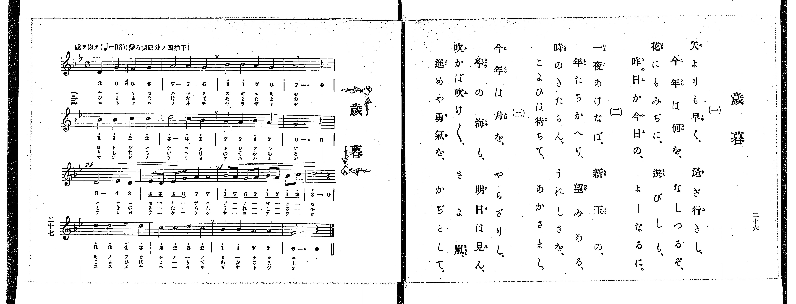

# 歳暮

> Re:Shōka 使用 AI 協助辨識與重建樂譜，可能會有錯誤。歡迎[回報](https://github.com/TMDLang/reshoka/issues)。

- **鋼琴伴奏版**：<br><audio controls src="seibo.mp3"></audio>
- **NEUTRINO 歌聲合成版**：<br><audio controls src="seibo_neutrino.mp3"></audio>

- 出處：共益商社樂器店《唱歌教科書 教師用 巻四》第二十六～二十七頁（第二學期第六曲）
- NDL Digital Collections PID 854865（https://dl.ndl.go.jp/pid/854865）掃描 P019.jpg

## 說明

原書資訊與歌詞全文（NDL PID 854865《唱歌教科書 教師用 巻四》第二十六～二十七頁，掃描 P019.jpg）：
調性與拍號：變ろ調四分ノ四拍子（調號二降記號，實為 g 小調 4/4 拍），♩=96，「感ヲ以テ」
註記：單聲部，三節分節歌。第一小節第三拍為升 F 音（五線譜標 #、簡譜標 #5）。第三行（第九小節）開頭標 pp，第十小節起有漸強記號，第十一小節開頭標 p。原書第二十六頁僅印歌詞三節，未附語釋與演奏注意欄。


## 歌詞

```text
一、
矢よりも早く、過ぎ行きし、
今年は何を、なしつるぞ、
花にもみぢに、遊びしも、
昨日か今日の、よーなるに。

二、
一夜あけなば、新玉の、
年たちかへり、望みある、
時のきたらん、うれしさを、
こよひは待ちて、あかさまし。

三、
今年は舟を、やらざりし、
學の海も、明日は見ん、
吹かば吹け〲、さよ嵐、
進めや勇氣を、かぢとして。
```

## ABC

<div class="abc-score" data-abc-src="seibo.abc" aria-label="五線譜載入中"></div>

[下載 ABC 原始檔](seibo.abc)

## TMD 檔案連結

- [主旋律 TMD 檔案](seibo.tmd) [[在 TMD Studio 編輯](https://tmdlang.github.io/Tmd-TS/#tmd=s7IKdvYPcrWy4qpTUCpJTLdSSM7PyUlNLsnMz7PKrsxPzc6ML87Iz05Ugisoy88pzU21yk7MizeJtzA1sTAzRUgW55cWJadaFSdn5OfnxJekVpQk5edno8vHFySmp1oFGBhaImQKivLLUvMS84C6C4oy80pSU8DaEQpSyzJTUkHSxclAq8tSizLTMlNTkNyVWlQMcjXUipKixLzi5KLMApBXEKrSU_OKUq2SMzJzUopS8-KL8_PSEZJp-UW5VsUlRfkFGZnJCOGSjFSgh4tTE4GqizGEIV7NyUxLRUgl5iXmVBZnFlvlZublFyHE84sy0zPzrHJTM7MysYROflFJRn56UWJBRqVVRmZxCVB5cmJOPDCogeGvpaXwbO3mZ7PWKWhpcSnaKliacdnbKjjpcNmY6JvYgcx42r7rxcyp7_fMetq68fnsrqdT254v2fdsRdPTmSue7pr-uKHr6ZSNz9b2PJs68_nyic9m71AAsp7uWP18ygqFp9t3P509-3FD9_M1a57s6nna2_i0de37vfMg7Cc7ml8uaHy_pwMqu3bHsznzgWygmmezN73f0wn2gp-Lj4IL0H8liTkKzvBUVKwQ4OmiAEknQBMySkoKiq309VNy9PKAOD1fL6tAvyAzRR-movNZX_Oz_n4FUOoAygFjh0tfS8GWWoBLQUHhad98oO9fbG5_saLrRUc7MEherJz3tHXFs2ntQBeCvIFwMhVCrQfNR0A_AuMI5JAXq_Y_a1gOckJ374uZ84GiL9Z1PW7qBYoDzX3a0fa4uQ_IAMo-XTsB6DSgOFAZ0PSXM3tfrJgB1tLzdP2y5027FNIVnm7oBypQAKYGBaAOsC09j2autLU0AzIeN_Q8a5n_uHnTk91LHze3PW7oBTtgxW6gOaAUM23di8ZNL5tXAJU-2dH5fH0D0HYgCfT444YmkPd2NADNB4qA2Z1AC4CWPu1tV3BTeDl_M9BtT3ZNeb591ou1c56tmKmg_Lih8fmGhTAeKFphxnS-WNgDTUk750KMBMq-nNb9csFakOKCAqATQGkLGJhg2Rdbtz-b0_lsz46ne7bDPQ1RAHcUknagPZD4RY4TYDw8bW592rsBEtcQH4JiZs6qlzNbXqya97K9GxQNe6Y8Xdr_bPOKZy39z9a0AI3iAoUS0Bqgf0Cs5_MXPW7qeNwEjKSmZ9NXPm7sB0q8bOx73NgH9Nbjxt7HjcB8Blb6ZHfX051bHjeuf7J36uOmSUDRx42rQNKNSx43dT9unAdV96Jr4-PG1UDzHjfuf9y4CMQGGdn1uHEzSDVQHKLu2YwVz6YvfdzYDTQYzFgHMhLomOY9IINBRgJ1Qh28CxhrEFcAQ2jJnMeNQNMngu3fAJR4Nm3D875OiAng_ABy5_zHjQuBpj9u3AHyHlDRnNlgFzWBjIY6YSbQmHVgX85_3NT5uGky2Fdtj5uAXgd6DOpPkNLHjZNBbmvcBAyAp_tawWYvA6sGGgG0ZOrjxn3gsIKFMDB9oAbbiw6gHeBga2oBWdY4DeQuePACyyCgW55t3Q4JoWcz-sCBsv7Fsm6Iu8CKJuwE27YBzJj4uGET2AlAd3Y83ToBquglULQJZMvT7vZnGxbD4gqoDRgZK8AeA7q8CaSU8uIHChS09Lm4glMzk_KtwvIzk1MdagxqqkE2KNhYaNmBGcBC73HzEiBeAcSrgHiRQg2Q7IeINq0H8Zp2AvE6oMgyIL0WLLIdZDRIf42CcbyCroIZiDBVhzNrFMxBFAiCGVBBQyAJwshicIUgaAASAhvsYwiypwXIBwYjmOwCk01gTcAogOqAqmnsh4rPBPP6wDJtYHYvVGY6kj1gqyH2GIHkNoFVrkDY1gizZyLMnsZVYHIDVBwkD0wwYLH5YHIfVGYddnuMQXKTEfaA3QPxB0hmK9yetWCTJ0HEoSEAsWcaPBxw-wcUoU2bgZHVAY4mUFSCIrQLiLuBeBOMB5ZrAeLVYGv2ISIUFklGUAyMYqgtIB5IBhppYAIenTWQCMURk3h8DgpXiM9XI_scGt4QtUvAMt1QmXnYQxgck8g2QOJlIVQXSDfEnh0o4QiKL4iZwJIITELjHmwfrpgExTbMjZvBJMgckAwo1UHsAZsGT7HgFANNnyC_Q-RB9oDCBtOe6oKCWkQeBeVISCSCInAREO8B4vlQugkm0wSVadoLlZkM5YOiew9UL2reBUETEAPMqwGxgSwgCYxPRDzXAN1TC4xtIAciDmYaAtMEIn1gi3d4PoWGFSiOQe6EhAYkvBchy0DDaS5SyIJiE6YHX7xD7AHld0RsQHjglADJReDQhsUTsE6B2wAssaH2gFIgrnhH5FNQ6kCUByBxSGmBzAbJgExFLlUg7iCQg9cCI6oPiKcC2ZAcuhHCA0dqHzgiQUU2iAdKFmA1wCSAiFqgeSBsAqVr4PkZxIPka5TimJhMjAhamCdhWRLhcUjgQIMf7G2k6IdnYVBk44pKcFEBDTBIwQwrKiCZDpShIWYug4pDkgwkQsDBDS-McRT64KiEZEUw2dQIJkGFLcjViCwM9jG8SILYAEmuiIIGJANyCao9tVxcunYK4NpXAchQ5gIA)]
- [鋼琴伴奏 TMD 檔案](seibo_piano.tmd) [[在 TMD Studio 編輯](https://tmdlang.github.io/Tmd-TS/#tmd=s7IKdvYPcrWy4qpTUCpJTLdSyC8qychPL0osyKi0ysgsLskvykxOzInPTsxLVOLS0lJ4tnbzs1nr3u_peNm95_mELU_2bHm6tP95Z8f7PZ0KWlpcirYKlmZc9rYKTjpcNib6JnYgg5-273oxc-r7PbOetm58Prvr6dS250v2PVvR9HTmiqe7pj9u6Ho6ZeOztT3Pps58vnzis9k7FICspztWP5-yQuHp9t1PZ89-3ND9fM2aJ7t6nvY2Pm1d-37vPAj7yY7mlwsagY6Byq7d8WzOfCAbqObZ7E1AJymBrPdz8VFwyUzPLEnMUXDOz8lJTS7JzM8rVgjwdFGwMDWxMDMFmpBRUlJQbKWvn5KjlwfE6fl6WQX6BZkp-jAVnc_6mp_19ysEGBhaAuXSlbi4glMzk_KtAjIT8_KDPBxqDGqquRSAwMZCyw7M0NdSeNy8BIhXAPEqIF6kUAMk-yGiTetBvKadQLwOKLIMSK8Fi2xX0NIH669RMI5X0FUwAxGm6nBmjYI5iAJBMAMqaAgkQRhZDK4QBA1AQmCDfQxB9rQA-Y-bOsBkF5hsAmt63LgeqgOqprEfKj4TzOsDy7SB2b1QmelI9oCththjBJLbBFa5AmFbI8yeiTB7GleByQ1QcZD846ZOsNh8MLkPKrMOuz3GILnJCHvA7oH4AySzFW7PWrDJkyDi0BCA2DMNHg64_QOK0KbNwMjqAEcTKCpBEdoFxN1AvAnGA8u1APFqsDX7EBEKiyQjKAZGMdQWEA8kA400MAGPzhpIhOKISTw-B4UrxOerkX0ODW-I2iVgmW6ozDzsIQyOSWQbIPGyEKoLpBtizw6UcATFF8TMx437wSQ07sH24YpJUGzD3LgZTILMAcmAUh3EHrBp8BQLTjHQ9AnyO0QeZA8obDDtqS4oqEXkUVCOhEQiKAIXAfEeIJ4PpZtgMk1Qmaa9UJnJUD4ouvdA9aLmXRA0ATHAvBoQG8gCksD4RMRzDdA9tcDYBnIg4mCmITBNINIHtniH51NoWIHiGOROSGhAwnsRsgw0nOYihSwoNmF68MU7xB5QfkfEBoQHTgmQXAQObVg8PW7qgdvwuHEq1B5QCsQV74h8CkodiPIAJA4pLZDZIBmQqcilCsQdBHLwWmBE9QHxVCAbkkM3QnjgSO0DRySoyAbxQMkCrAaYBBBRCzQPhE2gdA08P4N4kHyNUhwTk4kRQQvzJCxLIjwOCRxo8IO9jRT98CwMimxcUQkuKqABBimYYUUFJNOBMjTEzGVQcUiSgUQIOLjhhTGOQh8clZCsCCabGsEkqLAFuRqRhcE-hhdJEBsgyRVR0IBkQC5BtacWpfL1Qa58TRCV74u-rpftvU9bd7yc3QppqCCiEJgFo01iYVQNEJrGA9mm8bEIBsQ_wKgE8g2RxUlWjSEGVYvFFEy3oZqL5GIok0hTofqhFG5TyfIZkDKAxIuunQI4aqJ9gMIIjhEyxxjMUeYCAA)]

## 分析

```text
================================================================================
📊 TMD Song Profile: [ 歳暮 ]
================================================================================
⏱  Duration:       0:40 (40.0s), 16 measures total
🎼 Key & Tempo:    首調基準 B,, != 96.0 BPM, <4/4>
   - 分析範圍：      由實際發聲的音符與和弦推測調性；播放脈絡另行呈現
🎤 人聲音域:    D4 (MIDI 62) – D#5 (MIDI 75) [跨度: 13 個半音 / 1.1 個八度, 難度: moderate]
   - 最低音:  D4 in [Seibo #1 @ m.1, 0:00]
   - 最高音: D#5 in [Seibo #1 @ m.13, 0:31]
   - 適合: soprano, mezzo-soprano, contralto, tenor, baritone, bass
🏛  結構:      Seibo (40.0s)
⚡ 編曲密度:        Peak 1 軌道同時演奏
🗝  調性診斷：       G 小調（純淨自然小調，未偵測到可信轉調）
   - 風格氣質:    純淨自然小調（陰鬱抒情、旋律集中，無明顯調外色彩）
   - 轉調歷程:    全曲維持單一推測調性（未偵測到可信轉調）
   - 核心骨幹音:  A, D, G, A#, C
   - 調性數值:    G 小調 [相關度: 0.70, 穩定度: Moderate, 自然音純度: 98.3%]
   - 候選調性 (K-S): G 小調 (0.70), D 大調 (0.59), D 小調 (0.58)
   - 五度圈歷程:   +1
   - 各段落調性細節:
     • [Seibo #1]: G 小調 (r: 0.70, 自然音純度: 98.3%, 調外音: F#)

  [ 五度圈游移軌跡 ]
               C  
         F           [G ]*
      Bb               D  
      Eb               A  
         Ab           E  
            Db       B  
               F# 
     (* = active key center)

  [ 十二半音累積音高分佈 ]
     C  : ██████████                10.8%
     C# :                            0.0%
     D  : █████████████████████     22.5%
     D# : █████                      5.0%
     E  :                            0.0%
     F  :                            0.0%
     F# : ██                         1.7%
     G  : █████████████████         18.3%
     G# :                            0.0%
     A  : ████████████████████████  25.8%
     A# : ███████████████           15.8%
     B  :                            0.0%
--------------------------------------------------------------------------------
Assignment 軌道音域：
  - Voice         : D4 – D#5 (13 個半音 / 1.1 個八度, 55 個音符)
================================================================================
```


## 原書掃描頁




