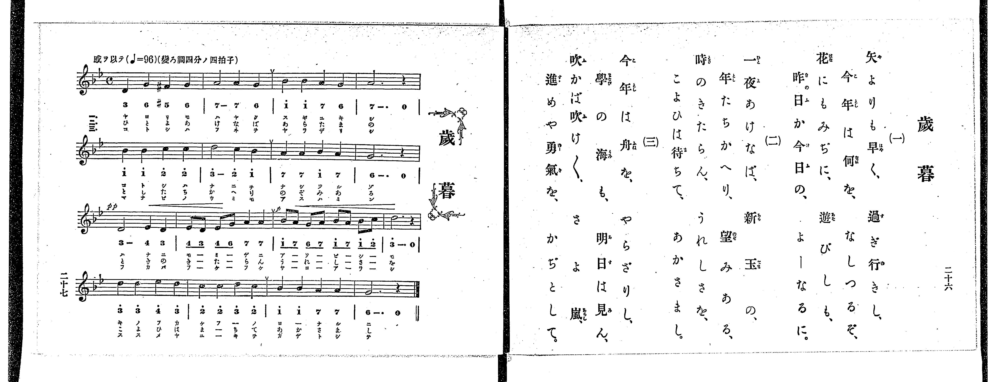

# 歳暮

> Re:Shoka 使用 AI 辨識樂譜，可能會有錯誤。歡迎回報。

<audio controls src="seibo.mp3"></audio>

- 出處：共益商社樂器店《唱歌教科書 教師用 巻四》第二十六～二十七頁（第二學期第六曲）
- NDL Digital Collections PID 854865（https://dl.ndl.go.jp/pid/854865）掃描 P019.jpg

## 說明

原書資訊與歌詞全文（NDL PID 854865《唱歌教科書 教師用 巻四》第二十六～二十七頁，掃描 P019.jpg）：
調性與拍號：變ろ調四分ノ四拍子（調號二降記號，實為 g 小調 4/4 拍），♩=96，「感ヲ以テ」
註記：單聲部，三節分節歌。第一小節第三拍為升 F 音（五線譜標 #、簡譜標 #5）。第三行（第九小節）開頭標 pp，第十小節起有漸強記號，第十一小節開頭標 p。原書第二十六頁僅印歌詞三節，未附語釋與演奏注意欄。

## 歌詞

```text
一、
矢よりも早く、過ぎ行きし、
今年は何を、なしつるぞ、
花にもみぢに、遊びしも、
昨日か今日の、よーなるに。

二、
一夜あけなば、新玉の、
年たちかへり、望みある、
時のきたらん、うれしさを、
こよひは待ちて、あかさまし。

三、
今年は舟を、やらざりし、
學の海も、明日は見ん、
吹かば吹け〲、さよ嵐、
進めや勇氣を、かぢとして。
```

## ABC

```abc
X:1
T:歳暮
M:4/4
L:1/16
Q:1/4=96
K:Bb
V:V1 name="Voice" snm="Voi"
[V:V1]
D4 G4 ^F4 G4 | A8 A4 G4 | B4 B4 A4 G4 | A12 z4 |
B4 B4 c4 c4 | d8 c4 B4 | A4 A4 B4 A4 | G12 z4 |
!pp! D8 E4 D4 | E2 D2 E2 G2 A4 A4 | !p! B2 A2 G2 A2 B2 A2 B2 c2 | d12 z4 |
d4 d4 e4 d4 | c4 c4 d4 c4 | B4 B4 A4 A4 | G12 z4 |
D4 G4 ^F4 G4 | A8 A4 G4 | B4 B4 A4 G4 | A12 z4 |
B4 B4 c4 c4 | d8 c4 B4 | A4 A4 B4 A4 | G12 z4 |
!pp! D8 E4 D4 | E2 D2 E2 G2 A4 A4 | !p! B2 A2 G2 A2 B2 A2 B2 c2 | d12 z4 |
d4 d4 e4 d4 | c4 c4 d4 c4 | B4 B4 A4 A4 | G12 z4 |
D4 G4 ^F4 G4 | A8 A4 G4 | B4 B4 A4 G4 | A12 z4 |
B4 B4 c4 c4 | d8 c4 B4 | A4 A4 B4 A4 | G12 z4 |
!pp! D8 E4 D4 | E2 D2 E2 G2 A4 A4 | !p! B2 A2 G2 A2 B2 A2 B2 c2 | d12 z4 |
d4 d4 e4 d4 | c4 c4 d4 c4 | B4 B4 A4 A4 | G12 z4 |
```

## TMD 檔案連結

- [主旋律 TMD 檔案](seibo.tmd) [[在 TMD Studio 編輯](https://tmdlang.github.io/Tmd-TS/#tmd=s7IKdvYPcrWy4qpTUCpJTLdSSM7PyUlNLsnMz7PKrsxPzc6ML87Iz05Ugisoy88pzU21yk7MizeJtzA1sTAzRUgW55cWJadaFSdn5OfnxJekVpQk5edno8vHFySmp1oFGBhaImQKivLLUvMS84C6C4oy80pSU8DaEQpSyzJTUkHSxclAq8tSizLTMlNTkNyVWlQMcjXUipKixLzi5KLMApBXEKrSU_OKUq2SMzJzUopS8-KL8_PSEZJp-UW5VsUlRfkFGZnJCOGSjFSgh4tTE4GqizGEIV7NyUxLRUgl5iXmVBZnFlvlZublFylxaWkpPFu7-dmsdQpaWlyKtgqWZlz2tgpOOlw2JvomdiBtT9t3vZg59f2eWU9bNz6f3fV0atvzJfuerWh6OnPF013THzd0PZ2y8dnanmdTZz5fPvHZ7B0KQNbTHaufT1mh8HT77qezZz9u6H6-Zs2TXT1Pexuftq59v3cehP1kR_PLBY3v93RAZdfueDZnPpANVPNs9qb3ezrBrvZz8VFwyUzPLEnMUXCGp4BihQBPFwVIHANNyCgpKSi20tdPydHLA-L0fL2sAv2CzBR9mIrOZ33Nz_r7FUAxC5QDhiyXvpaCLbUAl4KCwtO--UDfv9jc_mJF14uOdmCQvFg572nrimfT2oEuBHkD4WQqhFoPmo-AfgTGEcghL1btf9awHOSE7t4XM-cDRV-s63rc1AsUB5r7tKPtcXMfkAGUfbp2AtBpQHGgMqDpL2f2vlgxA6yl5-n6Zc-bdimkKzzd0A9UoABMDQpAHWBbeh7NXGlraQZkPG7oedYy_3Hzpie7lz5ubnvc0At2wIrdQHNAKWbauheNm142rwAqfbKj8_n6BqDtQBLo8ccNTSDv7WgAmg8UAbM7gRYALX3a267gpvBy_mag257smvJ8-6wXa-c8WzFTQflxQ-PzDQthPFC0wozpfLGwB5qSds6FGAmUfTmt--WCtSDFBQVAJ4DSFjAwwbIvtm5_Nqfz2Z4dT_dsh3saogDuKCTtQHsg8YscJ8B4eNrc-rR3AySuIT4ExcycVS9ntrxYNe9lezcoGvZMebq0_9nmFc9a-p-taQEaxQUKJaA1QP-AWM_nL3rc1PG4CRhJTc-mr3zc2A-UeNnY97ixD-itx429jxuB-Qys9Mnurqc7tzxuXP9k79THTZOAoo8bV4GkG5c8bup-3DgPqu5F18bHjauB5j1u3P-4cRGIDTKy63HjZpBqoDhE3bMZK55NX_q4sRtoMJixDmQk0DHNe0AGg4wE6oQ6eBcw1iCuAIbQkjmPG4GmTwTbvwEo8Wzahud9nRATwPkB5M75jxsXAk1_3LgD5D2gojmzwS5qAhkNdcJMoDHrwL6c_7ip83HTZLCv2h43Ab0O9BjUnyCljxsng9zWuAkYAE_3tYLNXgZWDTQCaMnUx437wGEFC2Fg-kANthcdQDvAwdbUArKscRrIXfDgBZZBQLc827odEkLPZvSBA2X9i2XdEHeBFU3YCbZtA5gx8XHDJrATgO7seLp1AlTRS6BoE8iWp93tzzYshsUVUBswMlaAPQZ0eRNIKeXFDxQoaOlzcQWnZiblW4XlZyanOtQY1ChUg6xQsLHQsgMzgKXe4-YlQLwCiFcB8SKFGiDZDxFtWg_iNe0E4nVAkWVAei1YZDvIbJD-GgXjeAVdBTMQYaoOZ9YomIMoEAQzoIKGQBKEkcXgCkHQACQEd1jTZqClHWDrQE4COawLiLuBeBOMB5ZrAeLVYIftQzgMZpkRFAOdCrUFxAPJQC0HE3Bn1UAchumi6oKCWkSYgUII4hiQQxYB8R4gng-lm2AyTVCZpr1QmclQPsjZe6B6UcMSBE1ADDCvBsQGsoAk0F0I9wJjsqAW6GogByIOZhoC_YbwJ5YQXQu0sA-IpwLZkBDbCOGBHdcHdhAoKYB4IO-B1QC9gnAiyGEgF0LpGnj4gniQcEaJZtyBWsvFpWunAE6gClgZylwA)]

## 分析

```text
================================================================================
📊 TMD Song Profile: [ 歳暮 ]
================================================================================
⏱  Duration:       2:00 (120.0s), 48 measures total
🎼 Key & Tempo:    首調基準 B,, != 96.0 BPM, <4/4>
   - 分析範圍：      由實際發聲的音符與和弦推測調性；播放脈絡另行呈現
🎤 人聲音域:    D4 (MIDI 62) – D#5 (MIDI 75) [跨度: 13 個半音 / 1.1 個八度, 難度: moderate]
   - 最低音:  D4 in [Seibo #1 @ m.1, 0:00]
   - 最高音: D#5 in [Seibo #1 @ m.13, 0:31]
   - 適合: soprano, mezzo-soprano, contralto, tenor, baritone, bass
🏛  結構:      Seibo (40.0s) -> Seibo (40.0s) -> Seibo (40.0s)
⚡ 編曲密度:        Peak 1 軌道同時演奏
🗝  調性診斷：       G 小調（純淨自然小調，未偵測到可信轉調）
   - 風格氣質:    純淨自然小調（陰鬱抒情、旋律集中，無明顯調外色彩）
   - 轉調歷程:    全曲維持單一推測調性（未偵測到可信轉調）
   - 核心骨幹音:  A, D, G, A#, C
   - 調性數值:    G 小調 [相關度: 0.70, 穩定度: Moderate, 自然音純度: 98.3%]
   - 候選調性 (K-S): G 小調 (0.70), D 大調 (0.59), D 小調 (0.58)
   - 五度圈歷程:   +1 -> +1 -> +1
   - 各段落調性細節:
     • [Seibo #1]: G 小調 (r: 0.70, 自然音純度: 98.3%, 調外音: F#)
     • [Seibo #2]: G 小調 (r: 0.70, 自然音純度: 98.3%, 調外音: F#)
     • [Seibo #3]: G 小調 (r: 0.70, 自然音純度: 98.3%, 調外音: F#)

  [ 五度圈游移軌跡 ]
               C  
         F           [G ]*
      Bb               D  
      Eb               A  
         Ab           E  
            Db       B  
               F# 
     (* = active key center)

  [ 十二半音累積音高分佈 ]
     C  : ██████████                10.8%
     C# :                            0.0%
     D  : █████████████████████     22.5%
     D# : █████                      5.0%
     E  :                            0.0%
     F  :                            0.0%
     F# : ██                         1.7%
     G  : █████████████████         18.3%
     G# :                            0.0%
     A  : ████████████████████████  25.8%
     A# : ███████████████           15.8%
     B  :                            0.0%
--------------------------------------------------------------------------------
Assignment 軌道音域：
  - Voice         : D4 – D#5 (13 個半音 / 1.1 個八度, 165 個音符)
================================================================================
```


## 原書掃描頁




