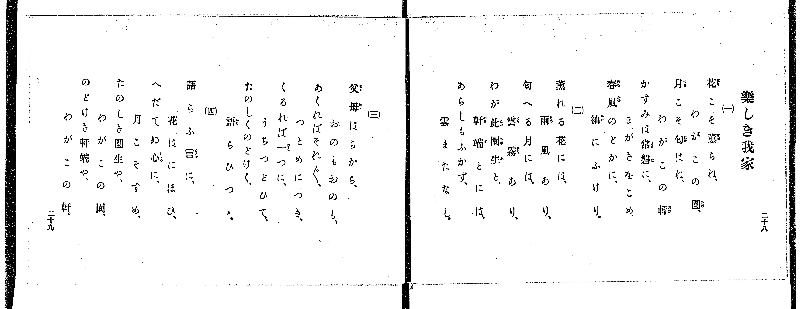
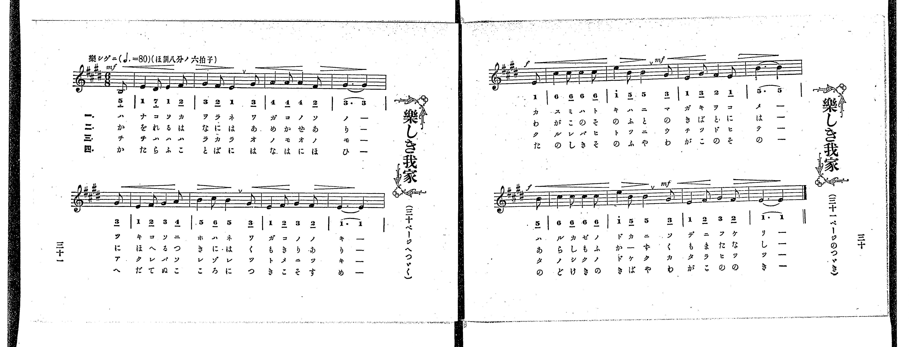

# 樂しき我家

> Re:Shoka 使用 AI 協助辨識與重建樂譜，可能會有錯誤。歡迎回報。

<audio controls src="tanoshiki_wagaya.mp3"></audio>

- 出處：共益商社樂器店《唱歌教科書 教師用 巻四》第二十八～三十一頁（第三學期第一曲）
- NDL Digital Collections PID 854865（https://dl.ndl.go.jp/pid/854865）掃描 P020.jpg、P021.jpg

## 說明

原書資訊與歌詞全文（NDL PID 854865《唱歌教科書 教師用 巻四》第二十八～三十一頁，掃描 P020.jpg–P021.jpg）：
調性與拍號：ほ調八分ノ六拍子（E 大調 6/8 拍），♩.=80，「樂シゲニ」，弱起一拍（八分音符）
註記：單聲部，四節分節歌。樂譜跨第三十一頁（P021_L）與第三十頁（P021_R）。開頭標 mf，第三行弱起（第八小節末拍）標 f，第十小節末拍標 mf，第四行弱起（第十二小節末拍）標 f，第十四小節末拍標 mf。第八小節末拍弱起音五線譜為 E4 八分音符，簡譜「1」漏印下底線。原書第二十八～二十九頁僅印歌詞四節，未附語釋與演奏注意欄。臺灣教育會《新定兒童唱歌》尋常科第六學年用第三學期第四首〈樂しき我家〉（標註出處「唱歌教科書」）即採自本曲。

## 歌詞

```text
一、
花こそ薫らね、わがこの園、
月こそ匂はね、わがこの軒、
かすみは常磐に、まがきをこめ、
春風のどかに、袖にふけり。

二、
薫れる花には、雨風あり、
匂へる月には、雲霧あり、
わが此園生と、軒端とには、
あらしもふかず、雲またなし。

三、
父母はらから、おのもおのも、
あくればそれ〲、つとめにつき、
くるれば一つに、うちつどひて、
たのしくのどけく、語らひつゝ。

四、
語らふ言に、花はにほひ、
へだてぬ心に、月こそすめ、
たのしき園生や、わがこの園、
のどけき軒端や、わがこの軒。
```

## ABC

```abc
X:1
T:樂しき我家
M:6/8
L:1/16
Q:3/8=53
K:E
V:V1 name="Voice" snm="Voi"
[V:V1]
!mf! z2 z2 z2 z2 z2 B,2 | E4 D2 E4 F2 | G4 F2 E4 G2 | A4 A2 A4 F2 |
G10 G2 | E4 F2 G4 A2 | B4 c2 B4 G2 | E4 F2 G4 F2 |
!f! E10 E2 | c4 c2 c4 c2 | !mf! e4 B2 B4 G2 | E4 G2 F4 E2 |
!f! B10 B2 | c4 c2 c4 c2 | !mf! e4 B2 B4 G2 | E4 F2 G4 F2 |
E10 z2 |
```

## TMD 檔案連結

- [主旋律 TMD 檔案](tanoshiki_wagaya.tmd) [[在 TMD Studio 編輯](https://tmdlang.github.io/Tmd-TS/#tmd=s7IKdvYPcrWy4qpTUCpJTLdSSM7PyUlNLsnMz7PKrsxPzc6ML87Iz05Ugisoy88pzU21yk7MizeJtzA1sTAzRUgW55cWJadaFSdn5OfnxJekVpQk5edno8vHFySmp1oFGBgZIGQKivLLUvMS84C6C4oy80pSU8DaEQpSyzJTUkHSxclAq8tSizLTMlNTkNyVWlQMcjXUipKixLzi5KLMApBXEKrSU_OKUq2SMzJzUopS8-KL8_PSEZJp-UW5VsUlRfkFGZnJCOGSjFSgh9MSczNzKtFF8xJLSotSlbi0tBSerWh63Dj9cWPvs46JT9dtU9DS4lK0VbAw4LK3VXDlsjHTt7ADaX7avuvFzKnv98x62rrx-eyup1Pbni_ZB9T7dOaKp7umP27oejpl47O1Pc-mzny-fOKz2TsUgKynO1Y_n7JC4en23U9nz37c0P18zZonu3qe9jY-bV39fu-8Jzs6gewnOxpeLmh8v6cDJAsUWbvj2Zz5YHbDs9mb3u_pBLvdz8VHwSUzPbMkMUfBGR7XxQoBni4KkNgEmpBRUlJQbKWvn5KjlwfE6fl6WQX6BZkp-jAVnc_6mp_19yuA4hAol_64oRHINAQxlbi49LUUbKkFuBQUFJ72zQcGxIvN7S9WdL3oaAeGzouV8562rng2rR3oWJCPEK6nQgD2oHnuUcNkmOeAPgfGHMhNL1btf9awHOSa7t4XM-cDRR837gYKAg182tH2uLnvaetaoNTTtROATnRVeLpkOVBSAZgIFICiYGN6Hs1cqWdrYQBkPW7oAaWepu2PmzY9bu5-3ABU0fN0z8YXW7eDYg-koQNi8Mv5m5-vWQbUD3bDit0vVswAJaVp6140bnrZvAKkbfbs5-sbgEqBJDAYHjc0AY1-sXbOi-0roAkDKamA_BXvAzQO6BG4LJJUEFAKaMLLad0vF6x9tmKmQm4a0AqIyhcLoU6EJDmQ-zb0gyydsxriRZB6qHJQSCNJIpsEdC-6SUAHAiMHr2GzZ2OaB3QopjsgBgOD7cmuKc-3zwIGxPOmXQquJgqo4dnzfMNCoBwwIgyBof9sT__T3g1PdnQ_3TUVqAloMCQJoicbMPvJzrnAEHva3ArUAk2a4CgAJaQ5q17ObHmxat7L9m5QUtkz5enS_mebVzxr6X-2pgVo7Iv2Xc8bFwMT6IumTc_mNAMT77NpG56uA5YNk56vXgpJyMDk-nRD99MdO4DJGey_tcCs_XTnFmCCRsvpQHtfLpv2uKEDrSh63ABMbkDBmcAEAyl-gP5EyyXgNAeM_c3P-ha-aF_1bM4aYKEBdCEXKKEB0wswh4OTXNfGx42THzfOfTFt9eOmzseNa4ESj5v6Hzf2gMXXPZ0zCar02ZwOiNKnPUDXrMdU-mI3TOnjxu7HjTMfN-4HqgN5dPGEx42rQaob94FV9z5umgTS09QIM3vG0peLVgDNeNy4EqwZpPrFomkgRuPWx40THzd1wR2_CxiEEMeD3NzzuKkb7AugyvVAiZezV4CNAmY_oBawOrCDdwDVgb0AV7fp5ZzlKOognnm2dgnQ08-nzH_cuALkit3AqAP6FmgkVCfEh0B9wOCa_rgJaDbQhUA3A9MVyFSwJ4GaV4Fk4QEOzHZgjc87tj1b3wsyCKS9G0SCwqUL5HeQUTAGwprGfpAnGzcAQx7EaADGIlDDEpCLgOEHchSQ3QvXAFQNNBWkARTLIDlIyLc9blwI5gIDGOjGZXANQKcCgx2YuoCeh4T_RBAb6PNV88COBKpe8rhpLswv4BIXEv5QBVtfrADaBI4yUEQAAwvoqN0gjTA7djxuXACys3HN0_3NEKXw5ARKKfCEgOScXmgsNAEzFo4kieTgXmg8YagGp8omkGrKKy8oUNDS5-IKSczLL87IzM4MT0xPrEy0CsvPTE51qDGoUagGWaZgY6FlB2YAa08NSKmlqfC4uV-hBkh2AdPaZiDeC8SrwSKbgHglEPcC8XqQSNMaiJrmPrA6kBogq3kPELeAHAAyukbBAA6rc9NqFUzjgWKGCroK5vFgygjINQbTIJ4xkGcCpE3AJEwOAoFyMNc-blqLcF5zN9jq2WCn43AeEINEgLpAzgN6CO48iBtAtpgAeaZA2gxMglyCkAO5BMSDwGqgPwyRXbMTaO58qP0dcJtAvG4gngd3DUgUGIxAV4FcvBAaWP0I15iB7YeQQBvjgAxTsHPAYQdzkzHQPbogF4ClEG4yRXJT82qwPx83gWwA-765EyICchM0utqhLpwKFNkIFlkFdhOJ7sEWRgZAt9RycenaKaAlQwWgkDIXAA)]

## 分析

```text
================================================================================
📊 TMD Song Profile: [ 樂しき我家 ]
================================================================================
⏱  Duration:       0:38 (38.2s), 17 measures total
🎼 Key & Tempo:    首調基準 E, != 80.0 BPM, <6/8>
   - 分析範圍：      由實際發聲的音符與和弦推測調性；播放脈絡另行呈現
🎤 人聲音域:    B3 (MIDI 59) – E5 (MIDI 76) [跨度: 17 個半音 / 1.4 個八度, 難度: challenging]
   - 最低音:  B3 in [TanoshikiWagaya #1 @ m.1, 0:01]
   - 最高音: E5 in [TanoshikiWagaya #1 @ m.11, 0:22]
   - 適合: soprano, mezzo-soprano, contralto, tenor, baritone, bass
🏛  結構:      TanoshikiWagaya (38.2s)
⚡ 編曲密度:        Peak 1 軌道同時演奏
🗝  調性診斷：       E 大調（純淨自然大調，未偵測到可信轉調）
   - 風格氣質:    純淨自然大調（陽光明朗、易唱易記，無明顯調外色彩）
   - 轉調歷程:    全曲維持單一推測調性（未偵測到可信轉調）
   - 核心骨幹音:  E, G#, B, C#, F#
   - 調性數值:    E 大調 [相關度: 0.95, 穩定度: High, 自然音純度: 100.0%]
   - 候選調性 (K-S): E 大調 (0.95), C# 小調 (0.74), G# 小調 (0.57)
   - 五度圈歷程:   +4
   - 各段落調性細節:
     • [TanoshikiWagaya #1]: E 大調 (r: 0.95, 自然音純度: 100.0%)

  [ 五度圈游移軌跡 ]
               C  
         F            G  
      Bb               D  
      Eb               A  
         Ab          [E ]*
            Db       B  
               F# 
     (* = active key center)

  [ 十二半音累積音高分佈 ]
     C  :                            0.0%
     C# : ██████████                13.5%
     D  :                            0.0%
     D# : █                          1.0%
     E  : ████████████████████████  31.2%
     F  :                            0.0%
     F# : ████████                  10.4%
     G  :                            0.0%
     G# : ███████████████           19.8%
     A  : █████                      6.2%
     A# :                            0.0%
     B  : ██████████████            17.7%
--------------------------------------------------------------------------------
Assignment 軌道音域：
  - Voice         : B3 – E5 (17 個半音 / 1.4 個八度, 56 個音符)
================================================================================
```


## 原書掃描頁






