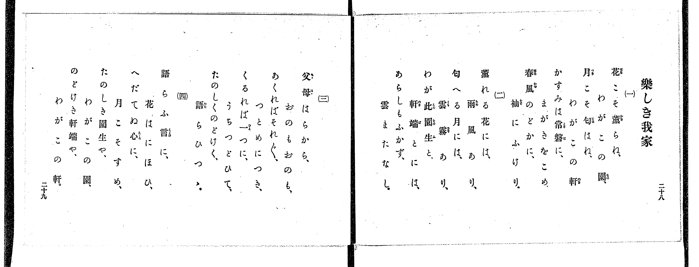
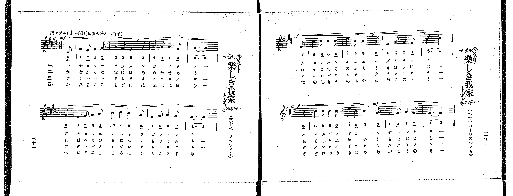

# 樂しき我家

> Re:Shōka 使用 AI 協助辨識與重建樂譜，可能會有錯誤。歡迎回報。

- **鋼琴伴奏版**：<br><audio controls src="tanoshiki_wagaya.mp3"></audio>
- **NEUTRINO 歌聲合成版**：<br><audio controls src="tanoshiki_wagaya_neutrino.mp3"></audio>

- 出處：共益商社樂器店《唱歌教科書 教師用 巻四》第二十八～三十一頁（第三學期第一曲）
- NDL Digital Collections PID 854865（https://dl.ndl.go.jp/pid/854865）掃描 P020.jpg、P021.jpg

## 說明

原書資訊與歌詞全文（NDL PID 854865《唱歌教科書 教師用 巻四》第二十八～三十一頁，掃描 P020.jpg–P021.jpg）：
調性與拍號：ほ調八分ノ六拍子（E 大調 6/8 拍），♩.=80，「樂シゲニ」，弱起一拍（八分音符）
註記：單聲部，四節分節歌。樂譜跨第三十一頁（P021_L）與第三十頁（P021_R）。開頭標 mf，第三行弱起（第八小節末拍）標 f，第十小節末拍標 mf，第四行弱起（第十二小節末拍）標 f，第十四小節末拍標 mf。第八小節末拍弱起音五線譜為 E4 八分音符，簡譜「1」漏印下底線。原書第二十八～二十九頁僅印歌詞四節，未附語釋與演奏注意欄。臺灣教育會《新定兒童唱歌》尋常科第六學年用第三學期第四首〈樂しき我家〉（標註出處「唱歌教科書」）即採自本曲。


## 歌詞

```text
一、
花こそ薫らね、わがこの園、
月こそ匂はね、わがこの軒、
かすみは常磐に、まがきをこめ、
春風のどかに、袖にふけり。

二、
薫れる花には、雨風あり、
匂へる月には、雲霧あり、
わが此園生と、軒端とには、
あらしもふかず、雲またなし。

三、
父母はらから、おのもおのも、
あくればそれ〲、つとめにつき、
くるれば一つに、うちつどひて、
たのしくのどけく、語らひつゝ。

四、
語らふ言に、花はにほひ、
へだてぬ心に、月こそすめ、
たのしき園生や、わがこの園、
のどけき軒端や、わがこの軒。
```

## ABC

<div class="abc-score" data-abc-src="tanoshiki_wagaya.abc" aria-label="五線譜載入中"></div>

[下載 ABC 原始檔](tanoshiki_wagaya.abc)

## TMD 檔案連結

- [主旋律 TMD 檔案](tanoshiki_wagaya.tmd) [[在 TMD Studio 編輯](https://tmdlang.github.io/Tmd-TS/#tmd=s7IKdvYPcrWy4qpTUCpJTLdSSM7PyUlNLsnMz7PKrsxPzc6ML87Iz05Ugisoy88pzU21yk7MizeJtzA1sTAzRUgW55cWJadaFSdn5OfnxJekVpQk5edno8vHFySmp1oFGBgZIGQKivLLUvMS84C6C4oy80pSU8DaEQpSyzJTUkHSxclAq8tSizLTMlNTkNyVWlQMcjXUipKixLzi5KLMApBXEKrSU_OKUq2SMzJzUopS8-KL8_PSEZJp-UW5VsUlRfkFGZnJCOGSjFSgh9MSczNzKtFF8xJLSotSEaL5RZnpmXlWuamZWZlI_tfSUni2oulx4_THjb3POiY-XbdNQUuLS9FWwcKAy95WwZXLxkzfwg5kytP2XS9mTn2_Z9bT1o3PZ3c9ndr2fMk-oN6nM1c83TX9cUPX0ykbn63teTZ15vPlE5_N3qEAZD3dsfr5lBUKT7fvfjp79uOG7udr1jzZ1fO0t_Fp6-r3e-c92dEJZD_Z0fByQeP7PR0gWaDI2h3P5swHsxuezd70fk8n2BN-Lj4KLkAvlCTmKDjDk0KxQoCniwIksoEmZJSUFBRb6eun5OjlAXF6vl5WgX5BZoo-TEXns77mZ_39CqAoBsqlP25oBDINQUwlLi59LQVbagEuBQWFp33zgQHxYnP7ixVdLzragaHzYuW8p60rnk1rBzoW5COE66kQgD1onnvUMBnmOaDPgTEHctOLVfufNSwHuaa798XM-UDRx427gYJAA592tD1u7nvauhYo9XTtBKATXRWeLlkOlFQAJgIFoCjYmJ5HM1fq2VoYAFmPG3pAqadp--OmTY-bux83AFX0PN2z8cXW7aDYA2nogBj8cv7m52uWAfWD3bBi94sVM0BJadq6F42bXjavAGmbPfv5-gagUiAJDIbHDU1Ao1-snfNi-wpowkBKKiB_xfsAjQN6BC6LJBUElAKa8HJa98sFa5-tmKmQmwa0AqLyxUKoEyFJDuS-Df0gS-eshngRpB6qHBTSSJLIJgHdi24S0IHAyMFr2OzZmOYBHYrpDojBwGB7smvK8-2zgAHxvGmXgquJAmp49jzfsBAoB4wIQ2DoP9vT_7R3w5Md3U93TQVqAhoMSYLoyQbMfrJzLjDEnja3ArVAkyY4CkAJac6qlzNbXqya97K9G5RU9kx5urT_2eYVz1r6n61pARr7on3X88bFwAT6omnTsznNwMT7bNqGp-uAZcOk56uXQhIyMLk-3dD9dMcOYHIG-28tMGs_3bkFmKDRcjrQ3pfLpj1u6EArih43AJMbUHAmMMFAih-gP9FyCTjNAWN_87O-hS_aVz2bswZYaABdyAVKaMD0Aszh4CTXtfFx4-THjXNfTFv9uKnzceNaoMTjpv7HjT1g8XVP50yCKn02pwOi9GkP0DXrMZW-2A1T-rix-3HjzMeN-4HqQB5dPOFx42qQ6sZ9YNW9j5smgfQ0NcLMnrH05aIVQDMeN64EawapfrFoGojRuPVx48THTV1wx-8CBiHE8SA39zxu6gb7AqhyPVDi5ewVYKOA2Q-oBawO7OAdQHVgL8DVbXo5ZzmKOohnnq1dAvT08ynzHzeuALliNzDqgL4FGgnVCfEhUB8wuKY_bgKaDXQh0M3AdAUyFexJoOZVIFl4gAOzHVjj845tz9b3ggwCae8GkaBw6QL5HWQUjIGwprEf5MnGDcCQBzEagLEI1LAE5CJg-IEcBWT3wjUAVQNNBWkAxTJIDhLybY8bF4K5wAAGunEZXAPQqcBgB6YuoOch4T8RxAb6fNU8sCOBqpc8bpoL8wu4xIWEP1TB1hcrgDaBowwUEcDAAjpqN0gjzI4djxsXgOxsXPN0fzNEKTw5gVIKPCEgOacXGgtNwIyFI0kiObgXGk8YqsGpsgmkmvLKCwoUtPS5uEIS8_KLMzKzM8MT0xMrE63C8jOTUx1qdA1rqkGWKdhYaNmBGcDaUwNSamkqPG7uV6gBkl3AtLYZiPcC8WqwyCYgXgnEvUC8HiTStAaiprkPrA6kBshq3gPELSAHgIyuUTCAw-rctFoF03igmKGCroJ5PJgyAnKNwTSIZwzkmQBpEzAJk4NAoBzYSB_DGoV4OARGJsjmxlVAFcDgBOK5YFY32IWTQOymTiB_LZgF9ltjD1ztOjBrLlgUxIZAYGqC2WWEaheyqT1A3A1WjeyC1WA-iNUEVtsIdc3jxjlIol1IdgFDF2KXMapdC8GmLoTaADMVEvKdMFOhrC64D4A5E8wHia4Dq21CsgtoO8QuEyz-apwPD62t0BACia4AszeAXYruW5C7IKK7waKbkOzaAbULmLoeN61FJKdmsGXNs8FJDUdyAmKQCFAXKDkBEyA8OUHSDChVmAB5pkDaDEyCUg5CDpRyQDwIrAamO0Ok1APMi2ipBZzCgX6A-QlfagGHKtgEmE-BHoKnFpgpO-CpA5iW4DYiUgfYbHDcgOQgKQJL6gC5AZ46QLqgKQ8YH_CUC-SD2PPgLIiN4HgDpj9YDCHcAXM33GxgagAWf2CxZUC8Bin2J4NNAboQwxTk8JsJT-sws-cjx_5OYDzOh8Z3BzxmQTxgEm6eB499kCiwmAGmAlAKWQgtTPoRsW8Gjm8ICYzhOCDDFBz94LIFlgaMgfGvC4pxsBQiDZiipIGZYHfuh8fICiSfIdL1PqQ0AIoncN6HhA2Kf4FJGCkN4C5hQHkLlqcQKQmSvyCikLQIchNGrgWlAUiqQkoDm5By6RK4u9uQSg-Q6EoktcuwxBMkDUBcOB3uKjR3N7XA0iReP8LMBvoPngaagUkfmI8fN4FiFJy7m4EFDUgElAag1Uc7NEVMBYpsBIusAqcBEuMfWxlggBz30JyJKJUhMQEJI5AoJAwhPloOjRVYqTgRLY8CKzREzEPLY2AIQvP2VrAZIPtAvFlgEjnv7wPHAYi1CqxyOqa54JyPiBlwGYDi4olwUfRyHFQew_LsEkyTwXGOMAMS52ipEm-co5eFIJNrubh07RTQGh8KQCFlLgA)]
- [鋼琴伴奏 TMD 檔案](tanoshiki_wagaya_piano.tmd) [[在 TMD Studio 編輯](https://tmdlang.github.io/Tmd-TS/#tmd=s7IKdvYPcrWy4tLSUni2oulx4_THjb3POiY-Xbft_Z6Ol917nk_Y8mTPlqdL-593drzf06mgpcWlaKtgYcBlb6vgymVjpm9hx1WnoPS0fdeLmVPf75n1tHXj89ldT6e2PV-yD2jg05krnu6a_rih6-mUjc_W9jybOvP58onPZu9QALKe7lj9fMoKhafbdz-dPftxQ_fzNWue7Op52tv4tHX1-73znuzoBLKf7Gh4uaAR6BaQLFBk7Y5nc-aD2Q3PZm8CukgJZL2fi4-CS2Z6ZklijoJzfk5OanJJZn5esUKAp4uChamJhZkp0ISMkpKCYit9_ZQcvTwgTs_XyyrQL8hM0Yep6HzW1_ysv18hwMDIACiX_rihEcg0BDGVuLhCEvPyizMyszPDE9MTKxOtAjKBAkEeDjW6hjXVXApAYGOhZQdm6GspaDzds_HF1u2aCo-b-xVqgGSXwuOmzUC8F4hXg0U2AfFKIO4F4vUgkaY1EDXNfWB1IDVAVvMeIG5R0NIHG12jYACH1blptQqm8UAxQwVdBfN4MGUE5BqDaRDPGMgzAdImYBImB4FAObCRPoY1CvFw-LgR7JbGVUAVjxsnA_FcMKsb7MJJIHZTJ5C_FswC-62xB652HZg1FywKYkPg48YlMLuMUO1CNrUHiLvBqpFdsBrMB7GawGoboa553DgHSbQLyS5g6ELsMka1ayHY1IVQG2CmQkK-E2YqlNUF98HjpiYwHyS6Dqy2CckuoO0Qu0yw-KtxPjy0tkJDCCS6AszeAHYpum9B7oKI7gaLbkKyawfULmDqety0FpGcmsGWNc8GJzUcyQmIQSJAXaDkBEyA8OQESTOgVGEC5JkCaTMwCUo5CDlQygHxILAamO4MkVIPsMxASy3gFA70A8xP-FILOFTBJsB8CvQQPLXATNkBTx3AtAS3EZE6wGaD4wYkB0kRWFIHyA3w1AHSBU15wPiAp1wgH8SeB2dBbATHGzD9wWII4Q6Yu-FmA1PD48YFYLFlQLwGKfYng00BuhDDFOTwmwlP6zCz5yPH_k5gPM6HxncHPGZBPGASbp4Hj32QKLCYAaYCUApZCC1M-hGxbwaObwgJjOE4IMMUHP3gsgWWBoyB8a8LinGwFCINmKKkgZlgd-6Hx8gKJJ8h0vU-pDQAiidw3oeEDYp_gUkYKQ3gLmFAeQuWpxApCZK_IKKQtAhyE0auBaUBSKpCSgObkHLpEri725BKD5DoSiS1y7DEEyQNQFw4He4qNHc3tcDSJF4_wswG-g-eBpqBSR-Yjx83gWIUnLubgQUNSASUBqDVRzs0RUwFimwEi6wCpwES4x9bGWCAHPfQnIkolSExAQkjkCgkDCE-Wg6NFVipOBEtjwIrNETMQ8tjYAhC8_ZWsBkg-0C8WWASOe_vA8cBiLUKrHI6prngnI-IGXAZgOLiiXBR9HIcVB7D8uwSTJPBcY4wAxLnaKkSb5yjl4Ugk2txtD18cLU9XvR1vWzvfdq64-XsVkjjDam4jwe1GKINY5FYNaCMHR-vYATkmsYiMyHewilLUB95tpmAWjLRJgQ0GQCDh5A92EyiyGkDYxHEq8B0oGungJYUon2ASrAJG2EXNsYuDHQ5UFiZCwA)]

## 分析

```text
================================================================================
📊 TMD Song Profile: [ 樂しき我家 ]
================================================================================
⏱  Duration:       0:36 (36.0s), 16 measures total
🎼 Key & Tempo:    首調基準 E, != 80.0 BPM, <6/8>
   - 分析範圍：      由實際發聲的音符與和弦推測調性；播放脈絡另行呈現
🎤 人聲音域:    B3 (MIDI 59) – E5 (MIDI 76) [跨度: 17 個半音 / 1.4 個八度, 難度: challenging]
   - 最低音:  B3 in [TanoshikiWagaya #1 @ m.1, 0:01]
   - 最高音: E5 in [TanoshikiWagaya #1 @ m.11, 0:22]
   - 適合: soprano, mezzo-soprano, contralto, tenor, baritone, bass
🏛  結構:      TanoshikiWagaya (36.0s)
⚡ 編曲密度:        Peak 1 軌道同時演奏
🗝  調性診斷：       E 大調（純淨自然大調，未偵測到可信轉調）
   - 風格氣質:    純淨自然大調（陽光明朗、易唱易記，無明顯調外色彩）
   - 轉調歷程:    全曲維持單一推測調性（未偵測到可信轉調）
   - 核心骨幹音:  E, G#, B, C#, F#
   - 調性數值:    E 大調 [相關度: 0.95, 穩定度: High, 自然音純度: 100.0%]
   - 候選調性 (K-S): E 大調 (0.95), C# 小調 (0.74), G# 小調 (0.57)
   - 五度圈歷程:   +4
   - 各段落調性細節:
     • [TanoshikiWagaya #1]: E 大調 (r: 0.94, 自然音純度: 100.0%)

  [ 五度圈游移軌跡 ]
               C  
         F            G  
      Bb               D  
      Eb               A  
         Ab          [E ]*
            Db       B  
               F# 
     (* = active key center)

  [ 十二半音累積音高分佈 ]
     C  :                            0.0%
     C# : ██████████                13.5%
     D  :                            0.0%
     D# : █                          1.0%
     E  : ████████████████████████  31.2%
     F  :                            0.0%
     F# : ████████                  10.4%
     G  :                            0.0%
     G# : ███████████████           19.8%
     A  : █████                      6.2%
     A# :                            0.0%
     B  : ██████████████            17.7%
--------------------------------------------------------------------------------
Assignment 軌道音域：
  - Voice         : B3 – E5 (17 個半音 / 1.4 個八度, 56 個音符)
================================================================================
```


## 原書掃描頁






