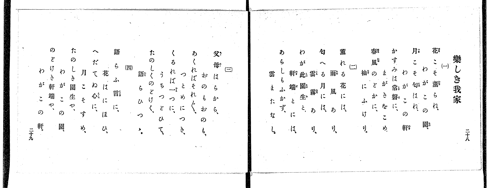
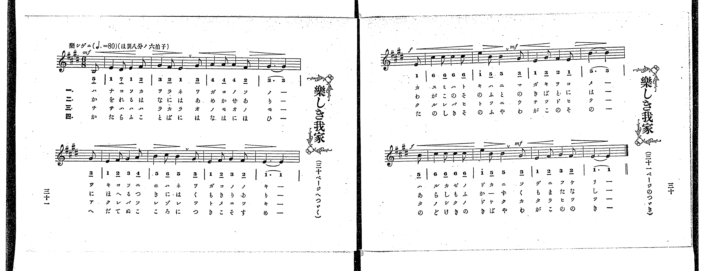

# 樂しき我家

> Re:Shōka 使用 AI 協助辨識與重建樂譜，可能會有錯誤。歡迎回報。

- **鋼琴伴奏版**：<br><audio controls src="tanoshiki_wagaya.mp3"></audio>
- **NEUTRINO 歌聲合成版**：<br><audio controls src="tanoshiki_wagaya_neutrino.mp3"></audio>

- 出處：共益商社樂器店《唱歌教科書 教師用 巻四》第二十八～三十一頁（第三學期第一曲）
- NDL Digital Collections PID 854865（https://dl.ndl.go.jp/pid/854865）掃描 P020.jpg、P021.jpg

## 說明

原書資訊與歌詞全文（NDL PID 854865《唱歌教科書 教師用 巻四》第二十八～三十一頁，掃描 P020.jpg–P021.jpg）：
調性與拍號：ほ調八分ノ六拍子（E 大調 6/8 拍），♩.=80，「樂シゲニ」，弱起一拍（八分音符）
註記：單聲部，四節分節歌。樂譜跨第三十一頁（P021_L）與第三十頁（P021_R）。開頭標 mf，第三行弱起（第八小節末拍）標 f，第十小節末拍標 mf，第四行弱起（第十二小節末拍）標 f，第十四小節末拍標 mf。第八小節末拍弱起音五線譜為 E4 八分音符，簡譜「1」漏印下底線。原書第二十八～二十九頁僅印歌詞四節，未附語釋與演奏注意欄。臺灣教育會《新定兒童唱歌》尋常科第六學年用第三學期第四首〈樂しき我家〉（標註出處「唱歌教科書」）即採自本曲。


## 歌詞

```text
一、
花こそ薫らね、わがこの園、
月こそ匂はね、わがこの軒、
かすみは常磐に、まがきをこめ、
春風のどかに、袖にふけり。

二、
薫れる花には、雨風あり、
匂へる月には、雲霧あり、
わが此園生と、軒端とには、
あらしもふかず、雲またなし。

三、
父母はらから、おのもおのも、
あくればそれ〲、つとめにつき、
くるれば一つに、うちつどひて、
たのしくのどけく、語らひつゝ。

四、
語らふ言に、花はにほひ、
へだてぬ心に、月こそすめ、
たのしき園生や、わがこの園、
のどけき軒端や、わがこの軒。
```

## ABC

<div class="abc-score" data-abc-src="tanoshiki_wagaya.abc" aria-label="五線譜載入中"></div>

[下載 ABC 原始檔](tanoshiki_wagaya.abc)

## TMD 檔案連結

- [主旋律 TMD 檔案](tanoshiki_wagaya.tmd) [[在 TMD Studio 編輯](https://tmdlang.github.io/Tmd-TS/#tmd=s7IKdvYPcrWy4qpTUCpJTLdSSM7PyUlNLsnMz7PKrsxPzc6ML87Iz05Ugisoy88pzU21yk7MizeJtzA1sTAzRUgW55cWJadaFSdn5OfnxJekVpQk5edno8vHFySmp1oFGBgZIGQKivLLUvMS84C6C4oy80pSU8DaEQpSyzJTUkHSxclAq8tSizLTMlNTkNyVWlQMcjXUipKixLzi5KLMApBXEKrSU_OKUq2SMzJzUopS8-KL8_PSEZJp-UW5VsUlRfkFGZnJCOGSjFSgh9MSczNzKtFF8xJLSotSEaL5RZnpmXlWuamZWZlY_J9fVJKRn16UWJBRaZWRWVwCVJ6cmBMPDExgCGtpKTxb0fS4cfrjxt5nHROfrtumoKXFpWirYGHAZW-r4MplY6ZvYQcy62n7rhczp77fM-tp68bns7ueTm17vmQfUO_TmSue7pr-uKHr6ZSNz9b2PJs68_nyic9m71AAsp7uWP18ygqFp9t3P509-3FD9_M1a57s6nna2_i0dfX7vfOe7OgEsp_saHi5oPH9ng6QLFBk7Y5nc-aD2Q3PZm96v6cT7BU_Fx8FF6A_SxJzFJzh6aVYIcDTRQGSIoAmZJSUFBRb6eun5OjlAXF6vl5WgX5BZoo-TEXns77mZ_39CqB0AJRLf9zQCGQagphKXFz6Wgq21AJcCgoKT_vmAwPixeb2Fyu6XnS0A0Pnxcp5T1tXPJvWDnQsyEcI11MhAHvQPPeoYTLMc0CfA2MO5KYXq_Y_a1gOck1374uZ84Gijxt3AwWBBj7taHvc3Pe0dS1Q6unaCUAnuio8XbIcKKkATAQKQFGwMT2PZq7Us7UwALIeN_SAUk_T9sdNmx43dz9uAKroebpn44ut20GxB9LQATH45fzNz9csA-oHu2HF7hcrZoCS0rR1Lxo3vWxeAdI2e_bz9Q1ApUASGAyPG5qARr9YO-fF9hXQhIGUVED-ivcBGgf0CFwWSSoIKAU04eW07pcL1j5bMVMhNw1oBUTli4VQJ0KSHMh9G_pBls5ZDfEiSD1UOSikkSSRTQK6F90koAOBkYPXsNmzMc0DOhTTHRCDgcH2ZNeU59tnAQPiedMuBVcTBdTw7Hm-YSFQDhgRhsDQf7an_2nvhic7up_umgrUBDQYkgTRkw2Y_WTnXGCIPW1uBWqBJk1wFIAS0pxVL2e2vFg172V7Nyip7JnydGn_s80rnrX0P1vTAjT2Rfuu542LgQn0RdOmZ3OagYn32bQNT9cBy4ZJz1cvhSRkYHJ9uqH76Y4dwOQM9t9aYNZ-unMLMEGj5XSgvS-XTXvc0IFWFD1uACY3oOBMYIKBFD9Af6LlEnCaA8b-5md9C1-0r3o2Zw2w0AC6kAuU0IDpBZjDwUmua-PjxsmPG-e-mLb6cVPn48a1QInHTf2PG3vA4uuezpkEVfpsTgdE6dMeoGvWYyp9sRum9HFj9-PGmY8b9wPVgTy6eMLjxtUg1Y37wKp7HzdNAulpaoSZPWPpy0UrgGY8blwJ1gxS_WLRNBCjcevjxomPm7rgjt8FDEKI40Fu7nnc1A32BVDleqDEy9krwEYBsx9QC1gd2ME7gOrAXoCr2_RyznIUdRDPPFu7BOjp51PmP25cAXLFbmDUAX0LNBKqE-JDoD5gcE1_3AQ0G-hCoJuB6QpkKtiTQM2rQLLwAAdmO7DG5x3bnq3vBRkE0t4NIkHh0gXyO8goGANhTWM_yJONG4AhD2I0AGMRqGEJyEXA8AM5CsjuhWsAqgaaCtIAimWQHCTk2x43LgRzgQEMdOMyuAagU4HBDkxdQM9Dwn8iiA30-ap5YEcCVS953DQX5hdwiQsJf6iCrS9WAG0CRxkoIoCBBXTUbpBGmB07HjcuANnZuObp_maIUnhyAqUUeEJAck4vNBaagBkLR5JEcnAvNJ4wVINTZRNINeWVFxQoaOlzcYUk5uUXZ2RmZ4YnpidWJlqF5WcmpzrU6BrWVIMsU7Cx0LIDM4C1pwak1NJUeNzcr1ADJLuAaW0zEO8F4tVgkU1AvBKIe4F4PUikaQ1ETXMfWB1IDZDVvAeIW0AOABldo2AAh9W5abUKpvFAMUMFXQXzeDBlBOQag2kQzxjIMwHSJmASJgeBQDmwkT6GNQrxcAiMTJDNjauAKoDBCcRzwaxusAsngdhNnUD-WjAL7LfGHrjadWDWXLAoiA2BwNQEs8sI1S5kU3uAuBusGtkFq8F8EKsJrLYR6prHjXOQRLuQ7AKGLsQuY1S7FoJNXQi1AWYqJOQ7YaZCWV1wHwBzJpgPEl0HVtuEZBfQdohdJlj81TgfHlpboSEEEl0BZm8AuxTdtyB3QUR3g0U3Idm1A2oXMHU9blqLSE7NYMuaZ4OTGo7kBMQgEaAuUHICJkB4coKkGVCqMAHyTIG0GZgEpRyEHCjlgHgQWA1Md4ZIqQeYF9FSCziFA_0A8xO-1AIOVbAJMJ8CPQRPLTBTdsBTBzAtwW1EpA6w2eC4AclBUgSW1AFyAzx1gHRBUx4wPuApF8gHsefBWRAbwfEGTH-wGEK4A-ZuuNnA1AAs_sBiy4B4DVLsTwabAnQhhinI4TcTntZhZs9Hjv2dwHicD43vDnjMgnjAJNw8Dx77IFFgMQNMBaAUshBamPQjYt8MHN8QEhjDcUCGKTj6wWULLA0YA-NfFxTjYClEGjBFSQMzwe7cD4-RFUg-Q6TrfUhpABRP4LwPCRsU_wKTMFIawF3CgPIWLE8hUhIkf0FEIWkR5CaMXAtKA5BUhZQGNiHl0iVwd7chlR4g0ZVIapdhiSdIGoC4cDrcVWjubmqBpUm8foSZDfQfPA00A5M-MB8_bgLFKDh3NwMLGpAIKA1Aq492aIqYChTZCBZZBU4DJMY_tjLAADnuoTkTUSpDYgISRiBRSBhCfLQcGiuwUnEiWh4FVmiImIeWx8AQhObtrWAzQPaBeLPAJHLe3weOAxBrFVjldExzwTkfETPgMgDFxRPhoujlOKg8huXZJZgmg-McYQYkztFSJd44Ry8LQSbXcnHp2imgNT4UgELKXAA)]
- [鋼琴伴奏 TMD 檔案](tanoshiki_wagaya_piano.tmd) [[在 TMD Studio 編輯](https://tmdlang.github.io/Tmd-TS/#tmd=s7IKdvYPcrWy4qpTUCpJTLdSyC8qychPL0osyKi0ysgsLskvykxOzInPTsxLVOLS0lJ4tqLpceP0x429zzomPl237f2ejpfde55P2PJkz5anS_ufd3a839OpoKXFpWirYGHAZW-r4MplY6ZvYQey4Gn7rhczp77fM-tp68bns7ueTm17vmQf0MCnM1c83TX9cUPX0ykbn63teTZ15vPlE5_N3qEAZD3dsfr5lBUKT7fvfjp79uOG7udr1jzZ1fO0t_Fp6-r3e-c92dEJZD_Z0fByQSPQLSBZoMjaHc_mzAezG57N3gR0kRLIej8XHwWXzPTMksQcBef8nJzU5JLM_LxihQBPFwULUxMLM1OgCRklJQXFVvr6KTl6eUCcnq-XVaBfkJmiD1PR-ayv-Vl_v0KAgZEBUC79cUMjkGkIYipxcYUk5uUXZ2RmZ4YnpidWJloFZAIFgjwcanQNa6q5FIDAxkLLDszQ11LQeLpn44ut2zUVHjf3K9QAyS6Fx02bgXgvEK8Gi2wC4pVA3AvE60EiTWsgapr7wOpAaoCs5j1A3KKgpQ82ukbBAA6rc9NqFUzjgWKGCroK5vFgygjINQbTIJ4xkGcCpE3AJEwOAoFyYCN9DGsU4uHwcSPYLY2rgCoeN04G4rlgVjfYhZNA7KZOIH8tmAX2W2MPXO06MGsuWBTEhsDHjUtgdhmh2oVsag8Qd4NVI7tgNZgPYjWB1TZCXfO4cQ6SaBeSXcDQhdhljGrXQrCpC6E2wEyFhHwnzFQoqwvug8dNTWA-SHQdWG0Tkl1A2yF2mWDxV-N8eGhthYYQSHQFmL0B7FJ034LcBRHdDRbdhGTXDqhdwNT1uGktIjk1gy1rng1OajiSExCDRIC6QMkJmADhyQmSZkCpwgTIMwXSZmASlHIQcqCUA-JBYDUw3RkipR5gmYGWWsApHOgHmJ_wpRZwqIJNgPkU6CF4aoGZsgOeOoBpCW4jInWAzQbHDUgOkiKwpA6QG-CpA6QLmvKA8QFPuUA-iD0PzoLYCI43YPqDxRDCHTB3w80GpobHjQvAYsuAeA1S7E8GmwJ0IYYpyOE3E57WYWbPR479ncB4nA-N7w54zIJ4wCTcPA8e-yBRYDEDTAWgFLIQWpj0I2LfDBzfEBIYw3FAhik4-sFlCywNGAPjXxcU42ApRBowRUkDM8Hu3A-PkRVIPkOk631IaQAUT-C8DwkbFP8CkzBSGsBdwoDyFixPIVISJH9BRCFpEeQmjFwLSgOQVIWUBjYh5dIlcHe3IZUeINGVSGqXYYknSBqAuHA63FVo7m5qgaVJvH6EmQ30HzwNNAOTPjAfP24CxSg4dzcDCxqQCCgNQKuPdmiKmAoU2QgWWQVOAyTGP7YywAA57qE5E1EqQ2ICEkYgUUgYQny0HBorsFJxIloeBVZoiJiHlsfAEITm7a1gM0D2gXizwCRy3t8HjgMQaxVY5XRMc8E5HxEz4DIAxcUT4aLo5TioPIbl2SWYJoPjHGEGJM7RUiXeOEcvC0Em1-Joe_jganu86Ot62d77tHXHy9mtkMYbUnEfD2oxRBvGIrFqQBk7Pl7BCMg1jUVmQryFU5agPvJsMwG1ZKJNCGgyAAYPIXuwmUSR0wbGIohXgelA104BLSlE-wCVYBM2wi5sjF0Y6HKgsDIXAA)]

## 分析

```text
================================================================================
📊 TMD Song Profile: [ 樂しき我家 ]
================================================================================
⏱  Duration:       0:36 (36.0s), 16 measures total
🎼 Key & Tempo:    首調基準 E, != 80.0 BPM, <6/8>
   - 分析範圍：      由實際發聲的音符與和弦推測調性；播放脈絡另行呈現
🎤 人聲音域:    B3 (MIDI 59) – E5 (MIDI 76) [跨度: 17 個半音 / 1.4 個八度, 難度: challenging]
   - 最低音:  B3 in [TanoshikiWagaya #1 @ m.1, 0:01]
   - 最高音: E5 in [TanoshikiWagaya #1 @ m.11, 0:22]
   - 適合: soprano, mezzo-soprano, contralto, tenor, baritone, bass
🏛  結構:      TanoshikiWagaya (36.0s)
⚡ 編曲密度:        Peak 1 軌道同時演奏
🗝  調性診斷：       E 大調（純淨自然大調，未偵測到可信轉調）
   - 風格氣質:    純淨自然大調（陽光明朗、易唱易記，無明顯調外色彩）
   - 轉調歷程:    全曲維持單一推測調性（未偵測到可信轉調）
   - 核心骨幹音:  E, G#, B, C#, F#
   - 調性數值:    E 大調 [相關度: 0.95, 穩定度: High, 自然音純度: 100.0%]
   - 候選調性 (K-S): E 大調 (0.95), C# 小調 (0.74), G# 小調 (0.57)
   - 五度圈歷程:   +4
   - 各段落調性細節:
     • [TanoshikiWagaya #1]: E 大調 (r: 0.94, 自然音純度: 100.0%)

  [ 五度圈游移軌跡 ]
               C  
         F            G  
      Bb               D  
      Eb               A  
         Ab          [E ]*
            Db       B  
               F# 
     (* = active key center)

  [ 十二半音累積音高分佈 ]
     C  :                            0.0%
     C# : ██████████                13.5%
     D  :                            0.0%
     D# : █                          1.0%
     E  : ████████████████████████  31.2%
     F  :                            0.0%
     F# : ████████                  10.4%
     G  :                            0.0%
     G# : ███████████████           19.8%
     A  : █████                      6.2%
     A# :                            0.0%
     B  : ██████████████            17.7%
--------------------------------------------------------------------------------
Assignment 軌道音域：
  - Voice         : B3 – E5 (17 個半音 / 1.4 個八度, 56 個音符)
================================================================================
```


## 原書掃描頁






