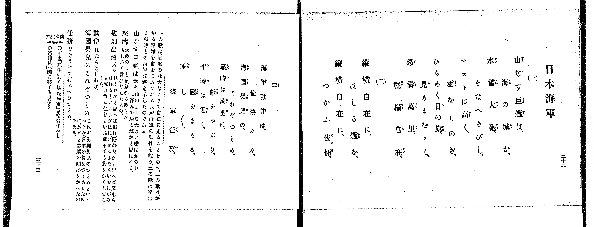
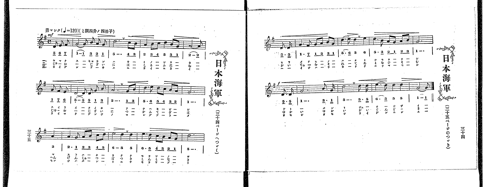

# 日本海軍

> Re:Shōka 使用 AI 協助辨識與重建樂譜，可能會有錯誤。歡迎回報。

- **鋼琴伴奏版**：<br><audio controls src="nihon_kaigun.mp3"></audio>
- **NEUTRINO 歌聲合成版**：<br><audio controls src="nihon_kaigun_neutrino.mp3"></audio>

- 出處：共益商社樂器店《唱歌教科書 教師用 巻四》第三十二～三十五頁（第三學期第二曲）
- NDL Digital Collections PID 854865（https://dl.ndl.go.jp/pid/854865）掃描 P022.jpg、P023.jpg

## 說明

原書資訊與歌詞全文（NDL PID 854865《唱歌教科書 教師用 巻四》第三十二～三十五頁，掃描 P022.jpg–P023.jpg）：
調性與拍號：と調四分ノ四拍子（G 大調 4/4 拍），♩=120，「勇マシク」，弱起一拍半（三個八分音符）
註記：單聲部，三節分節歌。樂譜跨第三十五頁（P023_L）與第三十四頁（P023_R）。開頭標 mf，第五行（第十六小節第四拍弱起）標 f。原書第三十二頁（P022_R）歌詞第（二）節於頁末「縱橫自在に、つかふ伎倆、」後排版漏印後半三句（翻頁至第三十三頁直接印第（三）節），然第三十三頁語釋仍載有「變幻出沒云々」之解說，且第三十四～三十五頁樂譜下方印有第（二）節完整唱詞（「へんげんしゅつぼつ、くつたくもなく…」）。
原典演奏注意：前出「乳牛」若くは「我陸軍」を豫習すべし；當曲は（ヘ）調に移すも可なり。
原典曲意：「一の歌は、軍艦の壯大なさまで自在に走ることをのべ、二の歌は、かゝる軍艦を自由にあつかふ我が海軍の動作を説き、三の歌は、平常と戰時との海軍任務を示したのである。」
原典語釋：「山なす巨艦は云々」山のよーな大きい船は海の中に浮んで居る城かと思はれる；「怒濤」大波のことを、怒れる波とおもしろく言ひなしたもの；「變幻出沒云々」見えたかと思へば隱れ、隱れたかと思へば又あらはれるといふ手ぎはに、いかに手あらいおにがみも泣き、海に住むといふ龍までも姿をかくしてしまふ；「動作」はたらき、しわざ；「海國男兒のこれぞつとめ」これぞ海國男兒のつとめといふべきを言葉の勢をつよめるために、わざと言葉の順序をかへたのである；「任務」ひきうけて行ふべきつとめ。


## 歌詞

```text
一、
山なす巨艦は、海の城か、
水雷大砲、そなへきびし、
マストは高く、雲をしのぎ、
ひらめく日の旗、見るもをゝし、
怒濤萬里、縱橫自在。

二、
縱橫自在に、はしる艦を、
縱橫自在に、つかふ伎倆、

三、
海軍動作は、愉快々々、
海國男兒の、これぞつとめ、
戰時は萬里に、敵をやぶり、
平時は近く、國をまもる、
重し〲、海軍任務。
```

## ABC

<div class="abc-score" data-abc-src="nihon_kaigun.abc" aria-label="五線譜載入中"></div>

[下載 ABC 原始檔](nihon_kaigun.abc)

## TMD 檔案連結

- [主旋律 TMD 檔案](nihon_kaigun.tmd) [[在 TMD Studio 編輯](https://tmdlang.github.io/Tmd-TS/#tmd=s7IKdvYPcrWy4qpTUCpJTLdSSM7PyUlNLsnMz7PKrsxPzc6ML87Iz05Ugisoy88pzU21yk7MizeJtzA1sTAzRUgW55cWJadaFSdn5OfnxJekVpQk5edno8vHFySmp1oFGBgZIWQKivLLUvMS84C6C4oy80pSU8DaEQpSyzJTUkHSxclAq8tSizLTMlNTkNyVWlQMcjXUipKixLzi5KLMApBXEKrSU_OKUq2SMzJzUopS8-KL8_PS0SULEkuKMvNLMpMREmn5RblWxSVF-QUZyMIlGanAkMjNzMksSSyqRBcvTyxJLUIXBDurIL8IyWP5RZnpmXlWuamZWZlYggyoNiM_vSixIKPSKiOzuASoPDkxJx4Y_sBI0dJSeDZ96bM5a55t3f5id6-ClhaXoq2CoZEBl72tgjuXjYm-iR3IpKftu17MnPp-z6ynrRufz-56OrXt-ZJ9z1Y0PZ254umu6Y8bup5O2fhsbc-zqTOfL5_4bPYOBSDr6Y7Vz6esUHi6fffT2bMfN3Q_X7PmyY7Op72NT3b1vN87D8ae8nJB4_s9HVDZtTuezZkPYu_qeTZ70_s9nWCP-Ln4KLgAfVmSmKPgDE9gxQoBni4KkCQENCGjpKSg2EpfPyVHLw-I0_P1sgr0CzJT9GEqOp_1NT_r71cAJRygXPrjhkYg0xjEVOLi0tdSsKUW4FJQUHjaNx8YEC82t79Y0fWiox0YOi9WznvauuLZtHagY0E-QrieCgHYg-a5Rw2TYZ4D-hwYcyA3vVi1_1nDcpBruntfzJwPFH3cuAIoCDT_aUfb4-Y-IAMo9XTtBKAT3RWeLlkOlFQAJgIFoCjYmJ5HM1faAtMHkPW4oedpd_vj5nmPm7Y_blr_uAGooufpno0vtm5_sqMBZExvF9AYkDMbup-2rgba8HL-5udrlgENAjtmxe4XK2aA0tS0dS8aN71sXgHUD1T9fH0DUCmQBIbH44YmYCp7sXbOi-0rkLwPTTMgD8b7AI0D-gguC_QCkmwQUBZoyMtp3S8XrH22YqZCbhrQFnACm_JiYQ8k4YF0ta59uqEfaCmICwkEsE9AqQaoKw1oBiRCkSMBbo8R2B5IFAMVgHwNjKI9IK88m7YHqOzZnNXA4Hq-Y-OzlatftK96OmfF40agSOPjxiWPG7sfN259sqfvaUMbSKSh9-k-YGROet7Z8WxP_9PeDUAuMCRBlvYvBbl3_26ggS_agSEJc8mOTqDI89lbnvUtBaqHOmAHMLZADoBE2_OWbWjqX6ya97K9-8nu3hdAl88BBlLPi3VdT3fuBmb1Z5smPdk18XFDK9AxT3Z2v1i--MWqVeDImYIczGhpEBJRT3Z0P5u2E-gMoJloQfF0HTB9bwEmdGAoAcWBNj5u3PG4afLjxklgcvrjplZwgOwBkaDA6Qdz54MYTU2PG1cBGY8aloFTGihWodnsaeuOZ3umPF3a_2zzimct_aAU1dkL9AbQgic7Nz_vBOad3hfdS8HGAZNpz7OOiS9n7gAWd0Dxx02TXmxc_Xz_pMeNMx837gQ64v2e2c-nbgMWPkDFIFc2A5NoJzAbACPs-fLdIGVNTU_714Nc09SF6ojZmyDWgyze0fC4cR0oBYOsbARa9qJzGVDk6eL1wFwF9srUx437HjcuhyeHF1s3PG4CpgVgSKwAOguoGOSgBlBCQzYKlF6a5gJVQs0EeqB91fMpG0EJqhEYSNAEBfTk48YeSLEOsrd76pO9c0CKV6153Aj0OSgVIBv7dOfmpzt2AK1-1rHh2UygOUAnrYNof7J799NuoLcnPV-yCxRLoAgBug3oiyaQgxuagOGICAVIuoKEwtONQGcBvTrz6fYVYP-vh6crsNS6x03AAAZG9ypwoAAd2vKiAxgJ64EWA2Wf7FgL9NWzrUBlwEBZ_nRjK9C-p_P7wD5c8axhLsjpTT1AQWCkgSK2YdKz_cCU0ws07dnmRWBXwkKzoREoC1EMlgJ6rwucqICpDmhv_4sVwAgDxjnQtWAfgqTWQYzFmi9eLAO6oQMcFnDHAINvw8tZG0G2NDRCGRgKnvYDdQEDDhj6UMeDHdMCirNOIBvoO2DighQOQEGgyGqwOEQLUKQLHNNAk_cDHfls82JIdIJDbPWTvcCcAvQI1MCX-4BeAyUyUJpdDlQPTFVAo4D5AOhHYHQASaDsVog3oUkEmCdADgCGANA6kMngIAJqmQYN5K3bn87pfj5l-9NWSBqdDPbmPHDKAwY1qASDC2IohqmBuRCc58C5cEXDi4mgFPm0exHYnUtAaQOoEhQ-QMcAtYDDBOwSUK0FU_9yQdvTXUBfQ7wGDGGU1AlxMzQFgxwGjGIg2fa4EZg9lgFrAIQbEO5v4gIlZ1AWbmgEJ2yMZAwL8HXQ1AhR92zDlpeztwMT3_MFm8ABB4xyoDagm4CmbwaFI0QduM7c-bgZmBDWv1w9AxQhwPQCLHFAngDGCdD5fTClQAcDIwLk_X5gSw2UJ6eDjAElP2DIAFMpUA-wOICbDckDLyasedkOSoUoVQ7MY8ACBaIYW4UEjHtgfHdDihY86tArLmiYActliDvARQc0TUECrKXz6X6gXmDuASKYIpTkATIXMzlBlEKLpfVQr4Fd8WzqVrD_gSlpG7g0hkTXzs1QpfuBkQwKW6Al4LDdBw4wWHS9bAdGCzDcQHGFUtJBCnXKm4FQoKClz8Xll5mRn-edmJlemmcVlp-ZnOpQY1BTDbJHwcbQTMsOzKrOTasFM4CNUQ1IA0QTmFqWgFIMEHcp1CgAEw6QtQdIr33cvBxIrQZyN4MkmvuBvGVgSRBvPhD3QZVuB9JrYTJgHSBRoEFNIKNXghwIsrVGwUBBFwyRadN4IGEGIsxBRI2CIVQSGRoDsREQg-RqFEyxqABBE6jKGrBamD6QKEwHiA8xA6YCGYJkwI4AO6cG7GgfwxoFEA8EkWlgqgCRjfvA5CqwmcAsjMVUcAHUDmZ0gzVOhipej8MbwPIDygKp2g8XXQdnTYexmnqRVIJMxzQL5CRgYQhW3YnwlhEObzXOADaT4Jq7wEZjd-QMMDkNbjzICatxegnmWZAqhPNhTgbmdDhrLUJl0yTsNmM4EeInY1x-Aoc7JAwaJ0CNBsUCptEr4aypUMfijKUm5FhCeARkC6o8QhakEiaPai-yC8HpA5ZPIXkIlJ_2Q9mzwfkPJLIXnhu7gHgGKNNCZJonw3MjKG_OQ-RAcG5Dh2BBUOJHzTzoEKECOQOagQwAYljmA-nGnolBEGY2InPhCpH5SCGyG2wmdhNB8nNhpkKzIkJmB5jshfM3I6mEJUNM80CZGsmVwLyCXR1pWWAJkt3IeRWS-IHtBTi_D0kl7lIC1LlBdSgwAwBrJKyKF4BIsHqIs0EqYQUKpmq4uUA9PSgy81C8AqxDkVQ24jRvNrpTwSkbVNV0QGoWWApH1CFN68EYlLoXAfEmaFoGpW5IvQNStw7ImoRaxyCnXlAqBPGRq4EacIpFhrDUDKNRVaCnbfxVEDR_ASnkFI5cLUCCDBGvkJQODUKMMhwRnQgWyONNyGrAxSRSsQqPWJCJsLSEDoFNP6juTqR0Duwso5gMSTCgrjNcG3Iy3oNhKCJl9CKpQ85qUEPhXkBkWZBKmC5M50KCBpTRkFM7KC0j1IACFdgJQrEJanITqKJANRGWVRFZD90F0KAF1_UQldvwmIgwGVTsILsVlNybF0ISNTjBoiRjlAwwHywCakRBkz1YLbyoB2eCTnDGgSd55MIW3H5BTveY6RVWYsPYEO8gq0BO6zBzcJfp1Wm12NM9SoEASb-wVIeeStFLOUSuQLSAQCailJvgJIRoJCBY-Et3SB0PyodI6R7YvIencYRSWAyjVDEoJSJEFlF0w1I1yAmwshHhOGTvI5vYgMux0EYEKPXjSvUQeURxshDJBUQWJyiVFsylsEoQkVPRIwDVZEhYgVQjpXlQ2p0A70KsAkrveNy8FJ7wocm7aQcQbwObD2ntYE3ayBCUIkHpE09JDCUxS3PM8h6bLaC-CQwj0jR2uxCFDqjIwV80wBuvoBDDNBARt5CGBcSB2BtJoDwHw8hFODa1EMchpSZ86pDLWiAJajIjzIBUCbCGMkQdpLGMzSwsbgSnYNzZEykd4VVH2I3w8h2lHsCW11BdWcvFpWungNSlVgBylbkA)]
- [鋼琴伴奏 TMD 檔案](nihon_kaigun_piano.tmd) [[在 TMD Studio 編輯](https://tmdlang.github.io/Tmd-TS/#tmd=s7IKdvYPcrWy4qpTUCpJTLdSyC8qychPL0osyKi0ysgsLskvykxOzInPTsxLVOLS0lJ4Nn3pszlrnm3d_mJ37_s9HS-79zyfsOXJni1Pl_Y_7-x4v6dTQUuLS9FWwdDIgMveVsGdy8ZE38QOZPzT9l0vZk59v2fW09aNz2d3PZ3a9nzJvmcrmp7OXPF01_THDV1Pp2x8trbn2dSZz5dPfDZ7hwKQ9XTH6udTVig83b776ezZjxu6n69Z82RH59Pexie7et7vnQdjT3m5oBHoGKjs2h3P5swHsXf1PJu9CegkJZD1fi4-Ci6Z6ZkliTkKzvk5OanJJZn5ecUKAZ4uChamJhZmpkATMkpKCoqt9PVTcvTygDg9Xy-rQL8gM0UfpqLzWV_zs_5-hQADIyOgXPrjhkYg0xjEVOLi8svMyM_zTsxML82zCshMzMsP8nCoMaip5lIAAhtDMy07MKs6N60WzNDXUtB4umfji63bNRUeNy8B4nlA3KVQo_C4aSeQtQdIr33cvBxIrQZyN4MkmvuBvGVgSRBvPhD3QZVuB9JrYTJgHSBRoEFNIKNXKmjpg22tUTBQ0AVDZNo0HkiYgQhzEFGjYAiVRIbGQGwExCC5GgVTLCpA0ASqsgasFqYPJArTAeJDzICpQIYgGbAjwM6pATvax7BGAcQDQWT6cVMLiGzcByZXgc183DgTi6mPG3sfN7WDGd1gjZOhitfj8MbjxjYoC6RqP1x0HZw1HcZq6kVSCTId0yyQkx43gh3b1InwlhEObzXOeNzUCtfcBTYauyNngMlpcONBTliN00swz4JUIZwPc_Ljxq1w1lqEyqZJ2G3GcCLET8a4_AQOd0gYNE6AGg2KBUyjV8JZU6GOxRlLTcixhPAIyBZUeYQsSCVMHtVeZBeC0wcsn0LyECg_7YeyZ4PzH0hkLzw3dgHxDFCmhcg0T4bnRlDenIfIgeDchg7BgqDEj5p50CFCBXIGNAMZAMSwzAfSjT0TgyDMbETmwhUi85FCZDfYTOwmguTnwkyFZkWEzA4w2Qvnb0ZSCUuGmOaBMjWSK4F5Bbs60rLAEiS7kfMqJPE_blwG5_chqcRdSuxAJGJEBnjc2I9V8QIQCVYPcTZIJaxAwVQNNxeopwdFZh6KVx43rkBS2YjTvNnoTgWnbFBV0wGpWWApHFGHNK0HY1DqXgTEm6BpGZS6IfUOSN06IGsSah2DnHpBqRDER64GasApFhnCUjOMRlWBnrbxV0HQ_AWkkFM4crUACTJEvEJSOjQIMcpwRHQiWCCPNyGrAReTSMUqPGJBJsLSEjp83LgJqrsTKZ0_bkQucmEJZjpygYucjPdgGIpIGb1I6pCzGtRQuBcQWRakEqYL07mQoAFlNOTUDkrLCDWgQH3cuAHFJqjJTaCKAtVEWFZFZD10F0CDFlzXQ1Ruw2MiwmRQsYPsVlByb14ISdTgBIuSjFEywHywCKgRBU32YLXwoh6cCTrBGQee5JELW3D7BTndY6ZXWIkNY0O8g6wCOa3DzMFdplen1WJP9ygFAiT9wlIdeipFL-UQuQLRAgKZiFJugpMQopGAYOEv3SF1PCgfIqX7pi5EGkcohcUwShWDUiJCZBFFNyxVg5wAKxsRjkP2PrKJDbgcC21EgFI_rlQPkUcUJwuRXEBkcYJSacFcCqsEETkVPQJQTYaEFUg1UpoHpd0J8C7EKqD0jsfNS-EJH5q8m3YA8Taw-ZDWDtakjQxBKRKUPvGUxFASszTHLO-x2QLqm8AwIk1jtwtR6ICKHPxFA7zxCgoxTAMRcQtpWEAciL2RBMpzMIxchGNTC3EcUmrCpw65rAWSoCYzwgxIlQBrKEPUQRrL2MzC4kZwCsadPZHSEV51hN0IL99R6gFseQ3VlbVYetQ-yD1qE2iHGpjEX_R1vWzvfdq64-XsVshwBFLijVeINowFFopA2jQ-FiiCRQxVrQmQMoGohCuBSsFUwsWxmYtLLUwcCKFW4HIBiqlwDsxdULVQLvGmIqnE4n5UU7GFARHmYg8BTHVobsdQZwBJAbp2CkiJINoHKIkuZIQpZAwWUuYCAA)]

## 分析

```text
================================================================================
📊 TMD Song Profile: [ 日本海軍 ]
================================================================================
⏱  Duration:       0:42 (42.0s), 21 measures total
🎼 Key & Tempo:    首調基準 G, != 120.0 BPM, <4/4>
   - 分析範圍：      由實際發聲的音符與和弦推測調性；播放脈絡另行呈現
🎤 人聲音域:    D4 (MIDI 62) – E5 (MIDI 76) [跨度: 14 個半音 / 1.2 個八度, 難度: moderate]
   - 最低音:  D4 in [NihonKaigun #1 @ m.1, 0:01]
   - 最高音: E5 in [NihonKaigun #1 @ m.8, 0:14]
   - 適合: soprano, mezzo-soprano, contralto, tenor, baritone, bass
🏛  結構:      NihonKaigun (42.0s)
⚡ 編曲密度:        Peak 1 軌道同時演奏
🗝  調性診斷：       G 調性不明確（純淨自然大調，未偵測到可信轉調）
   - 風格氣質:    純淨自然大調（陽光明朗、易唱易記，無明顯調外色彩）
   - 轉調歷程:    全曲維持單一推測調性（未偵測到可信轉調）
   - 核心骨幹音:  D, G, A, E, B
   - 調性數值:    G 調性不明確 [相關度: 0.85, 穩定度: Ambiguous, 自然音純度: 100.0%]
   - 候選調性 (K-S): G 大調 (0.85), D 大調 (0.84), D 小調 (0.58)
   - 五度圈歷程:   +1
   - 各段落調性細節:
     • [NihonKaigun #1]: G 調性不明確 (r: 0.85, 自然音純度: 100.0%)

  [ 五度圈游移軌跡 ]
               C  
         F           [G ]*
      Bb               D  
      Eb               A  
         Ab           E  
            Db       B  
               F# 
     (* = active key center)

  [ 十二半音累積音高分佈 ]
     C  : ██                         3.1%
     C# :                            0.0%
     D  : ████████████████████████  35.0%
     D# :                            0.0%
     E  : ███████                   10.0%
     F  :                            0.0%
     F# : █                          1.9%
     G  : ██████████████████        25.9%
     G# :                            0.0%
     A  : ███████████               15.6%
     A# :                            0.0%
     B  : ██████                     8.4%
--------------------------------------------------------------------------------
Assignment 軌道音域：
  - Voice         : D4 – E5 (14 個半音 / 1.2 個八度, 83 個音符)
================================================================================
```


## 原書掃描頁






