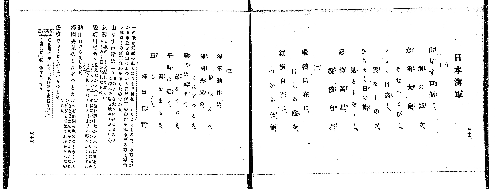
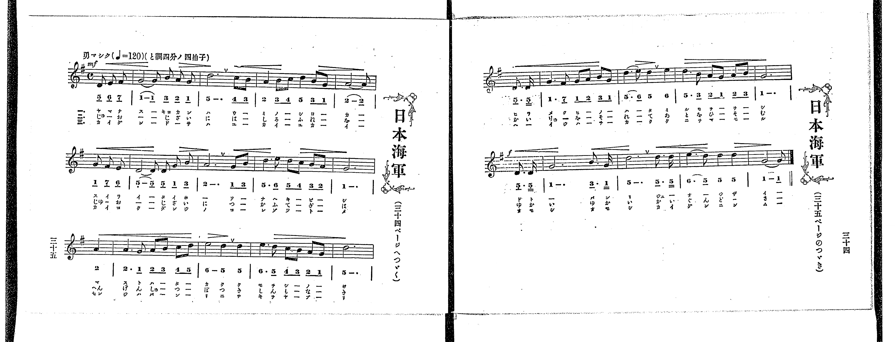

# 日本海軍

> Re:Shōka 使用 AI 協助辨識與重建樂譜，可能會有錯誤。歡迎回報。

- **鋼琴伴奏版**：<br><audio controls src="nihon_kaigun.mp3"></audio>
- **NEUTRINO 歌聲合成版**：<br><audio controls src="nihon_kaigun_neutrino.mp3"></audio>

- 出處：共益商社樂器店《唱歌教科書 教師用 巻四》第三十二～三十五頁（第三學期第二曲）
- NDL Digital Collections PID 854865（https://dl.ndl.go.jp/pid/854865）掃描 P022.jpg、P023.jpg

## 說明

原書資訊與歌詞全文（NDL PID 854865《唱歌教科書 教師用 巻四》第三十二～三十五頁，掃描 P022.jpg–P023.jpg）：
調性與拍號：と調四分ノ四拍子（G 大調 4/4 拍），♩=120，「勇マシク」，弱起一拍半（三個八分音符）
註記：單聲部，三節分節歌。樂譜跨第三十五頁（P023_L）與第三十四頁（P023_R）。開頭標 mf，第五行（第十六小節第四拍弱起）標 f。原書第三十二頁（P022_R）歌詞第（二）節於頁末「縱橫自在に、つかふ伎倆、」後排版漏印後半三句（翻頁至第三十三頁直接印第（三）節），然第三十三頁語釋仍載有「變幻出沒云々」之解說，且第三十四～三十五頁樂譜下方印有第（二）節完整唱詞（「へんげんしゅつぼつ、くつたくもなく…」）。
原典演奏注意：前出「乳牛」若くは「我陸軍」を豫習すべし；當曲は（ヘ）調に移すも可なり。
原典曲意：「一の歌は、軍艦の壯大なさまで自在に走ることをのべ、二の歌は、かゝる軍艦を自由にあつかふ我が海軍の動作を説き、三の歌は、平常と戰時との海軍任務を示したのである。」
原典語釋：「山なす巨艦は云々」山のよーな大きい船は海の中に浮んで居る城かと思はれる；「怒濤」大波のことを、怒れる波とおもしろく言ひなしたもの；「變幻出沒云々」見えたかと思へば隱れ、隱れたかと思へば又あらはれるといふ手ぎはに、いかに手あらいおにがみも泣き、海に住むといふ龍までも姿をかくしてしまふ；「動作」はたらき、しわざ；「海國男兒のこれぞつとめ」これぞ海國男兒のつとめといふべきを言葉の勢をつよめるために、わざと言葉の順序をかへたのである；「任務」ひきうけて行ふべきつとめ。


## 歌詞

```text
一、
山なす巨艦は、海の城か、
水雷大砲、そなへきびし、
マストは高く、雲をしのぎ、
ひらめく日の旗、見るもをゝし、
怒濤萬里、縱橫自在。

二、
縱橫自在に、はしる艦を、
縱橫自在に、つかふ伎倆、

三、
海軍動作は、愉快々々、
海國男兒の、これぞつとめ、
戰時は萬里に、敵をやぶり、
平時は近く、國をまもる、
重し〲、海軍任務。
```

## ABC

```abc
X:1
T:日本海軍
M:4/4
L:1/16
Q:1/4=120
K:G
V:V1 name="Voice" snm="Voi"
[V:V1]
!mf! z4 z4 z2 D2 E2 F2 | G10 B2 A2 G2 | d12 c2 B2 | A4 B2 c2 d4 B2 G2 |
w: 1.~や ま な | す きょ か ん | は う _ | み の _ し ろ _
w: 2.~じゅ _ お | _ じ ざ い | に は _ | し る _ ふ ね _
w: 3.~か い ぐ | ん ど _ さ | は ゆ _ | か い _ ゆ か _
A10 G2 F2 E2 | D10 D2 G2 B2 | A12 G2 B2 | d6 e2 d2 c2 B2 A2 |
w: 1.~か す い ら | い た い ほ | _ そ _ | な へ き _ び _
w: 2.~を じゅ _ お | _ じ ざ い | に つ _ | か ふ て _ ぎ _
w: 3.~い か い こ | く だ ん じ | の こ _ | れ ぞ つ _ と _
G12 A4 | A6 G2 A2 B2 c2 d2 | e8 d4 d4 | e6 d2 c2 B2 A2 G2 |
w: 1.~し ま | す と は _ た _ | か く く | も を し _ の _
w: 2.~は へん | げ ん しゅ _ つ _ | ぼ つ き | し ん も _ な _
w: 3.~め せん | じ は ば _ ん _ | り に て | き を や _ ぶ _
d12 D3 D | G6 F2 G2 A2 B2 G2 | d6 e2 d4 e4 | d6 B2 A2 G2 A2 B2 |
w: 1.~ぎ ひ ら | め く ひ _ の _ | は _ た み | る も を _ を _
w: 2.~き か い | りゅ _ お _ そ _ | れ _ て あ | と を ひ _ そ _
w: 3.~り へ い | じ _ は _ ち _ | か _ く く | に を ま _ も _
!f! G12 D3 D | G12 B3 G | d12 d3 d | e6 d2 d4 d4 |
w: 1.~し ど と | _ ば ん | り じゅ お | _ _ じ ざ
w: 2.~む ゆ か | い ゆ か | い か い | ぐ ん ど _
w: 3.~る お も | し お も | し か い | ぐ ん に ん
G10 z2 z2 z2 |
w: 1.~い
w: 2.~_
w: 3.~む
```

## TMD 檔案連結

- [主旋律 TMD 檔案](nihon_kaigun.tmd) [[在 TMD Studio 編輯](https://tmdlang.github.io/Tmd-TS/#tmd=s7IKdvYPcrWy4qpTUCpJTLdSSM7PyUlNLsnMz7PKrsxPzc6ML87Iz05Ugisoy88pzU21yk7MizeJtzA1sTAzRUgW55cWJadaFSdn5OfnxJekVpQk5edno8vHFySmp1oFGBgZIWQKivLLUvMS84C6C4oy80pSU8DaEQpSyzJTUkHSxclAq8tSizLTMlNTkNyVWlQMcjXUipKixLzi5KLMApBXEKrSU_OKUq2SMzJzUopS8-KL8_PS0SULEkuKMvNLMpMREmn5RblWxSVF-QUZyMIlGanAkMjNzMksSSyqRBcvTyxJLUIXBDurIL8IyWP5RZnpmXlWuamZWZlIQaalpfBs-tJnc9Y827r9xe5eBS0tLkVbBUMjAy57WwV3LhsTfRM7kBlP23e9mDn1_Z5ZT1s3Pp_d9XRq2_Ml-56taHo6c8XTXdMfN3Q9nbLx2dqeZ1NnPl8-8dnsHQpA1tMdq59PWaHwdPvup7NnP27ofr5mzZMdnU97G5_s6nm_dx6MPeXlgsb3ezqgsmt3PJszH8Te1fNs9qb3ezrBXvBz8VFwAXqgJDFHwRmedooVAjxdFCCpA2hCRklJQbGVvn5Kjl4eEKfn62UV6BdkpujDVHQ-62t-1t-vAEoTQLn0xw2NQKYxiKnExaWvpWBLLcCloKDwtG8-MCBebG5_saLrRUc7MHRerJz3tHXFs2ntQMeCfIRwPRUCsAfNc48aJsM8B_Q5MOZAbnqxav-zhuUg13T3vpg5Hyj6uHEFUBBo_tOOtsfNfUAGUOrp2glAJ7orPF2yHCipAEwECkBRsDE9j2autAWmDyDrcUPP0-72x83zHjdtf9y0_nEDUEXP0z0bX2zd_mRHA8iY3i6gMSBnNnQ_bV0NtOHl_M3P1ywDGgR2zIrdL1bMAKWpaeteNG562bwCqB-o-vn6BqBSIAkMj8cNTcBU9mLtnBfbVyB5H5pmQB6M9wEaB_QRXBboBSTZIKAs0JCX07pfLlj7bMVMhdw0oC3gBDblxcIeSMID6Wpd-3RDP9BSEBcSCGCfgFINUFca0AxIhCJHAtweI7A9kCgGKgD5GhhFe0BeeTZtD1DZszmrgcH1fMfGZytXv2hf9XTOiseNQJHGx41LHjd2P27c-mRP39OGNpBIQ-_TfcDInPS8s-PZnv6nvRuAXGBIgiztXwpy7_7dQANftANDEuaSHZ1AkeeztzzrWwpUD3XADmBsgRwAibbnLdvQ1L9YNe9le_eT3b0vgC6fAwyknhfrup7u3A3M6s82TXqya-LjhlagY57s7H6xfPGLVavAkTMFOZjR0iAkop7s6H42bSfQGUAz0YLi6Tpg-t4CTOjAUAKKA2183LjjcdPkx42TwOT0x02t4ADZAyJBgdMP5s4HMZqaHjeuAjIeNSwDpzRQrEKz2dPWHc_2THm6tP_Z5hXPWvpBKaqzF-gNoAVPdm5-3gnMO70vupeCjQMm055nHRNfztwBLO6A4o-bJr3YuPr5_kmPG2c-btwJdMT7PbOfT90GLHyAikGubAYm0U5gNgBG2PPlu0HKmpqe9q8HuaapC9URszdBrAdZvKPhceM6UAoGWdkItOxF5zKgyNPF64G5CuyVqY8b9z1uXA5PDi-2bnjcBEwLwJBYAXQWUDHIQQ2ghIZsFCi9NM0FqoSaCfRA-6rnUzaCElQjMJCgCQroyceNPZBiHWRv99Qne-eAFK9a87gR6HNQKkA29unOzU937ABa_axjw7OZQHOATloH0f5k9-6n3UBvT3q-ZBcolkARAnQb0BdNIAc3NAHDEREKkHQFCYWnG4HOAnp15tPtK8D-Xw9PV2CpdY-bgAEMjO5V4EABOrTlRQcwEtYDLQbKPtmxFuirZ1uByoCBsvzpxlagfU_n94F9uOJZw1yQ05t6gILASANFbMOkZ_uBKacXaNqzzYvAroSFZkMjUBaiGCwF9F4XOFEBUx3Q3v4XK4ARBoxzoGvBPgRJrYMYizVfvFgGdEMHOCzgjgEG34aXszaCbGlohDIwFDztB-oCBhww9KGOBzumBRRnnUA20HfAxAUpHICCQJHVYHGIFqBIFzimgSbvBzry2ebFkOgEh9jqJ3uBOQXoEaiBL_cBvQZKZKA0uxyoHpiqgEYB8wHQj8DoAJJA2a0Qb0KTCDBPgBwADAGgdSCTwUEE1DINGshbtz-d0_18yvanrZA0OhnszXnglAcMalAJBhfEUAxTA3MhOM-Bc-GKhhcTQSnyafcisDuXgNIGUCUofICOAWoBhwnYJaBaC6b-5YK2p7uAvoZ4DRjCKKkT4mZoCgY5DBjFQLLtcSMweywD1gAINyDc38QFSs6gLNzQCE7YGMkYFuDroKkRou7Zhi0vZ28HJr7nCzaBAw4Y5UBtQDcBTd8MCkeIOnCdufNxMzAhrH-5egYoQoDpBVjigDwBjBOg8_tgSoEOBkYEyPv9wJYaKE9OBxkDSn7AkAGmUqAeYHEANxuSB15MWPOyHZQKUaocmMeABQpEMbYKCRj3wPjuhhQteNShV1zQMAOWyxB3gIsOaJqCBFhL59P9QL3A3ANEMEUoyQNkLmZygiiFFkvroV4Du-LZ1K1g_wNT0jZwaQyJrp2boUr3AyMZFLZAS8Bhuw8cYLDoetkOjBZguIHiCqWkgxTqlDcDoUBBS5-Lyy8zIz_POzEzvTTPKiw_MznVocagphpkj4KNoZmWHZhVnZtWC2YAG6MakAaIJjC1LAGlGCDuUqhRACYcIGsPkF77uHk5kFoN5G4GSTT3A3nLwJIg3nwg7oMq3Q6k18JkwDpAokCDmkBGrwQ5EGRrjYKBgi4YItOm8UDCDESYg4gaBUOoJDI0BmIjIAbJ1SiYYlEBgiZQlTVgtTB9IFGYDhAfYgZMBTIEyYAdAXZODdjRPoY1CiAeCCLTwFQBIhv3gclVYDOBWRiLqeACqB3M6AZrnAxVvB6HN4DlB5QFUrUfLroOzpoOYzX1IqkEmY5pFshJwMIQrLoT4S0jHN5qnAFsJsE1d4GNxu7IGWByGtx4kBNW4_QSzLMgVQjnw5wMzOlw1lqEyqZJ2G3GcCLET8a4_AQOd0gYNE6AGg2KBUyjV8JZU6GOxRlLTcixhPAIyBZUeYQsSCVMHtVeZBeC0wcsn0LyECg_7YeyZ4PzH0hkLzw3dgHxDFCmhcg0T4bnRlDenIfIgeDchg7BgqDEj5p50CFCBXIGNAMZAMSwzAfSjT0TgyDMbETmwhUi85FCZDfYTOwmguTnwkyFZkWEzA4w2Qvnb0ZSCUuGmOaBMjWSK4F5Bbs60rLAEiS7kfMqJPED2wtwfh-SStylBKhzg-pQYAYA1khYFS8AkWD1EGeDVMIKFEzVcHOBenpQZOaheAVYhyKpbMRp3mx0p4JTNqiq6YDULLAUjqhDmtaDMSh1LwLiTdC0DErdkHoHpG4dkDUJtY5BTr2gVAjiI1cDNeAUiwxhqRlGo6pAT9v4qyBo_gJSyCkcuVqABBkiXiEpHRqEGGU4IjoRLJDHm5DVgItJpGIVHrEgE2FpCR0Cm35Q3Z1I6RzYWUYxGZJgQF1nuDbkZLwHw1BEyuhFUoec1aCGwr2AyLIglTBdmM6FBA0ooyGndlBaRqgBBSqwE4RiE9TkJlBFgWoiLKsish66C6BBC67rISq34TERYTKo2EF2Kyi5Ny-EJGpwgkVJxigZYD5YBNSIgiZ7sFp4UQ_OBJ3gjANP8siFLbj9gpzuMdMrrMSGsSHeQVaBnNZh5uAu06vTarGne5QCAZJ-YakOPZWil3KIXIFoAYFMRCk3wUkI0UhAsPCX7pA6HpQPkdI9sHkPT-MIpbAYRqliUEpEiCyi6IalapATYGUjwnHI3kc2sQGXY6GNCFDqx5XqIfKI4mQhkguILE5QKi2YS2GVICKnokcAqsmQsAKpRkrzoLQ7Ad6FWAWU3vG4eSk84UOTd9MOIN4GNh_S2sGatJEhKEWC0ieekhhKYpbmmOU9NltAfRMYRqRp7HYhCh1QkYO_aIA3XkEhhmkgIm4hDQuIA7E3kkB5DoaRi3BsaiGOQ0pN-NQhl7VAEtRkRpgBqRJgDWWIOkhjGZtZWNwITsG4sydSOsKrjrAb4eU7Sj2ALa-hurKWi0vXTgGpS60A5CpzAQA)]
- [鋼琴伴奏 TMD 檔案](nihon_kaigun_piano.tmd) [[在 TMD Studio 編輯](https://tmdlang.github.io/Tmd-TS/#tmd=s7IKdvYPcrWy4tLSUng2femzOWuebd3-Ynfv-z0dL7v3PJ-w5cmeLU-X9j_v7Hi_p1NBS4tL0VbB0MiAy95WwZ3LxkTfxI6rTkHpafuuFzOnvt8z62nrxuezu55ObXu-ZN-zFU1PZ654umv644aup1M2Plvb82zqzOfLJz6bvUMByHq6Y_XzKSsUnm7f_XT27McN3c_XrHmyo_Npb-OTXT3v986Dsae8XNAIdAxUdu2OZ3Pmg9i7ep7N3gR0khLIej8XHwWXzPTMksQcBef8nJzU5JLM_LxihQBPFwULUxMLM1OgCRklJQXFVvr6KTl6eUCcnq-XVaBfkJmiD1PR-ayv-Vl_v0KAgZERUC79cUMjkGkMYipxcfllZuTneSdmppfmWQVkJublB3k41BjUVHMpAIGNoZmWHZhVnZtWC2boayloPN2z8cXW7ZoKj5uXAPE8IO5SqFF43LQTyNoDpNc-bl4OpFYDuZtBEs39QN4ysCSINx-I-6BKtwPptTAZsA6QKNCgJpDRKxW09MG21igYKOiCITJtGg8kzECEOYioUTCESiJDYyA2AmKQXI2CKRYVIGgCVVkDVgvTBxKF6QDxIWbAVCBDkAzYEWDn1IAd7WNYowDigSAy_bipBUQ27gOTq8BmPm6cicXUx429j5vawYxusMbJUMXrcXjjcWMblAVStR8uug7Omg5jNfUiqQSZjmkWyEmPG8GObepEeMsIh7caZzxuaoVr7gIbjd2RM8DkNLjxICesxuklmGdBqhDOhzn5ceNWOGstQmXTJOw2YzgR4idjXH4ChzskDBonQI0GxQKm0SvhrKlQx-KMpSbkWEJ4BGQLqjxCFqQSJo9qL7ILwekDlk8heQiUn_ZD2bPB-Q8ksheeG7uAeAYo00JkmifDcyMob85D5EBwbkOHYEFQ4kfNPOgQoQI5A5qBDABiWOYD6caeiUEQZjYic-EKkflIIbIbbCZ2E0Hyc2GmQrMiQmYHmOyF8zcjqYQlQ0zzQJkayZXAvIJdHWlZYAmS3ch5FZL4Hzcug_P7kFTiLiV2IBIxIgM8buzHqngBiASrhzgbpBJWoGCqhpsL1NODIjMPxSuPG1cgqWzEad5sdKeCUzaoqumA1CywFI6oQ5rWgzEodS8C4k3QtAxK3ZB6B6RuHZA1CbWOQU69oFQI4iNXAzXgFIsMYakZRqOqQE_b-KsgaP4CUsgpHLlagAQZIl4hKR0ahBhlOCI6ESyQx5uQ1YCLSaRiFR6xIBNhaQkdPm7cBNXdiZTOHzciF7mwBDMducBFTsZ7MAxFpIxeJHXIWQ1qKNwLiCwLUgnThelcSNCAMhpyagelZYQaUKA-btyAYhPU5CZQRYFqIiyrIrIeugugQQuu6yEqt-ExEWEyqNhBdisouTcvhCRqcIJFScYoGWA-WATUiIIme7BaeFEPzgSd4IwDT_LIhS24_YKc7jHTK6zEhrEh3kFWgZzWYebgLtOr02qxp3uUAgGSfmGpDj2VopdyiFyBaAGBTEQpN8FJCNFIQLDwl-6QOh6UD5HSfVMXIo0jlMJiGKWKQSkRIbKIohuWqkFOgJWNCMchex_ZxAZcjoU2IkCpH1eqh8gjipOFSC4gsjhBqbRgLoVVgoicih4BqCZDwgqkGinNg9LuBHgXYhVQesfj5qXwhA9N3k07gHgb2HxIawdr0kaGoBQJSp94SmIoiVmaY5b32GwB9U1gGJGmsduFKHRARQ7-ogHeeAWFGKaBiLiFNCwgDsTeSALlORhGLsKxqYU4Dik14VOHXNYCSVCTGWEGpEqANZQh6iCNZWxmYXEjOAXjzp5I6QivOsJuhJfvKPUAtryG6spaLD1qH-QetQm0Qw1M4i_6ul629z5t3fFyditkOAIp8cYrRBvGAgtFIG0aHwsUwSKGqtYESJlAVMKVQKVgKuHi2MzFpRYmDoRQK3C5AMVUOAfmLqhaKJd4U5FUYnE_qqnYwoAIc7GHAKY6NLdjqDOApABdOwWkRBDtA5REFzLCFDIGCylzAQA)]

## 分析

```text
================================================================================
📊 TMD Song Profile: [ 日本海軍 ]
================================================================================
⏱  Duration:       0:42 (42.0s), 21 measures total
🎼 Key & Tempo:    首調基準 G, != 120.0 BPM, <4/4>
   - 分析範圍：      由實際發聲的音符與和弦推測調性；播放脈絡另行呈現
🎤 人聲音域:    D4 (MIDI 62) – E5 (MIDI 76) [跨度: 14 個半音 / 1.2 個八度, 難度: moderate]
   - 最低音:  D4 in [NihonKaigun #1 @ m.1, 0:01]
   - 最高音: E5 in [NihonKaigun #1 @ m.8, 0:14]
   - 適合: soprano, mezzo-soprano, contralto, tenor, baritone, bass
🏛  結構:      NihonKaigun (42.0s)
⚡ 編曲密度:        Peak 1 軌道同時演奏
🗝  調性診斷：       G 調性不明確（純淨自然大調，未偵測到可信轉調）
   - 風格氣質:    純淨自然大調（陽光明朗、易唱易記，無明顯調外色彩）
   - 轉調歷程:    全曲維持單一推測調性（未偵測到可信轉調）
   - 核心骨幹音:  D, G, A, E, B
   - 調性數值:    G 調性不明確 [相關度: 0.85, 穩定度: Ambiguous, 自然音純度: 100.0%]
   - 候選調性 (K-S): G 大調 (0.85), D 大調 (0.84), D 小調 (0.58)
   - 五度圈歷程:   +1
   - 各段落調性細節:
     • [NihonKaigun #1]: G 調性不明確 (r: 0.85, 自然音純度: 100.0%)

  [ 五度圈游移軌跡 ]
               C  
         F           [G ]*
      Bb               D  
      Eb               A  
         Ab           E  
            Db       B  
               F# 
     (* = active key center)

  [ 十二半音累積音高分佈 ]
     C  : ██                         3.1%
     C# :                            0.0%
     D  : ████████████████████████  35.0%
     D# :                            0.0%
     E  : ███████                   10.0%
     F  :                            0.0%
     F# : █                          1.9%
     G  : ██████████████████        25.9%
     G# :                            0.0%
     A  : ███████████               15.6%
     A# :                            0.0%
     B  : ██████                     8.4%
--------------------------------------------------------------------------------
Assignment 軌道音域：
  - Voice         : D4 – E5 (14 個半音 / 1.2 個八度, 83 個音符)
================================================================================
```


## 原書掃描頁






