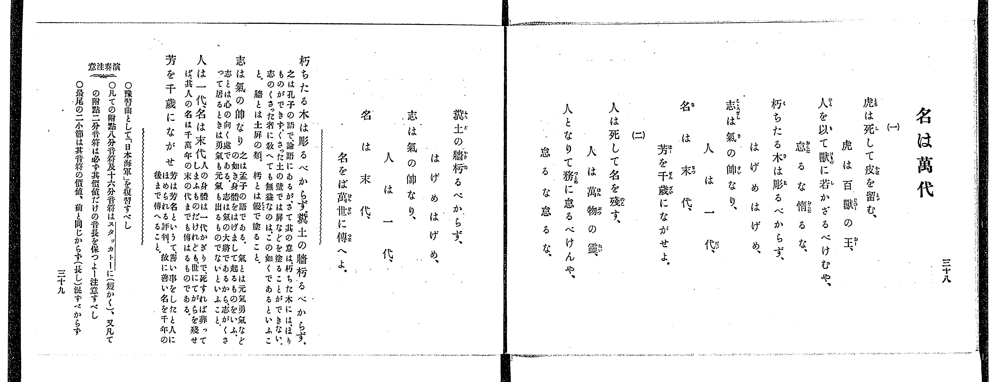
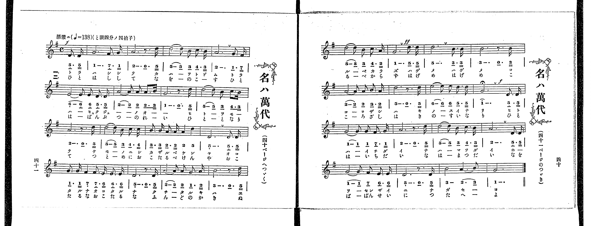

# 名は萬代

> Re:Shōka 使用 AI 協助辨識與重建樂譜，可能會有錯誤。歡迎[回報](https://github.com/TMDLang/reshoka/issues)。

- **鋼琴伴奏版**：<br><audio controls src="na_wa_yorozuyo.mp3"></audio>
- **NEUTRINO 歌聲合成版**：<br><audio controls src="na_wa_yorozuyo_neutrino.mp3"></audio>

- 出處：共益商社樂器店《唱歌教科書 教師用 巻四》第三十八～四十一頁（第三學期第四曲）
- NDL Digital Collections PID 854865（https://dl.ndl.go.jp/pid/854865）掃描 P025.jpg、P026.jpg

## 說明

原書資訊與歌詞全文（NDL PID 854865《唱歌教科書 教師用 巻四》第三十八～四十一頁，掃描 P025.jpg–P026.jpg）：
調性與拍號：と調四分ノ四拍子（G 大調 4/4 拍），♩=138，「活潑ニ」，弱起一拍（附點八分音符＋十六分音符）
註記：單聲部，二節分節歌。樂譜標題印作「名ハ萬代」，跨第四十一頁（P026_L）與第四十頁（P026_R）。開頭標 f，第十八小節第四拍標 ff，第二十四小節拍首 G5（1^）標有延長記號（𝄐），第四拍弱起標 f。第十三小節（P026_L 第四行第一小節）第三個音「ナ」簡譜印四分音符「7_」（無底線，與同小節其餘三拍合為四拍），五線譜於 F♯4 誤加一條八分音符符尾，此處依拍數正確之四分音符轉錄。第二十九小節第三拍五線譜為 F♯4，簡譜「7」漏印下點。
原典演奏注意：豫習曲として「日本海軍」を復習すべし；凡ての附點八分音符及十六分音符はスタッカトーに（短かく）、又凡ての附點二分音符は必ず其價値だけの音長を保つよー注意すべし；最尾の二小節は其音符の價値、前と同じからず（長し）混ずべからず。
原典語釋：「朽ちたる木は彫るべからず、糞土の牆朽るべからず」之は孔子の語で、論語にあるが、さて其の意は、朽ちた木には、ほりものができず、くさった土の壁では屏などを塗ることができない、志のくさった者に敎へても無益なのは、この如くであるといふこと、牆とは土屏の類、朽とは鏝で塗ること；「志は氣の帥なり」之は孟子の語である、氣とは元氣勇氣などの如き身體をはげまして起るものをいふ、志とは心の向く處である、志は氣の大將であるから、志がくさって居るときは勇氣も元氣も出るものでないといふこと；「人は一代、名は末代」人の身體は一代かぎりで、死すれば葬ってしまふものだけれども、世にてがらを殘せば、其人の名は千萬年の末の代までも傳はるものである；「芳を千歳にながせ」芳は芳名というて、善い事をしたと人にほめられる評判、故に善い名を千年の後まで傳へること。


## 歌詞

```text
一、
虎は死して皮を留む、虎は百獸の王、
人を以て獸に若かざるべけむや、怠るな惰るな、
朽ちたる木は彫るべからず、はげめはげめ、
志は氣の帥なり、人は一代、
名は末代、芳を千歳にながせよ。

二、
人は死して名を殘す、人は萬物の靈、
人となりて務に怠るべけんや、怠るな怠るな、
糞土の牆朽るべからず、はげめはげめ、
志は氣の帥なり、人は一代、
名は末代、名をば萬世に傳へよ。
```

## ABC

<div class="abc-score" data-abc-src="na_wa_yorozuyo.abc" aria-label="五線譜載入中"></div>

[下載 ABC 原始檔](na_wa_yorozuyo.abc)

## TMD 檔案連結

- [主旋律 TMD 檔案](na_wa_yorozuyo.tmd) [[在 TMD Studio 編輯](https://tmdlang.github.io/Tmd-TS/#tmd=s7IKdvYPcrWy4qpTUCpJTLdSSM7PyUlNLsnMz7PKrsxPzc6ML87Iz05Ugisoy88pzU21yk7MizeJtzA1sTAzRUgW55cWJadaFSdn5OfnxJekVpQk5edno8vHFySmp1oFGBgh6Swoyi9LzUvMA-ouKMrMK0lNAWtHKEgty0xJBUkXJwOtLkstykzLTE1BcldqUTHI1VArSooS84qTizILQF5BqEpPzStKtUrOyMxJKUrNiy_Oz0tHSKblF-VaFZcU5RdkZCYjhEsyUoEehvopJzMtFV0qNTcf1Zb8osz0zDyr3NTMrEwsoZBfVJKRn16UWJBRaZWRWVwCVJ6cmBMPDFJgOGtpKTyd0Pu4cf2LCWue7F6soKXFpWirYGhswWVvq-DOZWOib2IHMulp-64XM6e-3zPraevG57O7nk5te75k37MVTU9nrni6a_rjhq6nUzY-W9vzbOrM58snPpu9QwHIerpj9fMpKxSebt_9dPbsxw3dz9esebKj82lv49PW1e_3zgMKAtlPdjS8XND4fk8HVHbtjmdz5gPZQNlnsze939MJ9oifi4-CC9CXJYk5Cs7wNFOsEODpogBJFUATMkpKCoqt9PVTcvTygDg9Xy-rQL8gM0UfpqLzWV_zs_5-BVBaAMqlP25oBDLNQEwlLi59LQVbagEuBQWFp33zgQHxYnP7ixVdLzragaHzYuW8p60rnk1rBzoW5COE66kQgD1onnvUMBnmOaDPgTEHctOLVfufNSwHuaa798XM-UDRx40rgIIgozraHjf3gYK9u_fp2glAJ7orPF2yHCipAEwECkBRsDE9j2autAWmDyDrcUPPsy27n-2d-Li5-3EDULrn6Z6NL7ZuB7oIrLrj5cyWl7uBXl4NNPvl_M3P1yx7v6cb7Py1SCKdYIet2P1ixQxQ-pq27kXjppfNK4DGPdnV83x9A1ApkASGzeOGJmCKe7F2zrMVM18u7Hnau-HJ3jlAR4AScHM_JAFD3PFi-wpIEkJOYKDQiPcB2gf0PlwWSSoIKAW04uW07pcL1gKtUEgDmgRSCA7vpxv6ga6AJszuXrA8VAHQmSA1QPPAaoCyL5dNU3AHJUnDOFCqWzHz2ZzOp7u3vZy6HehJcLh3fJjbAgxjUIDCzYSEHthkoDsgNoPiG2wq3AMKEPUvFoKt3tEAk-6Epo6GbmDAAkPlcXMXMDCeb1gIDDBgUEFiGBLmQFnzeHBIdTxvWfh019Tn22eBQq2j_emEHoh5T1u3vVwyA2geyF0TOp437YK4EeLkJ7umALWAYmLaHgW3RzPXmwBT1pKnXQtAUb9oLnKMA9HTDftAyXPtEmAJ8mTfXFDoTd3xbO3i54t2PdnZjeywF3s7X_a0QDwPCdUnO-fCQx7iGrjdQDdB7AaFIdibIH8BvfVsTz8obezoBiY-oFnQvPi0dcezPVOeLu1_tnnFs5Z-YFJ7sXH18_2TgKUMMA88bpz-uBEUMM-mL302Z82zrdtf7O4FmvW4adLTfSuByh43znzcuBOo7P2e2U_bF4IUN67DTOBP-7vQEjiwbH3ctPNx0_7Hzc2Pm1Y_bu543LznceNqUODPX_u4sftxI9AxwJTX-LS_A81kUBggmfN0f-vjRmAJvO1p886nDUseNy543DgRpHj-ZmDSAjr1yf65jxuXPG4CWQHxJrKzn80BJpZ9QPUgY8GBCjITGNFQ89dBjQW6pBNYJawAJobHjTNALmzqBNoLytBAW0BGdT7bDmQAyw6gyVBZlIB-sWrey_ZuUOkCDNA5ex83An01_3FT97M5wIBe_3TvaiAbVXPj883zns6ZD3TE8842kBZ0Bb3ApALSu3YKsHACKgNa8bhxOVDji9XTwOzVjxubwLqA5UTj48apwHAE-g2oEhwK64GCcJeAnQFUDxJ83Lj7cVPX46YmoEqQXqCZjUDPg5wEjBiwOYuBWiBue7oYKAhUsP7pRqDUqseNK0HpY-F0sL2TwckIbgJQFpiSG5_uByYsoMkIo140AGNx9bOpfY8bd4Aiu6kJmAmBdSpYC1AlxFVA09Y9XQZ0FVAj0ECI14Dmtzxu3Aq1CxhonW1gwfVA54GdtO7lQmCSh_gUJP6yH5ggliO7EJgOQEUmyFXrn20Aumfd0x1LQVYDAwERyPNRAhliO9BYkHqwda3NQPbT7nawCDgcoK7tfbFr9cvVU4DBAvJII5AEJjhQ1gKWbCBDIOEMkgV7BBo-YDP3N4MMmQBM0P3AggLZXhTXLln-dEM7UpiAUwhUDTDw4eG87OnGVliggRo4UNc2NUEcD2K070I4CWQgOMpQAxkSXE927QKaACzcwDVMI6TF9GzOakiFA5ZdB_U4XBkoY_eBQhWcSp-t3Q3Kik1AF254MXENxIXgkAGGz1aYG8D5GaQGmK6agLqe7JgGTqhAlT0gbzZNerYOmCFnAw0BOaN1G8RqiHue9jYD68CnO7eA0vwcoK51YGcAzV8O8mzTZnBJhOxfUABCPPiiazMoJfc2P1sLVAbUCwwKoDOAUr0gKWDzsGsz2BZI4ABTHbCsbHw6DchuebILaCYwQoF-AeaRFWAnAU0AZqtGsJuBLu9-sXLq0w5QyfJsKijxQzSCDARbCnHz031AG0GuBTt1ByJPAUsWUNECDFegAeDGwkxg3lkPDlJQ0no-C5Sink8FBi9IBUT2-cx9z3uB-Wvd8z5QEgIbAHQZsIzcDUzuy8Byq190A9lAa6bBihtg6Dc8bgLl22cNC8CCq541b4AwoKYQWZ5Bkz8wDOAMiH4cWa8RLY2BlaKks0ackQQs72FhtAtU-sE8ixRGkLAGp56ZcMuAyeV5JyjrvpwLNAGhDegpsKOA2rqB1cdqWFhAAmgyegDBGFAjCJXktAgaiPdAeQvYCgRnGlgiAgcNUAPlbXooUNDS5-LySwxPjMwvyq8qrcy3CsvPTE51qDGoqQZZpGBjaKZlB2ZVp9WCaWDPQgPSuNNUANb_QLxSoQZI9is8btoOxiBeG5C1GibevAeIN0FVd4JFF8D1Al0AMrZGwUBBFwzRadN4GFWjYAgVQ4fmEDWGQCVGOJRAjAObYopF2hiITaAs3IZA7AfaVgN2tI9hjQLEZl0MGpjyIHQT2MeN63EYCUzScBqkbhkOdRBzgUkPp2nARINsbyM4XpoacNqL5D6Ib4zw-WYTXBc1fbMK7EaQuzFNWgcmJ0P5INNm4rQVyXWwVIpIepMeNy8G2rIeiHc8bl4KToAgcRDugybNPXDRSWAWKHHCku0iMBueUM1ggYIMwYLISRVbEgKJQcRBiQxXYiYlpcKTIY4k0bjpcVMzmNEPFZjxuKkVaDL2YAQHOTw6sKsCQVj0bQJHCyQhoZkFSYxNTTCz4EkMl0s3gNVDovtx4zawyUvwuLIH7kpg9Uu-O8GioIQIcXUXcgIClWIbwckBkgQgyaUbVsoBS7jHTduAIkC6eSZY7ePmzWD1S4C8VUC8GZFsKC6YTIAqQDyQGMQwI7ihMJ1AM7ClTqgNMIuQUg2hDDoR7FFYLKKGHCSDrobyIBm-G8qbBtQFY-8EmwPVBY1hcLw14Yq3x41dUHoySsoh5NoleNJjI4prgfEML1yA7R8quxaUepr2Q1NGFzwtwMRAKQQkuh7MaoSkLZj6prXw-nQFIvVACgtDWE0Hr_KA5Q60PAJSeGIfKZXhKpkgVhjBUxk-Q5BS0HyI34HhB8tFqCGCrAKkHqYGHcLisB-saiEWFRCTEDHVi7cqgpnXgZKCqO3areCUAUslqK5dCSZBuQREQ8zrJWDeGuTyB5R6QKUOqGwBsSE1-i5o6gAXas0L0XnIZQ7-AgUU1bgqoeq0tFqodlMcBsEMg9Rm-NMMSlUFjUD04NoJJqGRC201zcJhKizagU1ucJiAMjcl6mDBj1LcDAF3ggsaYMECTiZrIdURtAkOShSQogRUaYEKGGDJ1gSsmIBFD0gUWCQB2zqglg7eKgokBolbUHLBlQ6gJQOodYRFFiSGSEuGcTgMAXYxcNRSWPNXUy84KKZBgwRS_xAqDSBlBiRPopkHbl7C2hKwpimkZMCmGr3JCSlfhoJLkRvH4AQBqoEawIYgkges8TwPiFtQ5GejNoexlSAgMXr1ybCnGOxtTFCIweoW4AgVUW1HcOjiMG8fmIS0UgmZBxxFgrIIt4UH1p2wtjCwKEKkF0gn6XHTbnAbF1LQgJtboPYwJM00rYHKQzpTGK0XVAhOH6S2XdBrGeREAZIj1KuCBz64HsLe7wSOQYFyMSK_toDDC9JyxISo4Q_rlSAZhyYCsrgDr1moKQTUL8J0JHAcD-JIiPHEOhLSQIY0cZCN20GWI2u5uHTtFJDHjxSAfGUuAA)]
- [鋼琴伴奏 TMD 檔案](na_wa_yorozuyo_piano.tmd) [[在 TMD Studio 編輯](https://tmdlang.github.io/Tmd-TS/#tmd=s7IKdvYPcrWy4qpTUCpJTLdSyC8qychPL0osyKi0ysgsLskvykxOzInPTsxLVOLS0lJ4OqH3ceP6FxPWPNm9-P2ejpfde55P2PJkz5anS_ufd3a839OpoKXFpWirYGhswWVvq-DOZWOib2IHMv5p-64XM6e-3zPraevG57O7nk5te75k37MVTU9nrni6a_rjhq6nUzY-W9vzbOrM58snPpu9QwHIerpj9fMpKxSebt_9dPbsxw3dz9esebKj82lv49PW1e_3zgMKAtlPdjS8XNAIdAxUdu2OZ3PmA9lA2WezNwGdpASy3s_FR8ElMz2zJDFHwTk_Jyc1uSQzP69YIcDTRcHC1MTCzBRoQkZJSUGxlb5-So5eHhCn5-tlFegXZKbow1R0PutrftbfrxBgYGQKlEt_3NAIZJqBmEpcXH6J4YmR-UX5VaWV-VYBmYl5-UEeDjUGNdVcCkBgY2imZQdmVafVgml9LQWNp3s2vti6XVPhcXMHEK9UqAGS_QqPm7aDMYjXBmSthok37wHiTVDVnWDRBXC9WvpgY2sUDBR0wRCdNo2HUTUKhlAxdGgOUWMIVGKEQwnEOLApplikjYHYBMrCbQjEfqBtNWBH-xjWKEBs1sWgHzeugNBNYB83rsdh5OPG6XAapG4ZDnUQcx83duM07XHTJGR7G8Hx0tSA014k90F8Y4TPN5vguqjpm1VgN4LcjWnSOjA5GcoHmTYTp61IroOlUkTSm_S4eTHQlvVAvONx81JwAgSJg3AfNGnugYtOArNAiROWbBeB2fCEagYLFGQIFkROqtiSEEgMIg5KZLgSMykpFZ4McSSJxk2Pm5rBjH6owIzHTa1Ak7EHIzjI4dGBXRUIwqJvEzhaIAkJzSxIYmxqgpkFT2K4XLoBrB4S3Y8bt4FNXoLHlT1wVz5ubCHfnWBRUEKEuLoLOQGBSrGN4OQASQKQ5NINK-WAJdzjpm1AESDdPBOs9nHzZrD6JUDeKiDejEg2FBdMJkAVIB5IDGKYEdxQmE6gGdhSJ9QGmEVIqYZQBp0I9igsFlFDDpJBV0N5kAzfDeVNA-qCsXeCzYHqgsYwON6acMXb48YuKD0ZJeUQcu0SPOmxEcW1wHiGFy6PG-dT2bWg1NO0H5oyuuBpASYGSiEg0fVgViMkbcHUN62F16crEKkHUlgYwmo6eJUHLHeg5RGQwhP7SKkMV8kEscIInsrwGYKUguZD_A4MP1guQg0RZBUg9TA16BAWh_1gVQuxqICYhIipXrxVEcy8DpQURG3XbgWnDFgqQXXtSjAJyiUgGmJeLwHz1iCXP6DUAyp1QGULiA2p0XdBUwe4UGteiM5DLnPwFyigqMZVCVWnpdVCtZviMAhmGKQ2w59mUKoqaASiB9dOMAmNXGiraRYOU2HR_rgRXF2DMzcl6mDBj1LcDAF3ggsaYMECTiZrIdURtAkOShSQogRUaYEKGGDJ1gSsmIBFD0gUWCQB2zqglg7eKgokBolbUHLBlQ6gJQOodYRFFiSGSEuGcTgMAXYxcNRSWPNXUy84KKZBgwRS_xAqDSBlBiRPopkHbl7C2hKwpimkZMCmGr3JCSlfhoJLkRvH4AQBqoEawIYgkges8TwPiFtQ5GejNoexlSAgMXr1ybCnGOxtTFCIweqWx40LiGo7gkMXh3n7wCSklUrIvMeNu6Eswm3hgXUnrC0MLIoQ6QXSSXrctBvcxoUUNODmFqg9DEkzTWug8pDOFEbrBRWC0wepbRf0WgY5UYDkCPWq4IEProew9ztnQ-pzRH5tAYcXpOWICVHDH9YrQTIOTQRkcQdes1BTCKhfhOnIDTBHQown1pGQBjKkiYNs3A6yHFmLbfjIB3n4yAQ6egRMQi_6ul629z5t3fFyditk8A0pfcQrRBvGwqgahIhpPJA2jQeKwVo0MAFMtSZAygSLSoQZQAhVBNONVy2aq1DdCrMNm5sIq8TwF2YI0EotrpDFqRK7r8i0HXv40zT-sbkUTS05oWQAyQC6dgrIeSDaByiLIWYEFlPmAgA)]

## 分析

```text
================================================================================
📊 TMD Song Profile: [ 名は萬代 ]
================================================================================
⏱  Duration:       0:57 (57.4s), 33 measures total
🎼 Key & Tempo:    首調基準 G, != 138.0 BPM, <4/4>
   - 分析範圍：      由實際發聲的音符與和弦推測調性；播放脈絡另行呈現
🎤 人聲音域:    D4 (MIDI 62) – G5 (MIDI 79) [跨度: 17 個半音 / 1.4 個八度, 難度: challenging]
   - 最低音:  D4 in [NaWaYorozuyo #1 @ m.1, 0:01]
   - 最高音: G5 in [NaWaYorozuyo #1 @ m.25, 0:41]
   - 適合: soprano, mezzo-soprano, tenor, baritone
🏛  結構:      NaWaYorozuyo (57.4s)
⚡ 編曲密度:        Peak 1 軌道同時演奏
🗝  調性診斷：       D 大調（純淨自然大調，未偵測到可信轉調）
   - 風格氣質:    純淨自然大調（陽光明朗、易唱易記，無明顯調外色彩）
   - 轉調歷程:    全曲維持單一推測調性（未偵測到可信轉調）
   - 核心骨幹音:  D, A, G, B, E
   - 調性數值:    D 大調 [相關度: 0.91, 穩定度: High, 自然音純度: 96.7%]
   - 候選調性 (K-S): D 大調 (0.91), G 大調 (0.77), D 小調 (0.58)
   - 五度圈歷程:   +2
   - 各段落調性細節:
     • [NaWaYorozuyo #1]: D 大調 (r: 0.91, 自然音純度: 96.7%, 調外音: C)

  [ 五度圈游移軌跡 ]
               C  
         F            G  
      Bb              [D ]*
      Eb               A  
         Ab           E  
            Db       B  
               F# 
     (* = active key center)

  [ 十二半音累積音高分佈 ]
     C  : ███                        3.3%
     C# :                            0.0%
     D  : ████████████████████████  30.9%
     D# :                            0.0%
     E  : █████                      6.8%
     F  :                            0.0%
     F# : ███                        3.3%
     G  : ███████████████           19.4%
     G# :                            0.0%
     A  : ███████████████████       23.9%
     A# :                            0.0%
     B  : ██████████                12.4%
--------------------------------------------------------------------------------
Assignment 軌道音域：
  - Voice         : D4 – G5 (17 個半音 / 1.4 個八度, 106 個音符)
================================================================================
```


## 原書掃描頁






