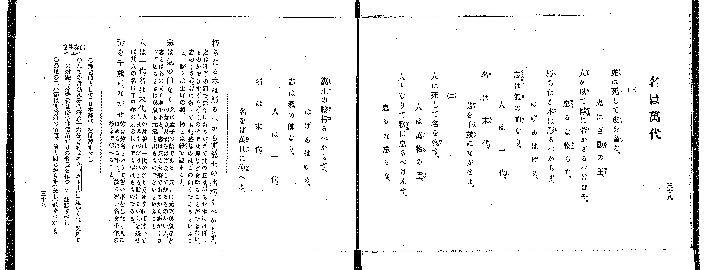
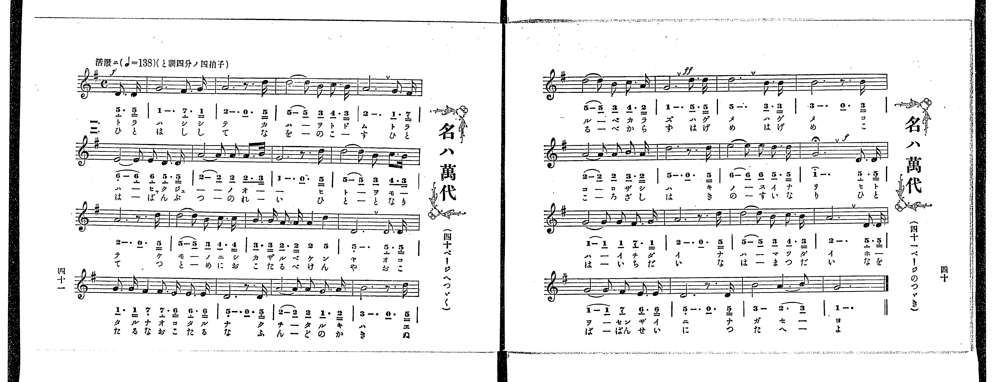

# 名は萬代

> Re:Shōka 使用 AI 協助辨識與重建樂譜，可能會有錯誤。歡迎回報。

- **鋼琴伴奏版**：<br><audio controls src="na_wa_yorozuyo.mp3"></audio>
- **NEUTRINO 歌聲合成版**：<br><audio controls src="na_wa_yorozuyo_neutrino.mp3"></audio>

- 出處：共益商社樂器店《唱歌教科書 教師用 巻四》第三十八～四十一頁（第三學期第四曲）
- NDL Digital Collections PID 854865（https://dl.ndl.go.jp/pid/854865）掃描 P025.jpg、P026.jpg

## 說明

原書資訊與歌詞全文（NDL PID 854865《唱歌教科書 教師用 巻四》第三十八～四十一頁，掃描 P025.jpg–P026.jpg）：
調性與拍號：と調四分ノ四拍子（G 大調 4/4 拍），♩=138，「活潑ニ」，弱起一拍（附點八分音符＋十六分音符）
註記：單聲部，二節分節歌。樂譜標題印作「名ハ萬代」，跨第四十一頁（P026_L）與第四十頁（P026_R）。開頭標 f，第十八小節第四拍標 ff，第二十四小節拍首 G5（1^）標有延長記號（𝄐），第四拍弱起標 f。第十三小節（P026_L 第四行第一小節）第三個音「ナ」簡譜印四分音符「7_」（無底線，與同小節其餘三拍合為四拍），五線譜於 F♯4 誤加一條八分音符符尾，此處依拍數正確之四分音符轉錄。第二十九小節第三拍五線譜為 F♯4，簡譜「7」漏印下點。
原典演奏注意：豫習曲として「日本海軍」を復習すべし；凡ての附點八分音符及十六分音符はスタッカトーに（短かく）、又凡ての附點二分音符は必ず其價値だけの音長を保つよー注意すべし；最尾の二小節は其音符の價値、前と同じからず（長し）混ずべからず。
原典語釋：「朽ちたる木は彫るべからず、糞土の牆朽るべからず」之は孔子の語で、論語にあるが、さて其の意は、朽ちた木には、ほりものができず、くさった土の壁では屏などを塗ることができない、志のくさった者に敎へても無益なのは、この如くであるといふこと、牆とは土屏の類、朽とは鏝で塗ること；「志は氣の帥なり」之は孟子の語である、氣とは元氣勇氣などの如き身體をはげまして起るものをいふ、志とは心の向く處である、志は氣の大將であるから、志がくさって居るときは勇氣も元氣も出るものでないといふこと；「人は一代、名は末代」人の身體は一代かぎりで、死すれば葬ってしまふものだけれども、世にてがらを殘せば、其人の名は千萬年の末の代までも傳はるものである；「芳を千歳にながせ」芳は芳名というて、善い事をしたと人にほめられる評判、故に善い名を千年の後まで傳へること。


## 歌詞

```text
一、
虎は死して皮を留む、虎は百獸の王、
人を以て獸に若かざるべけむや、怠るな惰るな、
朽ちたる木は彫るべからず、はげめはげめ、
志は氣の帥なり、人は一代、
名は末代、芳を千歳にながせよ。

二、
人は死して名を殘す、人は萬物の靈、
人となりて務に怠るべけんや、怠るな怠るな、
糞土の牆朽るべからず、はげめはげめ、
志は氣の帥なり、人は一代、
名は末代、名をば萬世に傳へよ。
```

## ABC

```abc
X:1
T:名は萬代
M:4/4
L:1/16
Q:1/4=138
K:G
V:V1 name="Voice" snm="Voi"
[V:V1]
!f! z4 z4 z4 D3 D | G12 F3 G | A12 z3 D | d10 B2 c3 B |
w: 1.~と ら | は し し | て か | は を と ど
w: 2.~ひ と | は し し | て な | を の こ _
A12 G3 F | E10 E2 D3 D | A10 A2 A3 B | G12 z3 D |
w: 1.~む と ら | は ひゃ く じゅ | _ の を _ | _ ひ
w: 2.~す ひ と | は ば ん ぶ | つ の れ _ | い ひ
d10 B2 c3 B | A12 z3 D | d10 B2 c3 c | B3 B A3 A A4 d4 |
w: 1.~と を も _ | て け | も の に し | か ざ る べ け ん
w: 2.~と と な り | て つ | と め に お | こ た る べ け ん
D12 D3 D | G3 G F4 F3 E E3 E | D12 z3 D | A10 A2 G3 A |
w: 1.~や お こ | た る な お こ た る | な く | ち た る き
w: 2.~や お こ | た る な お こ た る | な ふ | ん ど の か
B12 z3 D | d10 B2 c3 A | !ff! G12 d3 d | d12 B3 B |
w: 1.~は え | る べ か ら | ず は げ | め は げ
w: 2.~き ぬ | る べ か ら | ず は げ | め は げ
B12 z3 B | A10 A2 B3 A | d12 z3 d | e10 e2 d3 d |
w: 1.~め こ | こ ろ ざ し | は き | の す い な
w: 2.~め こ | こ ろ ざ し | は き | の す い な
!f! g12 D3 D | G10 G2 F3 G | A12 z3 D | d10 B2 c3 B |
w: 1.~り ひ と | は い ち だ | い な | は ま つ だ
w: 2.~り ひ と | は い ち だ | い な | は ま つ だ
A12 D3 D | G10 F2 E3 E | D12 z3 D | B8 A6 B2 |
w: 1.~い ほ _ | を せん ざ い | に な | が せ _
w: 2.~い な を | ば ばん せ い | に つ | た へ _
G12 z4 |
w: 1.~よ
w: 2.~よ
```

## TMD 檔案連結

- [主旋律 TMD 檔案](na_wa_yorozuyo.tmd) [[在 TMD Studio 編輯](https://tmdlang.github.io/Tmd-TS/#tmd=s7IKdvYPcrWy4qpTUCpJTLdSSM7PyUlNLsnMz7PKrsxPzc6ML87Iz05Ugisoy88pzU21yk7MizeJtzA1sTAzRUgW55cWJadaFSdn5OfnxJekVpQk5edno8vHFySmp1oFGBgh6Swoyi9LzUvMA-ouKMrMK0lNAWtHKEgty0xJBUkXJwOtLkstykzLTE1BcldqUTHI1VArSooS84qTizILQF5BqEpPzStKtUrOyMxJKUrNiy_Oz0tHSKblF-VaFZcU5RdkZCYjhEsyUoEehvopJzMtFV0qNTcf1Zb8osz0zDyr3NTMrEykUNDSUng6ofdx4_oXE9Y82b1YQUuLS9FWwdDYgsveVsGdy8ZE38QOZMbT9l0vZk59v2fW09aNz2d3PZ3a9nzJvmcrmp7OXPF01_THDV1Pp2x8trbn2dSZz5dPfDZ7hwKQ9XTH6udTVig83b776ezZjxu6n69Z82RH59Pexqetq9_vnQcUBLKf7Gh4uaDx_Z4OqOzaHc_mzAeygbLPZm96v6cT7AU_Fx8FF6AHShJzFJzhyaFYIcDTRQES4UATMkpKCoqt9PVTcvTygDg9Xy-rQL8gM0UfpqLzWV_zs_5-BVA0A-XSHzc0AplmIKYSF5e-loIttQCXgoLC0775wIB4sbn9xYquFx3twNB5sXLe09YVz6a1Ax0L8hHC9VQIwB40zz1qmAzzHNDnwJgDuenFqv3PGpaDXNPd-2LmfKDo48YVQEGQUR1tj5v7QMHe3ft07QSgE90Vni5ZDpRUACYCBaAo2JieRzNX2gLTB5D1uKHn2Zbdz_ZOfNzc_bgBKN3zdM_GF1u3A10EVt3xcmbLy91AL68Gmv1y_ubna5a939MNdv5aJJFOsMNW7H6xYgYofU1b96Jx08vmFUDjnuzqeb6-AagUSALD5nFDEzDFvVg759mKmS8X9jzt3fBk7xygI0AJuLkfkoAh7nixfQUkCSEnMFBoxPsA7QN6Hy6LJBUElAJa8XJa98sFa4FWKKQBTQIpBIf30w39QFdAE2Z3L1geqgDoTJAaoHlgNUDZl8umKbiDkqRhHCjVrZj5bE7n093bXk7dDvQkONw7PsxtAYYxKEDhZkJCD2wy0B0Qm0HxDTYV7gEFiPoXC8FW72iASXdCU0dDNzBggaHyuLkLGBjPNywEBhgwqCAxDAlzoKx5PDikOp63LHy6a-rz7bNAodbR_nRCD8S8p63bXi6ZATQP5K4JHc-bdkHcCHHyk11TgFpAMTFtj4Lbo5nrTYApa8nTrgWgqF80FznGgejphn2g5Ll2CbAEebJvLij0pu54tnbx80W7nuzsRnbYi72dL3taIJ6HhOqTnXPhIQ9xDdxuoJsgdoPCEOxNkL-A3nq2px-UNnZ0AxMf0CxoXnzauuPZnilPl_Y_27ziWUs_MKm92Lj6-f5JwFIGmAceN05_3AgKmGfTlz6bs-bZ1u0vdvcCzXrcNOnpvpVAZY8bZz5u3AlU9n7P7KftC0GKG9dhJvCn_V1oCRxYtj5u2vm4af_j5ubHTasfN3c8bt7zuHE1KPDnr33c2P24EegYYMprfNrfgWYyKAyQzHm6v_VxI7AE3va0eefThiWPGxc8bpwIUjx_MzBpAZ36ZP_cx41LHjeBrIB4E9nZz-YAE8s-oHqQseBABZkJjGio-eugxgJd0gmsElYAE8PjxhkgFzZ1Au0FZWigLSCjOp9tBzKAZQfQZKgsSkC_WDXvZXs3qHQBBuicvY8bgb6a_7ip-9kcYECvf7p3NZCNqrnx-eZ5T-fMBzrieWcbSAu6gl5gUgHpXTsFWDgBlQGteNy4HKjxxeppYPbqx41NYF3AcqLxceNUYDgC_QZUCQ6F9UBBuEvAzgCqBwk-btz9uKnrcVMTUCVIL9DMRqDnQU4CRgzYnMVALRC3PV0MFAQqWP90I1Bq1ePGlaD0sXA62N7J4GQENwEoC0zJjU_3AxMW0GSEUS8agLG4-tnUvseNO0CR3dQEzITAOhWsBagS4iqgaeueLgO6CqgRaCDEa0DzWx43boXaBQy0zjaw4Hqg88BOWvdyITDJQ3wKEn_ZD0wQy5FdCEwHoCIT5Kr1zzYA3bPu6Y6lIKuBgYAI5PkogQyxHWgsSD3YutZmIPtpdztYBBwOUNf2vti1-uXqKcBgAXmkEUgCExwoawFLNpAhkHAGyYI9Ag0fsJn7m0GGTAAm6H5gQYFsL4prlyx_uqEdKUzAKQSqBhj48HBe9nRjKyzQQA0cqGubmiCOBzHadyGcBDIQHGWogQwJrie7dgFNABZu4BqmEdJiejZnNaTCAcuug3ocrgyUsftAoQpOpc_W7gZlxSagCze8mLgG4kJwyADDZyvMDeD8DFIDTFdNQF1PdkwDJ1Sgyh6QN5smPVsHzJCzgYaAnNG6DWI1xD1Pe5uBdeDTnVtAaX4OUNc6sDOA5i8HebZpM7gkQvYvKAAhHnzRtRmUknubn60FKgPqBQYF0BlAqV6QFLB52LUZbAskcICpDlhWNj6dBmS3PNkFNBMYoUC_APPICrCTgCYAs1Uj2M1Al3e_WDn1aQeoZHk2FZT4IRpBBoIthbj56T6gjSDXgp26A5GngCULqGgBhivQAHBjYSYw76wHBykoaT2fBUpRz6cCgxekAiL7fOa-573A_LXueR8oCYENALoMWEbuBib3ZWC51S-6gWygNdNgxQ0w9BseN4Hy7bOGBWDBVc-aN0AYUFOILM-gyR8YBnAGRD-OrNeIlsbASlHSWSPOSAKW97Aw2gUq_WCeRQojSFiDU89MuGXA5PK8E5R1X84FmoDQBvQU2FFAbd3A6mM1LCwgATQZPYBgDKgRhEpyWgQNxHugvAVsBYIzDSwRgYMGqIHyNj0UKGjpc3H5JYYnRuYX5VeVVuZbheVnJqc61BjUVIMsUrAxNNOyA7Oq02rBNLBnoQFp3GkqAOt_IF6pUAMk-xUeN20HYxCvDchaDRNv3gPEm6CqO8GiC-B6gS4AGVujYKCgC4botGk8jKpRMISKoUNziBpDoBIjHEogxoFNMcUibQzEJlAWbkMg9gNtqwE72sewRgFisy4GDUx5ELoJ7OPG9TiMBCZpOA1StwyHOoi5wKSH0zRgokG2txEcL00NOO1Fch_EN0b4fLMJrouavlkFdiPI3ZgmrQOTk6F8kGkzcdqK5DpYKkUkvUmPmxcDbVkPxDseNy8FJ0CQOAj3QZPmHrjoJDALlDhhyXYRmA1PqGawQEGGYEHkpIotCYHEIOKgRIYrMZOSUuHJEEeSaNz0uKkZzOiHCsx43NQKNBl7MIKDHB4d2FWBICz6NoGjBZKQ0MyCJMamJphZ8CSGy6UbwOoh0f24cRvY5CV4XNkDdyWw-iXfnWBRUEKEuLoLOQGBSrGN4OQASQKQ5NINK-WAJdzjpm1AESDdPBOs9nHzZrD6JUDeKiDejEg2FBdMJkAVIB5IDGKYEdxQmE6gGdhSJ9QGmEVIqYZQBp0I9igsFlFDDpJBV0N5kAzfDeVNA-qCsXeCzYHqgsYwON6acMXb48YuKD0ZJeUQcu0SPOmxEcW1wHiGFy7A9g-VXQtKPU37oSmjC54WYGKgFAISXQ9mNULSFkx901p4fboCkXoghYUhrKaDV3nAcgdaHgEpPLGPlMpwlUwQK4zgqQyfIUgpaD7E78Dwg-Ui1BBBVgFSD1ODDmFx2A9WtRCLCohJiJjqxVsVwczrQElB1HbtVnDKgKUSVNeuBJOgXAKiIeb1EjBvDXL5A0o9oFIHVLaA2JAafRc0dYALteaF6DzkMgd_gQKKalyVUHVaWi1UuykOg2CGQWoz_GkGpaqCRiB6cO0Ek9DIhbaaZuEwFRbtwCY3OExAmZsSdbDgRyluhoA7wQUNsGABJ5O1kOoI2gQHJQpIUQKqtEAFDLBkawJWTMCiByQKLJKAbR1QSwdvFQUSg8QtKLngSgfQkgHUOsIiCxJDpCXDOByGALsYOGoprPmrqRccFNOgQQKpfwiVBpAyA5In0cwDNy9hbQlY0xRSMmBTjd7khJQvQ8GlyI1jcIIA1UANYEMQyQPWeJ4HxC0o8rNRm8PYShCQGL36ZNhTDPY2JijEYHULcISKqLYjOHRxmLcPTEJaqYTMA44iQVmE28ID605YWxhYFCHSC6ST9LhpN7iNCylowM0tUHsYkmaa1kDlIZ0pjNYLKgSnD1LbLui1DHKiAMkR6lXBAx9cD2HvdwLHoEC5GJFfW8DhBWk5YkLU8If1SpCMQxMBWdyB1yzUFALqF2E6EjiOB3EkxHhiHQlpIEOaOMjG7SDLkbVcXLp2CsjjRwpAvjIXAA)]
- [鋼琴伴奏 TMD 檔案](na_wa_yorozuyo_piano.tmd) [[在 TMD Studio 編輯](https://tmdlang.github.io/Tmd-TS/#tmd=s7IKdvYPcrWy4tLSUng6ofdx4_oXE9Y82b34_Z6Ol917nk_Y8mTPlqdL-593drzf06mgpcWlaKtgaGzBZW-r4M5lY6JvYsdVp6D0tH3Xi5lT3--Z9bR14_PZXU-ntj1fsu_ZiqanM1c83TX9cUPX0ykbn63teTZ15vPlE5_N3qEAZD3dsfr5lBUKT7fvfjp79uOG7udr1jzZ0fm0t_Fp6-r3e-cBBYHsJzsaXi5oBDoGKrt2x7M584FsoOyz2ZuATlICWe_n4qPgkpmeWZKYo-Ccn5OTmlySmZ9XrBDg6aJgYWpiYWYKNCGjpKSg2EpfPyVHLw-I0_P1sgr0CzJT9GEqOp_1NT_r71cIMDAyBcqlP25oBDLNQEwlLi6_xPDEyPyi_KrSynyrgMzEvPwgD4cag5pqLgUgsDE007IDs6rTasG0vpaCxtM9G19s3a6p8Li5A4hXKtQAyX6Fx03bwRjEawOyVsPEm_cA8Sao6k6w6AK4Xi19sLE1CgYKumCITpvGw6gaBUOoGDo0h6gxBCoxwqEEYhzYFFMs0sZAbAJl4TYEYj_Qthqwo30MaxQgNuti0I8bV0DoJrCPG9fjMPJx43Q4DVK3DIc6iLmPG7txmva4aRKyvY3geGlqwGkvkvsgvjHC55tNcF3U9M0qsBtB7sY0aR2YnAzlg0ybidNWJNfBUiki6U163LwYaMt6IN7xuHkpOAGCxEG4D5o098BFJ4FZoMQJS7aLwGx4QjWDBQoyBAsiJ1VsSQgkBhEHJTJciZmUlApPhjiSROOmx03NYEY_VGDG46ZWoMnYgxEc5PDowK4KBGHRtwkcLZCEhGYWJDE2NcHMgicxXC7dAFYPie7HjdvAJi_B48oeuCsfN7aQ706wKCghQlzdhZyAQKXYRnBygCQBSHLphpVywBLucdM2oAiQbp4JVvu4eTNY_RIgbxUQb0YkG4oLJhOgChAPJAYxzAhuKEwn0AxsqRNqA8wipFRDKINOBHsUFouoIQfJoKuhPEiG74bypgF1wdg7weZAdUFjGBxvTbji7XFjF5SejJJyCLl2CZ702IjiWmA8wwuXx43zqexaUOpp2g9NGV3wtAATA6UQkOh6MKsRkrZg6pvWwuvTFYjUAyksDGE1HbzKA5Y70PIISOGJfaRUhqtkglhhBE9l-AxBSkHzIX4Hhh8sF6GGCLIKkHqYGnQIi8N-sKqFWFRATELEVC_eqghmXgdKCqK2a7eCUwYslaC6diWYBOUSEA0xr5eAeWuQyx9Q6gGVOqCyBcSG1Oi7oKkDXKg1L0TnIZc5-AsUUFTjqoSq09JqodpNcRgEMwxSm-FPMyhVFTQC0YNrJ5iERi601TQLh6mwaH_cCK6uwZmbEnWw4EcpboaAO8EFDbBgASeTtZDqCNoEByUKSFECqrRABQywZGsCVkzAogckCiySgG0dUEsHbxUFEoPELSi54EoH0JIB1DrCIgsSQ6QlwzgchgC7GDhqKaz5q6kXHBTToEECqX8IlQaQMgOSJ9HMAzcvYW0JWNMUUjJgU43e5ISUL0PBpciNY3CCANVADWBDEMkD1nieB8QtKPKzUZvD2EoQkBi9-mTYUwz2NiYoxGB1y-PGBUS1HcGhi8O8fWAS0kolZN7jxt1QFuG28MC6E9YWBhZFiPQC6SQ9btoNbuNCChpwcwvUHoakmaY1UHlIZwqj9YIKwemD1LYLei2DnChAcoR6VfDAB9dD2PudsyH1OSK_toDDC9JyxISo4Q_rlSAZhyYCsrgDr1moKQTUL8J05AaYIyHGE-tISAMZ0sRBNm4HWY6sxTZ85IM8fGQCHT0CJqEXfV0v23uftu54ObsVMviGlD7iFaINY2FUDULENB5Im8YDxWAtGpgAploTIGWCRSXCDCCEKoLpxqsWzVWoboXZhs1NhFVi-AszBGilFlfI4lSJ3Vdk2o49_Gka_9hciqaWnFAygGQAXTsF5DwQ7QOUxRAzAospcwEA)]

## 分析

```text
================================================================================
📊 TMD Song Profile: [ 名は萬代 ]
================================================================================
⏱  Duration:       0:57 (57.4s), 33 measures total
🎼 Key & Tempo:    首調基準 G, != 138.0 BPM, <4/4>
   - 分析範圍：      由實際發聲的音符與和弦推測調性；播放脈絡另行呈現
🎤 人聲音域:    D4 (MIDI 62) – G5 (MIDI 79) [跨度: 17 個半音 / 1.4 個八度, 難度: challenging]
   - 最低音:  D4 in [NaWaYorozuyo #1 @ m.1, 0:01]
   - 最高音: G5 in [NaWaYorozuyo #1 @ m.25, 0:41]
   - 適合: soprano, mezzo-soprano, tenor, baritone
🏛  結構:      NaWaYorozuyo (57.4s)
⚡ 編曲密度:        Peak 1 軌道同時演奏
🗝  調性診斷：       D 大調（純淨自然大調，未偵測到可信轉調）
   - 風格氣質:    純淨自然大調（陽光明朗、易唱易記，無明顯調外色彩）
   - 轉調歷程:    全曲維持單一推測調性（未偵測到可信轉調）
   - 核心骨幹音:  D, A, G, B, E
   - 調性數值:    D 大調 [相關度: 0.91, 穩定度: High, 自然音純度: 96.7%]
   - 候選調性 (K-S): D 大調 (0.91), G 大調 (0.77), D 小調 (0.58)
   - 五度圈歷程:   +2
   - 各段落調性細節:
     • [NaWaYorozuyo #1]: D 大調 (r: 0.91, 自然音純度: 96.7%, 調外音: C)

  [ 五度圈游移軌跡 ]
               C  
         F            G  
      Bb              [D ]*
      Eb               A  
         Ab           E  
            Db       B  
               F# 
     (* = active key center)

  [ 十二半音累積音高分佈 ]
     C  : ███                        3.3%
     C# :                            0.0%
     D  : ████████████████████████  30.9%
     D# :                            0.0%
     E  : █████                      6.8%
     F  :                            0.0%
     F# : ███                        3.3%
     G  : ███████████████           19.4%
     G# :                            0.0%
     A  : ███████████████████       23.9%
     A# :                            0.0%
     B  : ██████████                12.4%
--------------------------------------------------------------------------------
Assignment 軌道音域：
  - Voice         : D4 – G5 (17 個半音 / 1.4 個八度, 106 個音符)
================================================================================
```


## 原書掃描頁






