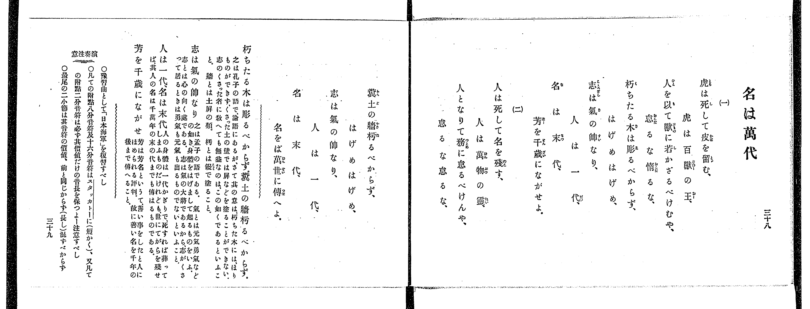
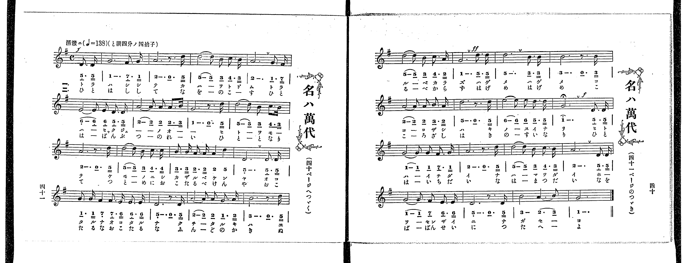

# 名は萬代

> Re:Shoka 使用 AI 辨識樂譜，可能會有錯誤。歡迎回報。

<audio controls src="na_wa_yorozuyo.mp3"></audio>

- 出處：共益商社樂器店《唱歌教科書 教師用 巻四》第三十八～四十一頁（第三學期第四曲）
- NDL Digital Collections PID 854865（https://dl.ndl.go.jp/pid/854865）掃描 P025.jpg、P026.jpg

## 說明

原書資訊與歌詞全文（NDL PID 854865《唱歌教科書 教師用 巻四》第三十八～四十一頁，掃描 P025.jpg–P026.jpg）：
調性與拍號：と調四分ノ四拍子（G 大調 4/4 拍），♩=138，「活潑ニ」，弱起一拍（附點八分音符＋十六分音符）
註記：單聲部，二節分節歌。樂譜標題印作「名ハ萬代」，跨第四十一頁（P026_L）與第四十頁（P026_R）。開頭標 f，第十八小節第四拍標 ff，第二十四小節拍首 G5（1^）標有延長記號（𝄐），第四拍弱起標 f。第十三小節（P026_L 第四行第一小節）第三個音「ナ」簡譜印四分音符「7_」（無底線，與同小節其餘三拍合為四拍），五線譜於 F♯4 誤加一條八分音符符尾，此處依拍數正確之四分音符轉錄。第二十九小節第三拍五線譜為 F♯4，簡譜「7」漏印下點。
原典演奏注意：豫習曲として「日本海軍」を復習すべし；凡ての附點八分音符及十六分音符はスタッカトーに（短かく）、又凡ての附點二分音符は必ず其價値だけの音長を保つよー注意すべし；最尾の二小節は其音符の價値、前と同じからず（長し）混ずべからず。
原典語釋：「朽ちたる木は彫るべからず、糞土の牆朽るべからず」之は孔子の語で、論語にあるが、さて其の意は、朽ちた木には、ほりものができず、くさった土の壁では屏などを塗ることができない、志のくさった者に敎へても無益なのは、この如くであるといふこと、牆とは土屏の類、朽とは鏝で塗ること；「志は氣の帥なり」之は孟子の語である、氣とは元氣勇氣などの如き身體をはげまして起るものをいふ、志とは心の向く處である、志は氣の大將であるから、志がくさって居るときは勇氣も元氣も出るものでないといふこと；「人は一代、名は末代」人の身體は一代かぎりで、死すれば葬ってしまふものだけれども、世にてがらを殘せば、其人の名は千萬年の末の代までも傳はるものである；「芳を千歳にながせ」芳は芳名というて、善い事をしたと人にほめられる評判、故に善い名を千年の後まで傳へること。

## 歌詞

```text
一、
虎は死して皮を留む、虎は百獸の王、
人を以て獸に若かざるべけむや、怠るな惰るな、
朽ちたる木は彫るべからず、はげめはげめ、
志は氣の帥なり、人は一代、
名は末代、芳を千歳にながせよ。

二、
人は死して名を殘す、人は萬物の靈、
人となりて務に怠るべけんや、怠るな怠るな、
糞土の牆朽るべからず、はげめはげめ、
志は氣の帥なり、人は一代、
名は末代、名をば萬世に傳へよ。
```

## ABC

```abc
X:1
T:名は萬代
M:4/4
L:1/16
Q:1/4=138
K:G
V:V1 name="Voice" snm="Voi"
[V:V1]
!f! z4 z4 z4 D3 D | G12 F3 G | A12 z3 D | d10 B2 c3 B |
A12 G3 F | E10 E2 D3 D | A10 A2 A3 B | G12 z3 D |
d10 B2 c3 B | A12 z3 D | d10 B2 c3 c | B3 B A3 A A4 d4 |
D12 D3 D | G3 G F4 F3 E E3 E | D12 z3 D | A10 A2 G3 A |
B12 z3 D | d10 B2 c3 A | !ff! G12 d3 d | d12 B3 B |
B12 z3 B | A10 A2 B3 A | d12 z3 d | e10 e2 d3 d |
!f! g12 D3 D | G10 G2 F3 G | A12 z3 D | d10 B2 c3 B |
A12 D3 D | G10 F2 E3 E | D12 z3 D | B8 A6 B2 |
G12 z4 | !f! z4 z4 z4 D3 D | G12 F3 G | A12 z3 D |
d10 B2 c3 B | A12 G3 F | E10 E2 D3 D | A10 A2 A3 B |
G12 z3 D | d10 B2 c3 B | A12 z3 D | d10 B2 c3 c |
B3 B A3 A A4 d4 | D12 D3 D | G3 G F4 F3 E E3 E | D12 z3 D |
A10 A2 G3 A | B12 z3 D | d10 B2 c3 A | !ff! G12 d3 d |
d12 B3 B | B12 z3 B | A10 A2 B3 A | d12 z3 d |
e10 e2 d3 d | !f! g12 D3 D | G10 G2 F3 G | A12 z3 D |
d10 B2 c3 B | A12 D3 D | G10 F2 E3 E | D12 z3 D |
B8 A6 B2 | G12 z4 |
```

## TMD 檔案連結

- [主旋律 TMD 檔案](na_wa_yorozuyo.tmd) [[在 TMD Studio 編輯](https://tmdlang.github.io/Tmd-TS/#tmd=s7IKdvYPcrWy4qpTUCpJTLdSSM7PyUlNLsnMz7PKrsxPzc6ML87Iz05Ugisoy88pzU21yk7MizeJtzA1sTAzRUgW55cWJadaFSdn5OfnxJekVpQk5edno8vHFySmp1oFGBgh6Swoyi9LzUvMA-ouKMrMK0lNAWtHKEgty0xJBUkXJwOtLkstykzLTE1BcldqUTHI1VArSooS84qTizILQF5BqEpPzStKtUrOyMxJKUrNiy_Oz0tHSKblF-VaFZcU5RdkZCYjhEsyUoEehvopJzMtFV0qNTcfYouWlsLTCb2PG9e_mLDmye7FClpaXIq2CobGFlz2tgruXDYm-iZ2IL1P23e9mDn1_Z5ZT1s3Pp_d9XRq2_Ml-56taHo6c8XTXdMfN3Q9nbLx2dqeZ1NnPl8-8dnsHQpA1tMdq59PWaHwdPvup7NnP27ofr5mzZMdnU97G5-2rn6_dx5QEMh-sqPh5YLG93s6oLJrdzybMx_IBso-m73p_Z5OsNP9XHwUXDLTM0sScxSc4fFdrBDg6aIAiVGgCRklJQXFVvr6KTl6eUCcnq-XVaBfkJmiD1PR-ayv-Vl_vwIoHoFy6Y8bGoFMMxBTiYtLX0vBllqAS0FB4WnffGBAvNjc_mJF14uOdmDovFg572nrimfT2oGOBfkI4XoqBGAPmuceNUyGeQ7oc2DMgdz0YtX-Zw3LQa7p7n0xcz5Q9HHjCqAgyKiOtsfNfaBg7-59unYC0InuCk-XLAdKKgATgQJQFGxMz6OZK22B6QPIetzQ82zL7md7Jz5u7n7cAJTuebpn44ut24EuAqvueDmz5eVuoJdXA81-OX_z8zXL3u_pBjt_LZJIJ9hhK3a_WDEDlL6mrXvRuOll8wqgcU929Txf3wBUCiSBYfO4oQmY4l6snfNsxcyXC3ue9m54sncO0BGgBNzcD0nAEHe82L4CkoSQExgoNOJ9gPYBvQ-XRZIKAkoBrXg5rfvlgrVAKxTSgCaBFILD--mGfqAroAmzuxcsD1UAdCZIDdA8sBqg7Mtl0xTcQUnSMA6U6lbMfDan8-nubS-nbgd6EhzuHR_mtgDDGBSgcDMhoQc2GegOiM2g-AabCveAAkT9i4Vgq3c0wKQ7oamjoRsYsMBQedzcBQyM5xsWAgMMGFSQGIaEOVDWPB4cUh3PWxY-3TX1-fZZoFDraH86oQdi3tPWbS-XzACaB3LXhI7nTbsgboQ4-cmuKUAtoJiYtkfB7dHM9SbAlLXkadcCUNQvmosc40D0dMM-UPJcuwRYgjzZNxcUelN3PFu7-PmiXU92diM77MXezpc9LRDPQ0L1yc658JCHuAZuN9BNELtBYQj2JshfQG8929MPShs7uoGJD2gWNC8-bd3xbM-Up0v7n21e8aylH5jUXmxc_Xz_JGApA8wDjxunP24EBcyz6UufzVnzbOv2F7t7gWY9bpr0dN9KoLLHjTMfN-4EKnu_Z_bT9oUgxY3rMBP40_4utAQOLFsfN-183LT_cXPz46bVj5s7Hjfvedy4GhT489c-bux-3Ah0DDDlNT7t70AzGRQGSOY83d_6uBFYAm972rzzacOSx40LHjdOBCmevxmYtIBOfbJ_7uPGJY-bQFZAvIns7GdzgIllH1A9yFhwoILMBEY01Px1UGOBLukEVgkrgInhceMMkAubOoH2gjI00BaQUZ3PtgMZwLIDaDJUFiWgX6ya97K9G1S6AAN0zt7HjUBfzX_c1P1sDjCg1z_duxrIRtXc-HzzvKdz5gMd8byzDaQFXUEvMKmA9K6dAiycgMqAVjxuXA7U-GL1NDB79ePGJrAuYDnR-LhxKjAcgX4DqgSHwnqgINwlYGcA1YMEHzfuftzU9bipCagSpBdoZiPQ8yAnASMGbM5ioBaI254uBgoCFax_uhEotepx40pQ-lg4HWzvZHAygpsAlAWm5Man-4EJC2gywqgXDcBYXP1sat_jxh2gyG5qAmZCYJ0K1gJUCXEV0LR1T5cBXQXUCDQQ4jWg-S2PG7dC7QIGWmcbWHA90HlgJ617uRCY5CE-BYm_7AcmiOXILgSmA1CRCXLV-mcbgO5Z93THUpDVwEBABPJ8lECG2A40FqQebF1rM5D9tLsdLAIOB6hre1_sWv1y9RRgsIA80ggkgQkOlLWAJRvIEEg4g2TBHoGGD9jM_c0gQyYAE3Q_sKBAthfFtUuWP93QjhQm4BQCVQMMfHg4L3u6sRUWaKAGDtS1TU0Qx4MY7bsQTgIZCI4y1ECGBNeTXbuAJgALN3AN0whpMT2bsxpS4YBl10E9DlcGyth9oFAFp9Jna3eDsmIT0IUbXkxcA3EhOGSA4bMV5gZwfgapAaarJqCuJzumgRMqUGUPyJtNk56tA2bI2UBDQM5o3QaxGuKep73NwDrw6c4toDQ_B6hrHdgZQPOXgzzbtBlcEiH7FxSAEA--6NoMSsm9zc_WApUB9QKDAugMoFQvSArYPOzaDLYFEjjAVAcsKxufTgOyW57sApoJjFCgX4B5ZAXYSUATgNmqEexmoMu7X6yc-rQDVLI8mwpK_BCNIAPBlkLc_HQf0EaQa8FO3YHIU8CSBVS0AMMVaAC4sTATmHfWg4MUlLSezwKlqOdTgcELUgGRfT5z3_NeYP5a97wPlITABgBdBiwjdwOT-zKw3OoX3UA20JppsOIGGPoNj5tA-fZZwwKw4KpnzRsgDKgpRJZn0OQPDAM4A6IfR9ZrREtjYKUo6awRZyQBy3tYGO0ClX4wzyKFESSswalnJtwyYHJ53gnKui_nAk1AaAN6CuwooLZuYPWxGhYWkACajB5AMAbUCEIlOS2CBuI9UN4CtgLBmQaWiMBBA9RAeZseChS09Lm4_BLDEyPzi_KrSivzrcLyM5NTHWoMahSqQTYp2BiaadmBWdVptWAa2LXQgLTuNBWADQAgXqlQAyT7FR43bQdjEK8NyFoNE2_eA8SboKo7waIL4HqBTgAZW6NgoKALhui0aTyMqlEwhIqhQ3OIGkOgEiMcSiDGgU0xxSJtDMQmUBZuQyD2A22rgYUFwoOTHjcvBvp6PRDveNy8FOxNkDgI90EDYA9cdBKYBQoCWOAsArPhwWEG8RIqBAsiBwg2h4LEIOIgr-AKMlLCA-FZULxuBDsd4lyI17ph8Q6M88dN24AiQLp5Jljt4-bNYPVLgLxVQLwZ4UWKo8oEqALEA4lBDDOCGwrTCTQDW0hCbYBZBPdh036o67vg7oWJgXwBEl0PZjVC_A9T37QWngtWIHwICXxDWPqEJ1RgPELjF0jhcSFSSOCKaYgVRvCQwGcIIh5BPgTFHiiOQGxwHgZ2QiA-2AT2y0J0HnLc4Y8YkHNwJbzqtLRaqHZTHAbBDIOkYPz-Qk6eoMgCe2stJBlCCyOQJyDRA0qsoEjbCcTABAmMTpAoMJqB-RGUG_EmTZAYxC0g7-FyNzS0QTkYiyxIDOF3wzgchgALW6ypE1bYgB0PSoEN4HhDeAVWGM0D4hYU-dmoxQu22AGJ0askxeo7SBH5uGk3uNSAROESsL-AJQzEh01roPKQohQjr6FCsG9IzWno6Q3ZCyA5QmUqUAVXLReXrp0CctWqgIWvzAUA)]

## 分析

```text
================================================================================
📊 TMD Song Profile: [ 名は萬代 ]
================================================================================
⏱  Duration:       1:54 (114.8s), 66 measures total
🎼 Key & Tempo:    首調基準 G, != 138.0 BPM, <4/4>
   - 分析範圍：      由實際發聲的音符與和弦推測調性；播放脈絡另行呈現
🎤 人聲音域:    D4 (MIDI 62) – G5 (MIDI 79) [跨度: 17 個半音 / 1.4 個八度, 難度: challenging]
   - 最低音:  D4 in [NaWaYorozuyo #1 @ m.1, 0:01]
   - 最高音: G5 in [NaWaYorozuyo #1 @ m.25, 0:41]
   - 適合: soprano, mezzo-soprano, tenor, baritone
🏛  結構:      NaWaYorozuyo (57.4s) -> NaWaYorozuyo (57.4s)
⚡ 編曲密度:        Peak 1 軌道同時演奏
🗝  調性診斷：       D 大調（純淨自然大調，未偵測到可信轉調）
   - 風格氣質:    純淨自然大調（陽光明朗、易唱易記，無明顯調外色彩）
   - 轉調歷程:    全曲維持單一推測調性（未偵測到可信轉調）
   - 核心骨幹音:  D, A, G, B, E
   - 調性數值:    D 大調 [相關度: 0.91, 穩定度: High, 自然音純度: 96.7%]
   - 候選調性 (K-S): D 大調 (0.91), G 大調 (0.77), D 小調 (0.58)
   - 五度圈歷程:   +2 -> +2
   - 各段落調性細節:
     • [NaWaYorozuyo #1]: D 大調 (r: 0.91, 自然音純度: 96.7%, 調外音: C)
     • [NaWaYorozuyo #2]: D 大調 (r: 0.91, 自然音純度: 96.7%, 調外音: C)

  [ 五度圈游移軌跡 ]
               C  
         F            G  
      Bb              [D ]*
      Eb               A  
         Ab           E  
            Db       B  
               F# 
     (* = active key center)

  [ 十二半音累積音高分佈 ]
     C  : ███                        3.3%
     C# :                            0.0%
     D  : ████████████████████████  30.9%
     D# :                            0.0%
     E  : █████                      6.8%
     F  :                            0.0%
     F# : ███                        3.3%
     G  : ███████████████           19.4%
     G# :                            0.0%
     A  : ███████████████████       23.9%
     A# :                            0.0%
     B  : ██████████                12.4%
--------------------------------------------------------------------------------
Assignment 軌道音域：
  - Voice         : D4 – G5 (17 個半音 / 1.4 個八度, 212 個音符)
================================================================================
```


## 原書掃描頁






