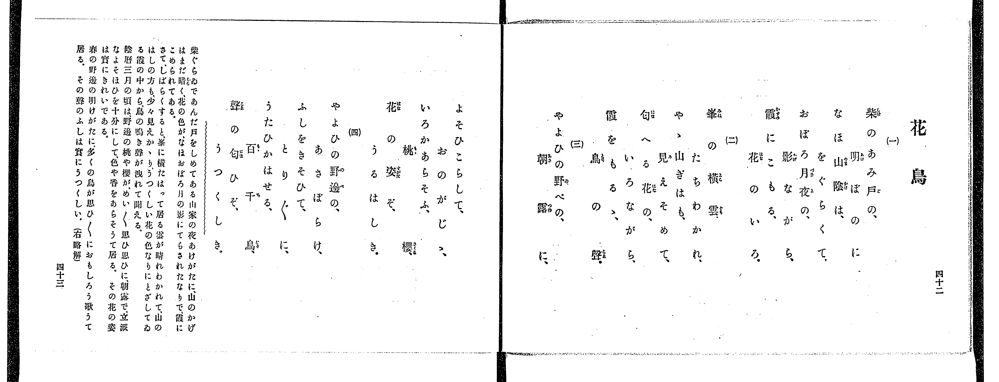
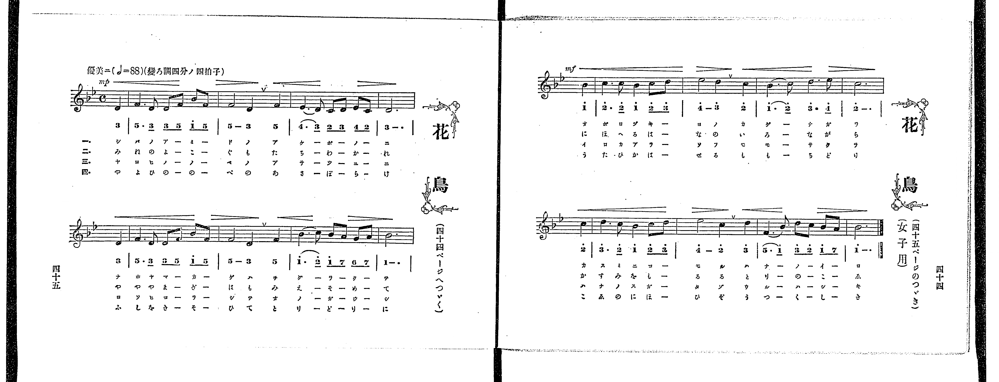

# 花鳥

> Re:Shōka 使用 AI 協助辨識與重建樂譜，可能會有錯誤。歡迎回報。

- **NEUTRINO 歌聲合成版**：<br><audio controls src="hanatori_neutrino.mp3"></audio>
- **鋼琴伴奏版**：<br><audio controls src="hanatori.mp3"></audio>


- 出處：共益商社樂器店《唱歌教科書 教師用 巻四》第四十二～四十五頁（女生徒專用曲第一曲）
- NDL Digital Collections PID 854865（https://dl.ndl.go.jp/pid/854865）掃描 P027.jpg、P028.jpg

## 說明

原書資訊與歌詞全文（NDL PID 854865《唱歌教科書 教師用 巻四》第四十二～四十五頁，掃描 P027.jpg–P028.jpg）：
調性與拍號：變ろ調四分ノ四拍子（B♭ 大調 4/4 拍），♩=88，「優美ニ」，弱起一拍
註記：女生徒專用曲（樂譜標註「女子用」），單聲部，四節分節歌。樂譜跨第四十五頁（P028_L）與第四十四頁（P028_R）。開頭標 mp，第三行弱起（第八小節第四拍）標 mf。第八小節（P028_L 第二行末小節）五線譜為 B♭4，簡譜「1 - .」漏印上點。原書第四十二～四十三頁未附演奏注意欄。
原典略解：「柴ぐらゐであんだ戸をしめてある山家の夜あけがたに、山のかげはまだ暗く、花の色がなほおぼろ月の影にてらされたなりで、霞にこめられてある。さて、しばらくすると、峯に橫たはって居る雲が晴れわかれて、山のはしの方も、少々見えかゝり、うつくしい花の色なりにとざしてゐる霞の中から、鳥の鳴き聲が洩れて聞える。陰曆三月の頃は、野邊の桃や櫻が、めい〲思ひ思ひに、朝露で、立派なよそほひを十分にして、色や香をあらそうて居る。その花の姿は實にきれいである。春の野邊の明けがたに、多くの鳥が思ひ〲におもしろう歌うて居る。その聲のふしは實にうつくしい。」


## 歌詞

```text
一、
柴のあみ戸の、明ぼのに
なほ山陰は、をぐらくて、
おぼろ月夜の、影ながら、
霞にこもる、花のいろ。

二、
峯の橫雲、たちわかれ、
やゝ山ぎはも、見えそめて、
匂へる花の、いろながら、
霞をもるゝ、鳥の聲。

三、
やよひの野べの、朝露に、
よそひこらして、おのがじゝ、
いろかあらそふ、桃櫻、
花の姿ぞ、うるはしき。

四、
やよひの野邊の、あさぼらけ、
ふしをきそひて、とり〲に、
うたひかはせる、百千鳥、
聲の匂ひぞ、うつくしき。
```

## ABC

```abc
X:1
T:花鳥
M:4/4
L:1/16
Q:1/4=88
K:Bb
V:V1 name="Voice" snm="Voi"
[V:V1]
!mp! z4 z4 z4 D4 | F6 D2 D2 F2 B2 F2 | F8 D4 F4 | E6 D2 C2 D2 E2 C2 |
w: 1.~し | ば の あ _ み _ | ど の あ | け _ ぼ _ の _
w: 2.~み | ね の よ _ こ _ | ぐ も た | ち _ わ _ か _
w: 3.~や | よ ひ の _ の _ | べ の あ | さ _ つ _ ゆ _
w: 4.~や | よ ひ の _ の _ | べ の あ | さ _ ぼ _ ら _
D12 D4 | F6 D2 D2 F2 B2 F2 | F8 D4 F4 | B6 c2 B2 A2 G2 A2 |
w: 1.~に な | ほ や ま _ か _ | げ は を | ぐ _ ら _ く _
w: 2.~れ や | や や ま _ ぎ _ | は も み | え _ そ _ め _
w: 3.~に よ | そ ひ こ _ ら _ | し て お | の _ が _ じ _
w: 4.~け ふ | し を き _ そ _ | ひ て と | り _ ど _ り _
!mf! B12 B4 | c6 c2 B4 c2 d2 | e8 d4 c4 | B6 c2 d6 e2 |
w: 1.~て お | ぼ ろ づ き _ | よ の か | げ _ な が
w: 2.~て に | ほ へ る は _ | な の い | ろ _ な が
w: 3.~じ い | ろ か あ ら _ | そ ふ も | も _ さ く
w: 4.~に う | た ひ か は _ | せ る も | も _ ち ど
c12 c4 | d6 c2 B4 c2 d2 | e8 c4 d4 | F6 B2 d2 c2 B2 A2 |
w: 1.~ら か | す み に こ _ | も る は | な _ の _ い _
w: 2.~ら か | す み を も _ | る る と | り _ の _ こ _
w: 3.~ら は | な の す が _ | た ぞ う | る _ は _ し _
w: 4.~り こ | ゑ の に ほ _ | ひ ぞ う | つ _ く _ し _
B12 z4 |
w: 1.~ろ
w: 2.~ゑ
w: 3.~き
w: 4.~き
```

## TMD 檔案連結

- [主旋律 TMD 檔案](hanatori.tmd) [[在 TMD Studio 編輯](https://tmdlang.github.io/Tmd-TS/#tmd=s7IKdvYPcrWy4qpTUCpJTLdSSM7PyUlNLsnMz7PKrsxPzc6ML87Iz05Ugisoy88pzU21yk7MizeJtzA1sTAzRUgW55cWJadaFSdn5OfnxJekVpQk5edno8vHFySmp1oFGBiZI2QKivLLUvMS84C6C4oy80pSU8DaEQpSyzJTUkHSxclAq8tSizLTMlNTkNyVWlQMcjXUipKixLzi5KLMApBXEKrSU_OKUq2SMzJzUopS8-KL8_PSEZJp-UW5VsUlRfkFGZnJCOGSjFSgh_MSS0qLUtFFC3IS85AcCRFMzMvMTcxBFy1OTQRaV4wuXJKZmxqfnxafkliJkMovykzPzLPKTc3MykQKRi0thRddG19uXqqgpcWlaKtgYcFlb6vgpMNlY6JvYgfS_bR914uZU9_vmfW0dePz2V1Pp7Y9X7Lv2YqmpzNXPN01_XFD19MpG5-t7Xk2debz5ROfzd6hAGQ93bH6-ZQVCk-37346e_bjhu7na9YAGU97G5_s6nm_dx6MPeXlgsb3ezqeLt38fMr8p_smPd3QAdT2bPYmoPonOxqAjPd7OsFe8HPxUXABeqAkMUfBGZ6eihUCPF0UICkGaE5GSUlBsZW-fkqOXh4Qp-frZRXoF2Sm6MNUdD7ra37W368ASidAufTHDY1ApgWIqcTFpa-lYEstwKWgoPC0bz4wOF5sbn-xoutFRzswjF6snPe0dcWzae1Ax4J8hHA9FYKxB81zjxomwzwH9Dkw_kBuerFq_7OG5SDXdPe-mDkfKPpiXdfjpl6gOMi0jrbHzX1ABlD26doJQFc6PZq5VuHpkuVAeQVgglAASoAN63k0c6WthQWQ8bih52nLquf7-h43dz9uAMr2PN2z8cXW7aD46-4F27li94sVM0AJCCOegTYAU9KLtXOerZgJVAYya-lmoM1AWbBZIJueTlv3onHTy-YVIPbs2c_XNwCdCSSBgfW4oQmi_cX2FUhhA01WIN_H-wANAXoXLgskkWSDgLJAQ15O6365YC3QDQq5BUBbwKmv88VCqE-AikHaW1c_3dAPtBdiFCQgwFrSgCYgK4BbrQAyaFcP0KBnc-BynUD3Pd8-C-jo5027FEDhawKycsNCoAjQ_4YKugp6QL8_29P_tHfDkx1dL3fPA5oPSUvY439HJ9BHz-asejmz5dmeKU-X9j_bvOJZS_-zNS1AjdCE-LR1x_OpS18sXwyMBqAtz-Zvedw44XFT5-OmCY8blz9ubHrcNPlx44JnHTseN0163Dj9cVPj48ZlYPHupxs3Pl237XHjuqdL5oBEGic-bux53Dj_ceNqYAYCygKlHjd2P24Ealz_uHEfyJxZ0x839gNlgWULUPZF5yawllWPG3c_bux63LgHmOSezekAmbkXqGA1yC6gYxqnPm6CmLzqcRNQ2XKgCS_nzAMrmAxyEsjBQAVQhwG9B9IC5DYAXQu0cQPYkP7HjTNBso3ANNT4dDPQSaufrQSaADQWyF4MVP90YytQwcvZIFc9m7kFZGYTUFc31HCEp4DqgcauezZt5-OmJpD4homPG1pfLAMaDnQ8UP1ckDtBtrc9blwCthqovgXJ1xCPAG1f8bhxGlgW6FNgyHeD_bXuyY61YHOAqbARWAgDRV5uBkZNLzDFg9y2ZSXESS8agYo7IF5-OXPDs9ltwFiHBODLBc0gdwK1t_e9BNm17tnC5sdNLc9WA4MamEOAgQZ0HjApbHrWMPdxI5SExN2zOXNfzgGyQeH8fHX3sy3AuAM6GGgsUA1Q-yZgYgDlGWCxAPIC2PHAOAX6q6nl5TJgIANjHBgRwDAHqgeqgQYsOF6AIusg4fB0-X6gC5-uB8Ya0JBesI9aYKkOpPjZDLDH4e6f0YeexpbMAoctMHCAKnugXmgA-wKYnIBRA0qxvUA3gAoFrC4BeRkYoVvBvoA7BiXWQIoberlAOQZYeAGtBbHAOQWoEWjOflDuALKB4QZy4R6w-GqQIkjKBiYaYNxAIgMcNOAMBjIdFGoQdYi0D85MIMPAOQCoH5gGQakApA4pzUOCCJqPQI4EehOYq8GO3AWKXnAGByXydcBEDkrSoNQIDLeFiCQNtbwJqHkuOGUDXb8ekqBhSRmYjsEZHmpeD9C7wJKgG2otyEiwzVjcCfQoxJHAvABLw6DQhjlyB0wx2H6gVaCIAMb148ad0MCEJkJQREPUQdIfUAjof2AAQpMdOPCAQQCM4BkQyyBBCnEY0BvwlLgVZOrCZlAOgChCSofAwhScW0HlAyR3w8MTXMdicyokWYI1QgocYBQCbQIWBVAngFMVKMaBDoG4HOLgFeDSAdlvoBQHjBygEMT-2ZDofT5z39PeZlDgQR0MthocDUAGzM2ItAp2M1Ad5Q0VKFDQ0ufi8kgEtkiB7USrsPzM5FSHGoOaapAlCjaGZlp2YFZ1bkEtmAFsK2lAakdNYGhtV6hReNw8AYj7gLxFQHoPEM8H0yCZTrgMkNe0ESo_B0oDZaDquoG4C-QUkBU1CgbAuhAE0WnjeCijRsEUxoSLgwmwMKgqBTPQlKEYAZepUTDBMMsIbiBYDsytQehFhwh3gT3gY1ijABNBp4GxCLcXWG8hGQKMdzDZBOfvR1K5Es1KiGoIC6YDpG4ihro9GDpA6lbj8Aowp6P6xQifX5BduBbTL00dcP5kJJUT0O1sQvh5PpK6hRjq-uHquhHqmnpw-aWpBdUvxnj8glCL5G6IXZvAJCK8kcNxJ7qdOOJlKoa6JXCb25DU4YwXuJugfjEZTH6Bp7GmTiR16GkRoX4ril-AZcrj5tlAvASI50EKh6bVsMKhaROQ1Q_Em8C8DdDCYyVU3Xp4IdIG5K1CFCLULCFA6mHQCKrfHCRtBiLALFRFyLA6N60WLokoIYANB-QwAccZsBENDyOkFN44Cc1IYBUC1weTw56zYPEBrECQ1C3D4VRgVYvqTmDuR6Qm7O7sQzIX5iqEauylGXKahMjOhetoJMqdsHyCyNkIMyAqICkdVu6gpkxYGYxQDbMJKQSQ0j9CHaysAbZFkNTB2JjuRCuBgLkW1XZI_AErdrgOmC9AKkF-wOXOFQh1TTA3I9TB6guEHP5SH14GIXIkqJpeC8StQENANCSXrYBW6avheROUG7uA7DVgeWC-BMrBcyEot8AgLOfA2MZgV5mguQUkClMBcTd67oOpAEGQblRbkCHcDKRcByurIKHTC_b9Ung4gPjQ0EIpOSGyiPIQf-6E1aEQHijNgMyDpUB0iGQaItehlg6NO8CuhalD5DSQSmTb0N2JXBPA_EY1d4JyHYqpEBVIbRiUXIecPyGqYfUAopwAmQhjI9Qh1ziQkgy_O-Ghg5TrYC0LiApI6YA9PGejm4cIdwLuRG6xQPIgttyJUAFvFcFzXdNOaAMa2CRu2gzPdaCmNahG7AfzgLkNqQH9uAlUb0LUrUXkPORcQlzOg-UWmE60yhFkAEgKpQLEXe3BGu3IeW8miu9BNQKiTEJpI2KGLZXTPgyitdzBOQ-LK-G1LGoKgLkJmyvxl88IVyL7GleLCc2V4NoONe9C-g4wlyPqKfSUD5GdB2chtT0xfYNoZaD0WnqJcyUo16H4COZKRIzDyjjsdR1WV8LbzQh1iF4Baa6s5eLStVOAdX4VgGxlLgA)]
- [鋼琴伴奏 TMD 檔案](hanatori_piano.tmd) [[在 TMD Studio 編輯](https://tmdlang.github.io/Tmd-TS/#tmd=s7IKdvYPcrWy4tLSUnjRtfHl5qXv93S87N7zfMKWJ3u2PF3a_7yz4_2eTgUtLS5FWwULCy57WwUnHS4bE30TO646BaWn7btezJz6fs-sp60bn8_uejq17fmSfc9WND2dueLprumPG7qeTtn4bG3Ps6kzny-f-Gz2DgUg6-mO1c-nrFB4un3309mzHzd0P1-zBsh42tv4ZFfP-73zYOwpLxc0Ah3zdOnm51PmP9036emGDqC2Z7M3AdU_2dEAZAAdpgRyhJ-Lj4JLZnpmSWKOgnN-Tk5qcklmfl6xQoCni4KFqYmFmSnQnIySkoJiK339lBy9PCBOz9fLKtAvyEzRh6nofNbX_Ky_XyHAwMgcKJf-uKERyLQAMZW4uDwS8xJL8osyrQIyE_PygzwcagxqqrkUgMDG0EzLDsyqzi2oBTP0tRQ0nu7Z-GLrdk2Fx03bFWoUHjdPAOI-IG8RkN4DxPPBNEimEy4D5DVthMrPgdJAGai6biDuUtDSB1tRo2CgoAuG6LRxPJRRo2AKY8LFwQRY2BDGQFOGYgRcpkbBBMMsI7iBYDkwtwahFx0i3AX2gI9hjQJMBJ1-3Dgdbu_jxg1IhjxuXAcmm-D8_UgqV6JZCVENYcF0gNRNxFC3B0MHSN1qHF553LgK1S9G-PyC7MK1mH5p6oDzJyOpnIBuZxPCz_OR1C3EUNcPV9eNUNfUg8svTS2ofjHG4xeEWiR3Q-zaBCYR4Y0cjjvR7cQRL1Mx1C2B29yGpA5nvMDdBPWLyWDyCzyNNXUiqUNPiwj1W1H8AixTHjfPBuIlQDwPUjg0rYYVDk2bgKx-IN4E5m2AFh4roerWwwuRNiBvFaIQoWYJAVIPg0ZQ_eYgaTMQAWahKkKG1blptXBJRAnxuHE3cpiA4-xx4z54GCGl8MZJaEY-blwP1weTw56zYPHxuBGWd0DqluFw6uPGLlR3AnM_IjVhd2cfkrkwVyFUYy_NkNMkRHYuXEcjUe6E5RNEzkaYAVEBSemwcgc1ZcLKYIRqmE1IIYCU_hHqYGXN48YZSOpgbEx3opVAwFyLajsk_h439sJ1wHwBUgnyAy53rkCoa4K5GaEOVl8g5PCX-vAyCJEjQdX0WiBuBRoCoiG5bAW0Sl8Nz5ug3NgFZK8BywPzJVAOngtBuQUGYTkHxjYGu8oEzS0gUZgKiLvRcx9MBQiCdKPaggzhZiDlOlhZBQmdXrDvl8LDAcSHhhZKyQmRRZSH-HMnrA6F8EBpBmQeLAWiQyTTELkOtXRo3AF2LUwdIqeBVCLbhu5O5JoA5jequROU61BMhahAasOg5Drk_AlRDasHEOUEyEQYG6EOucaBlGT43QkPHaRcB2tZQFRASgfs4Tkb3TxEuBNwJ3KLBZIHseVOhAp4qwie65p2QhvQwCZx02Z4rgM1rUE1Yj-YB8xtSA3ox02gehOibi0i5yHnEuJyHiy3wHSiVY4gA0BSKBUg7moP1mhHznszUXwPqhEQZRJKGxEzbKmc9mEQreUOznlYXAmvZVFTAMxN2FyJv3xGuBLZ17haTGiuBNd2qHkX0neAuRxRT6GnfIjsPDgLqe2J6RtEKwOl19JLnCtBuQ7FRzBXImIcVsZhr-uwuhLebkaoQ_QKSHNlLXrf1we572sC7foCc-WLvq6X7b1PW3e8nN0KGTtAZDPDeIVow1gYVYMpglOdaTyQbRofi2DgVksLM3GrBXZ6o02QxZFVQyVharGYQrLZUEfhcbMBJLp07RRgMRbtA5RB4Ruh8Y3R-EBbgXxlLgA)]

## 分析

```text
================================================================================
📊 TMD Song Profile: [ 花鳥 ]
================================================================================
⏱  Duration:       0:46 (46.4s), 17 measures total
🎼 Key & Tempo:    首調基準 B,, != 88.0 BPM, <4/4>
   - 分析範圍：      由實際發聲的音符與和弦推測調性；播放脈絡另行呈現
🎤 人聲音域:    C4 (MIDI 60) – D#5 (MIDI 75) [跨度: 15 個半音 / 1.2 個八度, 難度: moderate]
   - 最低音:  C4 in [Hanatori #1 @ m.4, 0:09]
   - 最高音: D#5 in [Hanatori #1 @ m.11, 0:27]
   - 適合: soprano, mezzo-soprano, contralto, tenor, baritone, bass
🏛  結構:      Hanatori (46.4s)
⚡ 編曲密度:        Peak 1 軌道同時演奏
🗝  調性診斷：       A# 大調（純淨自然大調，未偵測到可信轉調）
   - 風格氣質:    純淨自然大調（陽光明朗、易唱易記，無明顯調外色彩）
   - 轉調歷程:    全曲維持單一推測調性（未偵測到可信轉調）
   - 核心骨幹音:  D, A#, F, C, D#
   - 調性數值:    A# 大調 [相關度: 0.84, 穩定度: High, 自然音純度: 100.0%]
   - 候選調性 (K-S): A# 大調 (0.84), D 小調 (0.66), F 大調 (0.64)
   - 五度圈歷程:   -2
   - 各段落調性細節:
     • [Hanatori #1]: A# 大調 (r: 0.84, 自然音純度: 100.0%)

  [ 五度圈游移軌跡 ]
               C  
         F            G  
     [Bb]*              D  
      Eb               A  
         Ab           E  
            Db       B  
               F# 
     (* = active key center)

  [ 十二半音累積音高分佈 ]
     C  : █████████████████         18.7%
     C# :                            0.0%
     D  : ████████████████████████  25.8%
     D# : █████████                 10.2%
     E  :                            0.0%
     F  : ██████████████████        19.5%
     F# :                            0.0%
     G  : █                          0.8%
     G# :                            0.0%
     A  : ██                         2.3%
     A# : █████████████████████     22.7%
     B  :                            0.0%
--------------------------------------------------------------------------------
Assignment 軌道音域：
  - Voice         : C4 – D#5 (15 個半音 / 1.2 個八度, 64 個音符)
================================================================================
```


## 原書掃描頁






