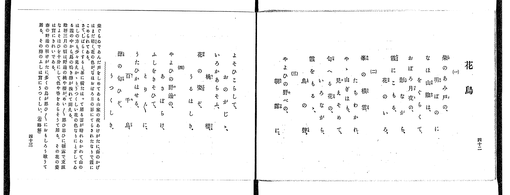
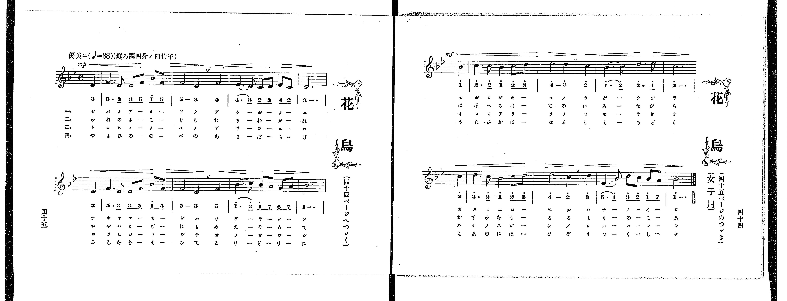

# 花鳥

> Re:Shōka 使用 AI 協助辨識與重建樂譜，可能會有錯誤。歡迎[回報](https://github.com/TMDLang/reshoka/issues)。

- **鋼琴伴奏版**：<br><audio controls src="hanatori.mp3"></audio>
- **NEUTRINO 歌聲合成版**：<br><audio controls src="hanatori_neutrino.mp3"></audio>

- 出處：共益商社樂器店《唱歌教科書 教師用 巻四》第四十二～四十五頁（女生徒專用曲第一曲）
- NDL Digital Collections PID 854865（https://dl.ndl.go.jp/pid/854865）掃描 P027.jpg、P028.jpg

## 說明

原書資訊與歌詞全文（NDL PID 854865《唱歌教科書 教師用 巻四》第四十二～四十五頁，掃描 P027.jpg–P028.jpg）：
調性與拍號：變ろ調四分ノ四拍子（B♭ 大調 4/4 拍），♩=88，「優美ニ」，弱起一拍
註記：女生徒專用曲（樂譜標註「女子用」），單聲部，四節分節歌。樂譜跨第四十五頁（P028_L）與第四十四頁（P028_R）。開頭標 mp，第三行弱起（第八小節第四拍）標 mf。第八小節（P028_L 第二行末小節）五線譜為 B♭4，簡譜「1 - .」漏印上點。原書第四十二～四十三頁未附演奏注意欄。
原典略解：「柴ぐらゐであんだ戸をしめてある山家の夜あけがたに、山のかげはまだ暗く、花の色がなほおぼろ月の影にてらされたなりで、霞にこめられてある。さて、しばらくすると、峯に橫たはって居る雲が晴れわかれて、山のはしの方も、少々見えかゝり、うつくしい花の色なりにとざしてゐる霞の中から、鳥の鳴き聲が洩れて聞える。陰曆三月の頃は、野邊の桃や櫻が、めい〲思ひ思ひに、朝露で、立派なよそほひを十分にして、色や香をあらそうて居る。その花の姿は實にきれいである。春の野邊の明けがたに、多くの鳥が思ひ〲におもしろう歌うて居る。その聲のふしは實にうつくしい。」


## 歌詞

```text
一、
柴のあみ戸の、明ぼのに
なほ山陰は、をぐらくて、
おぼろ月夜の、影ながら、
霞にこもる、花のいろ。

二、
峯の橫雲、たちわかれ、
やゝ山ぎはも、見えそめて、
匂へる花の、いろながら、
霞をもるゝ、鳥の聲。

三、
やよひの野べの、朝露に、
よそひこらして、おのがじゝ、
いろかあらそふ、桃櫻、
花の姿ぞ、うるはしき。

四、
やよひの野邊の、あさぼらけ、
ふしをきそひて、とり〲に、
うたひかはせる、百千鳥、
聲の匂ひぞ、うつくしき。
```

## ABC

<div class="abc-score" data-abc-src="hanatori.abc" aria-label="五線譜載入中"></div>

[下載 ABC 原始檔](hanatori.abc)

## TMD 檔案連結

- [主旋律 TMD 檔案](hanatori.tmd) [[在 TMD Studio 編輯](https://tmdlang.github.io/Tmd-TS/#tmd=s7IKdvYPcrWy4qpTUCpJTLdSSM7PyUlNLsnMz7PKrsxPzc6ML87Iz05Ugisoy88pzU21yk7MizeJtzA1sTAzRUgW55cWJadaFSdn5OfnxJekVpQk5edno8vHFySmp1oFGBiZI2QKivLLUvMS84C6C4oy80pSU8DaEQpSyzJTUkHSxclAq8tSizLTMlNTkNyVWlQMcjXUipKixLzi5KLMApBXEKrSU_OKUq2SMzJzUopS8-KL8_PSEZJp-UW5VsUlRfkFGZnJCOGSjFSgh_MSS0qLUtFFC3IS85AcCRFMzMvMTcxBFy1OTQRaV4wuXJKZmxqfnxafkliJkMovykzPzLPKTc3MysQSjPlFJRn56UWJBRmVVhmZxSVA5cmJOfHAOAFGlJaWwouujS83L1XQ0uJStFWwsOCyt1Vw0uGyMdE3sQOZ8bR914uZU9_vmfW0dePz2V1Pp7Y9X7Lv2YqmpzNXPN01_XFD19MpG5-t7Xk2debz5ROfzd6hAGQ93bH6-ZQVCk-37346e_bjhu7na9YAGU97G5_s6nm_dx6MPeXlgsb3ezqeLt38fMr8p_smPd3QAdT2bPYmoPonOxqAjPd7OsEe8XPxUXAB-rIkMUfBGZ7oihUCPF0UIMkKaE5GSUlBsZW-fkqOXh4Qp-frZRXoF2Sm6MNUdD7ra37W368ASkxAufTHDY1ApgWIqcTFpa-lYEstwKWgoPC0bz4wOF5sbn-xoutFRzswjF6snPe0dcWzae1Ax4J8hHA9FYKxB81zjxomwzwH9Dkw_kBuerFq_7OG5SDXdPe-mDkfKPpiXdfjpl6gOMi0jrbHzX1ABlD26doJQFc6PZq5VuHpkuVAeQVgglAASoAN63k0c6WthQWQ8bih52nLquf7-h43dz9uAMr2PN2z8cXW7aD46-4F27li94sVM0AJCCOegTYAU9KLtXOerZgJVAYya-lmoM1AWbBZIJueTlv3onHTy-YVIPbs2c_XNwCdCSSBgfW4oQmi_cX2FUhhA01WIN_H-wANAXoXLgskkWSDgLJAQ15O6365YC3QDQq5BUBbwKmv88VCqE-AikHaW1c_3dAPtBdiFCQgwFrSgCYgK4BbrQAyaFcP0KBnc-BynUD3Pd8-C-jo5027FEDhawKycsNCoAjQ_4YKugp6QL8_29P_tHfDkx1dL3fPA5oPSUvY439HJ9BHz-asejmz5dmeKU-X9j_bvOJZS_-zNS1AjdCE-LR1x_OpS18sXwyMBqAtz-Zvedw44XFT5-OmCY8blz9ubHrcNPlx44JnHTseN0163Dj9cVPj48ZlYPHupxs3Pl237XHjuqdL5oBEGic-bux53Dj_ceNqYAYCygKlHjd2P24Ealz_uHEfyJxZ0x839gNlgWULUPZF5yawllWPG3c_bux63LgHmOSezekAmbkXqGA1yC6gYxqnPm6CmLzqcRNQ2XKgCS_nzAMrmAxyEsjBQAVQhwG9B9IC5DYAXQu0cQPYkP7HjTNBso3ANNT4dDPQSaufrQSaADQWyF4MVP90YytQwcvZIFc9m7kFZGYTUFc31HCEp4DqgcauezZt5-OmJpD4homPG1pfLAMaDnQ8UP1ckDtBtrc9blwCthqovgXJ1xCPAG1f8bhxGlgW6FNgyHeD_bXuyY61YHOAqbARWAgDRV5uBkZNLzDFg9y2ZSXESS8agYo7IF5-OXPDs9ltwFiHBODLBc0gdwK1t_e9BNm17tnC5sdNLc9WA4MamEOAgQZ0HjApbHrWMPdxI5SExN2zOXNfzgGyQeH8fHX3sy3AuAM6GGgsUA1Q-yZgYgDlGWCxAPIC2PHAOAX6q6nl5TJgIANjHBgRwDAHqgeqgQYsOF6AIusg4fB0-X6gC5-uB8Ya0JBesI9aYKkOpPjZDLDH4e6f0YeexpbMAoctMHCAKnugXmgA-wKYnIBRA0qxvUA3gAoFrC4BeRkYoVvBvoA7BiXWQIoberlAOQZYeAGtBbHAOQWoEWjOflDuALKB4QZy4R6w-GqQIkjKBiYaYNxAIgMcNOAMBjIdFGoQdYi0D85MIMPAOQCoH5gGQakApA4pzUOCCJqPQI4EehOYq8GO3AWKXnAGByXydcBEDkrSoNQIDLeFiCQNtbwJqHkuOGUDXb8ekqBhSRmYjsEZHmpeD9C7wJKgG2otyEiwzVjcCfQoxJHAvABLw6DQhjlyB0wx2H6gVaCIAMb148ad0MCEJkJQREPUQdIfUAjof2AAQpMdOPCAQQCM4BkQyyBBCnEY0BvwlLgVZOrCZlAOgChCSofAwhScW0HlAyR3w8MTXMdicyokWYI1QgocYBQCbQIWBVAngFMVKMaBDoG4HOLgFeDSAdlvoBQHjBygEMT-2ZDofT5z39PeZlDgQR0MthocDUAGzM2ItAp2M1Ad5Q0VKFDQ0ufi8gC2CEGtQ6uw_MzkVIcag5pqkCUKNoZmWnZgVnVuQS2YAWwraUBqR01gaG1XqFF43DwBiPuAvEVAeg8QzwfTIJlOuAyQ17QRKj8HSgNloOq6gbgL5BSQFTUKBsC6EATRaeN4KKNGwRTGhIuDCbAwqCoFM9CUoRgBl6lRMMEwywhuIFgOzK1B6EWHCHeBPeBjWKMAE0GngbEItxdYbyEZAox3MNkE5-9HUrkSzUqIaggLpgOkbiKGuj0YOkDqVuPwCjCno_rFCJ9fkF24FtMvTR1w_mQklRPQ7WxC-Hk-krqFGOr64eq6EeqaenD5pakF1S_GePyCUIvkbohdm8AkIryRw3Enup044mUqhrolcJvbkNThjBe4m6B-MRlMfoGnsaZOJHXoaRGhfiuKX4BlyuPm2UC8BIjnQQqHptWwwqFpE5DVD8SbwLwN0MJjJVTdengh0gbkrUIUItQsIUDqYdAIqt8cJG0GIsAsVEXIsDo3rRYuiSghgA0H5DABxxmwEQ0PI6QU3jgJzUhgFQLXB5PDnrNg8QGsQJDULcPhVGBVi-pOYO5HpCbs7uxDMhfmKoRq7KUZcpqEyM6F62gkyp2wfILI2QgzICogKR1W7qCmTFgZjFANswkpBJDSP0IdrKwBtkWQ1MHYmO5EK4GAuRbVdkj8ASt2uA6YL0AqQX7A5c4VCHVNMDcj1MHqC4Qc_lIfXgYhciSoml4LxK1AQ0A0JJetgFbpq-F5E5Qbu4DsNWB5YL4EysFzISi3wCAs58DYxmBXmaC5BSQKUwFxN3rug6kAQZBuVFuQIdwMpFwHK6sgodML9v1SeDiA-NDQQik5IbKI8hB_7oTVoRAeKM2AzIOlQHSIZBoi16GWDo07wK6FqUPkNJBKZNvQ3YlcE8D8RjV3gnIdiqkQFUhtGJRch5w_Iaph9QCinACZCGMj1CHXOJCSDL874aGDlOtgLQuICkjpgD08Z6Obhwh3Au5EbrFA8iC23IlQAW8VwXNd005oAxrYJG7aDM91oKY1qEbsB_OAuQ2pAf24CVRvQtStReQ85FxCXM6D5RaYTrTKEWQASAqlAsRd7cEa7ch5byaK70E1AqJMQmkjYoYtldM-DKK13ME5D4sr4bUsagqAuQmbK_GXzwhXIvsaV4sJzZXg2g4170L6DjCXI-op9JQPkZ0HZyG1PTF9g2hloPRaeolzJSjXofgI5kpEjMPKOOx1HVZXwtvNCHWIXgFprqzl4tK1U4B1fhWAbGUuAA)]
- [鋼琴伴奏 TMD 檔案](hanatori_piano.tmd) [[在 TMD Studio 編輯](https://tmdlang.github.io/Tmd-TS/#tmd=s7IKdvYPcrWy4qpTUCpJTLdSyC8qychPL0osyKi0ysgsLskvykxOzInPTsxLVOLS0lJ40bXx5eal7_d0vOze83zClid7tjxd2v-8s-P9nk4FLS0uRVsFCwsue1sFJx0uGxN9EzuQwU_bd72YOfX9nllPWzc-n931dGrb8yX7nq1oejpzxdNd0x83dD2dsvHZ2p5nU2c-Xz7x2ewdCkDW0x2rn09ZofB0--6ns2c_buh-vmYNkPG0t_HJrp73e-fB2FNeLmgEOubp0s3Pp8x_um_S0w0dQG3PZm8Cqn-yowHIADpMCeQIPxcfBZfM9MySxBwF5_ycnNTkksz8vGKFAE8XBQtTEwszU6A5GSUlBcVW-vopOXp5QJyer5dVoF-QmaIPU9H5rK_5WX-_QoCBkTlQLv1xQyOQaQFiKnFxeQBDCRRiVgGZiXn5QR4ONQY11VwKQGBjaKZlB2ZV5xbUghn6WgoaT_dsfLF1u6bC46btCjUKj5snAHEfkLcISO8B4vlgGiTTCZcB8po2QuXnQGmgDFRdNxB3KWjpg62oUTBQ0AVDdNo4HsqoUTCFMeHiYAIsbAhjoClDMQIuU6NggmGWEdxAsByYW4PQiw4R7gJ7wMewRgEmgk4_bpwOt_dx4wYkQx43rgOTTXD-fiSVK9GshKiGsGA6QOomYqjbg6EDpG41Dq88blyF6hcjfH5BduFaTL80dcD5k5FUTkC3swnh5_lI6hZiqOuHq-tGqGvqweWXphZUvxjj8QtCLZK7IXZtApOI8EYOx53oduKIl6kY6pbAbW5DUoczXuBugvrFZDD5BZ7GmjqR1KGnRYT6rSh-AZYpj5tnA_ESIJ4HKRyaVsMKh6ZNQFY_EG8C8zZAC4-VUHXr4YVIG5C3ClGIULOEAKmHQSOofnOQtBmIALNQFSHD6ty0WrgkooR43LgbOUzAcfa4cR88jJBSeOMkNCMfN66H64PJYc9ZsPh43AjLOyB1y3A49XFjF6o7gbkfkZqwu7MPyVyYqxCqsZdmyGkSIjsXrqORKHfC8gkiZyPMgKiApHRYuYOaMmFlMEI1zCakEEBK_wh1sLLmceMMJHUwNqY70UogYK5FtR0Sf48be-E6YL4AqQT5AZc7VyDUNcHcjFAHqy8QcvhLfXgZhMiRoGp6LRC3Ag0B0ZBctgJapa-G501QbuwCsteA5YH5EigHz4Wg3AKDsJwDYxuDXWWC5haQKEwFxN3ouQ-mAgRBulFtQYZwM5ByHaysgoROL9j3S-HhAOJDQwul5ITIIspD_LkTVodCeKA0AzIPlgLRIZJpiFyHWjo07gC7FqYOkdNAKpFtQ3cnck0A8xvV3AnKdSimQlQgtWFQch1y_oSohtUDiHICZCKMjVCHXONASjL87oSHDlKug7UsICogpQP28JyNbh4i3Am4E7nFAsmD2HInQgW8VQTPdU07oQ1oYJO4aTM814Ga1qAasR_MA-Y2pAb04yZQvQlRtxaR85BzCXE5D5ZbYDrRKkeQASAplAoQd7UHa7Qj572ZKL4H1QiIMgmljYgZtlRO-zCI1nIH5zwsroTXsqgpAOYmbK7EXz4jXInsa1wtJjRXgms71LwL6TvAXI6op9BTPkR2HpyF1PbE9A2ilYHSa-klzpWgXIfiI5grETEOK-Ow13VYXQlvNyPUIXoFpLmyFr3v64Pc9zWBdn2BufJFX9fL9t6nrTtezm6FjB0gsplhvEK0YSyMqsEUwanONB7INo2PRTBwq6WFmbjVAju90SbI4siqoZIwtVhMIdlsqKPwuNkAEl26dgqwGIv2Acqg8I3Q-MZofKCtQL4yFwA)]

## 分析

```text
================================================================================
📊 TMD Song Profile: [ 花鳥 ]
================================================================================
⏱  Duration:       0:46 (46.4s), 17 measures total
🎼 Key & Tempo:    首調基準 B,, != 88.0 BPM, <4/4>
   - 分析範圍：      由實際發聲的音符與和弦推測調性；播放脈絡另行呈現
🎤 人聲音域:    C4 (MIDI 60) – D#5 (MIDI 75) [跨度: 15 個半音 / 1.2 個八度, 難度: moderate]
   - 最低音:  C4 in [Hanatori #1 @ m.4, 0:09]
   - 最高音: D#5 in [Hanatori #1 @ m.11, 0:27]
   - 適合: soprano, mezzo-soprano, contralto, tenor, baritone, bass
🏛  結構:      Hanatori (46.4s)
⚡ 編曲密度:        Peak 1 軌道同時演奏
🗝  調性診斷：       A# 大調（純淨自然大調，未偵測到可信轉調）
   - 風格氣質:    純淨自然大調（陽光明朗、易唱易記，無明顯調外色彩）
   - 轉調歷程:    全曲維持單一推測調性（未偵測到可信轉調）
   - 核心骨幹音:  D, A#, F, C, D#
   - 調性數值:    A# 大調 [相關度: 0.84, 穩定度: High, 自然音純度: 100.0%]
   - 候選調性 (K-S): A# 大調 (0.84), D 小調 (0.66), F 大調 (0.64)
   - 五度圈歷程:   -2
   - 各段落調性細節:
     • [Hanatori #1]: A# 大調 (r: 0.84, 自然音純度: 100.0%)

  [ 五度圈游移軌跡 ]
               C  
         F            G  
     [Bb]*              D  
      Eb               A  
         Ab           E  
            Db       B  
               F# 
     (* = active key center)

  [ 十二半音累積音高分佈 ]
     C  : █████████████████         18.7%
     C# :                            0.0%
     D  : ████████████████████████  25.8%
     D# : █████████                 10.2%
     E  :                            0.0%
     F  : ██████████████████        19.5%
     F# :                            0.0%
     G  : █                          0.8%
     G# :                            0.0%
     A  : ██                         2.3%
     A# : █████████████████████     22.7%
     B  :                            0.0%
--------------------------------------------------------------------------------
Assignment 軌道音域：
  - Voice         : C4 – D#5 (15 個半音 / 1.2 個八度, 64 個音符)
================================================================================
```


## 原書掃描頁






