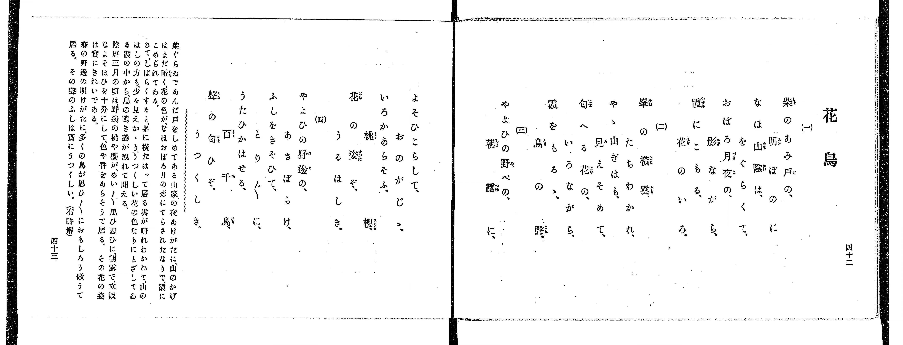
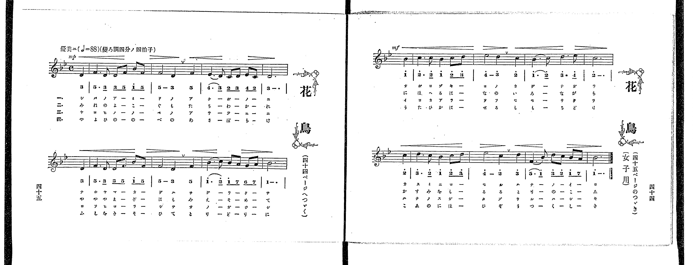

# 花鳥

<audio controls src="hanatori.mp3"></audio>

- 出處：共益商社樂器店《唱歌教科書 教師用 巻四》第四十二～四十五頁（女生徒專用曲第一曲）
- NDL Digital Collections PID 854865（https://dl.ndl.go.jp/pid/854865）掃描 P027.jpg、P028.jpg

## 說明

原書資訊與歌詞全文（NDL PID 854865《唱歌教科書 教師用 巻四》第四十二～四十五頁，掃描 P027.jpg–P028.jpg）：
調性與拍號：變ろ調四分ノ四拍子（B♭ 大調 4/4 拍），♩=88，「優美ニ」，弱起一拍
註記：女生徒專用曲（樂譜標註「女子用」），單聲部，四節分節歌。樂譜跨第四十五頁（P028_L）與第四十四頁（P028_R）。開頭標 mp，第三行弱起（第八小節第四拍）標 mf。第八小節（P028_L 第二行末小節）五線譜為 B♭4，簡譜「1 - .」漏印上點。原書第四十二～四十三頁未附演奏注意欄。
原典略解：「柴ぐらゐであんだ戸をしめてある山家の夜あけがたに、山のかげはまだ暗く、花の色がなほおぼろ月の影にてらされたなりで、霞にこめられてある。さて、しばらくすると、峯に橫たはって居る雲が晴れわかれて、山のはしの方も、少々見えかゝり、うつくしい花の色なりにとざしてゐる霞の中から、鳥の鳴き聲が洩れて聞える。陰曆三月の頃は、野邊の桃や櫻が、めい〲思ひ思ひに、朝露で、立派なよそほひを十分にして、色や香をあらそうて居る。その花の姿は實にきれいである。春の野邊の明けがたに、多くの鳥が思ひ〲におもしろう歌うて居る。その聲のふしは實にうつくしい。」

## 歌詞

```text
一、
柴のあみ戸の、明ぼのに
なほ山陰は、をぐらくて、
おぼろ月夜の、影ながら、
霞にこもる、花のいろ。

二、
峯の橫雲、たちわかれ、
やゝ山ぎはも、見えそめて、
匂へる花の、いろながら、
霞をもるゝ、鳥の聲。

三、
やよひの野べの、朝露に、
よそひこらして、おのがじゝ、
いろかあらそふ、桃櫻、
花の姿ぞ、うるはしき。

四、
やよひの野邊の、あさぼらけ、
ふしをきそひて、とり〲に、
うたひかはせる、百千鳥、
聲の匂ひぞ、うつくしき。
```

## ABC

```abc
X:1
T:花鳥
M:4/4
L:1/16
Q:1/4=88
K:Bb
V:V1 name="Voice" snm="Voi"
[V:V1]
!mp! z4 z4 z4 D4 | F6 D2 D2 F2 B2 F2 | F8 D4 F4 | E6 D2 C2 D2 E2 C2 |
D12 D4 | F6 D2 D2 F2 B2 F2 | F8 D4 F4 | B6 c2 B2 A2 G2 A2 |
!mf! B12 B4 | c6 c2 B4 c2 d2 | e8 d4 c4 | B6 c2 d6 e2 |
c12 c4 | d6 c2 B4 c2 d2 | e8 c4 d4 | F6 B2 d2 c2 B2 A2 |
B12 z4 | !mp! z4 z4 z4 D4 | F6 D2 D2 F2 B2 F2 | F8 D4 F4 |
E6 D2 C2 D2 E2 C2 | D12 D4 | F6 D2 D2 F2 B2 F2 | F8 D4 F4 |
B6 c2 B2 A2 G2 A2 | !mf! B12 B4 | c6 c2 B4 c2 d2 | e8 d4 c4 |
B6 c2 d6 e2 | c12 c4 | d6 c2 B4 c2 d2 | e8 c4 d4 |
F6 B2 d2 c2 B2 A2 | B12 z4 | !mp! z4 z4 z4 D4 | F6 D2 D2 F2 B2 F2 |
F8 D4 F4 | E6 D2 C2 D2 E2 C2 | D12 D4 | F6 D2 D2 F2 B2 F2 |
F8 D4 F4 | B6 c2 B2 A2 G2 A2 | !mf! B12 B4 | c6 c2 B4 c2 d2 |
e8 d4 c4 | B6 c2 d6 e2 | c12 c4 | d6 c2 B4 c2 d2 |
e8 c4 d4 | F6 B2 d2 c2 B2 A2 | B12 z4 | !mp! z4 z4 z4 D4 |
F6 D2 D2 F2 B2 F2 | F8 D4 F4 | E6 D2 C2 D2 E2 C2 | D12 D4 |
F6 D2 D2 F2 B2 F2 | F8 D4 F4 | B6 c2 B2 A2 G2 A2 | !mf! B12 B4 |
c6 c2 B4 c2 d2 | e8 d4 c4 | B6 c2 d6 e2 | c12 c4 |
d6 c2 B4 c2 d2 | e8 c4 d4 | F6 B2 d2 c2 B2 A2 | B12 z4 |
```

## TMD 檔案連結

- [主旋律 TMD 檔案](hanatori.tmd) [[在 TMD Studio 編輯](https://tmdlang.github.io/Tmd-TS/#tmd=s7IKdvYPcrWy4qpTUCpJTLdSSM7PyUlNLsnMz7PKrsxPzc6ML87Iz05Ugisoy88pzU21yk7MizeJtzA1sTAzRUgW55cWJadaFSdn5OfnxJekVpQk5edno8vHFySmp1oFGBiZI2QKivLLUvMS84C6C4oy80pSU8DaEQpSyzJTUkHSxclAq8tSizLTMlNTkNyVWlQMcjXUipKixLzi5KLMApBXEKrSU_OKUq2SMzJzUopS8-KL8_PSEZJp-UW5VsUlRfkFGZnJCOGSjFSgh_MSS0qLUtFFC3IS85AcCRFMzMvMTcxBFy1OTQRaV4wuXJKZmxqfnxafklipxKWlpfCia-PLzUsVtLS4FG0VLCy47G0VnHS4bEz0TexAOp-273oxc-r7PbOetm58Prvr6dS250v2PVvR9HTmiqe7pj9u6Ho6ZeOztT3Pps58vnzis9k7FICspztWP5-yQuHp9t1PZ89-3ND9fM0aIONpb-OTXT3v986Dsae8XND4fk_H06Wbn0-Z_3TfpKcbOoDans3eBFT_ZEcDkPF-TyfY-X4uPgoumemZJYk5Cs7wBFOsEODpogBJEkBzMkpKCoqt9PVTcvTygDg9Xy-rQL8gM0UfpqLzWV_zs_5-BVBCAMqlP25oBDItQEwlLi59LQVbagEuBQWFp33zgcHxYnP7ixVdLzragWH0YuW8p60rnk1rBzoW5COE66kQjD1onnvUMBnmOaDPgfEHctOLVfufNSwHuaa798XM-UDRF-u6Hjf1AsVBpnW0PW7uAzKAsk_XTgC60unRzLUKT5csB8orABOEAlACbFjPo5krbS0sgIzHDT1PW1Y939f3uLn7cQNQtufpno0vtm4HxV93L9jOFbtfrJgBSkAY8Qy0AZiSXqyd82zFTKAykFlLNwNtBsqCzQLZ9HTauheNm142rwCxZ89-vr4B6EwgCQysxw1NEO0vtq9AChtosgL5Pt4HaAjQu3BZIIkkGwSUBRryclr3ywVrgW5QyC0A2gJOfZ0vFkJ9AlQM0t66-umGfqC9EKMgAQHWkgY0AVkB3GoFkEG7eoAGPZsDl-sEuu_59llARz9v2qUACl8TkJUbFgJFgP43VNBV0AP6_dme_qe9G57s6Hq5ex7QfEhawh7_OzqBPno2Z9XLmS3P9kx5urT_2eYVz1r6n61pAWqEJsSnrTueT136YvliYDQAbXk2f8vjxgmPmzofN0143Lj8cWPT46bJjxsXPOvY8bhp0uPG6Y-bGh83LgOLdz_duPHpum2PG9c9XTIHJNI48XFjz-PG-Y8bVwMzEFAWKPW4sftxI1Dj-seN-0DmzJr-uLEfKAssW4CyLzo3gbWsety4-3Fj1-PGPcAk92xOB8jMvUAFq0F2AR3TOPVxE8TkVY-bgMqWA014OWceWMFkkJNADgYqgDoM6D2QFiC3AehaoI0bwIb0P26cCZJtBKahxqebgU5a_Wwl0ASgsUD2YqD6pxtbgQpezga56tnMLSAzm4C6uqGGIzwFVA80dt2zaTsfNzWBxDdMfNzQ-mIZ0HCg44Hq54LcCbK97XHjErDVQPUtSL6GeARo-4rHjdPAskCfAkO-G-yvdU92rAWbA0yFjcBCGCjycjMwanqBKR7kti0rIU560QhU3AHx8suZG57NbgPGOiQAXy5oBrkTqL297yXIrnXPFjY_bmp5thoY1MAcAgw0oPOASWHTs4a5jxuhJCTuns2Z-3IOkA0K5-eru59tAcYd0MFAY4FqgNo3ARMDKM8AiwWQF8COB8Yp0F9NLS-XAQMZGOPAiACGOVA9UA00YMHxAhRZBwmHp8v3A134dD0w1oCG9IJ91AJLdSDFz2aAPQ53_4w-9DS2ZBY4bIGBA1TZA_VCA9gXwOQEjBpQiu0FugFUKGB1CcjLwAjdCvYF3DEosQZS3NDLBcoxwMILaC2IBc4pQI1Ac_aDcgeQDQw3kAv3gMVXgxRBUjYw0QDjBhIZ4KABZzCQ6aBQg6hDpH1wZgIZBs4BQP3ANAhKBSB1SGkeEkTQfARyJNCbwFwNduQuUPSCMzgoka8DJnJQkgalRmC4LUQkaajlTUDNc8EpG-j69ZAEDUvKwHQMzvBQ83qA3gWWBN1Qa0FGgm3G4k6gRyGOBOYFWBoGhTbMkTtgisH2A60CRQQwrh837oQGJjQRgiIaog6S_oBCQP8DAxCa7MCBBwwCYATPgFgGCVKIw4DegKfErSBTFzaDcgBEEVI6BBam4NwKKh8guRsenuA6FptTIckSrBFS4ACjEGgTsCiAOgGcqkAxDnQIxOUQB68Alw7IfgOlOGDkAIUg9s-GRO_zmfue9jaDAg_qYLDV4GgAMmBuRqRVsJuB6ihvqECBgpY-F5dHIrDJmV-UaRWWn5mc6lBjUKNQDbJFwcbQTMsOzKrOLagFM4CNJQ1I9agJDK7tCjUKj5snAHEfkLcISO8B4vlgGiTTCZcB8po2QuXnQGmgDFRdNxB3gdwCsqJGwQBYGYIgOm0cD2XUKJjCmHBxMAEWBtWlYAaaMhQj4DI1CiYYZhnBDQTLgbk1CL3oEOEuWBg9bp4NxEuAeB7Es02rYZ5t2gRk9QPxJjBvAzQwVkLVrYcHShuQtwoRKNT0MUg9DBpB9ZuDpM1ABJiFqggZVuem1cIlkXwMita1QNwKdDeIhvhiBTQJrIb7HeTbLiB7DVge6G-gHNyXINeguwzGNgY7ywTdf0gqsPsOpgIEQbpRbUGGcDPgvmraCU3QwCTatBnuK1BSB8VoP5gH9A1Sgn7cBIp3iLq1CJ8hu4I4n8FcA9OJFrkgA0BSKBGIO9pgmaiGq5aLS9dOAZbrFYhkK3MBAA)]

## 分析

```text
================================================================================
📊 TMD Song Profile: [ 花鳥 ]
================================================================================
⏱  Duration:       3:05 (185.5s), 68 measures total
🎼 Key & Tempo:    首調基準 B,, != 88.0 BPM, <4/4>
   - 分析範圍：      由實際發聲的音符與和弦推測調性；播放脈絡另行呈現
🎤 人聲音域:    C4 (MIDI 60) – D#5 (MIDI 75) [跨度: 15 個半音 / 1.2 個八度, 難度: moderate]
   - 最低音:  C4 in [Hanatori #1 @ m.4, 0:09]
   - 最高音: D#5 in [Hanatori #1 @ m.11, 0:27]
   - 適合: soprano, mezzo-soprano, contralto, tenor, baritone, bass
🏛  結構:      Hanatori (46.4s) -> Hanatori (46.4s) -> Hanatori (46.4s) -> Hanatori (46.4s)
⚡ 編曲密度:        Peak 1 軌道同時演奏
🗝  調性診斷：       A# 大調（純淨自然大調，未偵測到可信轉調）
   - 風格氣質:    純淨自然大調（陽光明朗、易唱易記，無明顯調外色彩）
   - 轉調歷程:    全曲維持單一推測調性（未偵測到可信轉調）
   - 核心骨幹音:  D, A#, F, C, D#
   - 調性數值:    A# 大調 [相關度: 0.84, 穩定度: High, 自然音純度: 100.0%]
   - 候選調性 (K-S): A# 大調 (0.84), D 小調 (0.66), F 大調 (0.64)
   - 五度圈歷程:   -2 -> -2 -> -2 -> -2
   - 各段落調性細節:
     • [Hanatori #1]: A# 大調 (r: 0.84, 自然音純度: 100.0%)
     • [Hanatori #2]: A# 大調 (r: 0.84, 自然音純度: 100.0%)
     • [Hanatori #3]: A# 大調 (r: 0.84, 自然音純度: 100.0%)
     • [Hanatori #4]: A# 大調 (r: 0.84, 自然音純度: 100.0%)

  [ 五度圈游移軌跡 ]
               C  
         F            G  
     [Bb]*              D  
      Eb               A  
         Ab           E  
            Db       B  
               F# 
     (* = active key center)

  [ 十二半音累積音高分佈 ]
     C  : █████████████████         18.7%
     C# :                            0.0%
     D  : ████████████████████████  25.8%
     D# : █████████                 10.2%
     E  :                            0.0%
     F  : ██████████████████        19.5%
     F# :                            0.0%
     G  : █                          0.8%
     G# :                            0.0%
     A  : ██                         2.3%
     A# : █████████████████████     22.7%
     B  :                            0.0%
--------------------------------------------------------------------------------
Assignment 軌道音域：
  - Voice         : C4 – D#5 (15 個半音 / 1.2 個八度, 256 個音符)
================================================================================
```


## 原書掃描頁






