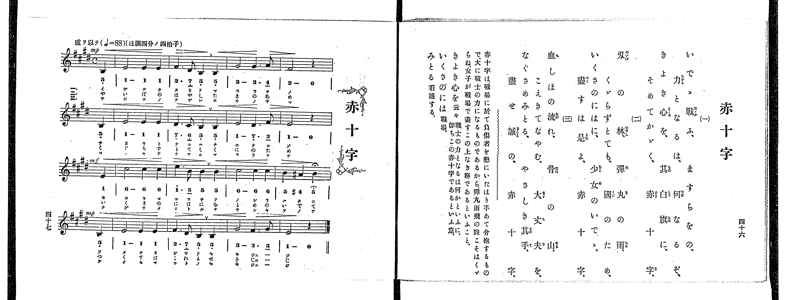

# 赤十字

> Re:Shōka 使用 AI 協助辨識與重建樂譜，可能會有錯誤。歡迎[回報](https://github.com/TMDLang/reshoka/issues)。

- **鋼琴伴奏版**：<br><audio controls src="sekijuji.mp3"></audio>
- **NEUTRINO 歌聲合成版**：<br><audio controls src="sekijuji_neutrino.mp3"></audio>

- 出處：共益商社樂器店《唱歌教科書 教師用 巻四》第四十六～四十七頁（女生徒專用曲第二曲）
- NDL Digital Collections PID 854865（https://dl.ndl.go.jp/pid/854865）掃描 P029.jpg

## 說明

原書資訊與歌詞全文（NDL PID 854865《唱歌教科書 教師用 巻四》第四十六～四十七頁，掃描 P029.jpg）：
調性與拍號：ほ調四分ノ四拍子（E 大調 4/4 拍），♩=88，「感ヲ以テ」，弱起一拍
註記：女生徒專用曲，單聲部，三節分節歌。開頭標 mp，第三行弱起（第八小節第四拍）標 mf，第十二小節第二拍為升 A 音（五線譜標 #、簡譜標 #4），第三拍 B4（5）標有延長記號（𝄐），第四拍弱起標 mp。原書第四十六頁未附演奏注意欄。
原典曲意：「赤十字は、戰場に於て負傷者を懇にいたはり手あて介抱するもので、大に戰士の力になるものであるから、彈丸雨飛の間こそはくゞらね、女子が戰場で盡すこの上なき務であるといふこと。」
原典語釋：「きよき心を云々」戰士の力となるは何かといふに、即ちこの赤十字であるといふ意；「いくさのには」戰場；「みとる」看護する。


## 歌詞

```text
一、
いでゝ戰ふ、ますらをの、
力となるは、何なるぞ、
きよき心を、其白旗に、
そめてかゞやく、赤十字。

二、
刄の林、彈丸の雨、
くゞらずとても、國のため、
いくさのにはに、少女のいでゝ、
盡すは是よ、赤十字。

三、
血しほの流れ、骨の山、
こえきてなやむ、大丈夫を、
なぐさめみとる、やさしき其手、
盡せ誠の、赤十字。
```

## ABC

<div class="abc-score" data-abc-src="sekijuji.abc" aria-label="五線譜載入中"></div>

[下載 ABC 原始檔](sekijuji.abc)

## TMD 檔案連結

- [主旋律 TMD 檔案](sekijuji.tmd) [[在 TMD Studio 編輯](https://tmdlang.github.io/Tmd-TS/#tmd=s7IKdvYPcrWy4qpTUCpJTLdSSM7PyUlNLsnMz7PKrsxPzc6ML87Iz05Ugisoy88pzU21yk7MizeJtzA1sTAzRUgW55cWJadaFSdn5OfnxJekVpQk5edno8vHFySmp1oFGBhZImQKivLLUvMS84C6C4oy80pSU8DaEQpSyzJTUkHSxclAq8tSizLTMlNTkNyVWlQMcjXUipKixLzi5KLMApBXEKrSU_OKUq2SMzJzUopS8-KL8_PSEZJp-UW5VsUlRfkFGZnJCOGSjFSgh3MzczJLEosq0cWT83NzS_MyS5Ak8osy0zPzrHJTM7MysQRCflFJRn56UWJBRqVVRmZxCVB5cmJOPDBEgcGspaXwYuuSp72NT9dOV9DS4lK0VbCw4LK3VXDlsjHRN7EDmfK0fdeLmVPf75n1tHXj89ldT6e2PV-y79mKpqczVzzdNf1xQ9fTKRufre15NnXm8-UTn83eoQBkPd2x-vmUFQpPt-9-Onv244bu52vWABkge1rXvt87D8J-sqP55YLG93s6ni7d_HzK_Kf7Jj3d0AHU9mz2JqD6J7t6gIz3ezrBXvFz8VFwAfqzJDFHwRmeaIoVAjxdFCDJAmhORklJQbGVvn5Kjl4eEKfn62UV6BdkpujDVHQ-62t-1t-vAEoMQDlgZHDpaynYUgtwKSgoPO2bDwyDF5vbX6zoetHRDgyYFyvnPW1d8WxaO9CFIG8gnEyFsOtB8xHQj8CYAjnkxar9zxqWg5zQ3fti5nyg6OPG3UBBkP6OtsfNfUAGUOrp2glAd7kqPF2yHCipAIx0BaAo2JieRzNX2lpYABmPG3qetcx_3Lzpye6lj5vbHjcAFfQ83bPxxdbtT3Y0ANWDLVyx-8WKGaB0ghGdINXT1r1o3PSyeQWQ_WRH5_P1DUBXAEmg7x83NL2c1v1ywdpnK2Yq5BYAFYCif0fni4VQO4AOBAVC6-qnG_qBWiABAnElWEsaRAsoWHb1wNWAElB37_OmXU972xUcFV7O3ww058muKc-3z3qxdg5Io_LjhsbnGxbCeCYQX0MsB2pVcAKKdICTzYqZz-Z0Pt297eXU7UA_goOz48PcFmDQQXVAAxPsXIg3gL6CpAXk-APG2bM5q17ObHm2Z8rTpf3PNq941tL_bE0LUDE08Txt3QEMMKAoKMIaeuC583HjeqBrn3VseLpgy-PG1c-m7XncuOzFpgVPm7a_aGh93DTpWXs7UPxxY8vjxvkgxU1dzzq7Hzc2AZU92d39rGvj48aZj5u6HzcBRdY9blwONA0Y5yCjgGYuBmpc97RrNtiEVSjKgCYAuY1AkU6Qlr0dT3bseDl7xcvFQMXrXk6b_LgRiOaCbGzsf9w0D6SscS1I5dLNwLT1uLEH5ublz2cvBLkBpH7dkx1dIIsae592A0XgtqwAu38rWM0KYKAAUxoiXF6smveyvRsSLkCdj5s6QPr3NwM9_2TXxMfAUGjoRfUM0DiwZxrXP9k7FeQHhAWrQU7s3fy4EegmkIOQAhrdNeDIAOZEoKVAbv_jRqBRwKAB2gKMErCNC7bAFOwH6QLqbeh9Pqf7xdrt0EAHRi_IH8DMArQWxAIbtfxx01ygdpB7GhofN-4DK-4EegdkPkQdmjeAomCfQLjz4IahBAbIZ63bns_c-2w60Dcgj0IUzX3cBLRlGTgugfEE9ktDI8LjMEfuAuZIiOUdQDXrns0DSkEjHhTls4ERAzURHuHAsgXoyGWgVANUOgfoNmAAzQfZh-Rd1JCDxMCGicB0AhaEhgdUAyytrH82A5iUO7C6cwcoQYJLnoUNjxuBXt0Ncu3WxsdNIA-8XAV00bqnGzfCnQCMZlAggYMAGIAtj5tAsQHMBE92dDxdshoSchClwJQJTLpTwQEGj1KgwUBHAr0AtKoXGMKg_IXk2tkvVi2ARByKU4HSlNcsUKCgpc_FFQxsJmWVZmVaheVnJqc61BjUVIMsUbCx0LIDM6pzC2rBDGDdpgEpkjQVHjctUahReNzcDsR7gbz9YB6ItRpITwXieSCRpp1A1kog3gSW7wPiRpCtIONqFAwUdOHYNB5I1CgYAkkQBNEgXKNgBOabx0NUQJUZQ5VBaBO4MmSzwJb4GNYogHgwDEwYYAOAqQOqARh_YHI-VBxEg_jdQLwVzNoHlZkJ09HUCaUngcXXQcUh5i9E2G2EZncTzG4QDbFlA5gEmQASXw81twXIno7iKpAbIDogtgHLFHD4NqLY3Y-w2xjd32B3Qc2FmLAbxe5VUNEeoKk9cHmQzFp0u4HuQ3YTxPzJcLuB6QSSDEAR3wGO-C4gBon0g9kgEWDwQkVB3tgHxGsRCQMzFQDjHyRghpoMYOqgskZIQqB0UJ2bVgvRD08LoHhFjkVgZkT1fxMo3kHxABEByayG-x-hBiQ-D8X_vQh7gPEOzPBo9syCmgayD5LqgMUbmAWONRR7YHE8H0scg9MQPI6BZRBcF8gFkNSM7B9gWmpqAMsQSMdAEtkesO_h8dm8AhxDj5s2wzJ6M5AHzNaPm_aCRRYCcRs43mEFwXqwHDxOzaCmg2gQBkZVHFjAFAhBJEgIUxFI3EQdqgBUFKHnbmBxjhYC4JQIpUG-64X6DVhlQWVgORaay8DhAMt_kDwHiQ2oDqRYBcUVROdUMAnLPZC4A5kA1Qm2ERHfIBFQPCJ0gOIRUgrBSqAlCLvAMQtPQRC7wPpB4vuhoqAoAaVmRLkCUofkL0iahPoCYjOmXeDYBRbMTdvBORYUe8BcCizQwXm0aTc4aYBifsfj5qVAwT1ggR34MiveIhsiaYyWVUEYOU5haR7mXpA_QT4BlUzQVA2OC2A9CZUB-RWiY8bjplYoByQxA8qGFYXYoxOUKSAJADnpgApDUPIi3xpwTCKsARmDyIlQa0AxCY0dMqyp5eLStVOAVeMKQLYyFwA)]
- [鋼琴伴奏 TMD 檔案](sekijuji_piano.tmd) [[在 TMD Studio 編輯](https://tmdlang.github.io/Tmd-TS/#tmd=s7IKdvYPcrWy4qpTUCpJTLdSyC8qychPL0osyKi0ysgsLskvykxOzInPTsxLVOLS0lJ4sXXJ097Gp2unv9_T8bJ7z_MJW57s2fJ0af_zzo73ezoVtLS4FG0VLCy47G0VXLlsTPRN7EBGP23f9WLm1Pd7Zj1t3fh8dtfTqW3Pl-x7tqLp6cwVT3dNf9zQ9XTKxmdre55Nnfl8-cRns3coAFlPd6x-PmWFwtPtu5_Onv24ofv5mjVABsjy1rXv986DsJ_saH65oBHolqdLNz-fMv_pvklPN3QAtT2bvQmo_smuHiAD6C4lkCP8XHwUXDLTM0sScxSc83NyUpNLMvPzihUCPF0ULExNLMxMgeZklJQUFFvp66fk6OUBcXq-XlaBfkFmij5MReezvuZn_f0KAQZGlkC5dCUuruDU7Mys0qxMq4DMxLz8IA-HGoOaai4FILCx0LIDM6pzC2rBDH0tBY2neza-2LpdU-Fx0xKFGoXHze1AvBfI2w_mgVirgfRUIJ4HEmnaCWStBOJNYPk-IG5U0NIHG1ejYKCgC8em8UCiRsEQSIIgiAbhGgUjMN88HqICqswYqgxCm8CVIZsFtsTHsEYBxIPhx40tYAMeNy6HanjcuAxMzoeKg2gQvxuIt4JZ-6AyM2E6mjqh9CSw-DqoOMT8hQi7jdDsboLZDaIhtmwAkyATQOLroea2ANnTUVwFcgNEB8S2x41N4PBtRLG7H2G3Mbq_we6CmgsxYTeK3augoj1AU3vg8iCZteh2A92H7CaI-ZPhdgPTCSQZgCK-AxzxXUAMEukHs0EiwOCFioK8sQ-I1yISBmYqAMY_SMAMNRnA1EFljZCEQOmgOjetFqIfnhZA8Yoci48bV6D6vwkU76B4gIiAZFbD_Y9QAxKfh-L_XoQ9wHh_3DgBzZ5ZUNNA9kFS3eOmJjALHGso9sDieD6WOAanIXgcP27sgOsCuQCSmpH9A0xLTQ1gGQLpGEgi2wP2PTw-m1eAY-hx02ZYRm8G8oDZ-nHTXrDIQiBuA8c7rCBYD5aDx6kZ1HQQDcLAqIoDC5gCIYgECWEqAombqEMVgIoi9Nz9uAk9BMApEUqDfNcL9dvjxrlQGViOheYycDjA8h8kz0FiA6oDKVZBcQXRORVMwnIPJO5AJkB1gm1ExDdIBBSPCB2geISUQrASaAnCLnDMwlMQxC6wfpD4fqgoKEpAqRlRroDUIfkLkiahvoDYjGkXOHaBBXPTdnCOBcUeMJcCC3RwHm3aDU4aoJjf8bh5KVBwD1hgB77MirfIhkgao2VVEEaOU1iah7kX5E-QT0AlEzRVg-PiceNsqAzIrxAdMx43tUI5IIkZUDasKMQenaBMAUkAyEkHVBiCkhf51oBjEmENyBhEToRaA4pJaOyQYU0tei3ug1yLm0BrcWA0v-jretne-7R1x8vZrZCWD1IkxitEG8bCqBpMEag603gg3zQem0oTIGVClEoizISLgRgGcKWYzoTaimY5seqgXEq8DZfCtBvkbmDs6NopwCIo2gcog8I3QuMbg_nKXAA)]

## 分析

```text
================================================================================
📊 TMD Song Profile: [ 赤十字 ]
================================================================================
⏱  Duration:       0:46 (46.4s), 17 measures total
🎼 Key & Tempo:    首調基準 E, != 88.0 BPM, <4/4>
   - 分析範圍：      由實際發聲的音符與和弦推測調性；播放脈絡另行呈現
🎤 人聲音域:    B3 (MIDI 59) – E5 (MIDI 76) [跨度: 17 個半音 / 1.4 個八度, 難度: challenging]
   - 最低音:  B3 in [Sekijuji #1 @ m.1, 0:02]
   - 最高音: E5 in [Sekijuji #1 @ m.11, 0:27]
   - 適合: soprano, mezzo-soprano, contralto, tenor, baritone, bass
🏛  結構:      Sekijuji (46.4s)
⚡ 編曲密度:        Peak 1 軌道同時演奏
🗝  調性診斷：       E 大調（純淨自然大調，未偵測到可信轉調）
   - 風格氣質:    純淨自然大調（陽光明朗、易唱易記，無明顯調外色彩）
   - 轉調歷程:    全曲維持單一推測調性（未偵測到可信轉調）
   - 核心骨幹音:  E, B, C#, F#, G#
   - 調性數值:    E 大調 [相關度: 0.91, 穩定度: High, 自然音純度: 98.4%]
   - 候選調性 (K-S): E 大調 (0.91), B 大調 (0.70), C# 小調 (0.63)
   - 五度圈歷程:   +4
   - 各段落調性細節:
     • [Sekijuji #1]: E 大調 (r: 0.91, 自然音純度: 98.4%, 調外音: A#)

  [ 五度圈游移軌跡 ]
               C  
         F            G  
      Bb               D  
      Eb               A  
         Ab          [E ]*
            Db       B  
               F# 
     (* = active key center)

  [ 十二半音累積音高分佈 ]
     C  :                            0.0%
     C# : ██████████                13.9%
     D  :                            0.0%
     D# : █████                      6.6%
     E  : ████████████████████████  33.6%
     F  :                            0.0%
     F# : ████████                  11.5%
     G  :                            0.0%
     G# : ███████                    9.8%
     A  : █                          0.8%
     A# : █                          1.6%
     B  : ████████████████          22.1%
--------------------------------------------------------------------------------
Assignment 軌道音域：
  - Voice         : B3 – E5 (17 個半音 / 1.4 個八度, 50 個音符)
================================================================================
```


## 原書掃描頁




