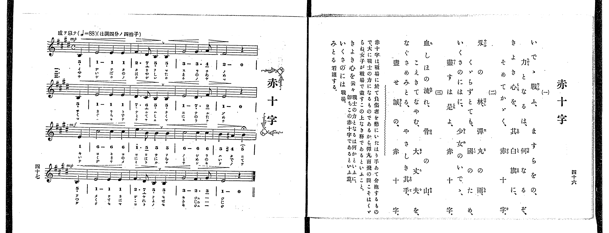

# 赤十字

> Re:Shōka 使用 AI 協助辨識與重建樂譜，可能會有錯誤。歡迎回報。

- **鋼琴伴奏版**：<br><audio controls src="sekijuji.mp3"></audio>
- **NEUTRINO 歌聲合成版**：<br><audio controls src="sekijuji_neutrino.mp3"></audio>

- 出處：共益商社樂器店《唱歌教科書 教師用 巻四》第四十六～四十七頁（女生徒專用曲第二曲）
- NDL Digital Collections PID 854865（https://dl.ndl.go.jp/pid/854865）掃描 P029.jpg

## 說明

原書資訊與歌詞全文（NDL PID 854865《唱歌教科書 教師用 巻四》第四十六～四十七頁，掃描 P029.jpg）：
調性與拍號：ほ調四分ノ四拍子（E 大調 4/4 拍），♩=88，「感ヲ以テ」，弱起一拍
註記：女生徒專用曲，單聲部，三節分節歌。開頭標 mp，第三行弱起（第八小節第四拍）標 mf，第十二小節第二拍為升 A 音（五線譜標 #、簡譜標 #4），第三拍 B4（5）標有延長記號（𝄐），第四拍弱起標 mp。原書第四十六頁未附演奏注意欄。
原典曲意：「赤十字は、戰場に於て負傷者を懇にいたはり手あて介抱するもので、大に戰士の力になるものであるから、彈丸雨飛の間こそはくゞらね、女子が戰場で盡すこの上なき務であるといふこと。」
原典語釋：「きよき心を云々」戰士の力となるは何かといふに、即ちこの赤十字であるといふ意；「いくさのには」戰場；「みとる」看護する。


## 歌詞

```text
一、
いでゝ戰ふ、ますらをの、
力となるは、何なるぞ、
きよき心を、其白旗に、
そめてかゞやく、赤十字。

二、
刄の林、彈丸の雨、
くゞらずとても、國のため、
いくさのにはに、少女のいでゝ、
盡すは是よ、赤十字。

三、
血しほの流れ、骨の山、
こえきてなやむ、大丈夫を、
なぐさめみとる、やさしき其手、
盡せ誠の、赤十字。
```

## ABC

<div class="abc-score" data-abc-src="sekijuji.abc" aria-label="五線譜載入中"></div>

[下載 ABC 原始檔](sekijuji.abc)

## TMD 檔案連結

- [主旋律 TMD 檔案](sekijuji.tmd) [[在 TMD Studio 編輯](https://tmdlang.github.io/Tmd-TS/#tmd=s7IKdvYPcrWy4qpTUCpJTLdSSM7PyUlNLsnMz7PKrsxPzc6ML87Iz05Ugisoy88pzU21yk7MizeJtzA1sTAzRUgW55cWJadaFSdn5OfnxJekVpQk5edno8vHFySmp1oFGBhZImQKivLLUvMS84C6C4oy80pSU8DaEQpSyzJTUkHSxclAq8tSizLTMlNTkNyVWlQMcjXUipKixLzi5KLMApBXEKrSU_OKUq2SMzJzUopS8-KL8_PSEZJp-UW5VsUlRfkFGZnJCOGSjFSgh3MzczJLEosq0cWT83NzS_MyS5Ak8osy0zPzrHJTM7MykQJBS0vhxdYlT3sbn66drqClxaVoq2BhwWVvq-DKZWOib2IH0v-0fdeLmVPf75n1tHXj89ldT6e2PV-y79mKpqczVzzdNf1xQ9fTKRufre15NnXm8-UTn83eoQBkPd2x-vmUFQpPt-9-Onv244bu52vWABkge1rXvt87D8J-sqP55YLG93s6ni7d_HzK_Kf7Jj3d0AHU9mz2JqD6J7t6gIz3ezrBnvBz8VFwAXqhJDFHwRmeHooVAjxdFCAxDjQno6SkoNhKXz8lRy8PiNPz9bIK9AsyU_RhKjqf9TU_6-9XAMUzUA4Yzlz6Wgq21AJcCgoKT_vmA8Pgxeb2Fyu6XnS0AwPmxcp5T1tXPJvWDnQhyBsIJ1Mh7HrQfAT0IzCmQA55sWr_s4blICd0976YOR8o-rhxN1AQpL-j7XFzH5ABlHq6dgLQXa4KT5csB0oqACNdASgKNqbn0cyVthYWQMbjhp5nLfMfN296snvp4-a2xw1ABT1P92x8sXX7kx0NQPVgC1fsfrFiBiidYEQnSPW0dS8aN71sXgFkP9nR-Xx9A9AVQBLo-8cNTS-ndb9csPbZipkKuQVABaDo39H5YiHUDqADQYHQuvrphn6gFkiAQFwJ1pIG0QIKll09cDWgBNTd-7xp19PedgVHhZfzNwPNebJryvPts16snQPSqPy4ofH5hoUwngnE1xDLgVoVnIAiHeBks2LmszmdT3dvezl1O9CP4ODs-DC3BRh0UB3QwAQ7F-INoK8gaQE5_oBx9mzOqpczW57tmfJ0af-zzSuetfQ_W9MCVAxNPE9bdwADDCgKirCGHnjufNy4HujaZx0bni7Y8rhx9bNpex43LnuxacHTpu0vGlofN0161t4OFH_c2PK4cT5IcVPXs87ux41NQGVPdnc_69r4uHHm46bux01AkXWPG5cDTQPGOcgooJmLgRrXPe2aDTZhFYoyoAlAbiNQpBOkZW_Hkx07Xs5e8XIxUPG6l9MmP24EorkgGxv7HzfNAylrXAtSuXQzMG09buyBuXn589kLQW4AqV_3ZEcXyKLG3qfdQBG4LSvA7t8KVrMCGCjAlIYIlxer5r1s74aEC1Dn46YOkP79zUDPP9k18TEwFBp6UT0DNA7smcb1T_ZOBfkBYcFqkBN7Nz9uBLoJ5CCkgEZ3DTgygDkRaCmQ2_-4EWgUMGiAtgCjBGzjgi0wBftBuoB6G3qfz-l-sXY7NNCB0QvyBzCzAK0FscBGLX_cNBeoHeSehsbHjfvAijuB3gGZD1GH5g2gKNgnEO48uGEogQHyWeu25zP3PpsO9A3IoxBFcx83AW1ZBo5LYDyB_dLQiPA4zJG7gDkSYnkHUM26Z_OAUtCIB0X5bGDEQE2ERziwbAE6chko1QCVzgG6DRhA80H2IXkXNeQgMbBhIjCdgAWh4QHVAEsr65_NACblDqzu3AFKkOCSZ2HD40agV3eDXLu18XETyAMvVwFdtO7pxo1wJwCjGRRI4CAABmDL4yZQbAAzwZMdHU-XrIaEHEQpMGUCk-5UcIDBoxRoMNCRQC8AreoFhjAofyG5dvaLVQsgEYfiVKA05TULFCho6XNxBQNbQFmlWZlWYfmZyakONQY11SBLFGwstOzAjOrcglowA1i3aUCKJE2Fx01LFGoUHje3A_FeIG8_mAdirQbSU4F4HkikaSeQtRKIN4Hl-4C4EWQryLgaBQMFXTg2jQcSNQqGQBIEQTQI1ygYgfnm8RAVUGXGUGUQ2gSuDNkssCU-hjUKIB4MAxMG2ABg6oBqAMYfmJwPFQfRIH43EG8Fs_ZBZWbCdDR1QulJYPF1UHGI-QsRdhuh2d0EsxtEQ2zZACZBJoDE10PNbQGyp6O4CuQGiA6IbcAyBRy-jSh29yPsNkb3N9hdUHMhJuxGsXsVVLQHaGoPXB4ksxbdbqD7kN0EMX8y3G5gOoEkA1DEd4AjvguIQSL9YDZIBBi8UFGQN_YB8VpEwsBMBcD4BwmYoSYDmDqorBGSECgdVOem1UL0w9MCKF6RYxGYGVH93wSKd1A8QERAMqvh_keoAYnPQ_F_L8IeYLwDMzyaPbOgpoHsg6Q6YPEGZoFjDcUeWBzPxxLH4DQEj2NgGQTXBXIBJDUj-weYlpoawDIE0jGQRLYH7Ht4fDavAMfQ46bNsIzeDOQBs_Xjpr1gkYVA3AaOd1hBsB4sB49TM6jpIBqEgVEVBxYwBUIQCRLCVAQSN1GHKgAVRei5G1ico4UAOCVCaZDveqF-A1ZZUBlYjoXmMnA4wPIfJM9BYgOqAylWQXEF0TkVTMJyDyTuQCZAdYJtRMQ3SAQUjwgdoHiElEKwEmgJwi5wzMJTEMQusH6Q-H6oKChKQKkZUa6A1CH5C5Imob6A2IxpFzh2gQVz03ZwjgXFHjCXAgt0cB5t2g1OGqCY3_G4eSlQcA9YYAe-zIq3yIZIGqNlVRBGjlNYmoe5F-RPkE9AJRM0VYPjAlhPQmVAfoXomPG4qRXKAUnMgLJhRSH26ARlCkgCQE46oMIQlLzItwYckwhrQMYgciLUGlBMQmOHDGtqubh07RRg1bgCkK3MBQA)]
- [鋼琴伴奏 TMD 檔案](sekijuji_piano.tmd) [[在 TMD Studio 編輯](https://tmdlang.github.io/Tmd-TS/#tmd=s7IKdvYPcrWy4tLSUnixdcnT3sana6e_39PxsnvP8wlbnuzZ8nRp__POjvd7OhW0tLgUbRUsLLjsbRVcuWxM9E3suOoUlJ6273oxc-r7PbOetm58Prvr6dS250v2PVvR9HTmiqe7pj9u6Ho6ZeOztT3Pps58vnzis9k7FICspztWP5-yQuHp9t1PZ89-3ND9fM0aIANkeeva93vnQdhPdjS_XNAIdMvTpZufT5n_dN-kpxs6gNqezd4EVP9kVw-QAXSXEsgRfi4-Ci6Z6ZkliTkKzvk5OanJJZn5ecUKAZ4uChamJhZmpkBzMkpKCoqt9PVTcvTygDg9Xy-rQL8gM0UfpqLzWV_zs_5-hQADI0ugXLoSF1dwanZmVmlWplVAZmJefpCHQ41BTTWXAhDYWGjZgRnVuQW1YIa-loLG0z0bX2zdrqnwuGmJQo3C4-Z2IN4L5O0H80Cs1UB6KhDPA4k07QSyVgLxJrB8HxA3Kmjpg42rUTBQ0IVj03ggUaNgCCRBEESDcI2CEZhvHg9RAVVmDFUGoU3gypDNAlviY1ijAOLB8OPGFrABjxuXQzU8blwGJudDxUE0iN8NxFvBrH1QmZkwHU2dUHoSWHwdVBxi_kKE3UZodjfB7AbREFs2gEmQCSDx9VBzW4Ds6SiuArkBogNi2-PGJnD4NqLY3Y-w2xjd32B3Qc2FmLAbxe5VUNEeoKk9cHmQzFp0u4HuQ3YTxPzJcLuB6QSSDEAR3wGO-C4gBon0g9kgEWDwQkVB3tgHxGsRCQMzFQDjHyRghpoMYOqgskZIQqB0UJ2bVgvRD08LoHhFjsXHjStQ_d8EindQPEBEQDKr4f5HqAGJz0Pxfy_CHmC8P26cgGbPLKhpIPsgqe5xUxOYBY41FHtgcTwfSxyD0xA8jh83dsB1gVwASc3I_gGmpaYGsAyBdAwkke0B-x4en80rwDH0uGkzLKM3A3nAbP24aS9YZCEQt4HjHVYQrAfLwePUDGo6iAZhYFTFgQVMgRBEgoQwFYHETdShCkBFEXruftyEHgLglAilQb7rhfrtceNcqAwsx0JzGTgcYPkPkucgsQHVgRSroLiC6JwKJmG5BxJ3IBOgOsE2IuIbJAKKR4QOUDxCSiFYCbQEYRc4ZuEpCGIXWD9IfD9UFBQloNSMKFdA6pD8BUmTUF9AbMa0Cxy7wIK5aTs4x4JiD5hLgQU6OI827QYnDVDM73jcvBQouAcssANfZsVbZEMkjdGyKggjxykszcPcC_InyCegkgmaqsFx8bhxNlQG5FeIjhmPm1qhHJDEDCgbVhRij05QpoAkAOSkAyoMQcmLfGvAMYmwBmQMIidCrQHFJDR2yLCmFr0W90GuxU2gtTgwml_0db1s733auuPl7FZIywcpEuMVog1jYVQNpghUnWk8kG8aj02lCZAyIUolEWbCxUAMA7hSTGdCbUWznFh1UC4l3oZLYdoNcjcwdnTtFGARFO0DlEHhG6HxjcF8ZS4A)]

## 分析

```text
================================================================================
📊 TMD Song Profile: [ 赤十字 ]
================================================================================
⏱  Duration:       0:46 (46.4s), 17 measures total
🎼 Key & Tempo:    首調基準 E, != 88.0 BPM, <4/4>
   - 分析範圍：      由實際發聲的音符與和弦推測調性；播放脈絡另行呈現
🎤 人聲音域:    B3 (MIDI 59) – E5 (MIDI 76) [跨度: 17 個半音 / 1.4 個八度, 難度: challenging]
   - 最低音:  B3 in [Sekijuji #1 @ m.1, 0:02]
   - 最高音: E5 in [Sekijuji #1 @ m.11, 0:27]
   - 適合: soprano, mezzo-soprano, contralto, tenor, baritone, bass
🏛  結構:      Sekijuji (46.4s)
⚡ 編曲密度:        Peak 1 軌道同時演奏
🗝  調性診斷：       E 大調（純淨自然大調，未偵測到可信轉調）
   - 風格氣質:    純淨自然大調（陽光明朗、易唱易記，無明顯調外色彩）
   - 轉調歷程:    全曲維持單一推測調性（未偵測到可信轉調）
   - 核心骨幹音:  E, B, C#, F#, G#
   - 調性數值:    E 大調 [相關度: 0.91, 穩定度: High, 自然音純度: 98.4%]
   - 候選調性 (K-S): E 大調 (0.91), B 大調 (0.70), C# 小調 (0.63)
   - 五度圈歷程:   +4
   - 各段落調性細節:
     • [Sekijuji #1]: E 大調 (r: 0.91, 自然音純度: 98.4%, 調外音: A#)

  [ 五度圈游移軌跡 ]
               C  
         F            G  
      Bb               D  
      Eb               A  
         Ab          [E ]*
            Db       B  
               F# 
     (* = active key center)

  [ 十二半音累積音高分佈 ]
     C  :                            0.0%
     C# : ██████████                13.9%
     D  :                            0.0%
     D# : █████                      6.6%
     E  : ████████████████████████  33.6%
     F  :                            0.0%
     F# : ████████                  11.5%
     G  :                            0.0%
     G# : ███████                    9.8%
     A  : █                          0.8%
     A# : █                          1.6%
     B  : ████████████████          22.1%
--------------------------------------------------------------------------------
Assignment 軌道音域：
  - Voice         : B3 – E5 (17 個半音 / 1.4 個八度, 50 個音符)
================================================================================
```


## 原書掃描頁




