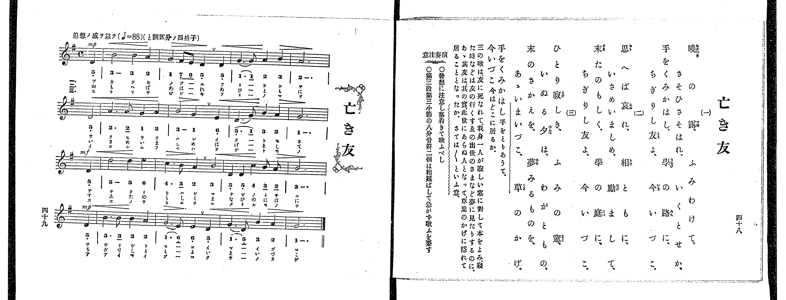

# 亡き友

> Re:Shoka 使用 AI 辨識樂譜，可能會有錯誤。歡迎回報。

<audio controls src="naki_tomo.mp3"></audio>

- 出處：共益商社樂器店《唱歌教科書 教師用 巻四》第四十八～四十九頁（女生徒專用曲第三曲）
- NDL Digital Collections PID 854865（https://dl.ndl.go.jp/pid/854865）掃描 P030.jpg

## 說明

原書資訊與歌詞全文（NDL PID 854865《唱歌教科書 教師用 巻四》第四十八～四十九頁，掃描 P030.jpg）：
調性與拍號：と調四分ノ四拍子（G 大調 4/4 拍），♩=88，「追想ノ感ヲ以テ」，弱起一拍
註記：女生徒專用曲，單聲部，三節分節歌。開頭標 mp，第三行弱起（第八小節第四拍）標 mf，第四行弱起（第十二小節第四拍）標 mp。
原典演奏注意：發想に注意し落着きて歌ふべし；第三段第三小節（第十一小節）の八分音符二個は稍延ばして急がず歌ふを要す。
原典曲意：「三の歌は、友に死なれて、我身一人が寂しい窓に對して本をよみ、寢た時などは友の行くすゑの出世のさまなど夢に見たりするのに、あゝ、其友は、其の實、此世にあらぬ人となって、草葉のかげに隱れて居ることとなったか。さては〳〵といふ意。」
原典語釋：「手をくみかはし」手をとりあうて；「今いづこ」今はどこに居るか。

## 歌詞

```text
一、
曉の露、ふみわけて、
さそひさそはれ、いくとせか、
手をくみかはし、學の路に、
ちぎりし友よ、今いづこ。

二、
思へば哀れ、相ともに、
いさめいましめ、勵まして、
末たのもし、學の庭に、
ちぎりし友よ、今いづこ。

三、
ひとり寂しき、ふみの窓、
いぬる夕は、わがともの、
末のさかえを、夢みるものを、
あゝいまいづこ、草のかげ。
```

## ABC

```abc
X:1
T:亡き友
M:4/4
L:1/16
Q:1/4=88
K:G
V:V1 name="Voice" snm="Voi"
[V:V1]
!mp! z4 z4 z4 D4 | B8 B4 A4 | G4 F2 E2 D4 D4 | G6 G2 A4 B4 |
A12 D4 | A6 A2 G4 A4 | B8 G4 E4 | D6 G2 B4 A4 |
!mf! G12 D4 | d8 d4 e4 | c6 B2 A4 B4 | D4 D4 c4 B2 A2 |
!mp! B12 D4 | B6 B2 B4 A4 | G6 E2 E4 D4 | G6 D2 B4 A4 |
G12 z4 | !mp! z4 z4 z4 D4 | B8 B4 A4 | G4 F2 E2 D4 D4 |
G6 G2 A4 B4 | A12 D4 | A6 A2 G4 A4 | B8 G4 E4 |
D6 G2 B4 A4 | !mf! G12 D4 | d8 d4 e4 | c6 B2 A4 B4 |
D4 D4 c4 B2 A2 | !mp! B12 D4 | B6 B2 B4 A4 | G6 E2 E4 D4 |
G6 D2 B4 A4 | G12 z4 | !mp! z4 z4 z4 D4 | B8 B4 A4 |
G4 F2 E2 D4 D4 | G6 G2 A4 B4 | A12 D4 | A6 A2 G4 A4 |
B8 G4 E4 | D6 G2 B4 A4 | !mf! G12 D4 | d8 d4 e4 |
c6 B2 A4 B4 | D4 D4 c4 B2 A2 | !mp! B12 D4 | B6 B2 B4 A4 |
G6 E2 E4 D4 | G6 D2 B4 A4 | G12 z4 |
```

## TMD 檔案連結

- [主旋律 TMD 檔案](naki_tomo.tmd) [[在 TMD Studio 編輯](https://tmdlang.github.io/Tmd-TS/#tmd=s7IKdvYPcrWy4qpTUCpJTLdSSM7PyUlNLsnMz7PKrsxPzc6ML87Iz05Ugisoy88pzU21yk7MizeJtzA1sTAzRUgW55cWJadaFSdn5OfnxJekVpQk5edno8vHFySmp1oFGBgbIGQKivLLUvMS84C6C4oy80pSU8DaEQpSyzJTUkHSxclAq8tSizLTMlNTkNyVWlQMcjXUipKixLzi5KLMApBXEKrSU_OKUq2SMzJzUopS8-KL8_PSEZJp-UW5VsUlRfkFGZnJCOGSjFSgh9OKMlPzUoozMgvQZaC-zclMS0WXSs3Nh9ivpaXwZNfCx429T_u7FbS0uBRtFSwsuOxtFdy5bEz0TexA-p6273oxc-r7PbOetm58Prvr6dS250v2PVvR9HTmiqe7pj9u6Ho6ZeOztT3Pps58vnzis9k7FICspztWP5-yQuHp9t1PZ89-3ND9fM0aIONpb-PT1tXv986DsJ_snPtyQeP7PR1Pl25-PmX-032Tnm7oAGp7NnsTUP2THZ1Axvs9nWDH-7n4KLhkpmeWJOYoOMPTQrFCgKeLAiS2geZklJQUFFvp66fk6OUBcXq-XlaBfkFmij5MReezvuZn_f0KoDgGygHDmEtfS8GWWoBLQUHhad98YBi82Nz-YkXXi452YMC8WDnvaeuKZ9PagS4EeQPhZCqEXQ-aj4B-BMYUyCEvVu1_1rAc5ITu3hcz5wNFHzeuAAqC9He0PW7uAzKAUk_XTgC6y13h6ZLlQEkFYKQrAEXBxvQ8mrnS1sICyHjc0PNi_95nzZuB2p61zH_cvOnJ7qWPm9seNwBV9jzds_HF1u1PdjQANYJtXrH7xYoZoASDEa8g1dPWvWjc9LJ5BZANjOPn6xuAzgGSwGB43ND0clr3ywVrn62YqZBbAFQASQcvFkLtALoUFBqtq59u6AdqgYQMxLlgLWkQLUBBdC3AENvVg0NXAdBeaNQ9bd3xbM-Up0v7n21e8aylH-iH5zP3gPzduBoi8rhx-osJe5_PbQDmmceNy0CObtz6uHEnUPz9ntnQZLtuK4QBsQ_hgh0NMJHOx43rQN7oaHs5f_PzNctAjmvofty4_vmK3qe7tz1u3AA0EGR-w9LHjUArZkEtapr0Ylnj48aZqC6evQniVmA0AW0FGg1Wvf5xQyMwW4Ocvnb348ZVj5uAgsuAgs86Jr7YtRromie7dgFNf7q-CWxZy_NVk4GKn24Aegxs95w1QPseN3U8btwPMmr9oseN85_NBCpe9bhxJdB8sOHrgCH9uBEYLjMfN00E-ap915Md04CMx41THzfugyh-ugSod_WLZUD18x83dYEVg_QCBYEmP25setw0F2RF6zawmWCXtwJDYd3T9WAHr10CNnM1WCXQg2vALl8BNnwxxFMvejtfTAT5_XEj0IRJQMUvZ22EePnpxlawdUDfAbXAdc0HqWwAegfozmVgSzc_bgDGJVBBCzCsQZENlG0AJ2lIQL9YNe9lezckoJ91doNCB-Tz_WAr14NCraEXJr4C7E-g6W1A04FJAxQ3u4EiQKOBUToZqBLMBeoCBiU43KGuBLmJC2QnMIKA_gKxns0GeezlnE3gwAI6cf_jJqC9wOAG-RykAuyJuY8bN8EY60FeB6kG2gdUCvTTbLDREPOwu73x6dodoAjdDuSC4gViMLB26AP7ZTooboCpoaER1SNQ1-4C2Qc2vQFoP9CgDU8nN0Bc8Xw2kAsMEGBoIMwF6p_6uAniQmAymQ5iA53QDfQemAv327M5wHgHRtY6sAEIdz7dtZYcdwIzCEwLMLRA0QTLAL2I4G1cB8oMSE4FZoXup0uAYQtKm-DQB6YsiJfWIbsTkuyBQdoBCmGgU0EpHxhdQBeBlYIFIaaCEz3U93BHgtIxIhFDcjnlFRMUKGjpc3H5JWZnhuTn5luF5WcmpzrUGNQoVINsUbCx0LIDM6pzC2rBDGDdqAEpRTUVHjctUqgBkqsVHje3AOm1IF5zH4TXvAeIlwHxVLDofKjIeqC6jWCRNiBrK8h6kLE1CgYKunBsGg8kahSMgSQIgmgjsIghkDSPVzCLhyiBqgOJ6gJJkBqQ2howCwYhimCOf9y0F2j3JLDdIDbIJf1AvAbIWwL2DdCFYJd2ANm74f5rQ7gUYrgR2FqIs2AOBYkA3QYSAtsKEkF1PAxW56bVoruseRPU9vlwW4Eua9oOpOeB3dkFxJOhIQwKz0awaDeYBXedKczbILeA7TWBBiIieBCBB5IDySD8AHFdAYbrmtYB7VkFdU8H2OZF0JBaAQs7oDvBIkDe4-ZWsC82I1wGscEYI0SAIQYONJTYBHKwhxwofdRw1XJx6dopwNKtAh62MhcA)]

## 分析

```text
================================================================================
📊 TMD Song Profile: [ 亡き友 ]
================================================================================
⏱  Duration:       2:19 (139.1s), 51 measures total
🎼 Key & Tempo:    首調基準 G, != 88.0 BPM, <4/4>
   - 分析範圍：      由實際發聲的音符與和弦推測調性；播放脈絡另行呈現
🎤 人聲音域:    D4 (MIDI 62) – E5 (MIDI 76) [跨度: 14 個半音 / 1.2 個八度, 難度: moderate]
   - 最低音:  D4 in [NakiTomo #1 @ m.1, 0:02]
   - 最高音: E5 in [NakiTomo #1 @ m.10, 0:26]
   - 適合: soprano, mezzo-soprano, contralto, tenor, baritone, bass
🏛  結構:      NakiTomo (46.4s) -> NakiTomo (46.4s) -> NakiTomo (46.4s)
⚡ 編曲密度:        Peak 1 軌道同時演奏
🗝  調性診斷：       G 大調（純淨自然大調，未偵測到可信轉調）
   - 風格氣質:    純淨自然大調（陽光明朗、易唱易記，無明顯調外色彩）
   - 轉調歷程:    全曲維持單一推測調性（未偵測到可信轉調）
   - 核心骨幹音:  B, G, D, A, E
   - 調性數值:    G 大調 [相關度: 0.84, 穩定度: Moderate, 自然音純度: 100.0%]
   - 候選調性 (K-S): G 大調 (0.84), D 大調 (0.72), B 小調 (0.69)
   - 五度圈歷程:   +1 -> +1 -> +1
   - 各段落調性細節:
     • [NakiTomo #1]: G 大調 (r: 0.84, 自然音純度: 100.0%)
     • [NakiTomo #2]: G 大調 (r: 0.84, 自然音純度: 100.0%)
     • [NakiTomo #3]: G 大調 (r: 0.84, 自然音純度: 100.0%)

  [ 五度圈游移軌跡 ]
               C  
         F           [G ]*
      Bb               D  
      Eb               A  
         Ab           E  
            Db       B  
               F# 
     (* = active key center)

  [ 十二半音累積音高分佈 ]
     C  : ████                       3.9%
     C# :                            0.0%
     D  : █████████████████████     21.9%
     D# :                            0.0%
     E  : ██████                     6.2%
     F  :                            0.0%
     F# : █                          0.8%
     G  : ██████████████████████    22.7%
     G# :                            0.0%
     A  : ███████████████████       19.5%
     A# :                            0.0%
     B  : ████████████████████████  25.0%
--------------------------------------------------------------------------------
Assignment 軌道音域：
  - Voice         : D4 – E5 (14 個半音 / 1.2 個八度, 165 個音符)
================================================================================
```


## 原書掃描頁




