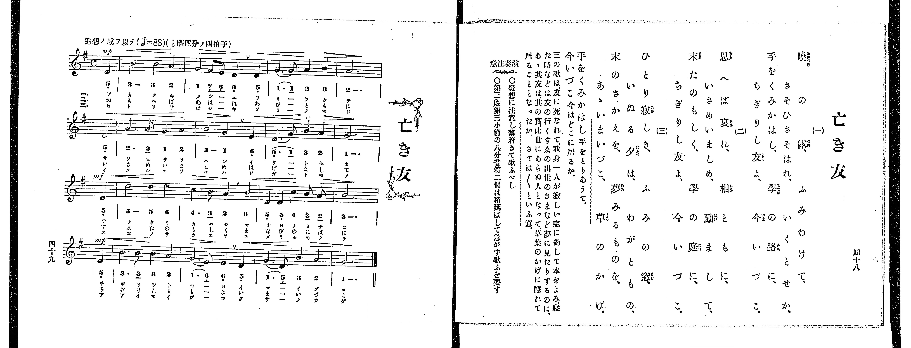

# 亡き友

> Re:Shōka 使用 AI 協助辨識與重建樂譜，可能會有錯誤。歡迎回報。

- **鋼琴伴奏版**：<br><audio controls src="naki_tomo.mp3"></audio>
- **NEUTRINO 歌聲合成版**：<br><audio controls src="naki_tomo_neutrino.mp3"></audio>

- 出處：共益商社樂器店《唱歌教科書 教師用 巻四》第四十八～四十九頁（女生徒專用曲第三曲）
- NDL Digital Collections PID 854865（https://dl.ndl.go.jp/pid/854865）掃描 P030.jpg

## 說明

原書資訊與歌詞全文（NDL PID 854865《唱歌教科書 教師用 巻四》第四十八～四十九頁，掃描 P030.jpg）：
調性與拍號：と調四分ノ四拍子（G 大調 4/4 拍），♩=88，「追想ノ感ヲ以テ」，弱起一拍
註記：女生徒專用曲，單聲部，三節分節歌。開頭標 mp，第三行弱起（第八小節第四拍）標 mf，第四行弱起（第十二小節第四拍）標 mp。
原典演奏注意：發想に注意し落着きて歌ふべし；第三段第三小節（第十一小節）の八分音符二個は稍延ばして急がず歌ふを要す。
原典曲意：「三の歌は、友に死なれて、我身一人が寂しい窓に對して本をよみ、寢た時などは友の行くすゑの出世のさまなど夢に見たりするのに、あゝ、其友は、其の實、此世にあらぬ人となって、草葉のかげに隱れて居ることとなったか。さては〳〵といふ意。」
原典語釋：「手をくみかはし」手をとりあうて；「今いづこ」今はどこに居るか。


## 歌詞

```text
一、
曉の露、ふみわけて、
さそひさそはれ、いくとせか、
手をくみかはし、學の路に、
ちぎりし友よ、今いづこ。

二、
思へば哀れ、相ともに、
いさめいましめ、勵まして、
末たのもし、學の庭に、
ちぎりし友よ、今いづこ。

三、
ひとり寂しき、ふみの窓、
いぬる夕は、わがともの、
末のさかえを、夢みるものを、
あゝいまいづこ、草のかげ。
```

## ABC

<div class="abc-score" data-abc-src="naki_tomo.abc" aria-label="五線譜載入中"></div>

[下載 ABC 原始檔](naki_tomo.abc)

## TMD 檔案連結

- [主旋律 TMD 檔案](naki_tomo.tmd) [[在 TMD Studio 編輯](https://tmdlang.github.io/Tmd-TS/#tmd=s7IKdvYPcrWy4qpTUCpJTLdSSM7PyUlNLsnMz7PKrsxPzc6ML87Iz05Ugisoy88pzU21yk7MizeJtzA1sTAzRUgW55cWJadaFSdn5OfnxJekVpQk5edno8vHFySmp1oFGBgbIGQKivLLUvMS84C6C4oy80pSU8DaEQpSyzJTUkHSxclAq8tSizLTMlNTkNyVWlQMcjXUipKixLzi5KLMApBXEKrSU_OKUq2SMzJzUopS8-KL8_PSEZJp-UW5VsUlRfkFGZnJCOGSjFSgh9OKMlPzUoozMgvQZaC-zclMS0WXSs3NR7U_vygzPTPPKjc1MysTS_jkF5Vk5KcXJRZkVFplZBaXAJUnJ-bEAwMbGANaWgpPdi183Nj7tL9bQUuLS9FWwcKCy95WwZ3LxkTfxA5kytP2XS9mTn2_Z9bT1o3PZ3c9ndr2fMm-Zyuans5c8XTX9McNXU-nbHy2tufZ1JnPl098NnuHApD1dMfq51NWKDzdvvvp7NmPG7qfr1kDZDztbXzauvr93nkQ9pOdc18uaHy_p-Pp0s3Pp8x_um_S0w0dQG3PZm8Cqn-yoxPIeL-nE-wVPxcfBRegP0sScxSc4empWCHA00UBkmKA5mSUlBQUW-nrp-To5QFxer5eVoF-QWaKPkxF57O-5mf9_QqgdAKUA8YTl76Wgi21AJeCgsLTvvnAMHixuf3Fiq4XHe3AgHmxct7T1hXPprUDXQjyBsLJVAi7HjQfAf0IjCmQQ16s2v-sYTnICd29L2bOB4o-blwBFATp72h73NwHZAClnq6dAHSXu8LTJcuBkgrASFcAioKN6Xk0c6WthQWQ8bih58X-vc-aNwO1PWuZ_7h505PdSx83tz1uAKrsebpn44ut25_saABqBNu8YveLFTNACQYjXkGqp6170bjpZfMKIBsYx8_XNwCdAySBwfC4oenltO6XC9Y-WzFTIbcAqACSDl4shNoBdCkoNFpXP93QD9QCCRmIc8Fa0iBagILoWoAhtqsHh64CoL3QqHvauuPZnilPl_Y_27ziWUs_0A_PZ-4B-btxNUTkceP0FxP2Pp_bAMwzjxuXgRzduPVx406g-Ps9s6HJdt1WCANiH8IFOxpgIp2PG9eBvNHR9nL-5udrloEc19D9uHH98xW9T3dve9y4AWggyPyGpY8bgVbMglrUNOnFssbHjTNRXTx7E8StwGgC2go0Gqx6_eOGRmC2Bjl97e7HjaseNwEFlwEFn3VMfLFrNdA1T3btApr-dH0T2LKW56smAxU_3QD0GNjuOWuA9j1u6njcuB9k1PpFjxvnP5sJVLzqceNKoPlgw9cBQ_pxIzBcZj5umgjyVfuuJzumARmPG6c-btwHUfx0CVDv6hfLgOrnP27qAisG6QUKAk1-3Nj0uGkuyIrWbWAzwS5vBYbCuqfrwQ5euwRs5mqwSqAH14BdvgJs-GKIp170dr6YCPL740agCZOAil_O2gjx8tONrWDrgL4DaoHrmg9S2QD0DtCdy8CWbn7cAIxLoIIWYFiDIhso2wBO0pCAfrFq3sv2bkhAP-vsBoUOyOf7wVauB4VaQy9MfAXYn0DT24CmA5MGKG52A0WARgOjdDJQJZgL1AUMSnC4Q10JchMXyE5gBAH9BWI9mw3y2Ms5m8CBBXTi_sdNQHuBwQ3yOUgF2BNzHzdugjHWg7wOUg20D6gU6KfZYKMh5mF3e-PTtTtAEbodyAXFC8RgYO3QB_bLdFDcAFNDQyOqR6Cu3QWyD2x6A9B-oEEbnk5ugLji-WwgFxggwNBAmAvUP_VxE8SFwGQyHcQGOqEb6D0wF-63Z3OA8Q6MrHVgAxDufLprLTnuBGYQmBZgaIGiCZYBehHB27gOlBmQnArMCt1PlwDDFpQ2waEPTFkQL61Ddick2QODtAMUwkCnglI-MLqALgIrBQtCTAUneqjv4Y4EpWNEIobkcsorJihQ0NLn4vJLzM4Myc_NtwrLz0xOdagxqKkGWaJgY6FlB2ZU5xbUghnAqlEDUohqKjxuWqRQAyRXKzxubgHSa0G85j4Ir3kPEC8D4qlg0flQkfVAdRvBIm1A1laQ7SBjaxQMFHTh2DQeSNQoGANJEATRRmARQyBpHq9gFg9RAlUHEtUFkiA1ILU1YBYMQhSBbfExrFEA8WAYGN5g5cCQhSp-3LgETPZCxdchxJrawOytUJn9MB1N_WDxiVDxZUhWA-MdYbcRut1dEB1NIDdAVO8AkxugJoHEgWkLbEcPims3wXWsAMvCxFej2N2CsNsY3W6QCSAdIP0QX4BcA3UvkN4M5k2HhwUWf0PDZh9UfCUOu4EJ5nHTXmB8TwLHN4gNiv1-IF4D5C0BBwEwVYBTRweQvRueptoQqQMSoUbgqIYkBVjiAIkA0wNICBzTIBHUBAOD1blpteipAVguQl28Cep7iAhIBhTykLCBhD7YT0AaFN9Iod84GyoOS0MQOVA6QMQ8xGyQWY1QkxAhBwplmBwsxkHik-BmgVRC1GGmsJkIe4CxDCyUoGZ1Y6TYnXA9kDQF8gdIHOQ7bKkJFL_Y7AHFaDMwuMCxNh8eW8AYbdoOpOeB47cLiCdDSwNQ3m8EiwIdBWTBY9UUajqINgPbagLmGyNlZURGB8mBZBBxD4nVAsxYbUKEHSR3glItIo5AIQBL3bBYWAXmQdI9JGXvB-KFWPLVQoRdoJhtAuV8iMx8uG5EvgbZA3MFbruAAQh0E167QLGLZBdEHyy_wvwFykAgv0PiHqQDkqZA_gelCUj8gnQjhxJELzjeEXl2HTCuVkHjtAMce4uguXQFLN8C4xosAuQ9bm4FG7kZEbuQWDLGyI3A3ArOsCilN5CDPdeC6gPk_NoHcS2wvILFICjVopSjTR1gcVh-BYU6xIeQfLcUKj4ZyRak9APOrTS3BZxXYSkEWF1C8zjMNJBuiBxIPyT9IEoRRPyDYhS5rEDYUsvFpWunAKvYFYBsZS4A)]
- [鋼琴伴奏 TMD 檔案](naki_tomo_piano.tmd) [[在 TMD Studio 編輯](https://tmdlang.github.io/Tmd-TS/#tmd=s7IKdvYPcrWy4qpTUCpJTLdSyC8qychPL0osyKi0ysgsLskvykxOzInPTsxLVOLS0lJ4smvh48bep_3d7_d0vOze83zClid7tjxd2v-8s-P9nk4FLS0uRVsFCwsue1sFdy4bE30TO5DRT9t3vZg59f2eWU9bNz6f3fV0atvzJfuerWh6OnPF013THzd0PZ2y8dnanmdTZz5fPvHZ7B0KQNbTHaufT1mh8HT77qezZz9u6H6-Zg2Q8bS38Wnr6vd750HYT3bOfbmgEeiWp0s3P58y_-m-SU83dAC1PZu9Caj-yY5OIAPoLiWQI_xcfBRcMtMzSxJzFJzzc3JSk0sy8_OKFQI8XRQsTE0szEyB5mSUlBQUW-nrp-To5QFxer5eVoF-QWaKPkxF57O-5mf9_QoBBsYGQLl0JS4uv8TszJD83HyrgMzEvPwgD4cag5pqLgUgsLHQsgMzqnMLasEMfS0Fjad7Nr7Yul1T4XHTIoUaILla4XFzC5BeC-I190F4zXuAeBkQTwWLzoeKrAeq2wgWaQOytipo6YONrVEwUNCFY9N4IFGjYAwkQRBEG4FFDIGkebyCWTxECVQdSFQXSILUgNTWgFkwCFEEtsXHsEYBxIPhx41NYOWPG7uhih83LgGTvVDxdQixpjYweytUZj9MR1M_WHwiVHwZktWPG6ci7DZCt7sLoqMJ5AaI6h1gcgPUJJD448b1YDt6UFy7Ca5jBVgWJr4axe4WhN3G6HaDTADpAOmH-ALkGqh7gfRmMG86PCyw-BsaNvug4itx2A1MMI-b9gLjexI4vkFsUOz3A_EaIG8JOAiAqQKcOjqA7N3wNNWGSB2QCDUCRzUkKcASB0gEmB5AQuCYBomgJhgYrM5Nq0VPDY8b50JdvAnqe4gISAYU8pCwgYQ-2E9AGhTfSKHfOBsqDktDEDlQOkDEPMRskFmNUJMQIQcKZZgcLMZB4pPgZoFUQtRhprCZCHuAsfy4cQ3UrG6MFLsTrgeSpkD-AImDfIctNYHiF5s9oBhtBgYXONbmw2MLGKNN24H0PHD8dgHxZGhpAMr7jWBRoKOALHismkJNB9FmYFtNwHxjpKyMyOggOZAMIu4hsVqAGatNiLCD5E5QqkXEESgEYKkbFgurwDxIuoek7P1AvBBLvlqIsAsUs02gnA-RmQ_XjcjXIHtgrsBtFzAAgW7CaxcodpHsguiD5VeYv0AZCOR3SNyDdEDSFMj_oDQBiV-QbuRQgugFxzsiz64DxtUqaJx2gGNvETSXroDlW2Bcg0WAvMfNrWAjNyNiFxJLxhi5EZhbwRkWpfQGcrDnWlB9gJxf-yCuBZZXsBgEpVqUcrSpAywOy6-gUIf4EJLvlkLFJyPZgpR-wLmV5raA8yoshQCrS2geh5kG0g2RA-mHpB9EKYKIf1CMIpcVCFtq0et1H-R63QRarwNj-kVf18v23qetO17OboW0hRBRaBivEG0YC6NqECKm8UDaNB4oBsvKMAETIG1CpFokc-FiGKqhiogwF6drYXqh6qBchH5yzMRQCTWVJHcaQCJK104BFlfRPkAZFL4RGt8YzFfmAgA)]

## 分析

```text
================================================================================
📊 TMD Song Profile: [ 亡き友 ]
================================================================================
⏱  Duration:       0:46 (46.4s), 17 measures total
🎼 Key & Tempo:    首調基準 G, != 88.0 BPM, <4/4>
   - 分析範圍：      由實際發聲的音符與和弦推測調性；播放脈絡另行呈現
🎤 人聲音域:    D4 (MIDI 62) – E5 (MIDI 76) [跨度: 14 個半音 / 1.2 個八度, 難度: moderate]
   - 最低音:  D4 in [NakiTomo #1 @ m.1, 0:02]
   - 最高音: E5 in [NakiTomo #1 @ m.10, 0:26]
   - 適合: soprano, mezzo-soprano, contralto, tenor, baritone, bass
🏛  結構:      NakiTomo (46.4s)
⚡ 編曲密度:        Peak 1 軌道同時演奏
🗝  調性診斷：       G 大調（純淨自然大調，未偵測到可信轉調）
   - 風格氣質:    純淨自然大調（陽光明朗、易唱易記，無明顯調外色彩）
   - 轉調歷程:    全曲維持單一推測調性（未偵測到可信轉調）
   - 核心骨幹音:  B, G, D, A, E
   - 調性數值:    G 大調 [相關度: 0.84, 穩定度: Moderate, 自然音純度: 100.0%]
   - 候選調性 (K-S): G 大調 (0.84), D 大調 (0.72), B 小調 (0.69)
   - 五度圈歷程:   +1
   - 各段落調性細節:
     • [NakiTomo #1]: G 大調 (r: 0.84, 自然音純度: 100.0%)

  [ 五度圈游移軌跡 ]
               C  
         F           [G ]*
      Bb               D  
      Eb               A  
         Ab           E  
            Db       B  
               F# 
     (* = active key center)

  [ 十二半音累積音高分佈 ]
     C  : ████                       3.9%
     C# :                            0.0%
     D  : █████████████████████     21.9%
     D# :                            0.0%
     E  : ██████                     6.2%
     F  :                            0.0%
     F# : █                          0.8%
     G  : ██████████████████████    22.7%
     G# :                            0.0%
     A  : ███████████████████       19.5%
     A# :                            0.0%
     B  : ████████████████████████  25.0%
--------------------------------------------------------------------------------
Assignment 軌道音域：
  - Voice         : D4 – E5 (14 個半音 / 1.2 個八度, 55 個音符)
================================================================================
```


## 原書掃描頁




