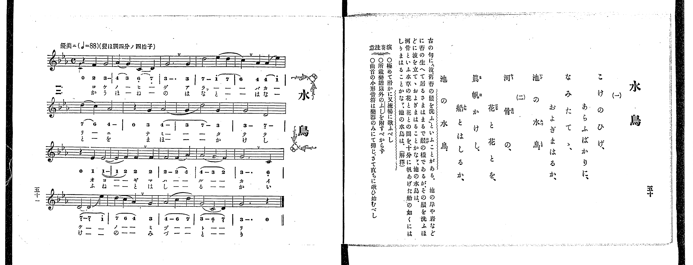

# 水鳥

> Re:Shōka 使用 AI 協助辨識與重建樂譜，可能會有錯誤。歡迎回報。

- **鋼琴伴奏版**：<br><audio controls src="mizutori.mp3"></audio>
- **NEUTRINO 歌聲合成版**：<br><audio controls src="mizutori_neutrino.mp3"></audio>

- 出處：共益商社樂器店《唱歌教科書 教師用 巻四》第五十～五十一頁（女生徒專用曲第四曲）
- NDL Digital Collections PID 854865（https://dl.ndl.go.jp/pid/854865）掃描 P031.jpg

## 說明

原書資訊與歌詞全文（NDL PID 854865《唱歌教科書 教師用 巻四》第五十～五十一頁，掃描 P031.jpg）：
調性與拍號：變ほ調四分ノ四拍子（E♭ 大調 4/4 拍），♩=88，「優美ニ」
註記：女生徒專用曲，單聲部，二節分節歌，全曲共十九小節（第一、三、四行各五小節，第二行四小節）。第一小節第一拍五線譜休止符下方印有小形音符 E♭4（簡譜標「0」），依原書「演奏注意」僅由樂器彈奏，歌唱聲部休止一拍後自第二拍進入。第十小節後半拍 E♭4（1 -）連結線跨小節延續至第十一小節第一拍。
原典演奏注意：極めて滑かに又流暢に歌ふべし；所載樂譜以外のふしを附すべからず；曲首の小形音符は樂器のみにて彈じ、さて直ちに歌ひ始むべし。
原典解釋：「古の句に『波、舊苔の鬚を洗ふ』といふことがある。池の岸や岩などに苔の生へて居るさまはまるで鬚の樣であるが、その鬚を洗ふほどに波を立てゝ、およぎまはることかなア、池の水鳥は。河骨といふ水草の花と花との間を、十分に帆あげた船の如くにはしりまはることかなア、池の水鳥は。」


## 歌詞

```text
一、
こけのひげ、あらふばかりに、
なみたてゝ、およぎまはるか、
池の水鳥。

二、
河骨の、花と花とを、
眞帆かけし、船とはしるか、
池の水鳥。
```

## ABC

<div class="abc-score" data-abc-src="mizutori.abc" aria-label="五線譜載入中"></div>

[下載 ABC 原始檔](mizutori.abc)

## TMD 檔案連結

- [主旋律 TMD 檔案](mizutori.tmd) [[在 TMD Studio 編輯](https://tmdlang.github.io/Tmd-TS/#tmd=s7IKdvYPcrWy4qpTUCpJTLdSSM7PyUlNLsnMz7PKrsxPzc6ML87Iz05Ugisoy88pzU21yk7MizeJtzA1sTAzRUgW55cWJadaFSdn5OfnxJekVpQk5edno8vHFySmp1oFGBgbImQKivLLUvMS84C6C4oy80pSU8DaEQpSyzJTUkHSxclAq8tSizLTMlNTkNyVWlQMcjXUipKixLzi5KLMApBXEKrSU_OKUq2SMzJzUopS8-KL8_PSEZJp-UW5VsUlRfkFGZnJCOGSjFSghxPzMnMTc9BFyxNLUovQBQtyEvOQXA4RzEssKS1KRYjmF2WmZ-ZZ5aZmZmUihZSWlsKzDVtebl6qoKXFpWirYGHBZW-r4KrDZWOib2IH0v20fdeLmVPf75n1tHXj89ldT6e2PV-y79mKpqczVzzdNf1xQ9fTKRufre15NnXm8-UTn83eoQBkPd2x-vmUFQpPt-9-Onv244bu52vWPNk15Wlv4_u98yCMJzsaXi5ofL-n4-nSzc-nzH-6b9LTDR1APc9mbwIqBuoCMt7v6QS738_FR8EF6PqSxBwFZ3h6KVYI8HRRgKQIoDkZJSUFxVb6-ik5enlAnJ6vl1WgX5CZog9T0fmsr_lZf78CKB0A5YDxwKWvpWBLLcCloKDwtG8-MABebG5_saLrRUc7MFRerJz3tHXFs2ntQBeCvIFwMqUB14PmHaAHgXEEcsWLVfufNSwH2d_d-2LmfKDoi3Vdjxt3A8WBhj7taHvc3AcK4O7ep2snAN3l-mjmWoWnS5YD5RWAka4AlAAb1vNo5kpbCwsg43FDz9OWVc_39T1u7n7c0Au2ZMXuFytmgFIFRvwBNTydtu5F46aXzSuA7Ce7ep6vbwBaCySB3gXJAkNk9iZgcgJ5Z-fcpxv6gVJAh4A8u6PhcQPQj51AEujGFwt7nk5oAXkcqqYHHCA9IHGgV6CCQMVNEL0QEQgb6A2gxufbZ71YO-fJnonP1i56vmbZkx3dz6btfNq74dmcTqDip3sXvZy_GSiuAAoEE5AbNiwEqn-2YibQzwZAv0JC4sm-uZC4BYo-2zPl6dL-Z5tXPGvpByp42tz6HBiPkPywF5ic-0Fxs7YHGLmQIIDYDXHQ0309L9pXQfwA5L5sAIbCUojrgWEBcT1QzdPeLqAs3E2GCrpAZ7xsWPx86wSQf7avgKrcve05MCzagR4Aacf0P9BkaLJ82roD2d3AeHu2dOvjpsbHjcue7Z74uLH7cePqp_0dz7Y2Ppu1CMgGeuBx49bHjTsfN05_v2f2s86GF8AMtKIJFJa7lz5dMu1x4zqwgumPmya9nNnyuHEmWHH346bOx42zQFpmb3q5DKQMOZgfN66HhBRY-36gRUAHAEPtceMMYIQ_bpwK5D6fveVx40KYGzY9XQ40swHiEhT_vFi--GV7N9AnoNTZvwRkU_9SkIkNfc82LwIa96Kj60X3FKD4yzWzgK58tmU6yMUN_Y8bgdYDXQx0_WQwG2hN0-MmYMpuerZxAcicTTseN7U83bTyceOqx41AcjXEHGA6f9y4A-Tija0g9SDn7gN6CUSCuMtBFjWue7ZiMZANNRNoOMhjc9Gd0bgbYjLIqU2Tnq8Gqlz2uGkuWHHX4yZgiPRBDQcZAnEnkLHqcRPIaxB3QgpukBqgyzdtfrkKqAbqNaDUi15gTKx70bURKAghQW6YNhloHShzAZMbsCQAxvoOINn0uHHS48b5LzqAobzu6TIgFxhKwLgBeg0YwcDCgwSXgAoIUCxBsjKIBdYFTGTAKN8EsgjkR2DgAJ0HDIcN4EQDtAIYcVDVwEAHJg1gWOMJEWBsgVWj2A9MHmCbd4ECHSwLDZV1oOSAHBLgMACpeD5nHjgEgEYCXQhMYcBkAwwEoB6I3_FYBRSivNqAAgUtfS4u38yq0hJgPW0Vlp-ZnOpQY1BTDbJEwcZEyw7MANZXGpDiRFPhcdNmIN6oUKMALM6BeA8QTwLTQJGmTUC8CCy3EioHFgezJgDlVoPZQEtBxtYoGCgYKRgr6AJZJkDaLF7BPB7IBonoAskaBXMgbRgHpGoUzIBKTECcGrBeH8MahXhQDAPxRLAJwDAC0sCohvImgU0BxjjYYaBIBwuAJEHCG4C4G8SDGGcEMa4biNugBuwGq1uLZDiIvx7MWwVmr4Cbth4qBjENGF6Pm1dBvd0NDoAuIJ6PEhxA3LQfzGsD4r2IQDEH-xVksgEwECAsY3BQgIIEFDjAUII7HBgOwGQMdsRqsFKQN4B2N-6HOg7i7PlgZy8Ds0EkwtsQbwBTJlz3PqjnEbrBfgCHMzBxInsTKVmA_LsCxXfrgPQ8sEg_SmKAJAJYkgHympYgJwlDIIRYbgSGNUAMYpuAkwkoFEBikEQCTDKo6QEYzk0dcLcD8y7YPyDXr4dHPzB3IdjgRABS2YKWFLbCIx8ivwIe-aAQIMYkUDIA5hRkr8NyDAiDo6S5FUW-A4W3CilRgKIcnBlgCQSUGEDBYQbOHqDgQM0_BsgpBBx3MHfCkjI49TUuRZIBpQSYz0BpShcYEsgphRJTarm4dO0UYGWNApCtzAUA)]
- [鋼琴伴奏 TMD 檔案](mizutori_piano.tmd) [[在 TMD Studio 編輯](https://tmdlang.github.io/Tmd-TS/#tmd=s7IKdvYPcrWy4tLSUni2YcvLzUvf7-l42b3n-YQtT_Zsebq0_3lnx_s9nQpaWlyKtgoWFlz2tgquOlw2Jvomdlx1CkpP23e9mDn1_Z5ZT1s3Pp_d9XRq2_Ml-56taHo6c8XTXdMfN3Q9nbLx2dqeZ1NnPl8-8dnsHQpA1tMdq59PWaHwdPvup7NnP27ofr5mzZNdU572Nr7fOw_CeLKj4eWCRqBLni7d_HzK_Kf7Jj3d0AHU82z2JqBioC4gA-gqJZAL_Fx8FFwy0zNLEnMUnPNzclKTSzLz84oVAjxdFCxMTSzMTIHmZJSUFBRb6eun5OjlAXF6vl5WgX5BZoo-TEXns77mZ_39CgEGxoZAuXQlLi7fzKrSkvyiTKuAzMS8_CAPhxqDmmouBSCwMdGyAzP0tRQ0nuyZ-GztIk2Fx02bgXijQo3C4-Y-IN4DxJPANFCkaRMQLwLLrYTKgcXBrAlAudVgtpY-2NgaBQMFIwVjBV0gywRIm8UrmMcD2SARXSBZo2AOpA3jgFSNghlQiQmIUwPW62NYoxCv8LhxMhBPBJvwuHEdkH7cuAnKmwQ25XFjE9hhnY8bt4IFQJIg4Q1A3A3iQYwzghjXDcRtUAN2g9WtRTIcxF8P5q0Cs1fATVsPFYOYBgyvx82roN7uBgdAFxDPRwkOIG7aD-a1AfFeRKCYg_0KMtkAGAgQljE4KEBBAgocYCjBHQ4Mh8dNXWBHrAYrBXkDaHfjfqjjIM6eD3b2MjAbRCK8DfHG4yZQeEF074N6HqEb7AdwOD9unI7sTaRkAfLvChTfrQPS88Ai_SiJAZIIYEkGyGtagpwkDIEQYrkRGNYAMYhtAk4moFAAiUESCTDJoKYHYDg3dcDd_rgRmESB_gG5fj08-h83gSIeygYnApDKFrSksBUe-RD5FfDIB4UAMSaBkgEwpyB7HZZjQBgcJc2tKPIdKLxVSIkCFOXgzABLIKDEAAoOM3D2AAUHav4xQE4h4LiDuROWlMGpr3EpkgwoJcB8BkpTusCQQE4plJhSi17U-OAoal70db1s733auuPl7FZI4YwIBtP4eIVo0_hYBUMgbRgLFAEGApBpEouQgji4BqYESSVcCYZaqBlQCkUtTAzVVCSVUBFc9iPEMd2E7isUtQRdi81kNNdiCy9cPsNjKp6wBSUzYNTq2inAYjfaByiDwjcC85W5AA)]

## 分析

```text
================================================================================
📊 TMD Song Profile: [ 水鳥 ]
================================================================================
⏱  Duration:       0:51 (51.8s), 19 measures total
🎼 Key & Tempo:    首調基準 E,, != 88.0 BPM, <4/4>
   - 分析範圍：      由實際發聲的音符與和弦推測調性；播放脈絡另行呈現
🎤 人聲音域:    C4 (MIDI 60) – D#5 (MIDI 75) [跨度: 15 個半音 / 1.2 個八度, 難度: moderate]
   - 最低音:  C4 in [Mizutori #1 @ m.2, 0:04]
   - 最高音: D#5 in [Mizutori #1 @ m.4, 0:09]
   - 適合: soprano, mezzo-soprano, contralto, tenor, baritone, bass
🏛  結構:      Mizutori (51.8s)
⚡ 編曲密度:        Peak 1 軌道同時演奏
🗝  調性診斷：       G 調性不明確（流行色彩大調，未偵測到可信轉調）
   - 風格氣質:    流行大調（略帶和弦色彩音與裝飾副屬和弦）
   - 轉調歷程:    全曲維持單一推測調性（未偵測到可信轉調）
   - 核心骨幹音:  G, D, G#, F, C
   - 調性數值:    G 調性不明確 [相關度: 0.58, 穩定度: Ambiguous, 自然音純度: 81.9%]
   - 候選調性 (K-S): G 小調 (0.58), G 大調 (0.55), C 小調 (0.53)
   - 五度圈歷程:   +1
   - 各段落調性細節:
     • [Mizutori #1]: G 調性不明確 (r: 0.58, 自然音純度: 81.9%, 調外音: G#)

  [ 五度圈游移軌跡 ]
               C  
         F           [G ]*
      Bb               D  
      Eb               A  
         Ab           E  
            Db       B  
               F# 
     (* = active key center)

  [ 十二半音累積音高分佈 ]
     C  : ████████                   9.7%
     C# :                            0.0%
     D  : ████████████████          20.8%
     D# : ████████                   9.7%
     E  :                            0.0%
     F  : █████████                 11.1%
     F# :                            0.0%
     G  : ████████████████████████  30.6%
     G# : ██████████████            18.1%
     A  :                            0.0%
     A# :                            0.0%
     B  :                            0.0%
--------------------------------------------------------------------------------
Assignment 軌道音域：
  - Voice         : C4 – D#5 (15 個半音 / 1.2 個八度, 51 個音符)
================================================================================
```


## 原書掃描頁




