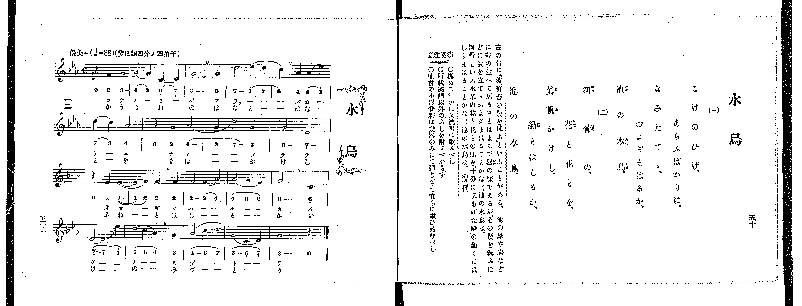

# 水鳥

> Re:Shoka 使用 AI 辨識樂譜，可能會有錯誤。歡迎回報。

<audio controls src="mizutori.mp3"></audio>

- 出處：共益商社樂器店《唱歌教科書 教師用 巻四》第五十～五十一頁（女生徒專用曲第四曲）
- NDL Digital Collections PID 854865（https://dl.ndl.go.jp/pid/854865）掃描 P031.jpg

## 說明

原書資訊與歌詞全文（NDL PID 854865《唱歌教科書 教師用 巻四》第五十～五十一頁，掃描 P031.jpg）：
調性與拍號：變ほ調四分ノ四拍子（E♭ 大調 4/4 拍），♩=88，「優美ニ」
註記：女生徒專用曲，單聲部，二節分節歌，全曲共十九小節（第一、三、四行各五小節，第二行四小節）。第一小節第一拍五線譜休止符下方印有小形音符 E♭4（簡譜標「0」），依原書「演奏注意」僅由樂器彈奏，歌唱聲部休止一拍後自第二拍進入。第十小節後半拍 E♭4（1 -）連結線跨小節延續至第十一小節第一拍。
原典演奏注意：極めて滑かに又流暢に歌ふべし；所載樂譜以外のふしを附すべからず；曲首の小形音符は樂器のみにて彈じ、さて直ちに歌ひ始むべし。
原典解釋：「古の句に『波、舊苔の鬚を洗ふ』といふことがある。池の岸や岩などに苔の生へて居るさまはまるで鬚の樣であるが、その鬚を洗ふほどに波を立てゝ、およぎまはることかなア、池の水鳥は。河骨といふ水草の花と花との間を、十分に帆あげた船の如くにはしりまはることかなア、池の水鳥は。」

## 歌詞

```text
一、
こけのひげ、あらふばかりに、
なみたてゝ、およぎまはるか、
池の水鳥。

二、
河骨の、花と花とを、
眞帆かけし、船とはしるか、
池の水鳥。
```

## ABC

```abc
X:1
T:水鳥
M:4/4
L:1/16
Q:1/4=88
K:Eb
V:V1 name="Voice" snm="Voi"
[V:V1]
z4 F4 G8 | A4 G4 C4 D4 | G12 G4 | d8 e4 d4 |
c4 A4 A4 e4 | d4 c4 A8 | z4 G4 A8 | G4 d8 G4 |
G8 D8 | z4 E4 E8- | E4 F4 F4 F4 | F8 F4 A4 |
A8 G4 F4 | G12 C4 | D12 e4 | d4 c4 A4 G4 |
A8 c4 d4 | G8 C4 D4 | G12 z4 | z4 F4 G8 |
A4 G4 C4 D4 | G12 G4 | d8 e4 d4 | c4 A4 A4 e4 |
d4 c4 A8 | z4 G4 A8 | G4 d8 G4 | G8 D8 |
z4 E4 E8- | E4 F4 F4 F4 | F8 F4 A4 | A8 G4 F4 |
G12 C4 | D12 e4 | d4 c4 A4 G4 | A8 c4 d4 |
G8 C4 D4 | G12 z4 |
```

## TMD 檔案連結

- [主旋律 TMD 檔案](mizutori.tmd) [[在 TMD Studio 編輯](https://tmdlang.github.io/Tmd-TS/#tmd=s7IKdvYPcrWy4qpTUCpJTLdSSM7PyUlNLsnMz7PKrsxPzc6ML87Iz05Ugisoy88pzU21yk7MizeJtzA1sTAzRUgW55cWJadaFSdn5OfnxJekVpQk5edno8vHFySmp1oFGBgbImQKivLLUvMS84C6C4oy80pSU8DaEQpSyzJTUkHSxclAq8tSizLTMlNTkNyVWlQMcjXUipKixLzi5KLMApBXEKrSU_OKUq2SMzJzUopS8-KL8_PSEZJp-UW5VsUlRfkFGZnJCOGSjFSghxPzMnMTc9BFyxNLUovQBQtyEvOQXA4RzEssKS1KVeLS0lJ4tmHLy81LFbS0uBRtFSwsuOxtFVx1uGxM9E3sQJqetu96MXPq-z2znrZufD676-nUtudL9j1b0fR05oqnu6Y_buh6OmXjs7U9z6bOfL584rPZOxSArKc7Vj-fskLh6fbdT2fPftzQ_XzNmie7pjztbXy_dx6E8WRHw8sFje_3dDxduvn5lPlP9016uqEDqOfZ7E1AxUBdQMb7PZ1gZ_u5-Ci4ZKZnliTmKDjDE0SxQoCniwIkyoHmZJSUFBRb6eun5OjlAXF6vl5WgX5BZoo-TEXns77mZ_39CqCIBsoBA5pLX0vBllqAS0FB4WnffGAAvNjc_mJF14uOdmCovFg572nrimfT2oEuBHkD4WRKA64HzTtADwLjCOSKF6v2P2tYDrK_u_fFzPlA0Rfruh437gaKAw192tH2uLkPFMDdvU_XTgC6y_XRzLUKT5csB8orACNdASgBNqzn0cyVthYWQMbjhp6nLaue7-t73Nz9uKEXbMmK3S9WzAClCoz4A2p4Om3di8ZNL5tXANlPdvU8X98AtBZIAr0LkgWGyOxNwOQE8s7OuU839AOlgA4BeXZHw-MGoB87gSTQjS8W9jyd0ALyOFRNDzhAekDiQK9ABYGKmyB6ISIQNtAbQI3Pt896sXbOkz0Tn61d9HzNsic7up9N2_m0d8OzOZ1AxU_3Lno5fzNQXAEUCCYgN2xYCFT_bMVMoJ8NgH6FhMSTfXMhcQsUfbZnytOl_c82r3jW0g9U8LS59TkwHiH5YS8wOfeD4mZtDzByIUEAsRvioKf7el60r4L4Ach92QAMhaUQ1wPDAuJ6oJqnvV1AWbibDBV0gc542bD4-dYJIP9sXwFVuXvbc2BYtAM9ANKO6X-gydBk-bR1B7K7gfH2bOnWx02NjxuXPds98XFj9-PG1U_7O55tbXw2axGQDfTA48atjxt3Pm6c_n7P7GedDS-AGWhFEygsdy99umTa48Z1YAXTHzdNejmz5XHjTLDi7sdNnY8bZ4G0zN70chlIGXIwP25cDwkpsPb9QIuADgCG2uPGGcAIf9w4Fch9PnvL48aFMDdserocaGYDxCUo_nmxfPHL9m6gT0Cps38JyKb-pSATG_qebV4ENO5FR9eL7ilA8ZdrZgFd-WzLdJCLG_ofNwKtB7oY6PrJYDbQmqbHTcCU3fRs4wKQOZt2PG5qebpp5ePGVY8bgeRqiDnAdP64cQfIxRtbQepBzt0H9BKIBHGXgyxqXPdsxWIgG2om0HCQx-aiO6NxN8RkkFObJj1fDVS57HHTXLDirsdNwBDpgxoOMgTiTiBj1eMmkNcg7oQU3CA1QJdv2vxyFVAN1GtAqRe9wJhY96JrI1AQQoLcMG0y0DpQ5gImN2BJAIz1HUCy6XHjpMeN8190AEN53dNlQC4wlIBxA_QaMIKBhQcJLgEVEKBYgmRlEAusC5jIgFG-CWQRyI_AwAE6DxgOG8CJBmgFMOKgqoGBDkwawLDGEyLA2AKrRrEfmDzANu8CBTpYFhoq60DJATkkwGEAUvF8zjxwCACNBLoQmMKAyQYYCEA9EL_jsQooRHm1AQUKWvpcXL6ZVaUl-UWZVmH5mcmpDjUGNQrVIFsUbCy07MAMYIWlASlPNBUeN20G4o0KNQrA8hyI9wDxJDANFGnaBMSLwHIroXJgcTBrAlBuNZgNtBVkbI2CgYKughEQGwMxCNYomEB5ZvFAwhxE1MBlQRDErlEwh_IM40CqwEJmQBKkGYTBwjUwpz9uXgV1QTfYLV1APB_FZUDctB_MawPivQj3gYyGGQxxH8jFIDcgREA8mHsgroO5F-x8sCIsoQhy0woUF6wD0vPAIv0oYQcJM1gIA3lNS1BDEFhQgzHEPSASFKYwXAMmYaIgd0NCGeZeiBrkMAaHPSL4gJGN7BxYpIPwfLBIK4p8BwpvFVJgwoIDHnOoAQwJPJjTQKKQmIU5DVeSAAVBDVctF5eunQIsLSugsZW5AA)]

## 分析

```text
================================================================================
📊 TMD Song Profile: [ 水鳥 ]
================================================================================
⏱  Duration:       1:43 (103.6s), 38 measures total
🎼 Key & Tempo:    首調基準 E,, != 88.0 BPM, <4/4>
   - 分析範圍：      由實際發聲的音符與和弦推測調性；播放脈絡另行呈現
🎤 人聲音域:    C4 (MIDI 60) – D#5 (MIDI 75) [跨度: 15 個半音 / 1.2 個八度, 難度: moderate]
   - 最低音:  C4 in [Mizutori #1 @ m.2, 0:04]
   - 最高音: D#5 in [Mizutori #1 @ m.4, 0:09]
   - 適合: soprano, mezzo-soprano, contralto, tenor, baritone, bass
🏛  結構:      Mizutori (51.8s) -> Mizutori (51.8s)
⚡ 編曲密度:        Peak 1 軌道同時演奏
🗝  調性診斷：       G 調性不明確（流行色彩大調，未偵測到可信轉調）
   - 風格氣質:    流行大調（略帶和弦色彩音與裝飾副屬和弦）
   - 轉調歷程:    全曲維持單一推測調性（未偵測到可信轉調）
   - 核心骨幹音:  G, D, G#, F, C
   - 調性數值:    G 調性不明確 [相關度: 0.58, 穩定度: Ambiguous, 自然音純度: 81.9%]
   - 候選調性 (K-S): G 小調 (0.58), G 大調 (0.55), C 小調 (0.53)
   - 五度圈歷程:   +1 -> +1
   - 各段落調性細節:
     • [Mizutori #1]: G 調性不明確 (r: 0.58, 自然音純度: 81.9%, 調外音: G#)
     • [Mizutori #2]: G 調性不明確 (r: 0.58, 自然音純度: 81.9%, 調外音: G#)

  [ 五度圈游移軌跡 ]
               C  
         F           [G ]*
      Bb               D  
      Eb               A  
         Ab           E  
            Db       B  
               F# 
     (* = active key center)

  [ 十二半音累積音高分佈 ]
     C  : ████████                   9.7%
     C# :                            0.0%
     D  : ████████████████          20.8%
     D# : ████████                   9.7%
     E  :                            0.0%
     F  : █████████                 11.1%
     F# :                            0.0%
     G  : ████████████████████████  30.6%
     G# : ██████████████            18.1%
     A  :                            0.0%
     A# :                            0.0%
     B  :                            0.0%
--------------------------------------------------------------------------------
Assignment 軌道音域：
  - Voice         : C4 – D#5 (15 個半音 / 1.2 個八度, 102 個音符)
================================================================================
```


## 原書掃描頁




