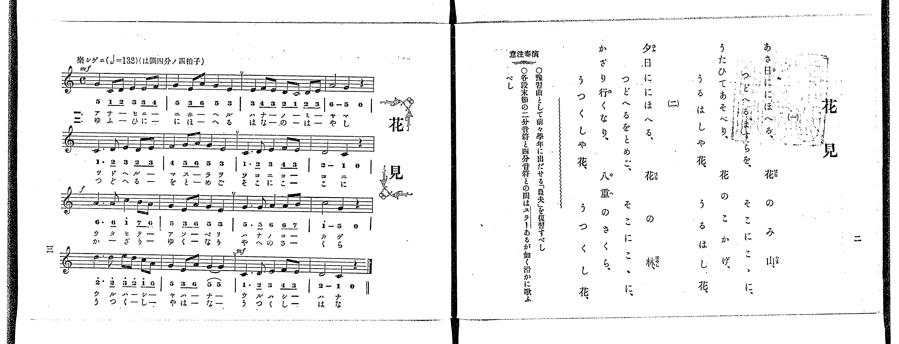

# 花見

> Re:Shōka 使用 AI 協助辨識與重建樂譜，可能會有錯誤。歡迎[回報](https://github.com/TMDLang/reshoka/issues)。

- **鋼琴伴奏版**：<br><audio controls src="hanami.mp3"></audio>
- **NEUTRINO 歌聲合成版**：<br><audio controls src="hanami_neutrino.mp3"></audio>

- 出處：共益商社樂器店《唱歌教科書 教師用 巻四》第二～三頁（第一學期第一曲）
- NDL Digital Collections PID 854865（https://dl.ndl.go.jp/pid/854865）掃描 P007.jpg

## 說明

原書資訊與歌詞全文（NDL PID 854865《唱歌教科書 教師用 巻四》第二～三頁，掃描 P007.jpg）：
調性與拍號：は調四分ノ四拍子（C 大調 4/4 拍），♩=132，「樂シゲニ」
註記：單聲部，二節分節歌。開頭 mf，第三段（第九小節）f，第四段第三小節（第十五小節）mf。第十四小節第四拍五線譜為 E4（3），與第三拍 G4（5）加圓滑線；但下方簡譜誤印為「5 5」（兩個 5 加圓滑線），本檔依五線譜記為 3。原譜於第二、六、十、十四小節末印有換氣記號「V」。
原典演奏注意：豫習曲として前々學年に出だせる「農夫」を復習すべし；各段末節の二分音符と四分音符との間はスラーあるが如く滑かに歌ふべし。


## 歌詞

```text
一、
あさ日ににほへる、花のみ山、
つどへるますらを、そこにこゝに、
うたひてあそべり、花のこかげ、
うるはしや花、うるはし花、

二、
夕日ににほへる、花の林、
つどへるをとめご、そこにこゝに、
かざり行くなり、八重のさくら、
うつくしや花、うつくし花、
```

## ABC

<div class="abc-score" data-abc-src="hanami.abc" aria-label="五線譜載入中"></div>

[下載 ABC 原始檔](hanami.abc)

## TMD 檔案連結

- [主旋律 TMD 檔案](hanami.tmd) [[在 TMD Studio 編輯](https://tmdlang.github.io/Tmd-TS/#tmd=s7IKdvYPcrWy4qpTUCpJTLdSSM7PyUlNLsnMz7PKrsxPzc6ML87Iz05Ugisoy88pzU21yk7MizeJtzA1sTAzRUgW55cWJadaFSdn5OfnxJekVpQk5edno8vHFySmp1oFGBiYI2QKivLLUvMS84C6C4oy80pSU8DaEQpSyzJTUkHSxclAq8tSizLTMlNTkNyVWlQMcjXUipKixLzi5KLMApBXEKrSU_OKUq2SMzJzUopS8-KL8_PSEZJp-UW5VsUlRfkFGZnJCOGSjFSgh4tTE4Gqi9GFC3IS85BcCRHMSywpLUpFiOYXZaZn5lnlpmZmZWIJlfyikoz89KLEgoxKq4zM4hKg8uTEnHhgEAPDXUtL4UXXxhfLuhW0tLgUbRUMjY247G0VnLlsTPRN7EBmPG3f9WLm1Pd7Zj1t3fh8dtfTqW3Pl-x7tqLp6cwVT3dNf9zQ9XTKxmdre55Nnfl8-cRns3coAFlPd6x-PmWFwtPtu5_Onv24ofv5mjVPdvW83zvvyY7Olwsa3-_pAInsaHi6dsezOfMh7GezN73f0wl2tp-Lj4IL0E8liTkKzvAUU6wQ4OmiAEkTQBMySkoKiq309VNy9PKAOD1fL6tAvyAzRR-movNZX_Oz_n4FUEoAygFjgktfS8GWWoBLQUHhad98oI9fbG5_saLrRUc7MBherJz3tHXFs2ntQBeCvIFwMpkh1YPmC6C_gHEBsvzFqv3PGpaDrO3ufTFzPlD0ceN6oCDQoKcdbY-b-4AMoNTTtROAbnFWeLpkOVBSARitCkBRsDE9j2autAXGOJD1uKEHGKePm7Y_btr0uLn7cUMv2IoVu1-smAGK-2nrXjRuetm8AqgU6L7n6xuAVgBJoHceNzS9nNb9csFahdw0oCw4MjufrdsKjeSdc59u6AeqBFoIlQY5a91WiDqYHEjp097GJ7umwFXnpgFNhgiDfAQWhuru7gUqfL591ou1c5437VJwNQEaYAzxETA4oC7o7lVwB0mAUsLTrgVP50x-tnsiUNP7PbOf7G17sqP72bSdzzcsBJrxYtWSp70bgCYBA8FUARhRwNDpeNq68mlDt4KpAqpekB3P5qx5tmrKk31z4a4ABhLIIcZAFwOTBFDg2bQ9kJh83ND4tHUtiOxthJBwzzybsxpo7bM5nc_6Zz_bsBhoBjAWgU4IAzoAaBA0fT1t3fFsz5SnS_ufbV7xrKUfGBcvNq5-vn8SMLs8blzxuHH648ZlTzuBGlqBmenpzi2PG1cDc-zjxgWPG2c_bgJGZM-LfZueLlkNMrRp0tN9K4F6HzfOfNy4E6gXGBZPJ7QAYwPoFqCLHjeuAzoZGLMv529-vmYZ0HxIWoJzgQpeTpsMTGaPm3Y-bl75uHnP40Zgoul-3NjzdFnT48Z-YDA9bgRyV4MSRuNWiC0gz4B8A8zkwCAAsUC6Gqc-m74UqBKMdj9u3AF2bSOwNALa8rhx_9ONG-GqlzxuXAlV0bgP5PqmTqBngNKPG-c-bgQ6CGjE5MdNQDbQn1A9bY8b5z9uBAYS0OFA24ByOx83dSHZANQGNA5kCkwDyPj1IAc3tYAUgYxHCEJEIB4Bxys4gpbg88WzeUC_Y3oB6HJgUDYBTZ-C3wtAm6cB3fxiITAs-x83roK4_2nr6pftvWAvTAWJA8MCyc9Ae4BKUb0AE4R6AaiU8uIPChS09Lm4PIBVSW6mVVh-ZnKqQ41BTTXICgUbCy07MKM6N60WzAAWv8C4AOKpCsCkA6Q3AfFqMLsGwmrcDZXZoQAMKbDoeiBeBRVdB6X3w_Q0tQB5-0COAJlfA8yuugqGCkYKxkDaWMEEKmKsYAaldYEiINIESBpBVdYAZXXBEKTGAKQGbJqPIcj6JiAf5GAQuQlMrgabAqFBDgaRO0Ak0MEQmfVgsVVgch2Y3A-RAToXYhPI0boK8Qi7jECybWCZrRTaBRJBtWs6il3gWFgCxCvh4QyLgX1APBMSxk2dQDwJLDoXiCdD4wdIQ9VCROAhbwi2CxLykFA1AYcocsgjqwHFQA2QDXEjSAY95JdAXQ9xJrKfQWEHcihIrBNMToLKzIXqgTgOwoLIgGiIHEgcLeRx2wU2GZhdwWKNYPYUsu2qRs4HbUA8HxzRwCIKHqqg3AEMb3Aq3wm0sgs5D4DSP1IMAOOtcRIiBiCp2EzBMA5ImQMZ2BI_iAWJFpBSc1CkgJTjSv2gFAnyB8ShINYyqB8h-QIUBiCHgkKnCyoDSn-QNAlLkbBwAYUpRA4UquhxgJCdhmweNFf0Q81EloGkcHAihtoEyqcgs0CqwXLg9IGW9oEhD0rzoFAFh_N0lNIEJgopcyCBAFePUAuNE3joG0GCEUgZx4FIYLBijwFQaUhiToDGAtQRsBwNCwHkMgAE8eqAxg5MPXocwOIbVDxAQpxImzB1YLWplotL104BUl8oAFnKXAA)]
- [鋼琴伴奏 TMD 檔案](hanami_piano.tmd) [[在 TMD Studio 編輯](https://tmdlang.github.io/Tmd-TS/#tmd=s7IKdvYPcrWy4qpTUCpJTLdSyC8qychPL0osyKi0ysgsLskvykxOzInPTsxLVOLS0lJ40bXxxbLu93s6XnbveT5hy5M9W54u7X_e2fF-T6eClhaXoq2CobERl72tgjOXjYm-iR3I4Kftu17MnPp-z6ynrRufz-56OrXt-ZJ9z1Y0PZ254umu6Y8bup5O2fhsbc-zqTOfL5_4bPYOBSDr6Y7Vz6esUHi6fffT2bMfN3Q_X7Pmya6e93vnPdnR-XJBI9ABIJEdDU_X7ng2Zz6E_Wz2JqAzlEBW-rn4KLhkpmeWJOYoOOfn5KQml2Tm5xUrBHi6KFiYmliYmQJNyCgpKSi20tdPydHLA-L0fL2sAv2CzBR9mIrOZ33Nz_r7FQIMDMyBculKXFwewIDIzbQKyEzMyw_ycKgxqKnmUgACGwstOzCjOjetFszQ11J43NgExFMVHjfvAdKbgHg1mF0DYTXuhsrsUHjc1A0WXQ_Eq6Ci66D0fpiephYgb5-Clj7Y_BoFUwVdBUMFIwVjIG2sYAIVMVYwg9K6QBEQaQIkjaAqa4CyumAIUmMAUgM2zccQZH0TkA9yMIjcBCZXg02B0CAHg8gdIBLoYIjMerDYKjC5Dkzuh8gAnQuxCeRoXYV4hF1GINk2sMxWCu0CiaDaNR3FLnAsLAHilfBwhsXAPiCeCQnjpk4gngQWnQvEk6HxA6ShaiEi8JA3BNsFCXlIqJqAQxQ55JHVgGKgBsiGuBEkgx7yS6CuhzgT2c-gsAM5FCTWCSYnQWXmQvVAHAdhQWRANEQOJI4W8rjtApv8uHEFWKwRzJ5Ctl3VyPmgDYjngyP6ceMyeKiCcgcwvMGpfCfQyi7kPABK_0gxAIy3xkmIGICkYjMFwzggZQ5kYEv8IBYkWkBKzUGRAlKOK_WDUiTIHxCHgljLoH6E5AtQGIAcCgqdLqgMKP1B0iQsRcLCBRSmEDlQqKLHAUJ2GrJ50FzRDzUTWQaSwsGJGGoTKJ-CzAKpBsuB0wda2geGPCjNg0IVHM7TUUoTmCikzIEEAlw9Qi00TuChbwQJRiBlHAcigcGKPQZApSGJOQEaC1BHwHI0LASQywAQxKsDGjsw9ehxAItvUPEACXEibcLUgdWmWtTqwge5ujCBVhfAOHrR1_Wyvfdp646Xs1sh9SlSQROvEG0YC6JM4-OBfGQREAXxDljUAKwEyACpMgFKm2BThayXCHUGYFUgg6NN4zHUQXUDKTMCjgNxgcrwewLDGkImYnUgUAQU8rp2CpDAj_YBqkTiGYF5ylwA)]

## 分析

```text
================================================================================
📊 TMD Song Profile: [ 花見 ]
================================================================================
⏱  Duration:       0:29 (29.1s), 16 measures total
🎼 Key & Tempo:    首調基準 C, != 132.0 BPM, <4/4>
   - 分析範圍：      由實際發聲的音符與和弦推測調性；播放脈絡另行呈現
🎤 人聲音域:    C4 (MIDI 60) – E5 (MIDI 76) [跨度: 16 個半音 / 1.3 個八度, 難度: moderate]
   - 最低音:  C4 in [Hanami #1 @ m.1, 0:00]
   - 最高音: E5 in [Hanami #1 @ m.13, 0:22]
   - 適合: soprano, mezzo-soprano, contralto, tenor, baritone, bass
🏛  結構:      Hanami (29.1s)
⚡ 編曲密度:        Peak 1 軌道同時演奏
🗝  調性診斷：       C 大調（純淨自然大調，未偵測到可信轉調）
   - 風格氣質:    純淨自然大調（陽光明朗、易唱易記，無明顯調外色彩）
   - 轉調歷程:    全曲維持單一推測調性（未偵測到可信轉調）
   - 核心骨幹音:  E, G, C, D, A
   - 調性數值:    C 大調 [相關度: 0.83, 穩定度: Moderate, 自然音純度: 100.0%]
   - 候選調性 (K-S): C 大調 (0.83), G 大調 (0.72), E 小調 (0.71)
   - 五度圈歷程:   +0
   - 各段落調性細節:
     • [Hanami #1]: C 大調 (r: 0.83, 自然音純度: 100.0%)

  [ 五度圈游移軌跡 ]
              [C ]*
         F            G  
      Bb               D  
      Eb               A  
         Ab           E  
            Db       B  
               F# 
     (* = active key center)

  [ 十二半音累積音高分佈 ]
     C  : ███████████████████       18.3%
     C# :                            0.0%
     D  : █████████████████         16.7%
     D# :                            0.0%
     E  : ████████████████████████  23.3%
     F  : █████                      5.0%
     F# :                            0.0%
     G  : █████████████████████     20.8%
     G# :                            0.0%
     A  : ███████████████           14.2%
     A# :                            0.0%
     B  : ██                         1.7%
--------------------------------------------------------------------------------
Assignment 軌道音域：
  - Voice         : C4 – E5 (16 個半音 / 1.3 個八度, 72 個音符)
================================================================================
```


## 原書掃描頁




