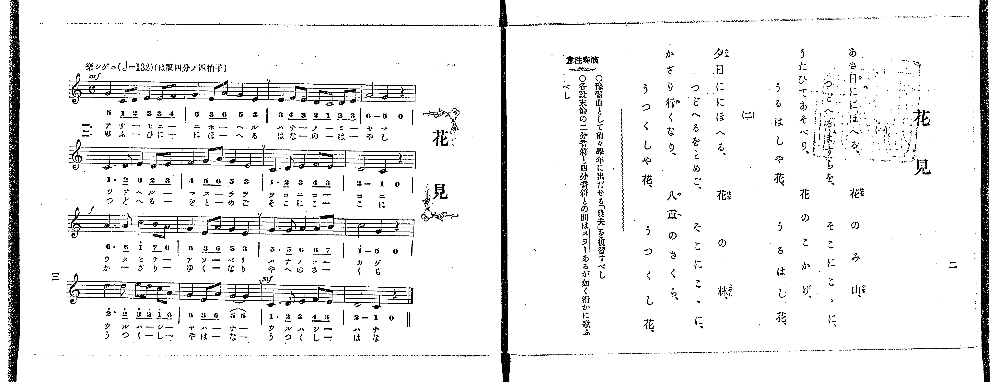

# 花見

> Re:Shōka 使用 AI 協助辨識與重建樂譜，可能會有錯誤。歡迎回報。

- **鋼琴伴奏版**：<br><audio controls src="hanami.mp3"></audio>
- **NEUTRINO 歌聲合成版**：<br><audio controls src="hanami_neutrino.mp3"></audio>

- 出處：共益商社樂器店《唱歌教科書 教師用 巻四》第二～三頁（第一學期第一曲）
- NDL Digital Collections PID 854865（https://dl.ndl.go.jp/pid/854865）掃描 P007.jpg

## 說明

原書資訊與歌詞全文（NDL PID 854865《唱歌教科書 教師用 巻四》第二～三頁，掃描 P007.jpg）：
調性與拍號：は調四分ノ四拍子（C 大調 4/4 拍），♩=132，「樂シゲニ」
註記：單聲部，二節分節歌。開頭 mf，第三段（第九小節）f，第四段第三小節（第十五小節）mf。第十四小節第四拍五線譜為 E4（3），與第三拍 G4（5）加圓滑線；但下方簡譜誤印為「5 5」（兩個 5 加圓滑線），本檔依五線譜記為 3。原譜於第二、六、十、十四小節末印有換氣記號「V」。
原典演奏注意：豫習曲として前々學年に出だせる「農夫」を復習すべし；各段末節の二分音符と四分音符との間はスラーあるが如く滑かに歌ふべし。

## 歌詞

```text
一、
あさ日ににほへる、花のみ山、
つどへるますらを、そこにこゝに、
うたひてあそべり、花のこかげ、
うるはしや花、うるはし花、

二、
夕日ににほへる、花の林、
つどへるをとめご、そこにこゝに、
かざり行くなり、八重のさくら、
うつくしや花、うつくし花、
```

## ABC

```abc
X:1
T:花見
M:4/4
L:1/16
Q:1/4=132
K:C
V:V1 name="Voice" snm="Voi"
[V:V1]
!mf! G4 C2 D2 E4 E2 F2 | G4 E2 A2 G4 E4 | E4 F2 E2 D2 C2 D2 E2 | A,8 G,4 z4 |
w: 1.~あ さ _ ひ に _ | に ほ _ へ る | は な _ の _ み _ | や ま
w: 2.~ゆ ふ _ ひ に _ | に ほ _ へ る | は な _ の _ は _ | や し
C6 D2 E4 D2 E2 | F4 G2 A2 G4 E4 | C6 D2 E4 F2 E2 | D8 C4 z4 |
w: 1.~つ ど へ る _ | ま す _ ら を | そ こ に こ _ | こ に
w: 2.~つ ど へ る _ | を と _ め ご | そ こ に こ _ | こ に
!f! A6 A2 c4 B2 A2 | G4 E2 A2 G4 E4 | G6 G2 A4 A2 B2 | c8 G4 z4 |
w: 1.~う た ひ て _ | あ そ _ べ り | は な の こ _ | か げ
w: 2.~か _ ざ り _ | ゆ く _ な り | や へ の さ _ | く ら
d6 d2 e2 d2 c2 A2 | G4 E2 A2 G4 E4 | !mf! C6 D2 E4 F2 E2 | D8 C4 z4 |
w: 1.~う る は _ し _ | や は _ な _ | う る は し _ | は な
w: 2.~う つ く _ し _ | や は _ な _ | う つ く し _ | は な
```

## TMD 檔案連結

- [主旋律 TMD 檔案](hanami.tmd) [[在 TMD Studio 編輯](https://tmdlang.github.io/Tmd-TS/#tmd=s7IKdvYPcrWy4qpTUCpJTLdSSM7PyUlNLsnMz7PKrsxPzc6ML87Iz05Ugisoy88pzU21yk7MizeJtzA1sTAzRUgW55cWJadaFSdn5OfnxJekVpQk5edno8vHFySmp1oFGBiYI2QKivLLUvMS84C6C4oy80pSU8DaEQpSyzJTUkHSxclAq8tSizLTMlNTkNyVWlQMcjXUipKixLzi5KLMApBXEKrSU_OKUq2SMzJzUopS8-KL8_PSEZJp-UW5VsUlRfkFGZnJCOGSjFSgh4tTE4Gqi9GFC3IS85BcCRHMSywpLUpV4tLSUnjRtfHFsm4FLS0uRVsFQ2MjLntbBWcuGxN9EzuQpqftu17MnPp-z6ynrRufz-56OrXt-ZJ9z1Y0PZ254umu6Y8bup5O2fhsbc-zqTOfL5_4bPYOBSDr6Y7Vz6esUHi6fffT2bMfN3Q_X7Pmya6e93vnPdnR-XJB4_s9HSCRHQ1P1-54Nmc-hP1s9qb3ezrB7vRz8VFwyUzPLEnMUXCGx3axQoCniwIkPoEmZJSUFBRb6eun5OjlAXF6vl5WgX5BZoo-TEXns77mZ_39CqBYBMoBQ5FLX0vBllqAS0FB4WnffKCPX2xuf7Gi60VHOzAYXqyc97R1xbNp7UAXgryBcDKZIdWD5gugv4BxAbL8xar9zxqWg6zt7n0xcz5Q9HHjeqAg0KCnHW2Pm_uADKDU07UTgG5xVni6ZDlQUgEYrQpAUbAxPY9mrrQFxjiQ9bihBxinj5u2P27a9Li5-3FDL9iKFbtfrJgBivtp6140bnrZvAKoFOi-5-sbgFYASaB3Hjc0vZzW_XLBWoXcNKAsODI7n63bCo3knXOfbugHqgRaCJUGOWvdVog6mBxI6dPexie7psBV56YBTYYIg3wEFobq7u4FKny-fdaLtXOeN-1ScDUBGmAM8REwOKAu6O5VcAdJgFLC064FT-dMfrZ7IlDT-z2zn-xte7Kj-9m0nc83LASa8WLVkqe9G4AmAQPBVAEYUcDQ6XjauvJpQ7eCqQKqXpAdz-asebZqypN9c-GuAAYSyCHGQBcDkwRQ4Nm0PZCYfNzQ-LR1LYjsbYSQcM88m7MaaO2zOZ3P-mc_27AYaAYwFoFOCAM6AGgQNH09bd3xbM-Up0v7n21e8aylHxgXLzaufr5_EjC7PG5c8bhx-uPGZU87gRpagZnp6c4tjxtXA3Ps48YFjxtnP24CRmTPi32bni5ZDTK0adLTfSuBeh83znzcuBOoFxgWTye0AGMD6Bagix43rgM6GRizL-dvfr5mGdB8SFqCc4EKXk6bDExmj5t2Pm5e-bh5z-NGYKLpftzY83RZ0-PGfmAwPW4EcleDEkbjVogtIM-AfAPM5MAgALFAuhqnPpu-FKgSjHY_btwBdm0jsDQC2vK4cf_TjRvhqpc8blwJVdG4D-T6pk6gZ4DSjxvnPm4EOghoxOTHTUA20J9QPW2PG-c_bgQGEtDhQNuAcjsfN3Uh2QDUBjQOZApMA8j49SAHN7WAFIGMRwhCRCAeAccrOIKW4PPFs3lAv2N6AehyYFA2AU2fgt8LQJunAd38YiEwLPsfN66CuP9p6-qX7b1gL0wFiQPDAsnPQHuASlG9ABOEegGolPLiDwoUtPS5uDwS8xJzM63C8jOTUx1qDGqqQVYo2Fho2YEZ1blptWAGsPgFxgUQT1UAJh0gvQmIV4PZNRBW426ozA4FYEiBRdcD8Sqo6DoovR-mp6kFyNsHcgTI_BpgdtVVMFQwUjAG0sYKJlARYwUzKK0LFAGRJkDSCKqyRsEsHigEgqYghgFIFdg8H0OQA5qAfJCTQeQmMLkabA6EBjkZRO4AkUAnQ2TWg8VWgcl1YHI_RAboYIhVIGfrKoDsg9plBJJtA8tspdAukAiqXdNR7ALHwxIgXgkPaVgc7APimZBQbuoE4klg0blAPBkaQ0AaqhYiAg97Q7BdkLCHhKsJKEhRwh5ZDSgOaoBsiBtBMughvwTqeogzkf0MCjuQQ0FinWByElRmLlQPxHEQFkQGREPkQOJoIY_bLrDJwAwLFmsEs6eQbVc1ck5oA-L54IgGFlLwUAXlD2B4g9P5TqCVXci5AJQDkGIAGG-NkxAxYAa200zBMA5ImQMZ2JI_iAWJFpBSc1CkgJRDBDHjAJQiQf6AOBTEWgb1IyRfgMIA5FBQ6HRBZUDpD5ImYSkSFi6gMIXIgUIVPQ4QstOQzYPmin6omcgykBQOTsRQm0D5FGQWSDVYDpw-0NI-MORBaR4UquBwno5SnsBEIaUOJBDg6hFqoXECD30jSDACKeM4EAkMVuwxACoPScwJ0FiAOgKWo2EhgFwGgCBeHdDYgalHjwNYfIOKB0iIE2kTpg6sNtVycenaKUBqDAUgS5kLAA)]
- [鋼琴伴奏 TMD 檔案](hanami_piano.tmd) [[在 TMD Studio 編輯](https://tmdlang.github.io/Tmd-TS/#tmd=s7IKdvYPcrWy4tLSUnjRtfHFsu73ezpedu95PmHLkz1bni7tf97Z8X5Pp4KWFpeirYKhsRGXva2CM5eNib6JHVedgtLT9l0vZk59v2fW09aNz2d3PZ3a9nzJvmcrmp7OXPF01_THDV1Pp2x8trbn2dSZz5dPfDZ7hwKQ9XTH6udTVig83b776ezZjxu6n69Z82RXz_u9857s6Hy5oBHoAJDIjoana3c8mzMfwn42exPQGUogK_1cfBRcMtMzSxJzFJzzc3JSk0sy8_OKFQI8XRQsTE0szEyBJmSUlBQUW-nrp-To5QFxer5eVoF-QWaKPkxF57O-5mf9_QoBBgbmQLl0JS4uj8S8xNxMq4DMxLz8IA-HGoOaai4FILCx0LIDM6pz02rBDH0thceNTUA8VeFx8x4gvQmIV4PZNRBW426ozA6Fx03dYNH1QLwKKroOSu-H6WlqAfL2KWjpg82vUTBV0FUwVDBSMAbSxgomUBFjBTMorQsUAZEmQNIIqrJGwSweKASCpiCGAUgV2DwfQ5ADmoB8kJNB5CYwuRpsDoQGORlE7gCRQCdDZNaDxVaByXVgcj9EBuhgiFUgZ-sqgOyD2mUEkm0Dy2yl0C6QCKpd01HsAsfDEiBeCQ9pWBzsA-KZkFBu6gTiSWDRuUA8GRpDQBqqFiICD3tDsF2QsIeEqwkoSFHCHlkNKA5qgGyIG0Ey6CG_BOp6iDOR_QwKO5BDQWKdYHISVGYuVA_EcRAWRAZEQ-RA4mghj9susMmPG1eAxRrB7Clk21WNnBPagHg-OKIfNy6DhyoofwDDG5zOdwKt7ELOBaAcgBQDwHhrnISIATOwnWYKhnFAyhzIwJb8QSxItICUmoMiBaQcIogZB6AUCfIHxKEg1jKoHyH5AhQGIIeCQqcLKgNKf5A0CUuRsHABhSlEDhSq6HGAkJ2GbB40V_RDzUSWgaRwcCKG2gTKpyCzQKrBcuD0gZb2gSEPSvOgUAWH83SU8gQmCil1IIEAV49QC40TeOgbQYIRSBnHgUhgsGKPAVB5SGJOgMYC1BGwHA0LAeQyAATx6oDGDkw9ehzA4htUPEBCnEibMHVgtakWtcLwQa4wTKAVBjCOXvR1vWzvfdq64-XsVkiNilTIx8crRJvGxyqYAGmTWKAIMA0DmYYIEahKKBeuAaQSKgbVAFMJV4JNLZqp2OyHi6GZi80F2N0KFcWmkii3YjcVT1gBKQNIhOjaKUDiJNoHKI7EMwLzlLkA)]

## 分析

```text
================================================================================
📊 TMD Song Profile: [ 花見 ]
================================================================================
⏱  Duration:       0:29 (29.1s), 16 measures total
🎼 Key & Tempo:    首調基準 C, != 132.0 BPM, <4/4>
   - 分析範圍：      由實際發聲的音符與和弦推測調性；播放脈絡另行呈現
🎤 人聲音域:    G3 (MIDI 55) – E5 (MIDI 76) [跨度: 21 個半音 / 1.8 個八度, 難度: difficult]
   - 最低音:  G3 in [Hanami #1 @ m.4, 0:06]
   - 最高音: E5 in [Hanami #1 @ m.13, 0:22]
   - 適合: mezzo-soprano, contralto, baritone, bass
🏛  結構:      Hanami (29.1s)
⚡ 編曲密度:        Peak 1 軌道同時演奏
🗝  調性診斷：       C 大調（純淨自然大調，未偵測到可信轉調）
   - 風格氣質:    純淨自然大調（陽光明朗、易唱易記，無明顯調外色彩）
   - 轉調歷程:    全曲維持單一推測調性（未偵測到可信轉調）
   - 核心骨幹音:  E, G, C, D, A
   - 調性數值:    C 大調 [相關度: 0.83, 穩定度: Moderate, 自然音純度: 100.0%]
   - 候選調性 (K-S): C 大調 (0.83), G 大調 (0.72), E 小調 (0.71)
   - 五度圈歷程:   +0
   - 各段落調性細節:
     • [Hanami #1]: C 大調 (r: 0.83, 自然音純度: 100.0%)

  [ 五度圈游移軌跡 ]
              [C ]*
         F            G  
      Bb               D  
      Eb               A  
         Ab           E  
            Db       B  
               F# 
     (* = active key center)

  [ 十二半音累積音高分佈 ]
     C  : ███████████████████       18.3%
     C# :                            0.0%
     D  : █████████████████         16.7%
     D# :                            0.0%
     E  : ████████████████████████  23.3%
     F  : █████                      5.0%
     F# :                            0.0%
     G  : █████████████████████     20.8%
     G# :                            0.0%
     A  : ███████████████           14.2%
     A# :                            0.0%
     B  : ██                         1.7%
--------------------------------------------------------------------------------
Assignment 軌道音域：
  - Voice         : G3 – E5 (21 個半音 / 1.8 個八度, 72 個音符)
================================================================================
```


## 原書掃描頁




