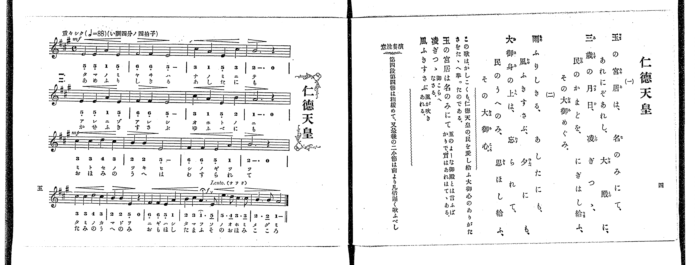

# 仁德天皇

> Re:Shōka 使用 AI 協助辨識與重建樂譜，可能會有錯誤。歡迎[回報](https://github.com/TMDLang/reshoka/issues)。

- **鋼琴伴奏版**：<br><audio controls src="nintoku_tenno.mp3"></audio>
- **NEUTRINO 歌聲合成版**：<br><audio controls src="nintoku_tenno_neutrino.mp3"></audio>

- 出處：共益商社樂器店《唱歌教科書 教師用 巻四》第四～五頁（第一學期第二曲）
- NDL Digital Collections PID 854865（https://dl.ndl.go.jp/pid/854865）掃描 P008.jpg

## 說明

原書資訊與歌詞全文（NDL PID 854865《唱歌教科書 教師用 巻四》第四～五頁，掃描 P008.jpg）：
調性與拍號：い調四分ノ四拍子（A 大調 4/4 拍），♩=88，「重々シク」
註記：單聲部，二節分節歌，共十八小節。開頭 mf，第三段（第九小節）mp，第十六小節第三拍附點四分音符標有延長記號（fermata）與 f 及換氣記號「V」，第十七～十八小節標示「Lento. (オソク)」（依演奏注意放慢約一倍，設為 ♩=44）。第十六小節第三拍五線譜為第二間 A4（1.），但下方簡譜誤印上點為「1^.」，本檔依五線譜記為 1。
原典演奏注意：第四段第四節は稍緩めて、又最後の二小節は前より凡倍遲く歌ふべし。
原典語釋：玉の宮居は名のみにて（玉のよーな御殿とは言ふばかりで、實はあれはてゝある）；凌ぎつゝ（御こらへなさる）；風ふきすさぶ（風が吹きあれる）。
原典曲意：「この歌は、かしこくも、仁德天皇の、民を愛し給ふ大御心のありがたさをたゝへ奉ったのである。」


## 歌詞

```text
一、
玉の宮居は、名のみにて、
あれにぞあれし、大殿に、
三歳の月日、凌ぎつゝ、
民のかまどを、にぎはし給ふ、
その大御めぐみ。

二、
雨ふりしきる、あしたにも、
風ふきすさぶ、夕にも、
大御身の上は、忘られて、
民のうへのみ、思ほし給ふ、
その大御心。
```

## ABC

<div class="abc-score" data-abc-src="nintoku_tenno.abc" aria-label="五線譜載入中"></div>

[下載 ABC 原始檔](nintoku_tenno.abc)

## TMD 檔案連結

- [主旋律 TMD 檔案](nintoku_tenno.tmd) [[在 TMD Studio 編輯](https://tmdlang.github.io/Tmd-TS/#tmd=s7IKdvYPcrWy4qpTUCpJTLdSSM7PyUlNLsnMz7PKrsxPzc6ML87Iz05Ugisoy88pzU21yk7MizeJtzA1sTAzRUgW55cWJadaFSdn5OfnxJekVpQk5edno8vHFySmp1oFGBhYIGQKivLLUvMS84C6C4oy80pSU8DaEQpSyzJTUkHSxclAq8tSizLTMlNTkNyVWlQMcjXUipKixLzi5KLMApBXEKrSU_OKUq2SU4tSc_PzMhNzEDJp-UW5VsUlRfkFGZnJCOGSjFSgbzNzC4AWIiuHiGdkFpfkF1UihPOLMtMz86xyUzOzMrH4P7-oJCM_vSixIKMSqjczOTEnHhiYwBDW0lJ4srvx6b7tT5esfD6rXUFLi0vRVsHCgsveVsGRy8ZE38QOZNDT9l0vZk59v2fW09aNz2d3PZ3a9nzJvmcrmp7OXPF01_THDV1Pp2x8trbn2dSZz5dPfDZ7hwKQ9XTH6udTVig83b776ezZjxu6n69ZA2S83zvvya4pLxc0vt_TARR5sqPh6dodz-bMB7F39Tybven9nk6w2_1cfBRcgB4rScxRcIYnkGKFAE8XBUgSAJqQUVJSUGylr5-So5cHxOn5elkF-gWZKfowFZ3P-pqf9fcrgCIeKJeuxMWlr6VgSy3ApaCg8LRvPtDHLza3v1jR9aKjHRgML1bOe9q64tm0dqALQd5AOJnMkOpB8wXQX8C4AFn-YtX-Zw3LQdZ2976YOR8o-rixBSgI1P-0o-1xcx-QAZR6unYC0C2OCk-XLAdKKgCjVQEoCjam59HMlbYWFkDG44ael-29jxtaHzdtf9y0_nFDL9iGFbtfrJgBivpp6140bnrZvAKoFBhVz9c3AG0AkkDfAEWACeNpb-PT1tVPN_QDBR83NL2c1v1ywVqF3DSgLDimO5-t2wqN9Z1zIcqALsgtgMiDda-FCEOVd_e-nNnycvc8iGdezt_8fM2yZytmPpvT-XT3tpdTtwPdBfZzR1pqUW5iSSLQNGBIKKQpPO3vetY_-9mGxRAVQI-FAX0Dt-fJjmZg4CI7F2jq8yW7gOp8UvNK8vUUNB43rXrctBcYCppgjR1P9s19tmfK06X9zzaveNbS_2zKvmeti55vaQGlX7DJL1asfd60SwEUmCYmQIcAAwCXp4Cx-nz7rBdr5wA1QJL9y2mTFRyBujoM9SBx8mRv25Md3c-m7Xy-YSFQ4YtVS572bniyowsYGEBNQHcaxulBfPRszppnq6YAnQc3FehnkEsMgS6AJs-nrTuQHQ-MS0gKA8YHhAGKsMb1z1f0Pt--8nFT4-PGZY8bGp_2dzyb0_B0X8_jxnVAN0LjtXH9087ex00dj5u6nrYvBPr9ZeOmx439wETwuHHr48adjxuBxQGSxS9WzXvZ3g2ysq8TaNDTdeuebmwFmTKhF8h93Lj_ceNqoH2gdAFWADK6ec_jxlVP9y18tg4ouwKo-MUKoMVA0zc8buwGWvy4cTnIfeuXAaUeNzY9bgLaDWQse9w0F8wFWgcMxNlP24HifY8blwDFgeYDDXzcOPlxE9CWHUDzHzdOhat8uQhoC9B8oJNmgsQbtwHVgwV7nk4AegkoDrYFrB41XGdvgoQoME5ApjeuA4cEMPMAQ7EbFBggwf7HTU1AEeSSFuTVhsZnGyY-bpr0rGU2UOXzrUD_bAXmUKBDn-5vBocO0Fagb4EGzgc7dxKIAfLkjqdLgd5YDBYHKlsO8TbQZaBMC3IdMF0CjQex0MIdFHCoQQ9VBwtIoNA8GBsYlY1AB4HjYTVUHSgNr90M8uicjmfTl4JUIIUzVBHIXyArgCGw73EjME1NAgcI0GygOmBUQT0LtxropXUQn4OT3wSQ44DBDLZvF7BgAit7ORscS6AQAQYrMBECPQxU3ATmAgNiNSSUwUoxIhTsEyADSRHEwhe7gK5aB8xb0MDZPwOUREC-h4UMzDNt4IQDDjhgzDUA3bwbn09AcQhJKpTXM1CgoKXPxeUHbKnkZ5eGpObl5VuF5WcmpzrUGNRUgyxSsLHQsgMzqnPTasEMYG0HDBwg3gfE64B4v0KNwuOmFiCeAOStB_EaV8HlgAEEFlkGsgqkv0bBNF5BF0IYwhg1CmYgCkyABUCwRsEYWQ2IU6NgBJUEQQOQCNhQH0OQHfOBfJC7QOQ6MLkfrAfkOiAP6D6Q2Hq48SB3oqoFuRYiswzJHrALIfYYgeSawKY1gtVvBbO7oLqmg8V6wWLdSPaAdUBlIa6E2tMEksG0BxzITUDpHrBSYA6CGgMRmQ7mdQHxbiBeAfYCSGQ1xYEMCt4aMBdXIEM83wP3BMhtSJ6EyoC8CvM8KHBALgWRK-ABDnEv7kAGBd_jxjmIQAYHK0hmJpg3FUxuQ9jT1IakdicRgVydW4CUpEFJFRSSs-GhuQRs5-PGTdCohSTpPrAMyNS5iNAGhSEIm0BpSDoFYaSARgt9UCDjT8-QFAkJstkoAbcEHiAg5yGCGpLCIOm5D0yCVMJ04Apq5AiC2AmzBxKkO8AkUr5p6geLgCOiqRNMgqIdd76BFxqgUAaFYjdYMagIWQnUPAmaGiChux7sEUiGhqjZCsRzwSIgvbB0Dyl4GoEsUMGzn-jYAAcz7tgA6ahOq4VmAqBkjUK1IrANVqtgChYxAasAqYPFnhE8w2CWRojwhCRpiLdBvJXgcJsECydocoXFGyi0IfGJXrKBEjiIhgUIhAcJFAgbFjAQHiRwUNwHjnVM94FiGyQDiW9EqQhzHzidgDMTLLVQ4L7GyVDeZKCZoJQMcV8tF5eunQJylaQA5CtzAQA)]
- [鋼琴伴奏 TMD 檔案](nintoku_tenno_piano.tmd) [[在 TMD Studio 編輯](https://tmdlang.github.io/Tmd-TS/#tmd=s7IKdvYPcrWy4qpTUCpJTLdSyC8qychPL0osyKi0ysgsLskvykxOzInPTsxLVOLS0lJ4srvx6b7tT5esfD6r_f2ejpfde55P2PJkz5anS_ufd3a839OpoKXFpWirYGHBZW-r4MhlY6JvYgcy_Wn7rhczp77fM-tp68bns7ueTm17vmTfsxVNT2eueLpr-uOGrqdTNj5b2_Ns6sznyyc-m71DAch6umP18ykrFJ5u3_109uzHDd3P16wBMt7vnfdk15SXCxqB9gNFnuxoeLp2x7M580HsXT3PZm8CukIJZKWfi4-CS2Z6ZklijoJzfk5OanJJZn5esUKAp4uChamJhZkp0ISMkpKCYit9_ZQcvTwgTs_XyyrQL8hM0Yep6HzW1_ysv18hwMDAAiiXrsTF5ZeZV5KfXRqSmpeXbxWQmZiXH-ThUGNQU82lAAQ2Flp2YEZ1blotmKGvpfC4cT4Q7wPidUC8X6FG4XFTCxBPAPLWg3iNq-ByjxtXg0WWKWjpg_XXKJjGK-hCCEMYo0bBDESBCbAACNYoGCOrAXFqFIygkiBoABIBG-pjCLJjPpAPcheIXAcm94P1gFwH5AHdBxJbDzce5E5UtSDXQmSWIdkDdiHEHiOQXBPYtEaw-q1gdhdU13SwWC9YrBvJHrAOqCzElVB7mkAymPaAA7kJKN0DVvq4cR7UGIjIdDCvC4h3A_EKsBdAIqspDmRQ8NaAubgCGeL5HrgnQG5D8iRUBuRVmOdBgQNyKYhcAQ9wiHtxBzIo-B43zkEEMjhYQTIzwbypYHIbwp6mNiS1O4kI5OrcAqQkDUqqoJCcDQ_NJWA7HzdugkYtJEn3gWVAps5FhDYoDEHYBEpD0ikIIwU0WuiDAhl_eoakSEiQzUYJuCXwAAE5DxHUkBQGSc99YBKkEqYDV1AjRxDETpg9kCDdASaR8k1TP1gEHBFNnWASFO248w280ACFMigUu8GKQUXISqDmSdDUAAnd9WCPQDI0RM1WIJ4LFgHphaV7SMHTCGSBCp79RMcGOJhxxwZIR3VaLTQTACVrFKoVbU1MahVMwSImYBUgdbDYM4JnGMzSCBGekCQN8TaItxIcbpNg4QRNrrB4A4U2JD7RSzZQAgfRsACB8CCBAmHDAgbCgwQOivvAsY7pPlBsg2Qg8Y0oFWHuA6cTcGaCpRYK3Nc4GcqbDDQTlJIh7qvFViP5INdIJtAaCZimXvR1vWzvfdq64-XsVki9jUgEhvEK0YaxMKoGCE2ATJNYGAUJCmzqTOOBbNP4WAQDt1q8ZiL0Y-pFVQnTj9d2qCJSXEqpuWiuxVSJ8JUBJPJ07RSQ4y_aByiLIWYEFlPmAgA)]

## 分析

```text
================================================================================
📊 TMD Song Profile: [ 仁德天皇 ]
================================================================================
⏱  Duration:       0:54 (54.5s), 18 measures total
🎼 Key & Tempo:    首調基準 A, != 88.0 BPM, <4/4>
   - 分析範圍：      由實際發聲的音符與和弦推測調性；播放脈絡另行呈現
🎤 人聲音域:    E4 (MIDI 64) – E5 (MIDI 76) [跨度: 12 個半音 / 1.0 個八度, 難度: easy]
   - 最低音:  E4 in [NintokuTenno #1 @ m.1, 0:00]
   - 最高音: E5 in [NintokuTenno #1 @ m.17, 0:43]
   - 適合: soprano, mezzo-soprano, contralto, tenor, baritone, bass
🏛  結構:      NintokuTenno (54.5s)
⚡ 編曲密度:        Peak 1 軌道同時演奏
🗝  調性診斷：       E 大調（純淨自然大調，未偵測到可信轉調）
   - 風格氣質:    純淨自然大調（陽光明朗、易唱易記，無明顯調外色彩）
   - 轉調歷程:    全曲維持單一推測調性（未偵測到可信轉調）
   - 核心骨幹音:  E, B, A, C#, F#
   - 調性數值:    E 大調 [相關度: 0.84, 穩定度: Moderate, 自然音純度: 96.3%]
   - 候選調性 (K-S): E 大調 (0.84), A 大調 (0.80), C# 小調 (0.62)
   - 五度圈歷程:   +4
   - 各段落調性細節:
     • [NintokuTenno #1]: E 大調 (r: 0.84, 自然音純度: 96.3%, 調外音: D)

  [ 五度圈游移軌跡 ]
               C  
         F            G  
      Bb               D  
      Eb               A  
         Ab          [E ]*
            Db       B  
               F# 
     (* = active key center)

  [ 十二半音累積音高分佈 ]
     C  :                            0.0%
     C# : ███████████████           17.6%
     D  : ███                        3.7%
     D# :                            0.0%
     E  : ████████████████████████  27.9%
     F  :                            0.0%
     F# : ██████████                11.8%
     G  :                            0.0%
     G# :                            0.0%
     A  : ████████████████          18.4%
     A# :                            0.0%
     B  : ██████████████████        20.6%
--------------------------------------------------------------------------------
Assignment 軌道音域：
  - Voice         : E4 – E5 (12 個半音 / 1.0 個八度, 58 個音符)
================================================================================
```


## 原書掃描頁




