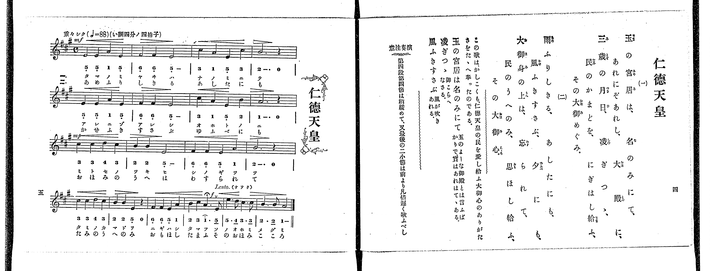

# 仁德天皇

> Re:Shoka 使用 AI 協助辨識與重建樂譜，可能會有錯誤。歡迎回報。

<audio controls src="nintoku_tenno.mp3"></audio>

- 出處：共益商社樂器店《唱歌教科書 教師用 巻四》第四～五頁（第一學期第二曲）
- NDL Digital Collections PID 854865（https://dl.ndl.go.jp/pid/854865）掃描 P008.jpg

## 說明

原書資訊與歌詞全文（NDL PID 854865《唱歌教科書 教師用 巻四》第四～五頁，掃描 P008.jpg）：
調性與拍號：い調四分ノ四拍子（A 大調 4/4 拍），♩=88，「重々シク」
註記：單聲部，二節分節歌，共十八小節。開頭 mf，第三段（第九小節）mp，第十六小節第三拍附點四分音符標有延長記號（fermata）與 f 及換氣記號「V」，第十七～十八小節標示「Lento. (オソク)」（依演奏注意放慢約一倍，設為 ♩=44）。第十六小節第三拍五線譜為第二間 A4（1.），但下方簡譜誤印上點為「1^.」，本檔依五線譜記為 1。
原典演奏注意：第四段第四節は稍緩めて、又最後の二小節は前より凡倍遲く歌ふべし。
原典語釋：玉の宮居は名のみにて（玉のよーな御殿とは言ふばかりで、實はあれはてゝある）；凌ぎつゝ（御こらへなさる）；風ふきすさぶ（風が吹きあれる）。
原典曲意：「この歌は、かしこくも、仁德天皇の、民を愛し給ふ大御心のありがたさをたゝへ奉ったのである。」

## 歌詞

```text
一、
玉の宮居は、名のみにて、
あれにぞあれし、大殿に、
三歳の月日、凌ぎつゝ、
民のかまどを、にぎはし給ふ、
その大御めぐみ。

二、
雨ふりしきる、あしたにも、
風ふきすさぶ、夕にも、
大御身の上は、忘られて、
民のうへのみ、思ほし給ふ、
その大御心。
```

## ABC

```abc
X:1
T:仁德天皇
M:4/4
L:1/16
Q:1/4=88
K:A
V:V1 name="Voice" snm="Voi"
[V:V1]
!mf! E4 E4 A4 E4 | F4 F4 E8 | c4 A4 E4 c4 | B12 z4 |
E4 E4 A4 E4 | F4 F4 E8 | c4 A4 E4 B4 | A12 z4 |
!mp! c4 c4 d4 c4 | B4 B4 E8 | F4 F4 E4 A4 | B12 z4 |
c4 c4 d4 c4 | B4 B4 E4 z4 | F4 F4 E4 A4 | !f! B4 c4 A6 E2 |
[Q:1/4=44] e6 d2 c6 c2 | B6 B2 A8 | !mf! E4 E4 A4 E4 | F4 F4 E8 |
c4 A4 E4 c4 | B12 z4 | E4 E4 A4 E4 | F4 F4 E8 |
c4 A4 E4 B4 | A12 z4 | !mp! c4 c4 d4 c4 | B4 B4 E8 |
F4 F4 E4 A4 | B12 z4 | c4 c4 d4 c4 | B4 B4 E4 z4 |
F4 F4 E4 A4 | !f! B4 c4 A6 E2 | [Q:1/4=44] e6 d2 c6 c2 | B6 B2 A8 |
```

## TMD 檔案連結

- [主旋律 TMD 檔案](nintoku_tenno.tmd) [[在 TMD Studio 編輯](https://tmdlang.github.io/Tmd-TS/#tmd=s7IKdvYPcrWy4qpTUCpJTLdSSM7PyUlNLsnMz7PKrsxPzc6ML87Iz05Ugisoy88pzU21yk7MizeJtzA1sTAzRUgW55cWJadaFSdn5OfnxJekVpQk5edno8vHFySmp1oFGBhYIGQKivLLUvMS84C6C4oy80pSU8DaEQpSyzJTUkHSxclAq8tSizLTMlNTkNyVWlQMcjXUipKixLzi5KLMApBXEKrSU_OKUq2SU4tSc_PzMhNzEDJp-UW5VsUlRfkFGZnJCOGSjFSgbzNzC4AWIiuHiGdkFpfkF1UqcWlpKTzZ3fh03_anS1Y-n9WuoKXFpWirYGHBZW-r4MhlY6JvYgfS-rR914uZU9_vmfW0dePz2V1Pp7Y9X7Lv2YqmpzNXPN01_XFD19MpG5-t7Xk2debz5ROfzd6hAGQ93bH6-ZQVCk-37346e_bjhu7na9YAGe_3znuya8rLBY3v93QARZ7saHi6dsezOfNB7F09z2Zver-nE-xaPxcfBZfM9MySxBwFZ3jkFisEeLooQKIPaEJGSUlBsZW-fkqOXh4Qp-frZRXoF2Sm6MNUdD7ra37W368AijSgXLoSF5e-loIttQCXgoLC0775QB-_2Nz-YkXXi452YDC8WDnvaeuKZ9PagS4EeQPhZDJDqgfNF0B_AeMCZPmLVfufNSwHWdvd-2LmfKDo48YWoCBQ_9OOtsfNfUAGUOrp2glAtzgqPF2yHCipAIxWBaAo2JieRzNX2lpYABmPG3petvc-bmh93LT9cdP6xw29YBtW7H6xYgYo6qete9G46WXzCqBSYFQ9X98AtAFIAn0DFAEmjKe9jU9bVz_d0A8UfNzQ9HJa98sFaxVy04Cy4JjufLZuKzTWd86FKAO6ILcAIg_WvRYiDFXe3ftyZsvL3fMgnnk5f_PzNcuerZj5bE7n093bXk7dDnQX2M8daalFuYkliUDTgCGhkKbwtL_rWf_sZxsWQ1QAPRYG9A3cnic7moGBi-xcoKnPl-wCqvNJzSvJ11PQeNy06nHTXmAoaII1djzZN_fZnilPl_Y_27ziWUv_syn7nrUuer6lBZR-wSa_WLH2edMuBVBgmpgAHQIMAFyeAsbq8-2zXqydA9QASfYvp01WcATq6jDUg8TJk71tT3Z0P5u28_mGhUCFL1Ytedq74cmOLmBgADUB3WkYpwfx0bM5a56tmgJ0HtxUoJ9BLjEEugCaPJ-27kB2PDAuISkMGB8QBijCGtc_X9H7fPvKx02NjxuXPW5ofNrf8WxOw9N9PY8b1wHdCI3XxvVPO3sfN3U8bup62r4Q6PeXjZseN_YDE8Hjxq2PG3c-bgQWB0gWv1g172V7N8jKvk6gQU_XrXu6sRVkyoReIPdx4_7HjauB9oHSBVgByOjmPY8bVz3dt_DZOqDsCqDiFyuAFgNN3_C4sRto8ePG5SD3rV8GlHrc2PS4CWg3kLHscdNcMBdoHTAQZz9tB4r3PW5cAhQHmg808HHj5MdNQFt2AM1_3DgVrvLlIqAtQPOBTpoJEm_cBlQPFux5OgHoJaA42BawetRwnb0JEqLAOAGZ3rgOHBLAzAMMxW5QYIAE-x83NQFFkEtakFcbGp9tmPi4adKzltlAlc-3Av2zFZhDgQ59ur8ZHDpAW4G-BRo4H-zcSSAGyJM7ni4FemMxWByobDnE20CXgTItyHXAdAk0HsRCC3dQwKEGPVQdLCCBQvNgbGBUNgIdBI6H1VB1oDS8djPIo3M6nk1fClKBFM5QRSB_gawAhsC-x43ANDUJHCBAs4HqgFEF9SzcaqCX1kF8Dk5-E0COAwYz2L5dwIIJrOzlbHAsgUIEGKzARAj0MFBxE5gLDIjVkFAGK8WIULBPgAwkRRALX-wCumodMG9BA2f_DFASAfkeFjIwz7SBEw444IAx1wB08258PgHFISSpUF7PQIGClj4Xlx-wlZGfXRqSmpeXbxWWn5mc6lBjUKNQDbJJwcZCyw7MqM5NqwUzgNUdMHSAeB8QrwPi_Qo1Co-bWoB4ApC3HsRrXAWXA4YQWGQZyC6Q_hoF03gFXQhhCGPUKJiBKDABFgDBGgVjZDUgTo2CEVQSBA1AIghHNQGd0AO2EJjkwJbCRKaDeV1AvBuIV4AdBxJZTbGjQM6pAXMxHVWdW4AUZKCgANk8G277EiDuBeJNYN50aJD1gWVAQToX4TqQnSBsghIOIIzkMDTXghyFN7xAkQhyFcjWbrAbQFG6EmjzJGjoQFyzHh6CsGjfCkqYYBGQXli4QhJCI5AFSgj7iXY92Fm4XQ_SUZ1WCw1koCQwbQLblCYmtQqmYCETsBKQQph3jeAxUsNVy8Wla6eAnMgVsPCVuQA)]

## 分析

```text
================================================================================
📊 TMD Song Profile: [ 仁德天皇 ]
================================================================================
⏱  Duration:       2:32 (152.7s), 36 measures total
🎼 Key & Tempo:    首調基準 A, != 88.0 BPM, <4/4>
   - 分析範圍：      由實際發聲的音符與和弦推測調性；播放脈絡另行呈現
🎤 人聲音域:    E4 (MIDI 64) – E5 (MIDI 76) [跨度: 12 個半音 / 1.0 個八度, 難度: easy]
   - 最低音:  E4 in [NintokuTenno #1 @ m.1, 0:00]
   - 最高音: E5 in [NintokuTenno #1 @ m.17, 0:43]
   - 適合: soprano, mezzo-soprano, contralto, tenor, baritone, bass
🏛  結構:      NintokuTenno (54.5s) -> NintokuTenno (98.2s)
⚡ 編曲密度:        Peak 1 軌道同時演奏
🗝  調性診斷：       E 大調（純淨自然大調，未偵測到可信轉調）
   - 風格氣質:    純淨自然大調（陽光明朗、易唱易記，無明顯調外色彩）
   - 轉調歷程:    全曲維持單一推測調性（未偵測到可信轉調）
   - 核心骨幹音:  E, B, A, C#, F#
   - 調性數值:    E 大調 [相關度: 0.84, 穩定度: Moderate, 自然音純度: 96.3%]
   - 候選調性 (K-S): E 大調 (0.84), A 大調 (0.80), C# 小調 (0.62)
   - 五度圈歷程:   +4 -> +4
   - 各段落調性細節:
     • [NintokuTenno #1]: E 大調 (r: 0.84, 自然音純度: 96.3%, 調外音: D)
     • [NintokuTenno #2]: E 大調 (r: 0.84, 自然音純度: 96.3%, 調外音: D)

  [ 五度圈游移軌跡 ]
               C  
         F            G  
      Bb               D  
      Eb               A  
         Ab          [E ]*
            Db       B  
               F# 
     (* = active key center)

  [ 十二半音累積音高分佈 ]
     C  :                            0.0%
     C# : ███████████████           17.6%
     D  : ███                        3.7%
     D# :                            0.0%
     E  : ████████████████████████  27.9%
     F  :                            0.0%
     F# : ██████████                11.8%
     G  :                            0.0%
     G# :                            0.0%
     A  : ████████████████          18.4%
     A# :                            0.0%
     B  : ██████████████████        20.6%
--------------------------------------------------------------------------------
Assignment 軌道音域：
  - Voice         : E4 – E5 (12 個半音 / 1.0 個八度, 116 個音符)
================================================================================
```


## 原書掃描頁




