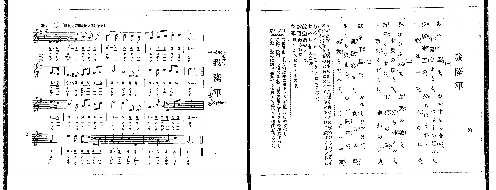
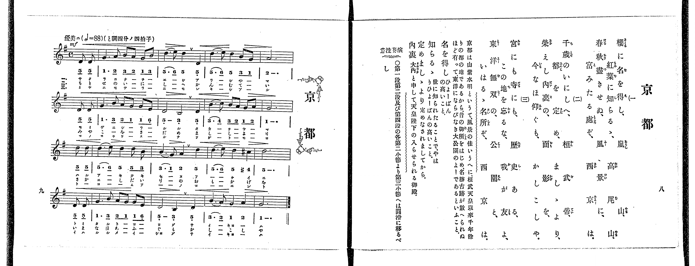

# 我陸軍

> Re:Shōka 使用 AI 協助辨識與重建樂譜，可能會有錯誤。歡迎回報。

- **鋼琴伴奏版**：<br><audio controls src="waga_rikugun.mp3"></audio>
- **NEUTRINO 歌聲合成版**：<br><audio controls src="waga_rikugun_neutrino.mp3"></audio>

- 出處：共益商社樂器店《唱歌教科書 教師用 巻四》第六～七頁（第一學期第三曲）
- NDL Digital Collections PID 854865（https://dl.ndl.go.jp/pid/854865）掃描 P009.jpg

## 說明

原書資訊與歌詞全文（NDL PID 854865《唱歌教科書 教師用 巻四》第六～七頁，掃描 P009.jpg）：
調性與拍號：と調四分ノ四拍子（G 大調 4/4 拍），♩=96，「壯大ニ」，弱起一拍
註記：單聲部，三節分節歌。開頭 f。第五小節第一拍後半出現升 D4（簡譜記為 #5_，TMD 記為 5'_）。第十三小節原譜印為「6. 6_ 6 5 4_ 3_」，若中間 6 5 均作四分音符則多出一拍，對照歌詞與拍號，第三拍之 6 5 記為兩個八分音符。第十五小節第四拍五線譜為 D4（5_），簡譜漏印下點作 5，依五線譜記為 5_。原譜於第二、六、十、十四小節印有換氣記號「V」。
原典演奏注意：豫習曲として前學年に出でたる「朝風」を復習すべし；第二段第一小節なる #5_ 音の高度の下らざる樣注意すべし；第二章の歌詞中「歩兵」と「砲兵」との混せざる樣注意あるべし。
原典語釋：あやにかしこき（きはめて尊い）；すめらぎ（天皇陛下）；敵壘（敵のとりで）；敵營（敵の陣屋）；凱歌（戰にかちたるときの歌）。
原典曲意：「我が陸軍には、騎兵、歩兵、砲兵、工兵、輜重兵などの種類があつて、各、その務めを守り、君のため、國のために命をさゝげて盡すさまを詠んだのである。」


## 歌詞

```text
一、
あやに畏き、わがすめらぎの、
御國をまもる、つはもの雄々し、
歩騎砲工の、分ちはあれど、
心は一つ、君のため。

二、
手むかふ敵を、騎兵の槍と、
歩兵の銃もて、打ち拂ふべし、
敵壘くづすは、工兵の鍬、
敵營くだくは、砲兵の彈丸。

三、
敵を千里に、おひしりぞけて、
凱歌奏する、喇叭の響、
きくも勇まし、わが陸軍の、
萬歳となへて、うたへや友。
```

## ABC

<div class="abc-score" data-abc-src="waga_rikugun.abc" aria-label="五線譜載入中"></div>

[下載 ABC 原始檔](waga_rikugun.abc)

## TMD 檔案連結

- [主旋律 TMD 檔案](waga_rikugun.tmd) [[在 TMD Studio 編輯](https://tmdlang.github.io/Tmd-TS/#tmd=s7IKdvYPcrWy4qpTUCpJTLdSSM7PyUlNLsnMz7PKrsxPzc6ML87Iz05Ugisoy88pzU21yk7MizeJtzA1sTAzRUgW55cWJadaFSdn5OfnxJekVpQk5edno8vHFySmp1oFGBhYImQKivLLUvMS84C6C4oy80pSU8DaEQpSyzJTUkHSxclAq8tSizLTMlNTkNyVWlQMcjXUipKixLzi5KLMApBXEKrSU_OKUq1yE4uSMxCCaflFuVbFJUX5BRmZyQjhkoxUoEdzM3MySxKLKtHFM3MLgG5IzEGI5xdlpmfmWeWmZmZlYvF7flFJRn56UWJBRqVVRmZxCVB5cmJOPDAggaGrpaXwrGPiy5k7XuzuVdDS4lK0VbA047K3VXDnsjHRN7EDmfK0fdeLmVPf75n1tHXj89ldT6e2PV-y79mKpqczVzzdNf1xQ9fTKRufre15NnXm8-UTn83eoQBkPd2x-vmUFQpPt-9-Onv244bu52vWPG1d-37vvCc7ml8uaHy_pwMo8mRHw9O1O57NmQ9mdz6bven9nk6ww_1cfBRcgL4qScxRcIanjGKFAE8XBUjcA03IKCkpKLbS10_J0csD4vR8vawC_YLMFH2Yis5nfc3P-vsVQDEOlEtX4uLS11KwpRbgUlBQeNo3H-jjF5vbX6zoetHRDgyGFyvnPW1d8WxaO9CFIG8gnExmSPWg-QLoL2BcgCx_sWr_s4blIGu7e1_MnA8Ufdy4AigINOhpR9vj5j4gAyj1dO0EoFvcFZ4uWQ6UVABGqwJQFGxMz6OZK20tzYCMxw09TxevByp53Nz9uAEo2_N0z8YXW7cD4wioGGzbit0vVswAJYNp6140bnrZvAKoCBhtz9c3AG0DkkCfPW5oejmt--WCtQppQCYoWndNebqhHygJiW6Qa_b1PO3tAqap5_37nva2K7iYgBLDhoUv1s4BGv-8aZeCsmk80OQQXxeglWABU3WgQCfEwKe9jUA7IWYCAx-o62nvBqAioPvN9BTM4hXMFEwVTOIVjOMhvnjRvfTJjrUvp00GSzyd2_5k7xxI-Lycv_n5mmVPO9ufLpkFdA7EdSB_b-h93rocEpNIYdsDTaTdvU92doMNg7juaevKpw3dT1tXw41EOBTJ85CoAIo83z4L6GiQt8A-B_kVFBGQEHi2px_onSc7ul_ungd0qAIwEfc82TcXrg0WIEDPNUF8_2zaHnAwA4O-EZhuQGRvI4QEeRMSTr0bns3pfNY_-9mGxUATgN4BhlYYMHyApkAT8dPWHc_2THm6tP_Z5hXPWvqBsfxi4-rn-ycB8yQwTT1unP64ERhUwKS04-nOLY8bVwMD7HHj8seN8x83AZNLz7M5c18uWgEysWnS030rgRofN8583LgTqPH9ntkQBz5btxWa58GOety4CqgXFNkKwGB73Lju5eoZT3ctAzKA3n_c1Pm4cRpQ_tmKxRAXYZr3fPUCoGJIPAGjGOSKtSuftm4FuQLo5Iae5ws2IbhAldu3P26cjWFsE8gHYJNRQuPFqnkv27vBWQqoogXo5ceNQHXAcJj8uBGYTDqA5OPG9Y-bGkEhs6HrcWMLOCKBFswECYI80AdU9nTJyuez2l_OnA30FUTBs6lbny4G5qMOIAPoLJDjmoDal8Nln7cDkxtU9uXMxU83QjU-bQcVHiCpjg0w9yyERgHIh0D3gIIDklWQ4nX2JkiMgkKoY-Ljxh5IcQ82Yj0wqbxc0QcOp0ZY-DXCQq7x6falEMaLPXNetveC2MBoa1wJtOn5inUvF84DmgYKoMYlwFAAqZ_QAiQfN84FKnjaDQmISU_XdYB8CJIFhg7Qw0AXg5PoHKC7YVxgkpq4F6j4cePUx01A7UDGsuezgd4DRvvUx437gFIvVi543AQMfVC0gxMfOOoamoAxzAXyLjBpAU0FseBx9nwqMIaByRzoDCAD6FRE3IAMgah-um8hyCkgu4HWQAwFOgjoJWD0Av227uVsoK9awSkErAEYTsAwAwXS9qUQY0DFLSgu1oNtBtqzEmb2_magKMhlQPPQQ6AJ4mxw3gWb2wl0BVAlMFi2gqIf6CJ47ACjdjkkXcOcABF92dUMdiQo9J91AkNn4bNuIBcoBUnSENXgJPe4ERgGQAcDQxQU7dC4BRrRuwahDpj4wOqAgQwkQeqgiQEYoXs7nuzYAXf2DmAyg-kCxXJv88t2oM9XgwMPmKCBBcd0cMoGJhJgqgM5EBwi4FQMLGnAkQEK6qfT2p_2rwU5ZP5-eAQC_doP9NjT7nZQrIB9AolDWOKFxd6LCWuerQWWH8AMAEyZOyAWPW4ExgfQIzuAyeBpPyiRgJRSXuVDgYKWPhdXeGJ6YlBmdml6aZ5VWH5mcqpDjUFNNcgeBRtDMy07MKs6rRZMA9sdGpAKVROUOhWA7lKoAbJWKzxu3gPBjd1APB2IJ4NlehEyTf1Afg8QzwTJNDUCcSdUTx8QrwOKagCDHGTybrA40HkgS2sUDBR0wRCdBha6UKpGwRAqhgyNgdgIiEFyNcCqDlMFSMwEqrIGrBamDyQK0wGjsdsCghBxc6BDwE72MaxRgLhNF4MGhRuYhocdpnGgUASR08HkZLDVoLDEohIYqiA1PXAngsIXJtcIZ3XCTe5DUrkOh3ceN-6HqYL4xwiff5ZB7WgAmwlyOaZ5W-EqIf4ApYBJWFWCZIFJHsmVLXA5mHtBYQdjdSGpXIHTP7uh9A6Yj4yJ8BHQLbjdORtsOyhuIG7AHZcgWWBBguROULyiuh5YvsBZE5FUQlyCzVRIjINCB-IjYN4EFjbQDAXNkECnQ_j7wDTIM6BMC8qiS4B4PUwEGLBgtU1zYerAWRiYDYFBAM-GwGYpwgHA1iyQBAsBkz0kB4DyTw049yBDWK4C51YwUQPOXTAIYsP4sByLPbeCoBnELKSMBvI1euCAIgIScSC_w4MT6Fc0lcCwgOlZAibXY1EJSXiIhIBgIUcmZhTBEh0wGcGzESI5I5ncOONxUyvccJjV-OO_DUwuhKoDORvhKVBuh-Q5iNqdRDkXKdXD8whmfgY2i-AsWEkDCjBs-R7ZNYuh9m9EMQvifVjeeNy4GcmlvThdCpNBSvmQKgOUwSF0C5SeDKXb4CkblNZBVVE3mLcQHHjgygycY4AVFFTdSrBueOpHTrKwZIpcUQDzB5o74dUHUsJHrkBgpoClQBKotRA6hGlFTvmQFIYcNKBkAWGBiiZYUMJEUQMezIJWIKDog4QHsipQsoJVWCC1yNXMShzuRLIZkepRkgd6HoDlX5CpSzFMg1dnUNfAqkNkP0EqDIi5sESFbCpy9kA1HZbBkJM8cnkCyY7IldBUJHNhZQvCPETRjqiYQf6HFfQIHz9unABXixxXuCvlDUgKESkfmMKbeiGpGJzSN8FT8AqoCKisB1dlwGodIgLMA43zoc0wRPmOZBmIDcLYG0ggCEv7IAhtiKGX7LAEjqYEVyMK1qxDTuAw_0KCqRccDLDIRK1T0et-SIEOYYH0wdTBWjYIdfCsAAwSuDp42wkdwv2BVKTDzIeY0gEmEQkGOSEuQFEJSQYI_8CyM0glrAUEkUEkbAyXYiRCHC4FJ-1pWEyFhRyw64HDfogsLKsgsh5IHcwlEBlwNkS0zuBmY6t8Md1Zy8Wla6eA1CVRAHKVuQA)]
- [鋼琴伴奏 TMD 檔案](waga_rikugun_piano.tmd) [[在 TMD Studio 編輯](https://tmdlang.github.io/Tmd-TS/#tmd=s7IKdvYPcrWy4qpTUCpJTLdSyC8qychPL0osyKi0ysgsLskvykxOzInPTsxLVOLS0lJ41jHx5cwdL3b3vt_T8bJ7z_MJW57s2fJ0af_zzo73ezoVtLS4FG0VLM247G0V3LlsTPRN7EBGP23f9WLm1Pd7Zj1t3fh8dtfTqW3Pl-x7tqLp6cwVT3dNf9zQ9XTKxmdre55Nnfl8-cRns3coAFlPd6x-PmWFwtPtu5_Onv24ofv5mjVPW9e-3zvvyY7mlwsagfYDRZ7saHi6dsezOfPB7M5nszcBXaEEstLPxUfBJTM9syQxR8E5PycnNbkkMz-vWCHA00XBwtTEwswUaEJGSUlBsZW-fkqOXh4Qp-frZRXoF2Sm6MNUdD7ra37W368QYGBgCZRLV-LiCk9MTwzKzC5NL82zCshMzMsP8nCoMaip5lIAAhtDMy07MKs6rRZM62spaDzds_HF1u2aCo8bmxQeN7Uo1ABZqxUeN--B4MZuIJ4OxJPBMr0ImaZ-IL8HiGeCZJoagbgTqqcPiNcBRTUeN3aBTN4NFtfSB1tao2CgoAuG6LRpPIyqUTCEiiFDYyA2AmKQXI2CKRYVIDETqMoasFqYPpAoTAeMxm4LCELEzYEOATvZx7BGAeI2XQwaFG5gGh52mMaBQhFETgeTk8FWg8ISi0pgqILU9MCdCApfmFwjnNUJN7kPSeU6HN553LgfpgriHyN8_lkGtaMBbCbI5ZjmbYWrhPgDlAImYVUJkn3cuAPJlS1wOZh7QWEHY3UhqVyB0z-7ofQOmI-MifAR0C243TkbbDsobiBuwB2XINnHjZuQ3AmKV1TXP26cB2dNRFIJcQk2UyExDgodiI-AefNxIzCLgTMUNEMCnQ7h7wPTIM-AMi0oiy4B4vUwEWDAgtU2zYWpA2dhYDYEBgE8G5rBAggETdVBPLAQMNlDcgAo_9SAcw8yhOUqcG4FEzXg3AWDIDaMD8ux2HMrCJpBzELKaCBfowcOKCIgEQfyOzw4gX5FUwkMC5ieJWByPRaVkISHSAgIFnJkYkYRLNEBkxE8GyGSM5LJjTMeN7XCDYdZjT_-28DkQqg6kLMRngLldkieg6jdSZRzkVI9PI9g5ufHjXPhLFhJAwowbPke2TWLofZvRDEL4n1Y3njcuBnJpb04XQqTQUr5kCoDlMEhdAuUngyl2-ApG5TWQVVRN5i3EBx44MoMnGOAFRRU3UqwbnjqR06ysGSKXFEA8weaO-HVB1LCR65AYKaApUASqLUQOoRpRU75kBSGHDSgZAFhgYomWFDCRFEDHsyCViCg6IOEB7IqULKCVVggtcjVzEoc7kSyGZHqUZIHeh6A5V-QqUsxTINXZ1DXwKpDZD9BKgyIubBEhWwqcvZANR2WwZCTPHJ5AsmOyJXQVCRzYWULwjxE0Y6omEH-hxX0CB8_bpwAV4scV7gr5Q1IChEpH5jCm3ohqRic0jfBU_AKqAiorAdXZcBqHSICzAON86HNMET5jmQZiA3C2BtIIAhL-yAIbYihl-ywBI6mBFcjCtasQ07gMP9CgqkXHAywyEStU9HrfkiBDmGB9MHUwVo2CHXwrAAMErg6eNsJHcL9gVSkw8yHmNIBJhEJBjkhLkBRCUkGCP_AsjNIJawFBJFBJGwMl2IkQhwuBSftaVhMhYXc48ZVOOyHyMKyCiLrgdTBXAKRAWdDROsMbja2yhfTnbVYeiQ-yD0SE2iHBJjwX_R1vWzvfdq64-XsVki3DZGSDeMVog1jYVQNQsQ0HkibxgPFUFWaACkTiEq4EpgYqkqECaDEDlGCYSpcAMkFBNWCGAZ4nQDlIhmKYRFhB6CZiWEXHqcighXoTlBk6dopIMVXtA9QEl3ICFPIGCykzAUA)]

## 分析

```text
================================================================================
📊 TMD Song Profile: [ 我陸軍 ]
================================================================================
⏱  Duration:       0:42 (42.5s), 17 measures total
🎼 Key & Tempo:    首調基準 G, != 96.0 BPM, <4/4>
   - 分析範圍：      由實際發聲的音符與和弦推測調性；播放脈絡另行呈現
🎤 人聲音域:    D4 (MIDI 62) – E5 (MIDI 76) [跨度: 14 個半音 / 1.2 個八度, 難度: moderate]
   - 最低音:  D4 in [WagaRikugun #1 @ m.1, 0:01]
   - 最高音: E5 in [WagaRikugun #1 @ m.9, 0:21]
   - 適合: soprano, mezzo-soprano, contralto, tenor, baritone, bass
🏛  結構:      WagaRikugun (42.5s)
⚡ 編曲密度:        Peak 1 軌道同時演奏
🗝  調性診斷：       G 大調（純淨自然大調，未偵測到可信轉調）
   - 風格氣質:    純淨自然大調（陽光明朗、易唱易記，無明顯調外色彩）
   - 轉調歷程:    全曲維持單一推測調性（未偵測到可信轉調）
   - 核心骨幹音:  D, G, A, C, B
   - 調性數值:    G 大調 [相關度: 0.92, 穩定度: High, 自然音純度: 99.2%]
   - 候選調性 (K-S): G 大調 (0.92), D 大調 (0.72), C 大調 (0.60)
   - 五度圈歷程:   +1
   - 各段落調性細節:
     • [WagaRikugun #1]: G 大調 (r: 0.92, 自然音純度: 99.2%, 調外音: D#)

  [ 五度圈游移軌跡 ]
               C  
         F           [G ]*
      Bb               D  
      Eb               A  
         Ab           E  
            Db       B  
               F# 
     (* = active key center)

  [ 十二半音累積音高分佈 ]
     C  : ██████████████            14.1%
     C# :                            0.0%
     D  : ████████████████████████  24.6%
     D# : █                          0.8%
     E  : ███████████               11.3%
     F  :                            0.0%
     F# : █                          1.2%
     G  : ████████████████████      20.7%
     G# :                            0.0%
     A  : ███████████████           15.6%
     A# :                            0.0%
     B  : ███████████               11.7%
--------------------------------------------------------------------------------
Assignment 軌道音域：
  - Voice         : D4 – E5 (14 個半音 / 1.2 個八度, 69 個音符)
================================================================================
```


## 原書掃描頁






