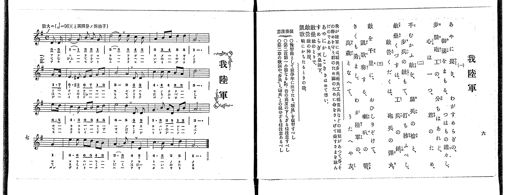
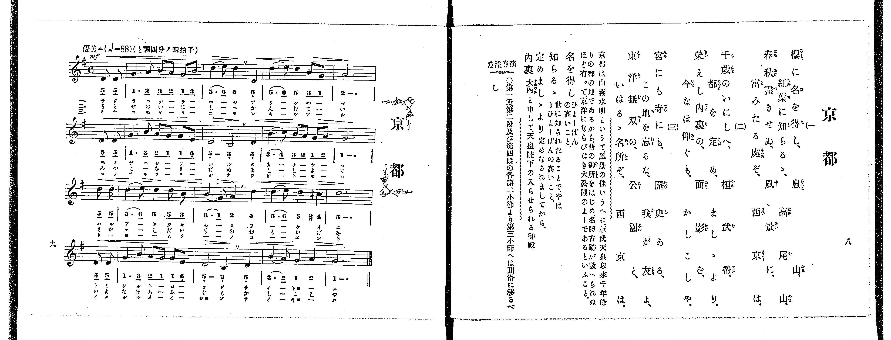

# 我陸軍

> Re:Shōka 使用 AI 協助辨識與重建樂譜，可能會有錯誤。歡迎回報。

- **鋼琴伴奏版**：<br><audio controls src="waga_rikugun.mp3"></audio>
- **NEUTRINO 歌聲合成版**：<br><audio controls src="waga_rikugun_neutrino.mp3"></audio>

- 出處：共益商社樂器店《唱歌教科書 教師用 巻四》第六～七頁（第一學期第三曲）
- NDL Digital Collections PID 854865（https://dl.ndl.go.jp/pid/854865）掃描 P009.jpg

## 說明

原書資訊與歌詞全文（NDL PID 854865《唱歌教科書 教師用 巻四》第六～七頁，掃描 P009.jpg）：
調性與拍號：と調四分ノ四拍子（G 大調 4/4 拍），♩=96，「壯大ニ」，弱起一拍
註記：單聲部，三節分節歌。開頭 f。第五小節第一拍後半出現升 D4（簡譜記為 #5_，TMD 記為 5'_）。第十三小節原譜印為「6. 6_ 6 5 4_ 3_」，若中間 6 5 均作四分音符則多出一拍，對照歌詞與拍號，第三拍之 6 5 記為兩個八分音符。第十五小節第四拍五線譜為 D4（5_），簡譜漏印下點作 5，依五線譜記為 5_。原譜於第二、六、十、十四小節印有換氣記號「V」。
原典演奏注意：豫習曲として前學年に出でたる「朝風」を復習すべし；第二段第一小節なる #5_ 音の高度の下らざる樣注意すべし；第二章の歌詞中「歩兵」と「砲兵」との混せざる樣注意あるべし。
原典語釋：あやにかしこき（きはめて尊い）；すめらぎ（天皇陛下）；敵壘（敵のとりで）；敵營（敵の陣屋）；凱歌（戰にかちたるときの歌）。
原典曲意：「我が陸軍には、騎兵、歩兵、砲兵、工兵、輜重兵などの種類があつて、各、その務めを守り、君のため、國のために命をさゝげて盡すさまを詠んだのである。」


## 歌詞

```text
一、
あやに畏き、わがすめらぎの、
御國をまもる、つはもの雄々し、
歩騎砲工の、分ちはあれど、
心は一つ、君のため。

二、
手むかふ敵を、騎兵の槍と、
歩兵の銃もて、打ち拂ふべし、
敵壘くづすは、工兵の鍬、
敵營くだくは、砲兵の彈丸。

三、
敵を千里に、おひしりぞけて、
凱歌奏する、喇叭の響、
きくも勇まし、わが陸軍の、
萬歳となへて、うたへや友。
```

## ABC

```abc
X:1
T:我陸軍
M:4/4
L:1/16
Q:1/4=96
K:G
V:V1 name="Voice" snm="Voi"
[V:V1]
!f! z4 z4 z4 D3 D | G10 B2 A2 G2 | d10 d2 c2 B2 | A4 B2 c2 d4 d4 |
w: 1.~あ や | に か し こ | き わ が _ | す め _ ら ぎ
w: 2.~て む | か ふ て き | を き へ _ | い の _ や り
w: 3.~て き | を せ ん り | に お ひ _ | し り _ ぞ け
G12 G3 F | E6 ^D2 E2 F2 G2 A2 | B8 A4 D2 D2 | c6 c2 c4 B2 A2 |
w: 1.~の み _ | く _ に を ま _ | も る つ は | も の を を _
w: 2.~と ほ へ | い の じゅ _ も _ | て _ う ち | は ら ふ べ _
w: 3.~て が い | か _ そ _ す _ | る _ ら っ | ぱ の ひ び _
d12 e3 d | c6 B2 A2 B2 c2 d2 | e8 d4 D2 D2 | G6 B2 A2 D2 G2 B2 |
w: 1.~し ほ き | ほ _ う _ こ _ | う の わ か | ち は あ _ れ _
w: 2.~し て き | る い _ _ く _ | づ す は こ | う へ い の く _
w: 3.~き き _ | く も い _ さ _ | ま し わ が | り く ぐ _ ん _
A12 G4 | e6 e2 e2 d2 c2 B2 | A6 B2 c4 D4 | c6 B2 A4 D4 |
w: 1.~ど こ | こ ろ は _ ひ _ | と _ つ き | み _ の た
w: 2.~は て | き え い _ く _ | だ く は ほ | へ い の た
w: 3.~の ばん | ざ い と _ な _ | へ _ て う | た へ や と
G12 z4 |
w: 1.~め
w: 2.~ま
w: 3.~も
```

## TMD 檔案連結

- [主旋律 TMD 檔案](waga_rikugun.tmd) [[在 TMD Studio 編輯](https://tmdlang.github.io/Tmd-TS/#tmd=s7IKdvYPcrWy4qpTUCpJTLdSSM7PyUlNLsnMz7PKrsxPzc6ML87Iz05Ugisoy88pzU21yk7MizeJtzA1sTAzRUgW55cWJadaFSdn5OfnxJekVpQk5edno8vHFySmp1oFGBhYImQKivLLUvMS84C6C4oy80pSU8DaEQpSyzJTUkHSxclAq8tSizLTMlNTkNyVWlQMcjXUipKixLzi5KLMApBXEKrSU_OKUq1yE4uSMxCCaflFuVbFJUX5BRmZyQjhkoxUoEdzM3MySxKLKtHFM3MLgG5IzEGI5xdlpmfmWeWmZmZlIvldS0vhWcfElzN3vNjdq6ClxaVoq2BpxmVvq-DOZWOib2IH0v-0fdeLmVPf75n1tHXj89ldT6e2PV-y79mKpqczVzzdNf1xQ9fTKRufre15NnXm8-UTn83eoQBkPd2x-vmUFQpPt-9-Onv244bu52vWPG1d-37vvCc7ml8uaHy_pwMo8mRHw9O1O57NmQ9mdz6bven9nk6wk_1cfBRcgA4uScxRcIZHerFCgKeLAiRagSZklJQUFFvp66fk6OUBcXq-XlaBfkFmij5MReezvuZn_f0KoMgEyqUrcXHpaynYUgtwKSgoPO2bD_Txi83tL1Z0vehoBwbDi5XznraueDatHehCkDcQTiYzpHrQfAH0FzAuQJa_WLX_WcNykLXdvS9mzgeKPm5cARQEGvS0o-1xcx-QAZR6unYC0C3uCk-XLAdKKgCjVQEoCjam59HMlbaWZkDG44aep4vXA5U8bu5-3ACU7Xm6Z-OLrduBcQRUDLZtxe4XK2aAksG0dS8aN71sXgFUBIy25-sbgLYBSaDPHjc0vZzW_XLBWoU0IBMUrbumPN3QD5SERDfINft6nvZ2AdPU8_59T3vbFVxMQIlhw8IXa-cAjX_etEtB2TQeaHKIrwvQSrCAqTpQoBNi4NPeRqCdEDOBgQ_U9bR3A1AR0P1megpm8QpmCqYKJvEKxvEQX7zoXvpkx9qX0yaDJZ7ObX-ydw4kfF7O3_x8zbKnne1Pl8wCOgfiOpC_N_Q-b10OiUmksO2BJtLu3ic7u8GGQVz3tHXl04bup62r4UYiHIrkeUhUAEWeb58FdDTIW2Cfg_wKighICDzb0w_0zpMd3S93zwM6VAGYiHue7JsL1wYLEKDnmiC-fzZtDziYgUHfCEw3ILK3EUKCvAkJp94Nz-Z0Puuf_WzDYqAJQO8AQysMGD5AU6CJ-Gnrjmd7pjxd2v9s84pnLf3AWH6xcfXz_ZOAeRKYph43Tn_cCAwqYFLa8XTnlseNq4EB9rhx-ePG-Y-bgMml59mcuS8XrQCZ2DTp6b6VQI2PG2c-btwJ1Ph-z2yIA5-t2wrN82BHPW5cBdQLimwFYLA9blz3cvWMp7uWARlA7z9u6nzcOA0o_2zFYoiLMM17vnoBUDEknoBRDHLF2pVPW7eCXAF0ckPP8wWbEFygyu3bHzfOxjC2CeQDsMkoofFi1byX7d3gLAVU0QL08uNGoDpgOEx-3AhMJh1A8nHj-sdNjaCQ2dD1uLEFHJFAC2aCBEEe6AMqe7pk5fNZ7S9nzgb6CqLg2dStTxcD81EHkAF0FshxTUDty-Gyz9uByQ0q-3Lm4qcboRqftoMKD5BUxwaYexZCowDkQ6B7QMEBySpI8Tp7EyRGQSHUMfFxYw-kuAcbsR6YVF6u6AOHUyMs_BphIdf4dPtSCOPFnjkv23tBbGC0Na4E2vR8xbqXC-cBTQMFUOMSYCiA1E9oAZKPG-cCFTzthgTEpKfrOkA-BMkCQwfoYaCLwUl0DtDdMC4wSU3cC1T8uHHq4yagdiBj2fPZQO8Bo33q48Z9QKkXKxc8bgKGPijawYkPHHUNTcAY5gJ5F5i0gKaCWPA4ez4VGMPAZA50BpABdCoibkCGQFQ_3bcQ5BSQ3UBrIIYCHQT0EjB6gX5b93I20Fet4BQC1gAMJ2CYgQJp-1KIMaDiFhQX68E2A-1ZCTN7fzNQFOQyoHnoIdAEcTY474LN7QS6AqgSGCxbQdEPdBE8doBRuxySrmFOgIi-7GoGOxIU-s86gaGz8Fk3kAuUgiRpiGpwknvcCAwDoIOBIQqKdmjcAo3oXYNQB0x8YHXAQAaSIHXQxACM0L0dT3bsgDt7BzCZwXSBYrm3-WU70OerwYEHTNDAgmM6OGUDEwkw1YEcCA4RcCoGljTgyAAF9dNp7U_714IcMn8_PAKBfu0HeuxpdzsoVsA-gcQhLPHCYu_FhDXP1gLLD2AGAKbMHRCLHjcC4wPokR3AZPC0H5RIQEopr_KhQEFLn4srPDE9MSgzuzS9NM8qLD8zOdWhxqCmGmSPgo2hmZYdmFWdVgumge0ODUiFqglKnQpAdynUAFmrFR4374Hgxm4gng7Ek8EyvQiZpn4gvweIZ4JkmhqBuBOqpw-I1wFFNYBBDjJ5N1gc6DyQpTUKBgq6YIhOAwtdKFWjYAgVQ4bGQGwExCC5GmBVh6kCJGYCVVkDVgvTBxKF6YDR2G0BQYi4OdAhYCf7GNYoQNymi0GDwg1Mw8MO0zhQKILI6WByMthqUFhiUQkMVZCaHrgTQeELk2uEszrhJvchqVyHwzuPG_fDVEH8Y4TPP8ugdjSAzQS5HNO8rXCVEH-AUsAkrCpBssAkj-TKFrgczL2gsIOxupBUrsDpn91QegfMR8ZE-AjoFtzunA22HRQ3EDfgjkuQLLAgQXInKF5RXQ8sX-CsiUgqIS7BZiokxkGhA_ERMG8CCxtohoJmSKDTIfx9YBrkGVCmBWXRJUC8HiYCDFiw2qa5MHXgLAzMhsAggGdDYLMU4QBgaxZIgoWAyR6SA0D5pwace5AhLFeBcyuYqAHnLhgEsWF8WI7FnltB0AxiFlJGA_kaPXBAEQGJOJDf4cEJ9CuaSmBYwPQsAZPrsaiEJDxEQkCwkCMTM4pgiQ6YjODZCJGckUxunPG4qRVuOMxq_PHfBiYXQtWBnI3wFCi3Q_IcRO1OopyLlOrheQQzPwObRXAWrKQBBRi2fI_smsVQ-zeimAXxPixvPG7cjOTSXpwuhckgpXxIlQHK4BC6BUpPhtJt8JQNSuugqqgbzFsIDjxwZQbOMcAKCqpuJVg3PPUjJ1lYMkWuKID5A82d8OoDKeEjVyAwU8BSIAnUWggdwrQip3xICkMOGlCygLBARRMsKGGiqAEPZkErEFD0QcIDWRUoWcEqLJBa5GpmJQ53ItmMSPUoyQM9D8DyL8jUpRimwaszqGtg1SGynyAVBsRcWKJCNhU5e6CaDstgyEkeuTyBZEfkSmgqkrmwsgVhHqJoR1TMIP_DCnqEjx83ToCrRY4r3JXyBiSFiJQPTOFNvZBUDE7pm-ApeAVUBFTWg6syYLUOEQHmgcb50GYYonxHsgzEBmHsDSQQhKV9EIQ2xNBLdlgCR1OCqxEFa9YhJ3CYfyHB1AsOBlhkotap6HU_pECHsED6YOpgLRuEOnhWAAYJXB287YQO4f5AKtJh5kNM6QCTiASDnBAXoKiEJAOEf2DZGaQS1gKCyCASNoZLMRIhDpeCk_Y0LKbCQg7Y9cBhP0QWllUQWQ-kDuYSiAw4GyJaZ3CzsVW-mO6s5eLStVNA6pIoALnKXAA)]
- [鋼琴伴奏 TMD 檔案](waga_rikugun_piano.tmd) [[在 TMD Studio 編輯](https://tmdlang.github.io/Tmd-TS/#tmd=s7IKdvYPcrWy4tLSUnjWMfHlzB0vdve-39PxsnvP8wlbnuzZ8nRp__POjvd7OhW0tLgUbRUszbjsbRXcuWxM9E3suOoUlJ6273oxc-r7PbOetm58Prvr6dS250v2PVvR9HTmiqe7pj9u6Ho6ZeOztT3Pps58vnzis9k7FICspztWP5-yQuHp9t1PZ89-3ND9fM2ap61r3--d92RH88sFjUD7gSJPdjQ8Xbvj2Zz5YHbns9mbgK5QAlnp5-Kj4JKZnlmSmKPgnJ-Tk5pckpmfV6wQ4OmiYGFqYmFmCjQho6SkoNhKXz8lRy8PiNPz9bIK9AsyU_RhKjqf9TU_6-9XCDAwsATKpStxcYUnpicGZWaXppfmWQVkJublB3k41BjUVHMpAIGNoZmWHZhVnVYLpvW1FDSe7tn4Yut2TYXHjU0Kj5taFGqArNUKj5v3QHBjNxBPB-LJYJlehExTP5DfA8QzQTJNjUDcCdXTB8TrgKIajxu7QCbvBotr6YMtrVEwUNAFQ3TaNB5G1SgYQsWQoTEQGwExSK5GwRSLCpCYCVRlDVgtTB9IFKYDRmO3BQQh4uZAh4Cd7GNYowBxmy4GDQo3MA0PO0zjQKEIIqeDyclgq0FhiUUlMFRBanrgTgSFL0yuEc7qhJvch6RyHQ7vPG7cD1MF8Y8RPv8sg9rRADYT5HJM87bCVUL8AUoBk7CqBMk-btyB5MoWuBzMvaCwg7G6kFSuwOmf3VB6B8xHxkT4COgW3O6cDbYdFDcQN-COS5Ds48ZNSO4ExSuq6x83zoOzJiKphLgEm6mQGAeFDsRHwLz5uBGYxcAZCpohgU6H8PeBaZBnQJkWlEWXAPF6mAgwYMFqm-bC1IGzMDAbAoMAng3NYAEEgqbqIB5YCJjsITkAlH9qwLkHGcJyFTi3gokacO6CQRAbxoflWOy5FQTNIGYhZTSQr9EDBxQRkIgD-R0enEC_oqkEhgVMzxIwuR6LSkjCQyQEBAs5MjGjCJbogMkIno0QyRnJ5MYZj5ta4YbDrMYf_21gciFUHcjZCE-Bcjskz0HU7iTKuUipHp5HMPPz48a5cBaspAEFGLZ8j-yaxVD7N6KYBfE-LG88btyM5NJenC6FySClfEiVAcrgELoFSk-G0m3wlA1K66CqqBvMWwgOPHBlBs4xwAoKqm4lWDc89SMnWVgyRa4ogPkDzZ3w6gMp4SNXIDBTwFIgCdRaCB3CtCKnfEgKQw4aULKAsEBFEywoYaKoAQ9mQSsQUPRBwgNZFShZwSoskFrkamYlDnci2YxI9SjJAz0PwPIvyNSlGKbBqzOoa2DVIbKfIBUGxFxYokI2FTl7oJoOy2DISR65PIFkR-RKaCqSubCyBWEeomhHVMwg_8MKeoSPHzdOgKtFjivclfIGJIWIlA9M4U29kFQMTumb4Cl4BVQEVNaDqzJgtQ4RAeaBxvnQZhiifEeyDMQGYewNJBCEpX0QhDbE0Et2WAJHU4KrEQVr1iEncJh_IcHUCw4GWGSi1qnodT-kQIewQPpg6mAtG4Q6eFYABglcHbzthA7h_kAq0mHmQ0zpAJOIBIOcEBegqIQkA4R_YNkZpBLWAoLIIBI2hksxEiEOl4KT9jQspsJC7nHjKhz2Q2RhWQWR9UDqYC6ByICzIaJ1BjcbW-WL6c5aLD0SH-QeiQm0QwJM-C_6ul629z5t3fFydiuk24ZIyYbxCtGGsTCqBiFiGg-kTeOBYqgqTYCUCUQlXAlMDFUlwgRQYocowTAVLoDkAoJqQQwDvE6AcpEMxbCIsAPQzMSwC49TEcEKdCcosnTtFJDiK9oHKIkuZIQpZAwWUuYCAA)]

## 分析

```text
================================================================================
📊 TMD Song Profile: [ 我陸軍 ]
================================================================================
⏱  Duration:       0:42 (42.5s), 17 measures total
🎼 Key & Tempo:    首調基準 G, != 96.0 BPM, <4/4>
   - 分析範圍：      由實際發聲的音符與和弦推測調性；播放脈絡另行呈現
🎤 人聲音域:    D4 (MIDI 62) – E5 (MIDI 76) [跨度: 14 個半音 / 1.2 個八度, 難度: moderate]
   - 最低音:  D4 in [WagaRikugun #1 @ m.1, 0:01]
   - 最高音: E5 in [WagaRikugun #1 @ m.9, 0:21]
   - 適合: soprano, mezzo-soprano, contralto, tenor, baritone, bass
🏛  結構:      WagaRikugun (42.5s)
⚡ 編曲密度:        Peak 1 軌道同時演奏
🗝  調性診斷：       G 大調（純淨自然大調，未偵測到可信轉調）
   - 風格氣質:    純淨自然大調（陽光明朗、易唱易記，無明顯調外色彩）
   - 轉調歷程:    全曲維持單一推測調性（未偵測到可信轉調）
   - 核心骨幹音:  D, G, A, C, B
   - 調性數值:    G 大調 [相關度: 0.92, 穩定度: High, 自然音純度: 99.2%]
   - 候選調性 (K-S): G 大調 (0.92), D 大調 (0.72), C 大調 (0.60)
   - 五度圈歷程:   +1
   - 各段落調性細節:
     • [WagaRikugun #1]: G 大調 (r: 0.92, 自然音純度: 99.2%, 調外音: D#)

  [ 五度圈游移軌跡 ]
               C  
         F           [G ]*
      Bb               D  
      Eb               A  
         Ab           E  
            Db       B  
               F# 
     (* = active key center)

  [ 十二半音累積音高分佈 ]
     C  : ██████████████            14.1%
     C# :                            0.0%
     D  : ████████████████████████  24.6%
     D# : █                          0.8%
     E  : ███████████               11.3%
     F  :                            0.0%
     F# : █                          1.2%
     G  : ████████████████████      20.7%
     G# :                            0.0%
     A  : ███████████████           15.6%
     A# :                            0.0%
     B  : ███████████               11.7%
--------------------------------------------------------------------------------
Assignment 軌道音域：
  - Voice         : D4 – E5 (14 個半音 / 1.2 個八度, 69 個音符)
================================================================================
```


## 原書掃描頁






