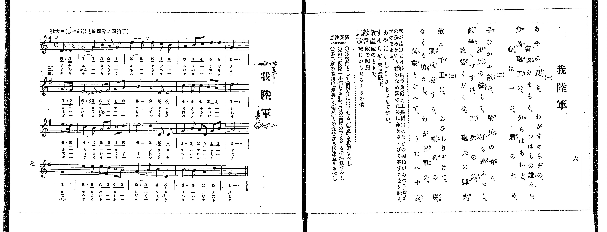
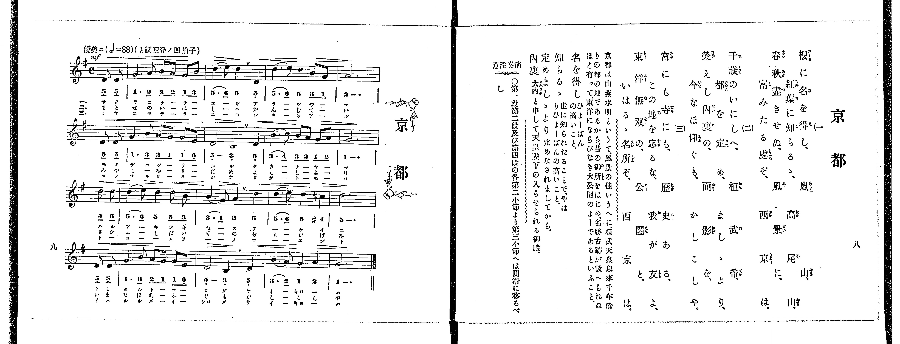

# 我陸軍

> Re:Shoka 使用 AI 協助辨識與重建樂譜，可能會有錯誤。歡迎回報。

<audio controls src="waga_rikugun.mp3"></audio>

- 出處：共益商社樂器店《唱歌教科書 教師用 巻四》第六～七頁（第一學期第三曲）
- NDL Digital Collections PID 854865（https://dl.ndl.go.jp/pid/854865）掃描 P009.jpg

## 說明

原書資訊與歌詞全文（NDL PID 854865《唱歌教科書 教師用 巻四》第六～七頁，掃描 P009.jpg）：
調性與拍號：と調四分ノ四拍子（G 大調 4/4 拍），♩=96，「壯大ニ」，弱起一拍
註記：單聲部，三節分節歌。開頭 f。第五小節第一拍後半出現升 D4（簡譜記為 #5_，TMD 記為 5'_）。第十三小節原譜印為「6. 6_ 6 5 4_ 3_」，若中間 6 5 均作四分音符則多出一拍，對照歌詞與拍號，第三拍之 6 5 記為兩個八分音符。第十五小節第四拍五線譜為 D4（5_），簡譜漏印下點作 5，依五線譜記為 5_。原譜於第二、六、十、十四小節印有換氣記號「V」。
原典演奏注意：豫習曲として前學年に出でたる「朝風」を復習すべし；第二段第一小節なる #5_ 音の高度の下らざる樣注意すべし；第二章の歌詞中「歩兵」と「砲兵」との混せざる樣注意あるべし。
原典語釋：あやにかしこき（きはめて尊い）；すめらぎ（天皇陛下）；敵壘（敵のとりで）；敵營（敵の陣屋）；凱歌（戰にかちたるときの歌）。
原典曲意：「我が陸軍には、騎兵、歩兵、砲兵、工兵、輜重兵などの種類があつて、各、その務めを守り、君のため、國のために命をさゝげて盡すさまを詠んだのである。」

## 歌詞

```text
一、
あやに畏き、わがすめらぎの、
御國をまもる、つはもの雄々し、
歩騎砲工の、分ちはあれど、
心は一つ、君のため。

二、
手むかふ敵を、騎兵の槍と、
歩兵の銃もて、打ち拂ふべし、
敵壘くづすは、工兵の鍬、
敵營くだくは、砲兵の彈丸。

三、
敵を千里に、おひしりぞけて、
凱歌奏する、喇叭の響、
きくも勇まし、わが陸軍の、
萬歳となへて、うたへや友。
```

## ABC

```abc
X:1
T:我陸軍
M:4/4
L:1/16
Q:1/4=96
K:G
V:V1 name="Voice" snm="Voi"
[V:V1]
!f! z4 z4 z4 D3 D | G10 B2 A2 G2 | d10 d2 c2 B2 | A4 B2 c2 d4 d4 |
G12 G3 F | E6 ^D2 E2 F2 G2 A2 | B8 A4 D2 D2 | c6 c2 c4 B2 A2 |
d12 e3 d | c6 B2 A2 B2 c2 d2 | e8 d4 D2 D2 | G6 B2 A2 D2 G2 B2 |
A12 G4 | e6 e2 e2 d2 c2 B2 | A6 B2 c4 D4 | c6 B2 A4 D4 |
G12 z4 |
```

## TMD 檔案連結

- [主旋律 TMD 檔案](waga_rikugun.tmd) [[在 TMD Studio 編輯](https://tmdlang.github.io/Tmd-TS/#tmd=s7IKdvYPcrWy4qpTUCpJTLdSSM7PyUlNLsnMz7PKrsxPzc6ML87Iz05Ugisoy88pzU21yk7MizeJtzA1sTAzRUgW55cWJadaFSdn5OfnxJekVpQk5edno8vHFySmp1oFGBhYImQKivLLUvMS84C6C4oy80pSU8DaEQpSyzJTUkHSxclAq8tSizLTMlNTkNyVWlQMcjXUipKixLzi5KLMApBXEKrSU_OKUq1yE4uSMxCCaflFuVbFJUX5BRmZyQjhkoxUoEdzM3MySxKLKtHFM3MLgG5IzFHi0tJSeNYx8eXMHS929ypoaXEp2ipYmnHZ2yq4c9mY6JvYgTQ-bd_1YubU93tmPW3d-Hx219Opbc-X7Hu2ounpzBVPd01_3ND1dMrGZ2t7nk2d-Xz5xGezdygAWU93rH4-ZYXC0-27n86e_bih-_maNU9b177fO-_JjuaXCxrf7-kAijzZ0fB07Y5nc-aD2Z3PZm96v6cT7FY_Fx8Fl8x0oONzFJzhsVqsEODpogCJN6AJGSUlBcVW-vopOXp5QJyer5dVoF-QmaIPU9H5rK_5WX-_Aii2gHLpSlxc-loKttQCXAoKCk_75gN9_GJz-4sVXS862oHB8GLlvKetK55Nawe6EOQNhJPJDKkeNF8A_QWMC5DlL1btf9awHGRtd--LmfOBoo8bVwAFgQY97Wh73NwHZAClnq6dAHSLu8LTJcuBkgrAaFUAioKN6Xk0c6WtpRmQ8bih5-ni9UAlj5u7HzcAZXue7tn4Yut2YBwBFYNtW7H7xYoZoGQwbd2Lxk0vm1cAFQGj7fn6BqBtQBLos8cNTS-ndb9csFYhDcgEReuuKU839AMlIdENcs2-nqe9XcA09bx_39PedgUXE1Bi2LDwxdo5QOOfN-1SUDaNB5oc4usCtBIsYKoOFOiEGPi0txFoJ8RMYOADdT3t3QBUBHS_mZ6CWbyCmYKpgkm8gnE8xBcvupc-2bH25bTJYImnc9uf7J0DCZ-X8zc_X7PsaWf70yWzgM6BuA7k7w29z1uXQ2ISKWx7oIm0u_fJzm6wYRDXPW1d-bSh-2nrariRCIcieR4SFUCR59tnAR0N8hbY5yC_giICEgLP9vQDvfNkR_fL3fOADlUAJuKeJ_vmwrXBAgTouSaI759N2wMOZmDQNwLTDYjsbYSQIG9Cwql3w7M5nc_6Zz_bsBhoAtA7wNAKA4YP0BRoIn7auuPZnilPl_Y_27ziWUs_MJZfbFz9fP8kYJ4EpqnHjdMfNwKDCpiUdjzdueVx42pggD1uXP64cf7jJmBy6Xk2Z-7LRStAJjZNerpvJVDj48aZjxt3AjW-3zMb4sBn67ZC8zzYUY8bVwH1giJbARhsjxvXvVw94-muZUAG0PuPmzofN04Dyj9bsRjiIkzznq9eAFQMiSdgFINcsXbl09atIFcAndzQ83zBJgQXqHL79seNszGMbQL5AGwySmi8WDXvZXs3OEsBVbQAvfy4EagOGA6THzcCk0kHkHzcuP5xUyMoZDZ0PW5sAUck0IKZIEGQB_qAyp4uWfl8VvvLmbOBvoIoeDZ169PFwHzUAWQAnQVyXBNQ-3K47PN2YHKDyr6cufjpRqjGp-2gwgMk1bEB5p6F0CgA-RDoHlBwQLIKUrzO3gSJUVAIdUx83NgDKe7BRqwHJpWXK_rA4dQIC79GWMg1Pt2-FMJ4sWfOy_ZeEBsYbY0rgTY9X7Hu5cJ5QNNAAdS4BBgKIPUTWoDk48a5QAVPuyEBMenpug6QD0GywNABehjoYnASnQN0N4wLTFIT9wIVP26c-rgJqB3IWPZ8NtB7wGif-rhxH1DqxcoFj5uAoQ-KdnDiA0ddQxMwhrlA3gUmLaCpIBY8zp5PBcYwMJkDnQFkAJ2KiBuQIRDVT_ctBDkFZDfQGoihQAcBvQSMXqDf1r2cDfRVKziFgDUAwwkYZqBA2r4UYgyouAXFxXqwzUB7VsLM3t8MFAW5DGgeegg0QZwNzrtgczuBrgCqBAbLVlD0A10Ejx1g1C6HpGuYEyCiL7uawY4Ehf6zTmDoLHzWDeQCpSBJGqIanOQeNwLDAOhgYIiCoh0at0Ajetcg1AETH1gdMJCBJEgdNDEAI3Rvx5MdO-DO3gFMZjBdoFjubX7ZDvT5anDgARM0sOCYDk7ZwEQCTHUgB4JDBJyKgSUNODJAQf10WvvT_rUgh8zfD49AoF_7gR572t0OihWwTyBxCEu8sNh7MWHNs7XA8gOYAYApcwfEoseNwPgAemQHMBk87QclEpBSyqt8KFDQ0ufiCk9MTwzKzC5NL82zCsvPTE51qDGoUagGWaRgY2imZQdmVafVgmlgw0MDUqNqgpKnAtBhCjVA1mqFx817ILixG4inA_FksEwvQqapH8jvAeKZIJmmRiDuhOrpA-J1QFENYJiDTN4NFge6D2RpjYKBgi4YotPAUhdK1SgYQsWQoTEQGwExSK4GWNdhqgCJmUBV1oDVwvSBRGE6YDR2W0AQIm4OdAgsnIAxD_UcNHCaJkH5-8A0KAhAAQgKriVAvB4mAgwIsNqmuTB14OAEBgkwMOFBAmwjIPlCHcQDCwGdAHENyC81YJ8gQ5gPwSEHJmrAPoVBEBvGh4Ue9pADQTNo6CB5GhJzwDQLpVug9GQo3Qb3FMiboBTRDeYtBAcBOE2BAwuYTqDqVoJ1wz2O7FqYC5HjCxg0aK6ExyKSn5HjEWYKWAokgZoYsEc1UAXC00DPNQETOsgDYE9ugjt-BVQEFMO9YJH9UBGg9xvnQzMCIlbRAheEsSdRmMNhwQHNCujxCfMbmhJcyRiWsWq4arm4dO0UkEoHBSBXmQsA)]
- [鋼琴伴奏 TMD 檔案](waga_rikugun_piano.tmd) [[在 TMD Studio 編輯](https://tmdlang.github.io/Tmd-TS/#tmd=s7IKdvYPcrWy4tLSUnjWMfHlzB0vdve-39PxsnvP8wlbnuzZ8nRp__POjvd7OhW0tLgUbRUszbjsbRXcuWxM9E3suOoUlJ6273oxc-r7PbOetm58Prvr6dS250v2PVvR9HTmiqe7pj9u6Ho6ZeOztT3Pps58vnzis9k7FICspztWP5-yQuHp9t1PZ89-3ND9fM2ap61r3--d92RH88sFjUD7gSJPdjQ8Xbvj2Zz5YHbns9mbgK5QAlnp5-Kj4JKZnlmSmKPgnJ-Tk5pckpmfV6wQ4OmiYGFqYmFmCjQho6SkoNhKXz8lRy8PiNPz9bIK9AsyU_RhKjqf9TU_6-9XCDAwsATKpStxcYUnpicGZWaXppfmWQVkJublB3k41BjUKFRz2RiaadlxKQBBdVotmNbXUtB4umfji63bNRUeNzYpPG5qUagBslYrPG7eA8GN3UA8HYgng2V6ETJN_UB-DxDPBMk0NQJxJ1RPHxCvA4pqPG7sApm8GyyupQ-2tEbBQEEXDNFp03gYVaNgCBVDhsZAbATEILkaBVMsKkBiJlCVNWC1MH0gUZgOGI3dFhCEiJsDHQILp8eNQO-CPQcNnKZJUP4-MA0KAlAAgoJrCRCvh4kAAwKstmkuTB04OIFBAgxMeJCYQbwOdZ86iAcWAjoB4hqQX2rAPkGGMB-CQw5M1IB9CoMgNowPCz3sIQeCZtDQQfI0JOYeN-6A0i1QejKUboN7CuRNUIroBvMWgoMAnKbAgQVMJ1B1K8G64R5Hdi3MhcjxBQwaNFfCYxHJz8jxCDMFLAWSQE0M2KMaqALhaaDnmoAJHeQBsCc3wR2_AioCiuFesMh-qAjQ-43zoRkBEatogQvC2JMozOGw4IBmBfT4hPkNTQmuZAzLWDVctVgKBh9YwQByrI0JtGwAhsCLvq6X7b1PW3e8nN0KKT4RXjKMV4g2jIVRNQgR03ggbRoPFENVaQKkTCAq4UpgYqgqESaAfA1RgmEqXADJBQTVghgGeJ0A5SIZimERYQegmYlhFx6nIoIV6E5QbOnaKSBFmAKQq8wFAA)]

## 分析

```text
================================================================================
📊 TMD Song Profile: [ 我陸軍 ]
================================================================================
⏱  Duration:       0:42 (42.5s), 17 measures total
🎼 Key & Tempo:    首調基準 G, != 96.0 BPM, <4/4>
   - 分析範圍：      由實際發聲的音符與和弦推測調性；播放脈絡另行呈現
🎤 人聲音域:    D4 (MIDI 62) – E5 (MIDI 76) [跨度: 14 個半音 / 1.2 個八度, 難度: moderate]
   - 最低音:  D4 in [WagaRikugun #1 @ m.1, 0:01]
   - 最高音: E5 in [WagaRikugun #1 @ m.9, 0:21]
   - 適合: soprano, mezzo-soprano, contralto, tenor, baritone, bass
🏛  結構:      WagaRikugun (42.5s)
⚡ 編曲密度:        Peak 1 軌道同時演奏
🗝  調性診斷：       G 大調（純淨自然大調，未偵測到可信轉調）
   - 風格氣質:    純淨自然大調（陽光明朗、易唱易記，無明顯調外色彩）
   - 轉調歷程:    全曲維持單一推測調性（未偵測到可信轉調）
   - 核心骨幹音:  D, G, A, C, B
   - 調性數值:    G 大調 [相關度: 0.92, 穩定度: High, 自然音純度: 99.2%]
   - 候選調性 (K-S): G 大調 (0.92), D 大調 (0.72), C 大調 (0.60)
   - 五度圈歷程:   +1
   - 各段落調性細節:
     • [WagaRikugun #1]: G 大調 (r: 0.92, 自然音純度: 99.2%, 調外音: D#)

  [ 五度圈游移軌跡 ]
               C  
         F           [G ]*
      Bb               D  
      Eb               A  
         Ab           E  
            Db       B  
               F# 
     (* = active key center)

  [ 十二半音累積音高分佈 ]
     C  : ██████████████            14.1%
     C# :                            0.0%
     D  : ████████████████████████  24.6%
     D# : █                          0.8%
     E  : ███████████               11.3%
     F  :                            0.0%
     F# : █                          1.2%
     G  : ████████████████████      20.7%
     G# :                            0.0%
     A  : ███████████████           15.6%
     A# :                            0.0%
     B  : ███████████               11.7%
--------------------------------------------------------------------------------
Assignment 軌道音域：
  - Voice         : D4 – E5 (14 個半音 / 1.2 個八度, 69 個音符)
================================================================================
```


## 原書掃描頁






