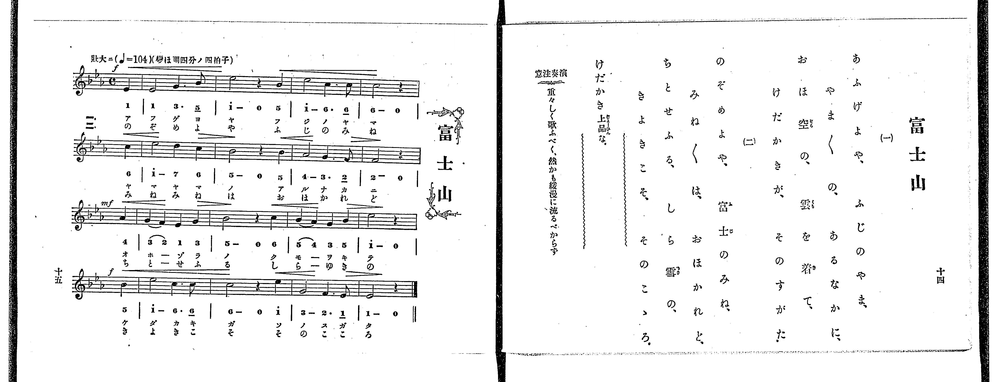

# 富士山

> Re:Shōka 使用 AI 協助辨識與重建樂譜，可能會有錯誤。歡迎回報。

- **NEUTRINO 歌聲合成版**：<br><audio controls src="fujisan_neutrino.mp3"></audio>
- **鋼琴伴奏版**：<br><audio controls src="fujisan.mp3"></audio>


- 出處：共益商社樂器店《唱歌教科書 教師用 巻四》第十四～十五頁（第二學期第一曲）
- NDL Digital Collections PID 854865（https://dl.ndl.go.jp/pid/854865）掃描 P013.jpg

## 說明

原書資訊與歌詞全文（NDL PID 854865《唱歌教科書 教師用 巻四》第十四～十五頁，掃描 P013.jpg）：
調性與拍號：變ほ調四分ノ四拍子（E♭大調 4/4 拍），♩=104，「壯大ニ」，弱起一拍
註記：單聲部，二節分節歌。開頭 f，第三段（第八小節第四拍弱起）mf，第四段（第十二小節第四拍弱起）f。第一小節第一音五線譜為二分音符 E♭4（1 -），下方簡譜漏印延長線僅印「1  3. 5_」，本檔依五線譜記為二分音符。
原典演奏注意：重々しく歌ふべく、然かも緩漫に流るべからず。
原典語釋：けだかき（上品な）。


## 跨冊／重複收錄參照

> 同曲＋同名異曲（《公學校唱歌》第三學年、《公學校唱歌集》與《新定兒童唱歌》第二學年為文部省『尋常小學唱歌』「あたまを雲の上に出し…」同曲；《公學校唱歌》第二學年〈フヂサン〉為低學年別曲）

- **[同名異曲]** 《公學校唱歌》第二學年用（昭和11年／1936）：[**〈フジサン（富士山）〉**](../../../kogakko_shoka/grade_2/8_fujisan/index.md)（`D` / `4/4` — [原始 TMD](../../../kogakko_shoka/grade_2/8_fujisan/fujisan.tmd)）
- **[同名異曲]** 《公學校唱歌集》（大正4年／1915，國臺圖 0725 26）：[**〈富士山〉**](../../../kogakko_shokashu_1915/5_02_fujisan/index.md)（`D` / `4/4` — [原始 TMD](../../../kogakko_shokashu_1915/5_02_fujisan/fujisan.tmd)）
- **[同名異曲]** 《新定兒童唱歌》尋常科第二學年用（2020.006.0847.0002）：[**〈ふじ山〉**](../../../shintei_jido_shoka/grade_2_2020.006.0847.0002/4_14_fujisan/index.md)（`D` / `4/4` — [原始 TMD](../../../shintei_jido_shoka/grade_2_2020.006.0847.0002/4_14_fujisan/fujisan.tmd)）
- **[同名異曲]** 《新編小公學校唱歌教材集》第三、四學年（大正12年／1923，國臺圖 0725-41）：[**〈富士山〉**](../../../shoka_kyozai_shu_1923/grade_3_4/07_fujisan/index.md)（`D` / `4/4` — [原始 TMD](../../../shoka_kyozai_shu_1923/grade_3_4/07_fujisan/fujisan.tmd)）
- 總表：[跨冊重複與同名歌曲總索引](../../../duplicate_songs.md)

## 歌詞

```text
一、
あふげよや、ふじのやま、
やま／＼の、あるなかに、
おほ空の、雲を着て、
けだかきが、そのすがた。

二、
のぞめよや、富士のみね、
みね／＼は、おほかれど、
ちとせふる、しら雪の、
きよきこそ、そのこゝろ。
```

## ABC

```abc
X:1
T:富士山
M:4/4
L:1/16
Q:1/4=104
K:Eb
V:V1 name="Voice" snm="Voi"
[V:V1]
!f! z4 z4 z4 E4 | E8 G6 B2 | e8 z4 B4 | e8 c6 c2 |
w: 1.~あ | ふ げ よ | や ふ | じ の や
w: 2.~の | ぞ め よ | や ふ | じ の み
c8 z4 c4 | e8 d4 c4 | B8 z4 B4 | A8 G6 F2 |
w: 1.~ま や | ま や ま | の あ | る な か
w: 2.~ね み | ね み ね | は お | ほ か れ
!mf! F8 z4 A4 | G4 F4 E4 G4 | B8 z4 c4 | B4 A4 G4 B4 |
w: 1.~に お | ほ _ ぞ ら | の く | も _ を き
w: 2.~ど ち | と _ せ ふ | る し | ら _ ゆ き
!f! e8 z4 B4 | e8 c6 c2 | c8 z4 e4 | G8 F6 E2 |
w: 1.~て け | だ か き | が そ | の す が
w: 2.~の き | よ き こ | そ そ | の こ こ
E8 z4 z4 |
w: 1.~た
w: 2.~ろ
```

## TMD 檔案連結

- [主旋律 TMD 檔案](fujisan.tmd) [[在 TMD Studio 編輯](https://tmdlang.github.io/Tmd-TS/#tmd=s7IKdvYPcrWy4qpTUCpJTLdSSM7PyUlNLsnMz7PKrsxPzc6ML87Iz05Ugisoy88pzU21yk7MizeJtzA1sTAzRUgW55cWJadaFSdn5OfnxJekVpQk5edno8vHFySmp1oFGBgaI2QKivLLUvMS84C6C4oy80pSU8DaEQpSyzJTUkHSxclAq8tSizLTMlNTkNyVWlQMcjXUipKixLzi5KLMApBXEKrSU_OKUq2SMzJzUopS8-KL8_PSEZJp-UW5VsUlRfkFGZnJCOGSjFSgh3MS81KAVhekokvkJZaUFmGIFuQkJgMFtbQUnq7vebp49dONGxW0tLgUbRUMDUy47G0VXHW4bEz0TexA-p6273oxc-r7PbOetm58Prvr6dS250v2PVvR9HTmiqe7pj9u6Ho6ZeOztT3Pps58vnzis9k7FICspztWP5-yQuHp9t1PZ89-3ND9fM2ap72NQPb7vfOAjCe7prxc0Ph-TwdQ_MmunqdrdzybMx_E3tHwbPam93s6wQ72c_FRcMlMzyxJzFFwhsd8sUKAp4sCJG6BJmSUlBQUW-nrp-To5QFxer5eVoF-QWaKPkxF57O-5mf9_QqgGAXKAUOUS19LwZZagEtBQeFp33ygv19sbn-xoutFRzswMF6snPe0dcWzae1AF4K8gXAyReHVg-YXoO-A8QJywotV-581LAdZ3t37YuZ8oOiLdV2PG3cDxYGmPO1oe9zcB2QAZZ-unQB0lOujmWufLlkOlFYAxrMCUBxsVs-jmSttgWkAyHrcAEwZ64FqHjd3P24ASvc83bPxxdbtoDjq7gXbuWL3ixUzQAlj2roXjZteNq8AKgJG5_P1DUALgSTQl48bml5O6365YK1CGlASHMWdz9ZthUT909bVTzf0AxWC2BDHga0AOiUXqhwkDFcOCogeXDrSgFZBkhBcBZD9cv5mYOA93z7rxdo5z5t2gfR3tAEFn69ZpgAKA6BPOwwVdCGef7Kj-9m0nc83LAQqfran_2nvhqe7t72cuh2o_WlzK5ALDBNDBQVjPQXTeEiQPJuz5tmqKU_2zYVbAgwRNHuA7oImkqetO57tmfJ0af-zzSuetfQDQ-5le-_jhtbHjdMfN_aDQqtx6-PGnUD244bG5y3bHjd2P25qer595bM9qx83rn62tfFxUzdYAVC883HjLBSjX6ya97K9G2jo48aJjxsXgBQ1At3Y8WRH19PJjY8bVwE9CdIA0gEMGaAVINbjxiawrZMeN3U8bmoBioK5Mx43rgNxG_fB1IE57_cAXb0HJAdS1wR2ziqwTavh5oGS3fOVuyCKXs7e9Lhp0vO5DY8bgQEBVYFw3uNGYAoBmjQXpLpxJojbOB_uyF0gSYgWoOy8x01A_0MdCSm3wOL7HzeuhasDcWCOXA82GuQccIABjV4JV7fwceOKx42zQX4F-gGkbjowSF_OBnoG5GyIol6QdSBHTga5EOHOyY-b5j5uAsYcOPQpL0OgQEFLn4vLrTQrszgxzyosPzM51aHGoKYaZIeCjYWWHZhRnVYLpoFlmAYk7WuC4lChBkhuBeJJwJjqAPGaWsAiIPEZoAAEi4B4-8AsoF0gY2oUDBR04RiYE4AiIBIEjcGkKUgkDioEUmQKUQQTMoOSNVAWRBGIXQO2wcewRiEeyINhkGNBBoAcB1EPcjSYhjscIg5RDVIF8QRM9Tqoaph3kFSD9ULtNUK3F6QPpGMezKSmRnLsbdwPFl-Lono_3F5gxMDCGESDlALDHhJDTd1A1iog7gaLrwblFkRMwIPUHBaA4LBGDXcTqAgkcoyAIkZIaqpz02rBShBhjwghiA8hfIizkH0AjRWgE2H-XQWlYY5FVt2FEs6I0ICEBIQPEl-PqQtI74arhtgGzJxg8ZUoqheihuluhcfNe8DRB8yp8HDtBzu6CSLXBEz9jb1guWWgcgYRtqDgAgUUKG2D2KhBiwhsUNiB5NESOThsgUELFkYKWoRHQIkK5C5sQdsPDVpQEEO8C0rwIJdCVC9DUT0RLWhXwO2YDSahCRMeURBd06GiIBdA7GhDsQPVRWBRRNAuAMcELOh6gHguPIBngkVAvPlYkir23A-WhgQ6JJWCSEOkogVW4CCH5QK4P6GJAu4cZJfPRfMPyIEQGuZIhGoQRgpJYDaH6QH5H0RPBusBmYnPhsnIqpsgepFtqOXi0rVTgJbcCkCmMhcA)]
- [鋼琴伴奏 TMD 檔案](fujisan_piano.tmd) [[在 TMD Studio 編輯](https://tmdlang.github.io/Tmd-TS/#tmd=s7IKdvYPcrWy4tLSUni6vufp4tVPN258v6fjZfee5xO2PNmz5enS_uedHe_3dCpoaXEp2ioYGphw2dsquOpw2Zjom9hx1SkoPW3f9WLm1Pd7Zj1t3fh8dtfTqW3Pl-x7tqLp6cwVT3dNf9zQ9XTKxmdre55Nnfl8-cRns3coAFlPd6x-PmWFwtPtu5_Onv24ofv5mjVPexuB7Pd75wEZT3ZNebmgEegOoPiTXT1P1-54Nmc-iL2j4dnsTUDXKIEs9nPxUXDJTM8sScxRcM7PyUlNLsnMzytWCPB0UbAwNbEwMwWakFFSUlBspa-fkqOXB8Tp-XpZBfoFmSn6MBWdz_qan_X3KwQYGBoD5dKVuLjcSrMyixPzrAIyE_PygzwcagxqqrkUgMDGQssOzKhOqwXT-loKGk_3bHyxdbumwuPGJoUaILkViCcpPG7qAPGaWsAiIPEZQLwOLALi7QOztPTBxtQoGCjowrEhENeASRA0BpOmIJE4qBBIkSlEEUzIDErWQFkQRSB2DdgGH8MahXggD4ZBjgUZAHIcRD3I0WAa7nCIOEQ1SBXEEzDV66CqYd5BUg3WC7XXCN1ekD6Qjnkwk5oaybG3cT9YfC2K6v1we4ERAwtjEA1SCgx7SAw1dQNZq4C4Gyy-Goi7EDEBD1JzWACCwxo13E2gIpDIMQKKGCGpqc5NqwUrQYQ9IoQgPoTwIc5C9gE0VoBOhPl3FZSGORZZdRdKOCNCAxISED5IfD2mLiC9G64aYtvjph6w-EoU1QtRw3S3wuPmPeDoe9zUCQ_XfrCjmyByTcDU39gLllsGxBMRYQsKLlBAgdI2iI0atIjABoUdSB4tkYPDFhi0YGGkoEV4BJSoQO7CFrT90KAFBTHEu6AED3IpRPUyFNUT0YJ2BdyO2WASmjDhEQXRNR0qCnIBxI42FDtQXQQWRQTtAnBMwIKuB4jnwgN4JlgExJuPJaliz_1gaUigQ1IpiDREKlpgBQ5yWC6A-xOaKODOQXb5XDT_gBwIoWGORKgGYaSQBGZzmB6Q_0H0ZLAekJn4bJiMrLoJohfZhlq0gtsHueA2gRbcwIB-0df1sr33aeuOl7NbITUcUojGK0QbxsKoGkwRQupMgJQJQh2UCxNFqDONB9Km8fhMhCsBMQzgCuHCSIbCxbA7E0kllEmZdzDV4fEOyOXAqNG1U4DGTrQPUAKZawTmKnMBAA)]

## 分析

```text
================================================================================
📊 TMD Song Profile: [ 富士山 ]
================================================================================
⏱  Duration:       0:39 (39.2s), 17 measures total
🎼 Key & Tempo:    首調基準 E,, != 104.0 BPM, <4/4>
   - 分析範圍：      由實際發聲的音符與和弦推測調性；播放脈絡另行呈現
🎤 人聲音域:    D#4 (MIDI 63) – D#5 (MIDI 75) [跨度: 12 個半音 / 1.0 個八度, 難度: easy]
   - 最低音:  D#4 in [Fujisan #1 @ m.1, 0:01]
   - 最高音: D#5 in [Fujisan #1 @ m.3, 0:04]
   - 適合: soprano, mezzo-soprano, contralto, tenor, baritone, bass
🏛  結構:      Fujisan (39.2s)
⚡ 編曲密度:        Peak 1 軌道同時演奏
🗝  調性診斷：       D# 大調（純淨自然大調，未偵測到可信轉調）
   - 風格氣質:    純淨自然大調（陽光明朗、易唱易記，無明顯調外色彩）
   - 轉調歷程:    全曲維持單一推測調性（未偵測到可信轉調）
   - 核心骨幹音:  D#, C, A#, G, F
   - 調性數值:    D# 大調 [相關度: 0.93, 穩定度: Moderate, 自然音純度: 100.0%]
   - 候選調性 (K-S): D# 大調 (0.93), C 小調 (0.83), G# 大調 (0.56)
   - 五度圈歷程:   -3
   - 各段落調性細節:
     • [Fujisan #1]: D# 大調 (r: 0.93, 自然音純度: 100.0%)

  [ 五度圈游移軌跡 ]
               C  
         F            G  
      Bb               D  
     [Eb]*              A  
         Ab           E  
            Db       B  
               F# 
     (* = active key center)

  [ 十二半音累積音高分佈 ]
     C  : ███████████████           19.6%
     C# :                            0.0%
     D  : █                          1.8%
     D# : ████████████████████████  31.2%
     E  :                            0.0%
     F  : ███████                    8.9%
     F# :                            0.0%
     G  : ███████████               14.3%
     G# : █████                      7.1%
     A  :                            0.0%
     A# : █████████████             17.0%
     B  :                            0.0%
--------------------------------------------------------------------------------
Assignment 軌道音域：
  - Voice         : D#4 – D#5 (12 個半音 / 1.0 個八度, 42 個音符)
================================================================================
```


## 原書掃描頁




