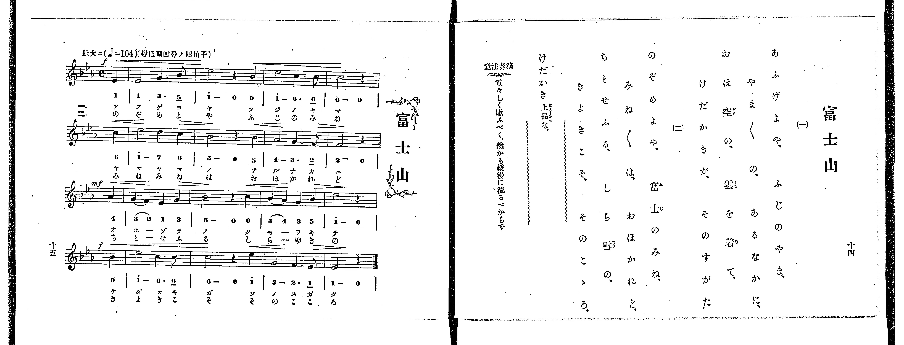

# 富士山

> Re:Shōka 使用 AI 協助辨識與重建樂譜，可能會有錯誤。歡迎[回報](https://github.com/TMDLang/reshoka/issues)。

- **鋼琴伴奏版**：<br><audio controls src="fujisan.mp3"></audio>
- **NEUTRINO 歌聲合成版**：<br><audio controls src="fujisan_neutrino.mp3"></audio>

- 出處：共益商社樂器店《唱歌教科書 教師用 巻四》第十四～十五頁（第二學期第一曲）
- NDL Digital Collections PID 854865（https://dl.ndl.go.jp/pid/854865）掃描 P013.jpg

## 說明

原書資訊與歌詞全文（NDL PID 854865《唱歌教科書 教師用 巻四》第十四～十五頁，掃描 P013.jpg）：
調性與拍號：變ほ調四分ノ四拍子（E♭大調 4/4 拍），♩=104，「壯大ニ」，弱起一拍
註記：單聲部，二節分節歌。開頭 f，第三段（第八小節第四拍弱起）mf，第四段（第十二小節第四拍弱起）f。第一小節第一音五線譜為二分音符 E♭4（1 -），下方簡譜漏印延長線僅印「1  3. 5_」，本檔依五線譜記為二分音符。
原典演奏注意：重々しく歌ふべく、然かも緩漫に流るべからず。
原典語釋：けだかき（上品な）。


## 歌詞

```text
一、
あふげよや、ふじのやま、
やま／＼の、あるなかに、
おほ空の、雲を着て、
けだかきが、そのすがた。

二、
のぞめよや、富士のみね、
みね／＼は、おほかれど、
ちとせふる、しら雪の、
きよきこそ、そのこゝろ。
```

## ABC

<div class="abc-score" data-abc-src="fujisan.abc" aria-label="五線譜載入中"></div>

[下載 ABC 原始檔](fujisan.abc)

## TMD 檔案連結

- [主旋律 TMD 檔案](fujisan.tmd) [[在 TMD Studio 編輯](https://tmdlang.github.io/Tmd-TS/#tmd=s7IKdvYPcrWy4qpTUCpJTLdSSM7PyUlNLsnMz7PKrsxPzc6ML87Iz05Ugisoy88pzU21yk7MizeJtzA1sTAzRUgW55cWJadaFSdn5OfnxJekVpQk5edno8vHFySmp1oFGBgaI2QKivLLUvMS84C6C4oy80pSU8DaEQpSyzJTUkHSxclAq8tSizLTMlNTkNyVWlQMcjXUipKixLzi5KLMApBXEKrSU_OKUq2SMzJzUopS8-KL8_PSEZJp-UW5VsUlRfkFGZnJCOGSjFSgh3MS81KAVhekokvkJZaUFmGIFuQkJiMJ5hdlpmfmWeWmZmZlYgmX_KKSjPz0osSCjEqrjMziEqDy5MSceGAgA0NeS0vh6fqep4tXP924UUFLi0vRVsHQwITL3lbBVYfLxkTfxA5kztP2XS9mTn2_Z9bT1o3PZ3c9ndr2fMm-Zyuans5c8XTX9McNXU-nbHy2tufZ1JnPl098NnuHApD1dMfq51NWKDzdvvvp7NmPG7qfr1nztLcRyH6_dx6Q8WTXlJcLGt_v6QCKP9nV83Ttjmdz5oPYOxqezd70fk8n2AN-Lj4KLkDflSTmKDjDU0-xQoCniwIkfQBNyCgpKSi20tdPydHLA-L0fL2sAv2CzBR9mIrOZ33Nz_r7FUCpAigHjBUufS0FW2oBLgUFhad984H-frG5_cWKrhcd7cDAeLFy3tPWFc-mtQNdCPIGwskUhVcPml-AvgPGC8gJL1btf9awHGR5d--LmfOBoi_WdT1u3A0UB5rytKPtcXMfkAGUfbp2AtBRro9mrn26ZDlQWgEYzwpAcbBZPY9mrrQFpgEg63EDMGWsB6p53Nz9uAEo3fN0z8YXW7eD4qi7F2znit0vVswAJYxp6140bnrZvAKoCBidz9c3AC0EkkBfPm5oejmt--WCtQppQElwFHc-W7cVEvVPW1c_3dAPVAhiQxwHtgLolFyocpAwXDkoIHpw6UgDWgVJQnAVQPbL-ZuBgfd8-6wXa-c8b9oF0t_RBhR8vmaZAigMgD7tMFTQhXj-yY7uZ9N2Pt-wEKj42Z7-p70bnu7e9nLqdqD2p82tQC4wTAwVFIz1FEzjIUHybM6aZ6umPNk3F24JMETQ7AG6C5pInrbueLZnytOl_c82r3jW0g8MuZftvY8bWh83Tn_c2A8Krcatjxt3AtmPGxqft2x73Nj9uKnp-faVz_asfty4-tnWxsdN3WAFQPHOx42zUIx-sWrey_ZuoKGPGyc-blwAUtQIdGPHkx1dTyc3Pm5cBfQkSANIBzBkgFaAWI8bm8C2Tnrc1PG4qQUoCubOeNy4DsRt3AdTB-a83wN09R6QHEhdE9g5q8A2rYabB0p2z1fugih6OXvT46ZJz-c2PG4EBgRUBcJ5jxuBKQRo0lyQ6saZIG7jfLgjd4EkIVqAsvMeNwH9D3UkpNwCi-9_3LgWrg7EgTlyPdhokHPAAQY0eiVc3cLHjSseN84G-RXoB5C66cAgfTkb6BmQsyGKekHWgRw5GeRChDsnP26a-7gJGHPg0Ke8DIECBS19Li630qzM4sQ8q7D8zORUhxqDmmqQHQo2Flp2YEZ1Wi2YBpZhGpC0rwmKQ4UaILkViCcBY6oDxGtqAYuAxGeAAhAsAuLtA7OAdoGMqVEwUNCFY2BOAIqASBA0BpOmIJE4qBBIkSlEEUzIDErWQFkQRSB2DdgGH8MahXggD4ZBjgUZAHIcRD3I0WAa7nCIOEQ1SBXEEzDV66CqYd5BUg3WC7XXCN1ekD6Qjnkwk5oaybG3cT9YfC2K6v1we4ERAwtjEA1SCgx7SAw1dQNZq4C4Gyy-GpRbEDEBD1JzWACCwxo13E2gIpDIMQKKGCGpqc5NqwUrQYQ9IoQgPoTwIc5C9gE0VoBOhPl3FZSGORZZdRdKOCNCAxISED5IfD2mLiC9G64aYhswc4LFV6KoXogaprsVHjfvAUcfMKfCw7Uf7OgmiFwTMPU39oLlloHKGUTYgoILFFCgtA1iowYtIrBBYQeSR0vk4LAFBi1YGCloER4BJSqQu7AFbT80aEFBDPEuKMGDXApRvQxF9US0oF0Bt2M2mIQmTHhEQXRNh4qCXACxow3FDlQXgUURQbsAHBOwoOsB4rnwAJ4JFgHx5mNJqthzP1gaEuiQVAoiDZGKFliBgxyWC-D-hCYKuHOQXT4XzT8gB0JomCMRqkEYKSSB2RymB-R_ED0ZrAdkJj4bJiOrboLoRbahlotL104BWnIrAJnKXAA)]
- [鋼琴伴奏 TMD 檔案](fujisan_piano.tmd) [[在 TMD Studio 編輯](https://tmdlang.github.io/Tmd-TS/#tmd=s7IKdvYPcrWy4qpTUCpJTLdSyC8qychPL0osyKi0ysgsLskvykxOzInPTsxLVOLS0lJ4ur7n6eLVTzdufL-n42X3nucTtjzZs-Xp0v7nnR3v93QqaGlxKdoqGBqYcNnbKrjqcNmY6JvYgQx_2r7rxcyp7_fMetq68fnsrqdT254v2fdsRdPTmSue7pr-uKHr6ZSNz9b2PJs68_nyic9m71AAsp7uWP18ygqFp9t3P509-3FD9_M1a572NgLZ7_fOAzKe7JryckEj0B1A8Se7ep6u3fFsznwQe0fDs9mbgK5RAlns5-Kj4JKZnlmSmKPgnJ-Tk5pckpmfV6wQ4OmiYGFqYmFmCjQho6SkoNhKXz8lRy8PiNPz9bIK9AsyU_RhKjqf9TU_6-9XCDAwNAbKpStxcbmVZmUWJ-ZZBWQm5uUHeTjUGNRUcykAgY2Flh2YUZ1WC6b1tRQ0nu7Z-GLrdk2Fx41NCjVAcisQT1J43NQB4jW1gEVA4jOAeB1YBMTbB2Zp6YONqVEwUNCFY0MgrgGTIGgMJk1BInFQIZAiU4gimJAZlKyBsiCKQOwasA0-hjUK8UAeDIMcCzIA5DiIepCjwTTc4RBxiGqQKognYKrXQVXDvIOkGqwXaq8Rur0gfSAd82AmNTWSY2_jfrD4WhTV--H2AiMGFsYgGqQUGPaQGGrqBrJWAXE3WHw1EHchYgIepOawAASHNWq4m0BFIJFjBBQxQlJTnZtWC1aCCHtECEF8COFDnIXsA2isAJ0I8-8qKA1zLLLqLpRwRoQGJCQgfJD4ekxdQHo3XDXEtsdNPWDxlSiqF6KG6W6Fx817wNH3uKkTHq79YEc3QeSagKm_sRcstwyIJyLCFhRcoIACpW0QGzVoEYENCjuQPFoiB4ctMGjBwkhBi_AIKFGB3IUtaPuhQQsKYoh3QQke5FKI6mUoqieiBe0KuB2zwSQ0YcIjCqJrOlQU5AKIHW0odqC6CCyKCNoF4JiABV0PEM-FB_BMsAiINx9LUsWe-8HSkECHpFIQaYhUtMAKHOSwXAD3JzRRwJ2D7PK5aP4BORBCwxyJUA3CSCEJzOYwPSD_g-jJYD0gM_HZMBlZdRNEL7INtWgFtw9ywW0CLbiBAf2ir-tle-_T1h0vZ7dCajikEI1XiDaMhVE1mCKE1JkAKROEOigXJopQZxoPpE3j8ZkIVwJiGMAVwoWRDIWLYXcmkkookzLvYKrD4x2Qy4FRo2unAI2daB-gBDLXCMxV5gIA)]

## 分析

```text
================================================================================
📊 TMD Song Profile: [ 富士山 ]
================================================================================
⏱  Duration:       0:39 (39.2s), 17 measures total
🎼 Key & Tempo:    首調基準 E,, != 104.0 BPM, <4/4>
   - 分析範圍：      由實際發聲的音符與和弦推測調性；播放脈絡另行呈現
🎤 人聲音域:    D#4 (MIDI 63) – D#5 (MIDI 75) [跨度: 12 個半音 / 1.0 個八度, 難度: easy]
   - 最低音:  D#4 in [Fujisan #1 @ m.1, 0:01]
   - 最高音: D#5 in [Fujisan #1 @ m.3, 0:04]
   - 適合: soprano, mezzo-soprano, contralto, tenor, baritone, bass
🏛  結構:      Fujisan (39.2s)
⚡ 編曲密度:        Peak 1 軌道同時演奏
🗝  調性診斷：       D# 大調（純淨自然大調，未偵測到可信轉調）
   - 風格氣質:    純淨自然大調（陽光明朗、易唱易記，無明顯調外色彩）
   - 轉調歷程:    全曲維持單一推測調性（未偵測到可信轉調）
   - 核心骨幹音:  D#, C, A#, G, F
   - 調性數值:    D# 大調 [相關度: 0.93, 穩定度: Moderate, 自然音純度: 100.0%]
   - 候選調性 (K-S): D# 大調 (0.93), C 小調 (0.83), G# 大調 (0.56)
   - 五度圈歷程:   -3
   - 各段落調性細節:
     • [Fujisan #1]: D# 大調 (r: 0.93, 自然音純度: 100.0%)

  [ 五度圈游移軌跡 ]
               C  
         F            G  
      Bb               D  
     [Eb]*              A  
         Ab           E  
            Db       B  
               F# 
     (* = active key center)

  [ 十二半音累積音高分佈 ]
     C  : ███████████████           19.6%
     C# :                            0.0%
     D  : █                          1.8%
     D# : ████████████████████████  31.2%
     E  :                            0.0%
     F  : ███████                    8.9%
     F# :                            0.0%
     G  : ███████████               14.3%
     G# : █████                      7.1%
     A  :                            0.0%
     A# : █████████████             17.0%
     B  :                            0.0%
--------------------------------------------------------------------------------
Assignment 軌道音域：
  - Voice         : D#4 – D#5 (12 個半音 / 1.0 個八度, 42 個音符)
================================================================================
```


## 原書掃描頁




