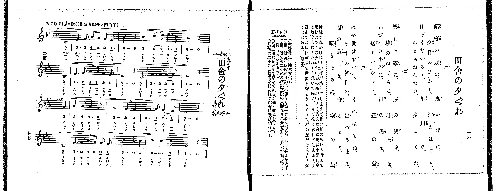
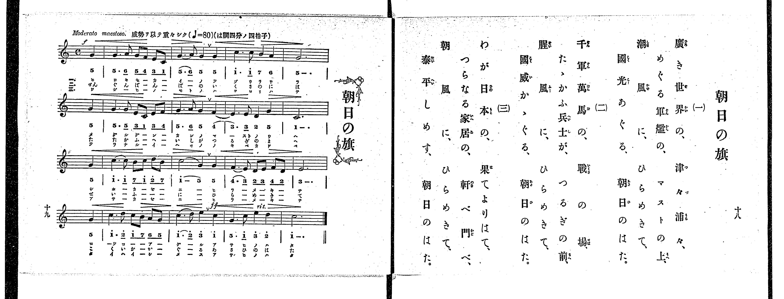

# 田舍の夕ぐれ

> Re:Shōka 使用 AI 協助辨識與重建樂譜，可能會有錯誤。歡迎回報。

- **NEUTRINO 歌聲合成版**：<br><audio controls src="inaka_no_yugure_neutrino.mp3"></audio>
- **鋼琴伴奏版**：<br><audio controls src="inaka_no_yugure.mp3"></audio>


- 出處：共益商社樂器店《唱歌教科書 教師用 巻四》第十六～十七頁（第二學期第二曲）
- NDL Digital Collections PID 854865（https://dl.ndl.go.jp/pid/854865）掃描 P014.jpg

## 說明

原書資訊與歌詞全文（NDL PID 854865《唱歌教科書 教師用 巻四》第十六～十七頁，掃描 P014.jpg）：
調性與拍號：變ほ調四分ノ四拍子（E♭大調 4/4 拍），♩=66，「感ヲ以テ」，弱起一拍
註記：單聲部，三節分節歌。開頭 p，第三段（第八小節第四拍弱起）mp，第四段（第十二小節第四拍弱起）p。第十小節第三與第四拍之間印有換氣記號「V」。
原典演奏注意：充分發想に注意すべし；第一段及第四段の各第二小節なる第一音符は滑らかに弱く歌ふを要す；第二段の第二小節及び第三段の末節なる二分音符（7_ 音）は其高度下り易し、注意あるべし；第三段は稍速度を早めて迫るが如く歌ふを可とす；最後の二小節は速度を緩め且つ微聲に歌ひ納むべし。
原典曲意：「村社の森かげに日かげが消えてしまうて、細い川の流れる音まで眠たさうな夕がたに、寺の鐘が鳴ると、農夫は家に、馬は小屋に、鳥はねぐらに、とそれ／″＼急いで歸る。さて全く暮れてしまふと、明朝まではおれが闇の世界を守らうというて、空の星がきら／＼光りはじめる。（略解）」


## 跨冊／重複收錄參照

> 同曲＋同名異曲（《新定兒童唱歌》高等科男子用與《唱歌帖》P022 為北村季晴作曲同曲；《共益商社唱歌教科書》卷四為同名異曲）

- **[同名異曲]** 《新定兒童唱歌》高等科男子用（2020.006.0848）：[**〈田舍の夕暮〉**](../../../shintei_jido_shoka/koto_boys_2020.006.0848/2_2_07_inaka_no_yugure/index.md)（`E,` / `3/4` — [原始 TMD](../../../shintei_jido_shoka/koto_boys_2020.006.0848/2_2_07_inaka_no_yugure/inaka_no_yugure.tmd)）
- **[同名異曲]** 楊金土手抄《唱歌帖》第 8 冊・VIII（2020.006.0843）：[**〈田舎の夕暮（鄉村的黃昏）〉**](../../../shokacho/vol_08/p022_inaka_no_yugure/index.md)（`E,` / `3/4` — [原始 TMD](../../../shokacho/vol_08/p022_inaka_no_yugure/inaka_no_yugure.tmd)）
- 總表：[跨冊重複與同名歌曲總索引](../../../duplicate_songs.md)

## 歌詞

```text
一、
鎭守の森の、森かげに、
夕日のひかり、消えはてゝ、
ほそくながるゝ、里川の、
おともねむたき、夕まぐれ。

二、
楽しき家に、賤の男を、
枝のねぐらに、群鳥を、
しづけき小屋に、農馬を、
送りてひゞく、鐘の聲。

三、
はや世はすべて、くれはてぬ、
あすの朝日の、出づるまで、
闇の是世を、守るとや、
瞬きそめぬ、空の星。
```

## ABC

```abc
X:1
T:田舍の夕ぐれ
M:4/4
L:1/16
Q:1/4=66
K:Eb
V:V1 name="Voice" snm="Voi"
[V:V1]
!p! z4 z4 z4 B,4 | E6 F2 A2 G2 F2 E2 | B8 z4 B4 | c6 d2 e6 c2 |
w: 1.~ちん | じゅ の も _ り _ | の も | り _ か げ
w: 2.~た | の し き _ い へ | に し | づ _ の を
w: 3.~は | や よ は _ す べ | て く | れ _ は て
B8 z4 B,4 | E6 F2 A2 G2 F2 E2 | D8 z4 B,4 | F6 F2 F6 G2 |
w: 1.~に ゆ | ふ ひ の _ ひ か | り き | え は て _
w: 2.~を え | だ の ね _ ぐ ら | に む | ら ど り _
w: 3.~ぬ あ | す の あ _ さ ひ | の い | づ る ま _
!mp! E8 z4 G4 | A6 A2 A6 G2 | G8 F4 F4 | G6 G2 F6 E2 |
w: 1.~て ほ | そ く な が | る る さ | と が は _
w: 2.~を し | づ け き こ | や に た | う ま を _
w: 3.~で や | み の こ の | よ _ ま | も る と _
!p! D8 z4 B,4 | E6 F2 A2 G2 F2 E2 | B8 z4 B4 | c8 B6 B2 |
w: 1.~の お | と も ね _ む た | き ゆ | ふ ま ぐ
w: 2.~を お | く り て _ ひ び | く か | ね の こ
w: 3.~や ま | た た き _ そ め | ぬ そ | ら の ほ
E8 z4 z4 |
w: 1.~れ
w: 2.~ゑ
w: 3.~し
```

## TMD 檔案連結

- [主旋律 TMD 檔案](inaka_no_yugure.tmd) [[在 TMD Studio 編輯](https://tmdlang.github.io/Tmd-TS/#tmd=s7IKdvYPcrWy4qpTUCpJTLdSSM7PyUlNLsnMz7PKrsxPzc6ML87Iz05Ugisoy88pzU21yk7MizeJtzA1sTAzRUgW55cWJadaFSdn5OfnxJekVpQk5edno8vHFySmp1oFGBiaIGQKivLLUvMS84C6C4oy80pSU8DaEQpSyzJTUkHSxclAq8tSizLTMlNTkNyVWlQMcjXUipKixLzi5KLMApBXEKrSU_OKUq2SMzJzUopS8-KL8_PSEZJp-UW5VsUlRfkFGZnJCOGSjFSgh0syc1Pj89PiUxIr0aVyEvNSgK4qSEWXyEssKS0CimppKTyfsuFFR-_jxnVPl0x93DjhcVOPgpYWl6KtgpkZl72tgqsOl42JvokdyICn7btezJz6fs-sp60bn8_uejq17fmSfc9WND2dueLprumPG7qeTtn4bG3Ps6kzny-f-Gz2DgUg6-mO1c-nrFB4un3309mzHzd0P1-z5mlv49PWte_3zgMynuxofrmg8f2eDqD4k109T9fueDZnPoT9bPam93s6wS73c_FRcMlMzyxJzFFwhqeDYoUATxcFSEwDTcgoKSkottLXT8nRywPi9Hy9rAL9gswUfZiKzmd9zc_6-xVA8QuUA4Yvl76Wgi21AJeCgsLTvvlAf7_Y3P5iRdeLjnZgYLxYOe9p64pn09qBLgR5A-FkisKrB80vQN8B4wXkhBer9j9rWA6yvLv3xcz5QNEX67oeN-4GigNNfNrR9ri5D8gAyj5dOwHoKNdHM9c-XbIcKK0AjGcFoDjYrJ5HM1fampkBGY8bep61zH_cvOnJ7qWPm9seNwAV9Dzds_HF1u1PdjQA1YNtXbH7xYoZoKQxbd2Lxk0vm1cAFT3Z0fl8fQPQSiAJ9OfjhqaX07pfLlirUACUBEXyjs5n67ZCIv9p6-qnG_qBCkFsiPPAVgAdkwtVDhKGKwcGBTC54NBRALQKGnAwFUC7gGECV_pkZ_fLaZOf9m54NqfzWf_sZxsWA50PDC6gZ8OAPgTqh0bn09Ydz_ZMebq0_9nmFc9a-sGJvxXkpZl7njVvfty4GiL-uHHm48adjxunv98zG2xbA9CpT_u74M4GZbAJLdBUDnbU48ZVj5tA8QtU_HL-5udrlj1uXP9s98THTZ2PG7uBJgO987ixHxRwjVsfN016sawRaAvUfGD2AJuJbCDQuseNQHOg4QqUfTZnNdwikLKONohFwDA0j1cAsoFhBbT0aeu2l6tnPN217MmO7sdNXc9mTAZ65HFDI8xrTUDtqL6DmL_--Yrelw3zgRqBzns2feXjJqALl73YvxqsvufpsiZk9z_tX_-4cQXEC8_mNDzdBxRfhxQa6-FGPd8OMurJjimPG5c83QdKT6BwBpmz6fmW3sdNQMUgx6BG0uxNkOgBJde5E4EFE8j_i9eBg3ISSP_0pTB2z7NtHY8bgQgY4tMfNwJVtoHYDY3Pt2x43NjydPtckN6tjcCyEOgTYDCB1Sx_PmfB48b5jxuBxSRQ_SpweQl0E1BkNVDv0_W7gLpeTpgBFHy5eQs4CFYAxV_s2_R0yWpQKK_bBlH5ctkaEHdD_9ONoGgGiWwGug0YOmvBBTAwSkCC4MCaC3TD-z39jxqAUbXnWQNQWQvQJc_W7gCZ3wAMX6AblgELGFBAz1oHcjDCU8AYAjng2Yy-Z3OAPgJ5AWxLF1hZz8vp7aAI2DHt-VSgNyc9XdcBthroNaBpQFtgYbIS5K9nM4DeBOoChj6wcACG856nrZ3AtAI2cAYo4sHuAWXOqUtfLF8MSlgNvVyg-AEmb6AxINbLvrUgW6Dxsg7kNqQIgioCBis4qoASwGgHpUeQOmiEAS0DJpC5UKXAUg0UQo3AJLoK5DqgE8ByL9t7IHEIVwd054rHTcDgWgtOPUC_ALN4IzgGgcECqvRAiQns2l1AJljXs6V7wSHZC4-4F5uXgLLclO3A4IIpmge2BzXmnu9bAopRuCKwMUAvTQQZhhTtwKQBSgtwdS-BkQ4KUmAMbnrcNA_kMaBnQCkKnAdgLtwBDFqouesfN7UAYxAcMJACCBRlII2gKAaHVuMauGqg_4GKgKXCXGgIA4OgHRi7QKcCXQROH1CHgJPGsxnrQWaDnQdOHeAU3dQCVfR8HjAZAxsOwCQKtBFkCyKpQHIm5XUqFCho6XNxeeYlZif65UeWpgObLlZh-ZnJqQ41BjXVIJsUbCy07MCM6oJaMA2s2TUg9YEm0OcLHzdNVqgBMoBJtRVIrVMApgaFx817gHQXmAZJQkSBLKgYMPkB8SSw3GqgaBvIHSDDaxQMFHTh2DQeSNQoGAJJXQUjBRMFYyBpCBQxBYtAFYHVmIH55gqGcWCGGboisElgK3wMaxRAPBiG-gFkCNQXIE0wNwNZQDdDJNdBDQTrAstBfAQRBfkJQsP8hay6DWG_Ebr981HMB6ZpIO4Fs1qAeAemaUAVEB1L4XZD9TaB7QaSyKo7EHYbo9u9HuqLFqj-DqgYMEED8U6wLctQTOuH6uiB2w1SD6KXgVWvQVENDiVYugGWnEC8CRK4IBqWFCDJBJQ4gB4HGQJxBshImNxcUKGESCaYaQJY76LHN1AGogpCG8P1QRRV5xbUAgWREwbIhRDPQFwJY3WjRDXEa6AogrgVFgyIoMIMtt0Ie4AJ4HHjAqguUEisBbMmAG3oxJJ0GqAB3gnVsRLJJZiRDU4a8MgGRSPCHnBybpwK9hNGggYmNuREBSyUgOx9SP5ZjuIqsGpExIKipx-IVwFxD9hZQO3gSJsK1rwCLA4OJESZ0NiFiFATsNkmUBoUVaCYgUQfBMNEQBEOojEiHVhCoWd0kMMg_oc4DsKGORCagMEskEMh_lwBVwVL2liyP9DpqPEJDbXGidCUAWKDS0Zo1gLxQfGKyO6gIgHE34cUh5jxiWQPOD73Q3WBgg9UakHYIH2QdAizCxRzIFFQnMNiE-Iz5AwPswWsGhGbwNgCleLAhAkpyRugWXU-PPZ6wWUaJMOAvQBMvpBSAU8WxVVsQ3ggEjWDgjByXEJjBuo0SN4AOQriIOTUCS5uwY5DDg9ILkMuvGAFIXJMggo4SLEPycOQEmAz2DyIHCzUQOkGJApyCywmkGN-InZbwPEISgWQ1AAr7IGZpakRSxEKSsGI_I9sy26walCOR7WllotL104BpVpXAAoocwEA)]
- [鋼琴伴奏 TMD 檔案](inaka_no_yugure_piano.tmd) [[在 TMD Studio 編輯](https://tmdlang.github.io/Tmd-TS/#tmd=s7IKdvYPcrWy4tLSUng-ZcOLjt7HjeueLpn6uHHC46ae93s6XnbveT5hy5M9W54u7X_e2fF-T6eClhaXoq2CmRmXva2Cqw6XjYm-iR1XnYLS0_ZdL2ZOfb9n1tPWjc9ndz2d2vZ8yb5nK5qezlzxdNf0xw1dT6dsfLa259nUmc-XT3w2e4cCkPV0x-rnU1YoPN2---ns2Y8bup-vWfO0t_Fp69r3e-cBGU92NL9c0Ah0BlD8ya6ep2t3PJszH8J-NnsT0DFKIIv9XHwUXDLTM0sScxSc83NyUpNLMvPzihUCPF0ULExNLMxMgSZklJQUFFvp66fk6OUBcXq-XlaBfkFmij5MReezvuZn_f0KAQaGJkC5dCUuLs-8xOxEv_zI0vTSolSrgMzEvPwgD4cag5pqLgUgsLHQsgMzqgtqwbS-loLG0z0bX2zdrqnwuHHh46bJCjVAxozHTa1Aap3C46YmhcfNe4B0F5gGSUJEgSyo2OPGbiCeBJZbDRRtU9DSBxteo2CgoAvHpvFAokbBEEjqKhgpmCgYA0lDoIgpWASqCKzGDMw3VzCMAzPM0BWBTQJb4WNYowDiwTDUDyBDoL4AaYK5GcgCuhkiuQ5qIFgXWA7iI4goyE8QGuYvZNVtCPuN0O2fj2L-48bpQNwLZrUA8Q5M04AqIDqWwu2G6m0C2w0kkVV3IOw2Rrd7PdQXLVD9HVCxx40zgXgn2JZlKKb1Q3X0wO0GqQfRy8Cq16CoBocSLN08btwKxJsggQuiYUkBkkxAiQPocZAhEGeAjITJzQXydiOSCWaaMAdZiBrfQBmIKghtDNcHUVSdW1ALFEROGCAXQjwDcSWM1Y0S1RCvgaII4lZYMCCCCjPYdiPsASaAx40LoLpAIbEWzJoAtKETS9JpgAZ4J1THSiSXYEY2OGnAIxsUjQh7wMm5cSrYTxgJGpjYkBPV4yZQFt2H5J_lKK4Cq0ZELCh6-oF4FRD3gJ0F1A6OtKlgzSvA4uBAQpQJjV2ICDUBm20CpUFRBYoZSPRBMEwEFOEgGiPSgSUUekYHOQzif4jjIGyYA6EJGMwCORTizxVwVbCkjSX7A52OGp_QUGucCE0ZIDa4ZIRmLRAfFK-I7A4qEkD8fUhxiBmfSPaA43M_VBco-EClFoQN0gdJhzC7QDEHEgXFOSw2IT5DzvAwW8CqEbEJjC1QKQ5MmJCSvAGaVefDY68XXKZBMgzYC8DkCykV8GRRXMU2hAciUTMoCCPHJTRmoE6D5A2QoyAOQk6d4OIW7Djk8IDkMuTCC1YQIsckqICDFPuQPAwpATaDzYPIwUINlG5AoiC3wGICOeYnYrcFHI-gVABJDbDCHphZmhqxFKGgFIzI_8i27AarBuV4VFtqsdbqPsi1ugm0VgdG94u-rpftvU9bd7yc3QppAyHFYbxCtGEsjKoBxWE8kG0aH4tgQHyFV60JkDYhSiWGqXABMt0AtRq7CxD6sYlR1wUwEQx1BpAY07VTQIm0aB-gNKagETZBY7CgMhcA)]

## 分析

```text
================================================================================
📊 TMD Song Profile: [ 田舍の夕ぐれ ]
================================================================================
⏱  Duration:       1:01 (61.8s), 17 measures total
🎼 Key & Tempo:    首調基準 E,, != 66.0 BPM, <4/4>
   - 分析範圍：      由實際發聲的音符與和弦推測調性；播放脈絡另行呈現
🎤 人聲音域:    A#3 (MIDI 58) – D#5 (MIDI 75) [跨度: 17 個半音 / 1.4 個八度, 難度: challenging]
   - 最低音:  A#3 in [InakaNoYugure #1 @ m.1, 0:02]
   - 最高音: D#5 in [InakaNoYugure #1 @ m.4, 0:12]
   - 適合: soprano, mezzo-soprano, contralto, tenor, baritone, bass
🏛  結構:      InakaNoYugure (61.8s)
⚡ 編曲密度:        Peak 1 軌道同時演奏
🗝  調性診斷：       D# 調性不明確（純淨自然大調，未偵測到可信轉調）
   - 風格氣質:    純淨自然大調（陽光明朗、易唱易記，無明顯調外色彩）
   - 轉調歷程:    全曲維持單一推測調性（未偵測到可信轉調）
   - 核心骨幹音:  A#, D#, F, G, G#
   - 調性數值:    D# 調性不明確 [相關度: 0.89, 穩定度: Ambiguous, 自然音純度: 100.0%]
   - 候選調性 (K-S): D# 大調 (0.89), A# 大調 (0.86), G 小調 (0.61)
   - 五度圈歷程:   -3
   - 各段落調性細節:
     • [InakaNoYugure #1]: D# 調性不明確 (r: 0.89, 自然音純度: 100.0%)

  [ 五度圈游移軌跡 ]
               C  
         F            G  
      Bb               D  
     [Eb]*              A  
         Ab           E  
            Db       B  
               F# 
     (* = active key center)

  [ 十二半音累積音高分佈 ]
     C  : ███████                    7.0%
     C# :                            0.0%
     D  : ████████                   7.9%
     D# : █████████████████████     21.1%
     E  :                            0.0%
     F  : █████████████████         17.5%
     F# :                            0.0%
     G  : █████████████             13.2%
     G# : █████████                  8.8%
     A  :                            0.0%
     A# : ████████████████████████  24.6%
     B  :                            0.0%
--------------------------------------------------------------------------------
Assignment 軌道音域：
  - Voice         : A#3 – D#5 (17 個半音 / 1.4 個八度, 54 個音符)
================================================================================
```


## 原書掃描頁






