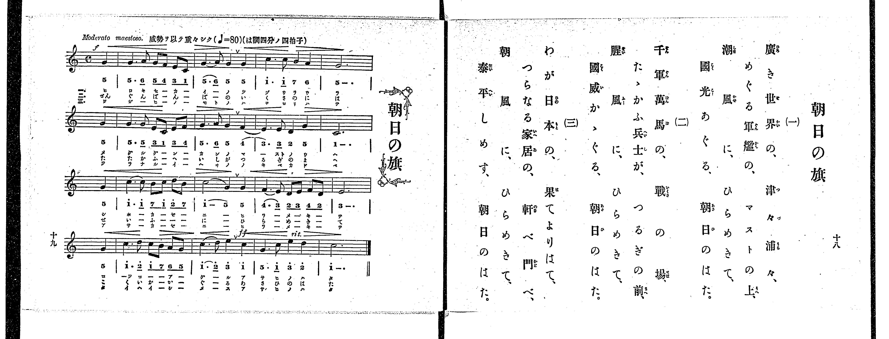
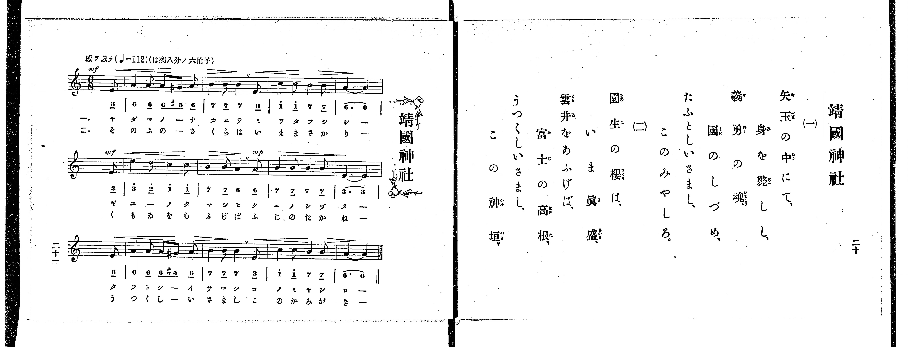

# 朝日の旗

> Re:Shōka 使用 AI 協助辨識與重建樂譜，可能會有錯誤。歡迎回報。

- **鋼琴伴奏版**：<br><audio controls src="asahi_no_hata.mp3"></audio>
- **NEUTRINO 歌聲合成版**：<br><audio controls src="asahi_no_hata_neutrino.mp3"></audio>

- 出處：共益商社樂器店《唱歌教科書 教師用 巻四》第十八～十九頁（第二學期第三曲）
- NDL Digital Collections PID 854865（https://dl.ndl.go.jp/pid/854865）掃描 P015.jpg

## 說明

原書資訊與歌詞全文（NDL PID 854865《唱歌教科書 教師用 巻四》第十八～十九頁，掃描 P015.jpg）：
調性與拍號：は調四分ノ四拍子（C 大調 4/4 拍），♩=80，「Moderato maestoso. 威勢ヲ以テ重々シク」，弱起一拍
註記：單聲部，三節分節歌。開頭 f，第十四小節第四拍弱起 ff，第十五小節後半標有「rit.」。第一小節第三拍五線譜為兩個八分音符 G4–F4（5 4），下方簡譜漏印八分音符底線，本檔依五線譜記為八分音符。原譜於第二、六、十、十四小節第三拍後印有換氣記號「V」。右頁僅印歌詞，未附演奏注意與語釋。


## 歌詞

```text
一、
廣き世界の、津々浦々、
めぐる軍艦の、マストの上、
潮風に、ひらめきて、
國光あぐる、朝日のはた。

二、
千軍萬馬の、戰の場、
たゝかふ兵士が、つるぎの前、
腥風に、ひらめきて、
國威かゝぐる、朝日のはた。

三、
わが日本の、果てよりはて、
つらなる家居の、軒べ門べ、
朝風に、ひらめきて、
泰平しめす、朝日のはた。
```

## ABC

<div class="abc-score" data-abc-src="asahi_no_hata.abc" aria-label="五線譜載入中"></div>

[下載 ABC 原始檔](asahi_no_hata.abc)

## TMD 檔案連結

- [主旋律 TMD 檔案](asahi_no_hata.tmd) [[在 TMD Studio 編輯](https://tmdlang.github.io/Tmd-TS/#tmd=s7IKdvYPcrWy4qpTUCpJTLdSSM7PyUlNLsnMz7PKrsxPzc6ML87Iz05Ugisoy88pzU21yk7MizeJtzA1sTAzRUgW55cWJadaFSdn5OfnxJekVpQk5edno8vHFySmp1oFGBgi6Swoyi9LzUvMA-ouKMrMK0lNAWtHKEgty0xJBUkXJwOtLkstykzLTE1BcldqUTHI1VArSooS84qTizILQF5BqEpPzSsC2pBYUpSZX5KZjJBIyy_KtSouKcovyEAWLslIBXo2NzMnsySxqBJdPDO3AOiOxByEeH5RZnpmnlVuamZWJpL_tbQUns2Z-2z60seN655Nn66gpcWlaKtgYcBlb6vgzGVjom9iBzLiafuuFzOnvt8z62nrxuezu55ObXu-ZN-zFU1PZ654umv644aup1M2Plvb82zqzOfLJz6bvUMByHq6Y_XzKSsUnm7f_XT27McN3c_XrHna2_i0dfX7vfOAjCc7575c0Ph-TwdQ_MmunqdrdzybMx_E3tH5bPam93s6wW73c_FRcAG6vCQxR8EZngKKFQI8XRQgcQw0IaOkpKDYSl8_JUcvD4jT8_WyCvQLMlP0YSo6n_U1P-vvVwDFLFAuXYmLS19LwZZagEtBQeFp33ygv19sbn-xoutFRzswMF6snPe0dcWzae1AF4K8gXAyReHVg-YXoO-A8QJywotV-581LAdZ3t37YuZ8oOjjxvVAQaBxTzvaHjf3ARlAqadrJwBd5KzwdMlyoKQCMIoVgKJgY3oezVxpa2EAZDxu6PHNT0ktSizJV8hNTC0uyS_O11N4uqLxafeix82bnuxe-ri57WV77-OG1sdN2x83rX_cADSi5-mejS-2bn-yowFoIthJK3a_WDEDlG6mrXvRuOll8wqgImAMP1_fAHQSkAQGwuOGppfTul8uWKuQBpSE-hro5A39QHkQF-JqsMkKaQg1T3ZNgah5uq_naW_XsxUzn83pBLq7KLNED-gaoLHg1NQANwiUsrp7gdqeb5_1Yu2c5027nraufNrQDQxioGNezt_8fM0yBXeTRw2T3UyAIWSqACRBgfJkR_ezaTufb1gI1PRsT__T3g3IOp7umgo0DxQvc9Y8WzXlyb65cBuAXgdbglAMdBQwoYDMmbYHku4fNwCjeC2I7G2EkMh-hzgZ7MENQN8965_9bMNioLHA6AX6NAzizaf9m4Ep42lzK0gRON2BXbPq5cyWZ3umPF3a_2zzimct_cCE8WLVvJft3UAtXKDIAYYN0EZw4t29-HFj75Md055P7QEWBEDRZ1uWAqP22Vagi1uhih43NT5unPC4qfvF7t4Xncsg6h43z3vctPNxcweQ-2RHF1Tps73rXi5a8bhxNUhF46bHTZ1gzb2PG4HmQWycAwz2zseNTRAjQTbCiiFgon3cCPQe1JHgIAJr6W0G2Txhzctla6CO7NgAZDxdsAXmQqC2prmPG7sfN2592rr16eLVjxtBuh83LgHZ0dgHUt0JDDKw6hetS4lw5AqgUDfYVALu3AFMe9Bw6gdaC1QDTBBQd86bAzK0qeNxUxdYF8wCsMOAobAKaPTTdduebmyFaHixe9Ljxp0vpzUASViQzplLwLXPNm94unPz48bpYImZ2J0KVEd5eQcFClr6XFyOxYkZmX75HokliVZh-ZnJqQ41BjXVIHsUbCy07MCM6rRaMA0sczUg-VgT6PVNCjXAsOoFskB4tsLj5j1AuhtMA2UaW6Ai60DBBBZZCsRtQD2dYBqkG8hqagS5A2R8jYKBgi4cmwJxDZjUVTAD0iYKxgqGKCIwNYZxYCEgZQ6WQeiDQLAqsA0-hjUK8UAeDIM8AVIN8gZIJcwrIFY3RAboDYgpII-AyCVQ8aVQUYiHICyIWSAeDIK8B7fdCN322Y-bJkONmwBVPhnI3gBlQWRAPGQHgBwEEu-Hik6Fy6yGyqxHdkDjfIQDjNEc0AQyA6SjB6p2NRDvRrEdZDLCLJDJINFlUNd2AHEXFhmYenBgwdIOyJPAjAKhQUkD5FloYgGKgr0OTCzN80AiYPmdQBpoBTgJgRNM4w4gBrZyYAkGEs2m4KRhDEwiqMnDBOwmY7CIsYIRWCU4wSC5ETVxIOIB4kzkkAAlCFgMQcJ7H1gG5teZQLwCEk_wtAB0L3JwTEdYBkwLkKiBpDVgiQdmgdQjUh1IByRy4OkO6DCITB-aM9DtAqViRLTDUiWwrIKagUhIEH2Pm4CxAjURRIJkYLkCGA9g7z9uXAmV2YliVxPcLnA070YpCx43zoFHMzB9gUTAopDyA1gCgKO6ESoKzIBQtcuAeDIiqpFzOZAwAtFwUUg8QmIXFOuQ-AalCCN4CsAe36DUDosEEDkH6kFQXkJ4EFZMwLI2JFtDAggz1YNTDFI0I4oQSCTDEgeV7ABFL7AUoL4_ECUHOFoXg61FRGATPKpg-RmUjpvAIqBCaRM4JYGKBkhaR49KYBSCYxOUWZEFjUGs6rS0WogYLE8DOWAZoAqkUh8CQRUGcqwuRgoleAIFOxTmb0gowcQhoQdzMnJ5BsmiEAgqM5HjFVoCgzMOxDxYpUE1e8BxCysMQIUfiA0tSKCxB5GbSbY9tVxcunYKSO0ABSBXmQsA)]
- [鋼琴伴奏 TMD 檔案](asahi_no_hata_piano.tmd) [[在 TMD Studio 編輯](https://tmdlang.github.io/Tmd-TS/#tmd=s7IKdvYPcrWy4tLSUng2Z-6z6UsfN657Nn36-z0dL7v3PJ-w5cmeLU-X9j_v7Hi_p1NBS4tL0VbBwoDL3lbBmcvGRN_EjqtOQelp-64XM6e-3zPraevG57O7nk5te75k37MVTU9nrni6a_rjhq6nUzY-W9vzbOrM58snPpu9QwHIerpj9fMpKxSebt_9dPbsxw3dz9esedrb-LR19fu984CMJzvnvlzQCHQFUPzJrp6na3c8mzMfxN7R-Wz2JqBblEAW-7n4KLhkpmeWJOYoOOfn5KQml2Tm5xUrBHi6KFiYmliYmQJNyCgpKSi20tdPydHLA-L0fL2sAv2CzBR9mIrOZ33Nz_r7FQIMDE2BculKXFyOxYkZmX75HokliVYBmYl5-UEeDjUGNdVcCkBgY6FlB2ZUp9WCaX0tBY2neza-2LpdU-Fx4yaFGoXHTb1AFgjPVnjcvAdId4NpoExjC1RkHRAvAYssBeI2oJ5OMA3SDWQ1NSpo6YONr1EwUNCFY1MgrgGTugpmQNpEwVjBEEUEpsYwDiwEpMzBMgh9EAhWBbbBx7BGIR7Ig2GQJ0CqQd4AqYR5BcTqhsgAvQExBeQRELkEKr4UKgrxEIQFMQvEg0GQ9-C2G6HbPvtx02SocROgyicD2RugLIgMiIfsAJCDQOL9UNGpcJnVUJn1yA5onI9wgDGaA5pAZoB09EDVrgbi3Si2g0xGmAUyGSS6DOraDiDuwiIDUw8OLFjaAXnycRMwgYBoUNIAeRaaWICiYK8DE0vzPJAIWH4nkAZaAU5C4ATTuAOIpyMSDCSaTcFJwxiYRFCThwnYTcZgEWMFI7BKcIJBciNq4kDEA8SZyCEBShCwGIKE9z6wDMyvM4F4BSSe4GkB6F7k4JiOsAyYFiBRA0lrjxu3glkg9YhUB9IBiRx4ugM6DCLTh-YMdLtAqRgR7bBU-bhxFdQMREKC6HvcBIwVqIkgEiQDyxXAeAB7_3HjSqjMThS7muB2gaN5N0pZ8LhxDjyagekLJAIWhZQfwBIAHNWNUFFgBoSqXQbEkxFRjZzLgYQRiIaLQuIRErugWIfENyhFGMFTAPb4BqV2WCSAyDlQD4LyEsKDsGIClrUh2RoSQJipHpxikKIZUYRAIhmWOKhkByh6gaUA9f2BKDnA0boYbC0iApvgUQXLz6B03AQWARVKm8ApCVQ0QNI6elQCoxAcm6DMiixoDGJVp6XVQsRgeRrIAcsAVSCV-hAIqjCQY3UxUijBEyjYoTB_Q0IJJg4JPZiTkcszSBaFQFCZiRyv0BIYnHEg5sEqDarZA45bWGEAKvxAbGhBAo09iNxMsu2pxdIM8EFuBphAmwHARPCir-tle-_T1h0vZ7dCWkxIsRqvEG0YC6NqQDkRyDSJhVEQH8FFkdRBmabxQNo0HqES00QoE7uJMFGSTIQroZtauABJIWAAiSldOwWkyIr2AUqiCxlhChmDhZS5AA)]

## 分析

```text
================================================================================
📊 TMD Song Profile: [ 朝日の旗 ]
================================================================================
⏱  Duration:       0:51 (51.0s), 17 measures total
🎼 Key & Tempo:    首調基準 C, != 80.0 BPM, <4/4>
   - 分析範圍：      由實際發聲的音符與和弦推測調性；播放脈絡另行呈現
🎤 人聲音域:    C4 (MIDI 60) – E5 (MIDI 76) [跨度: 16 個半音 / 1.3 個八度, 難度: moderate]
   - 最低音:  C4 in [AsahiNoHata #1 @ m.2, 0:05]
   - 最高音: E5 in [AsahiNoHata #1 @ m.15, 0:43]
   - 適合: soprano, mezzo-soprano, contralto, tenor, baritone, bass
🏛  結構:      AsahiNoHata (51.0s)
⚡ 編曲密度:        Peak 1 軌道同時演奏
🗝  調性診斷：       C 大調（純淨自然大調，未偵測到可信轉調）
   - 風格氣質:    純淨自然大調（陽光明朗、易唱易記，無明顯調外色彩）
   - 轉調歷程:    全曲維持單一推測調性（未偵測到可信轉調）
   - 核心骨幹音:  G, C, E, D, F
   - 調性數值:    C 大調 [相關度: 0.92, 穩定度: High, 自然音純度: 100.0%]
   - 候選調性 (K-S): C 大調 (0.92), G 大調 (0.74), E 小調 (0.63)
   - 五度圈歷程:   +0
   - 各段落調性細節:
     • [AsahiNoHata #1]: C 大調 (r: 0.92, 自然音純度: 100.0%)

  [ 五度圈游移軌跡 ]
              [C ]*
         F            G  
      Bb               D  
      Eb               A  
         Ab           E  
            Db       B  
               F# 
     (* = active key center)

  [ 十二半音累積音高分佈 ]
     C  : ████████████████████      28.9%
     C# :                            0.0%
     D  : █████                      7.0%
     D# :                            0.0%
     E  : ██████████                14.8%
     F  : ████                       6.2%
     F# :                            0.0%
     G  : ████████████████████████  34.4%
     G# :                            0.0%
     A  : ███                        4.7%
     A# :                            0.0%
     B  : ███                        3.9%
--------------------------------------------------------------------------------
Assignment 軌道音域：
  - Voice         : C4 – E5 (16 個半音 / 1.3 個八度, 65 個音符)
================================================================================
```


## 原書掃描頁






