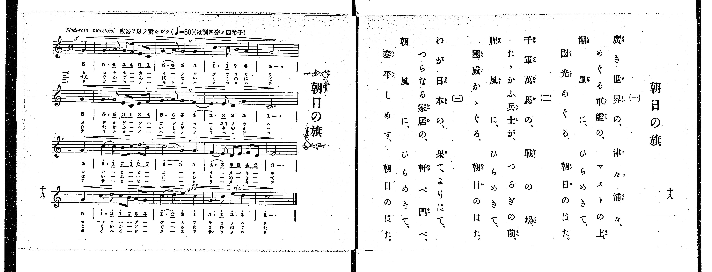
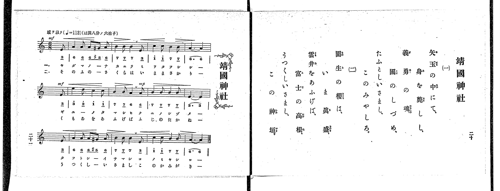

# 朝日の旗

> Re:Shōka 使用 AI 協助辨識與重建樂譜，可能會有錯誤。歡迎[回報](https://github.com/TMDLang/reshoka/issues)。

- **鋼琴伴奏版**：<br><audio controls src="asahi_no_hata.mp3"></audio>
- **NEUTRINO 歌聲合成版**：<br><audio controls src="asahi_no_hata_neutrino.mp3"></audio>

- 出處：共益商社樂器店《唱歌教科書 教師用 巻四》第十八～十九頁（第二學期第三曲）
- NDL Digital Collections PID 854865（https://dl.ndl.go.jp/pid/854865）掃描 P015.jpg

## 說明

原書資訊與歌詞全文（NDL PID 854865《唱歌教科書 教師用 巻四》第十八～十九頁，掃描 P015.jpg）：
調性與拍號：は調四分ノ四拍子（C 大調 4/4 拍），♩=80，「Moderato maestoso. 威勢ヲ以テ重々シク」，弱起一拍
註記：單聲部，三節分節歌。開頭 f，第十四小節第四拍弱起 ff，第十五小節後半標有「rit.」。第一小節第三拍五線譜為兩個八分音符 G4–F4（5 4），下方簡譜漏印八分音符底線，本檔依五線譜記為八分音符。原譜於第二、六、十、十四小節第三拍後印有換氣記號「V」。右頁僅印歌詞，未附演奏注意與語釋。


## 歌詞

```text
一、
廣き世界の、津々浦々、
めぐる軍艦の、マストの上、
潮風に、ひらめきて、
國光あぐる、朝日のはた。

二、
千軍萬馬の、戰の場、
たゝかふ兵士が、つるぎの前、
腥風に、ひらめきて、
國威かゝぐる、朝日のはた。

三、
わが日本の、果てよりはて、
つらなる家居の、軒べ門べ、
朝風に、ひらめきて、
泰平しめす、朝日のはた。
```

## ABC

<div class="abc-score" data-abc-src="asahi_no_hata.abc" aria-label="五線譜載入中"></div>

[下載 ABC 原始檔](asahi_no_hata.abc)

## TMD 檔案連結

- [主旋律 TMD 檔案](asahi_no_hata.tmd) [[在 TMD Studio 編輯](https://tmdlang.github.io/Tmd-TS/#tmd=s7IKdvYPcrWy4qpTUCpJTLdSSM7PyUlNLsnMz7PKrsxPzc6ML87Iz05Ugisoy88pzU21yk7MizeJtzA1sTAzRUgW55cWJadaFSdn5OfnxJekVpQk5edno8vHFySmp1oFGBgi6Swoyi9LzUvMA-ouKMrMK0lNAWtHKEgty0xJBUkXJwOtLkstykzLTE1BcldqUTHI1VArSooS84qTizILQF5BqEpPzSsC2pBYUpSZX5KZjJBIyy_KtSouKcovyEAWLslIBXo2NzMnsySxqBJdPDO3AOiOxByEeH5RZnpmnlVuamZWJhb_5xeVZOSnFyUWZFRaZWQWlwCVJyfmxAMDExjCWloKz-bMfTZ96ePGdc-mT1fQ0uJStFWwMOCyt1Vw5rIx0TexAxn0tH3Xi5lT3--Z9bR14_PZXU-ntj1fsu_ZiqanM1c83TX9cUPX0ykbn63teTZ15vPlE5_N3qEAZD3dsfr5lBUKT7fvfjp79uOG7udr1jztbXzauvr93nlAxpOdc18uaHy_pwMo_mRXz9O1O57NmQ9i7-h8NnvT-z2dYB_4ufgouAC9V5KYo-AMTybFCgGeLgqQhAA0IaOkpKDYSl8_JUcvD4jT8_WyCvQLMlP0YSo6n_U1P-vvVwBFP1AuXYmLS19LwZZagEtBQeFp33ygv19sbn-xoutFRzswMF6snPe0dcWzae1AF4K8gXAyReHVg-YXoO-A8QJywotV-581LAdZ3t37YuZ8oOjjxvVAQaBxTzvaHjf3ARlAqadrJwBd5KzwdMlyoKQCMIoVgKJgY3oezVxpa2EAZDxu6PHNT0ktSizJV8hNTAWmmuJ8PYWnKxqfdi963Lzpye6lj5vbXrb3Pm5ofdy0_XHT-scNQCN6nu7Z-GLr9ic7GoAmgp20YveLFTNA6WbauheNm142rwAqAsbw8_UNQCcBSWAgPG5oejmt--WCtQppQEmor4FO3tAPlAdxIa4Gm6yQhlDzZNcUiJqn-3qe9nY9WzHz2ZxOoLuLMkv0gK4BGgtOTQ1wg0Apq7sXqO359lkv1s553rTraevKpw3dwCAGOubl_M3P1yxTcDd51DDZzQQYQqYKQBIUKE92dD-btvP5hoVATc_29D_t3YCs4-muqUDzQPEyZ82zVVOe7JsLtwHodbAlCMVARwETCsicaXsg6f5xAzCK14LI3kYIiex3iJPBHtwA9N2z_tnPNiwGGguMXqBPwyDefNq_GZgynja3ghSB0x3YNatezmx5tmfK06X9zzaveNbSD0wYL1bNe9neDdTCBYocYNgAbQQn3t2LHzf2Ptkx7fnUHmBBABR9tmUpMGqfbQW6uBWq6HFT4-PGCY-bul_s7n3RuQyi7nHzvMdNOx83dwC5T3Z0QZU-27vu5aIVjxtXg1Q0bnrc1AnW3Pu4EWgexMY5wGDvfNzYBDESZCOsGAIm2seNQO9BHQkOIrCW3maQzRPWvFy2BurIjg1AxtMFW2AuBGprmvu4sftx49anrVufLl79uBGk-3HjEpAdjX0g1Z3AIAOrftG6lAhHrgAKdYNNJeDOHcC0Bw2nfqC1QDXABAF157w5IEObOh43dYF1wSwAOwwYCquARj9dt-3pxlaIhhe7Jz1u3PlyWgOQhAXpnLkEXPts84anOzc_bpwOlpiJ3alAdZSXd1CgoKXPxeVYnJiR6ZfvkViSaBWWn5mc6lBjUFMNskfBxkLLDsyoTqsF08AyVwOSjzWBXt-kUAMMq14gC4RnKzxu3gOku8E0UKaxBSqyDhRMYJGlQNwG1NMJpkG6gaymRpA7QMbXKBgo6MKxKRDXgEldBTMgbaJgrGCIIgJTYxgHFgJS5mAZhD4IBKsC2-BjWKMQD-TBMMgTINUgb4BUwrwCYnVDZIDegJgC8giIXAIVXwoVhXgIwoKYBeLBIMh7cNuN0G2f_bhpMtS4CVDlk4HsDVAWRAbEQ3YAyEEg8X6o6FS4zGqozHpkBzTORzjAGM0BTSAzQDp6oGpXA_FuFNtBJiPMApkMEl0GdW0HEHdhkYGpBwcWLO2APAnMKBAalDRAnoUmFqAo2OvAxNI8DyQClt8JpIFWgJMQOME07gBiYCsHlmAg0WwKThrGwCSCmjxMwG4yBosYKxiBVYITDJIbURMHIh4gzkQOCVCCgMUQJLz3gWVgfp0JxCsg8QRPC0D3IgfHdIRlwLQAiRpIWgOWeGAWSD0i1YF0QCIHnu6ADoPI9KE5A90uUCpGRDssVQLLKqgZiIQE0fe4CRgrUBNBJEgGliuA8QD2_uPGlVCZnSh2NcHtAkfzbpSy4HHjHHg0A9MXSAQsCik_gCUAOKoboaLADAhVuwyIJyOiGjmXAwkjEA0XhcQjJHZBsQ6Jb1CKMIKnAOzxDUrtsEgAkXOgHgTlJYQHYcUELGtDsjUkgDBTPTjFIEUzogiBRDIscVDJDlD0AksB6vsDUXKAo3Ux2FpEBDbBowqWn0HpuAksAiqUNoFTEqhogKR19KgERiE4NkGZFVnQGMSqTkurhYjB8jSQA5YBqkAq9SEQVGEgx-pipFCCJ1CwQ2H-hoQSTBwSejAnI5dnkCwKgaAyEzleoSUwOONAzINVGlSzBxy3sMIAVPiB2NCCBBp7ELmZZNtTy8Wla6eA1A5QAHKVuQA)]
- [鋼琴伴奏 TMD 檔案](asahi_no_hata_piano.tmd) [[在 TMD Studio 編輯](https://tmdlang.github.io/Tmd-TS/#tmd=s7IKdvYPcrWy4qpTUCpJTLdSyC8qychPL0osyKi0ysgsLskvykxOzInPTsxLVOLS0lJ4Nmfus-lLHzeuezZ9-vs9HS-79zyfsOXJni1Pl_Y_7-x4v6dTQUuLS9FWwcKAy95WwZnLxkTfxA5k-tP2XS9mTn2_Z9bT1o3PZ3c9ndr2fMm-Zyuans5c8XTX9McNXU-nbHy2tufZ1JnPl098NnuHApD1dMfq51NWKDzdvvvp7NmPG7qfr1nztLfxaevq93vnARlPds59uaAR6Aqg-JNdPU_X7ng2Zz6IvaPz2exNQLcogSz2c_FRcMlMzyxJzFFwzs_JSU0uyczPK1YI8HRRsDA1sTAzBZqQUVJSUGylr5-So5cHxOn5elkF-gWZKfowFZ3P-pqf9fcrBBgYmgLl0pW4uByLEzMy_fI9EksSrQIyE_PygzwcagxqqrkUgMDGQssOzKhOqwXT-loKGk_3bHyxdbumwuPGTQo1Co-beoEsEJ6t8Lh5D5DuBtNAmcYWqMg6IF4CFlkKxG1APZ1gGqQbyGpqVNDSBxtfo2CgoAvHpkBcAyZ1FcyAtImCsYIhighMjWEcWAhImYNlEPogEKwKbIOPYY1CPJAHwyBPgFSDvAFSCfMKiNUNkQF6A2IKyCMgcglUfClUFOIhCAtiFogHgyDvwW03Qrd99uOmyVDjJkCVTwayN0BZEBkQD9kBIAeBxPuholPhMquhMuuRHdA4H-EAYzQHNIHMAOnogapdDcS7UWwHmYwwC2QySHQZ1LUdQNyFRQamHhxYsLQD8uTjJmACAdGgpAHyLDSxAEXBXgcmluZ5IBGw_E4gDbQCnITACaZxBxBPRyQYSDSbgpOGMTCJoCYPE7CbjMEixgpGYJXgBIPkRtTEgYgHiDORQwKUIGAxBAnvfWAZmF9nAvEKSDzB0wLQvcjBMR1hGTAtQKIGktYeN24Fs0DqEakOpAMSOfB0B3QYRKYPzRnodoFSMSLaYanyceMqqBmIhATR97gJGCtQE0EkSAaWK4DxAPb-48aVUJmdKHY1we0CR_NulLLgceMceDQD0xdIBCwKKT-AJQA4qhuhosAMCFW7DIgnI6IaOZcDCSMQDReFxCMkdkGxDolvUIowgqcA7PENSu2wSACRc6AeBOUlhAdhxQQsa0OyNSSAMFM9OMUgRTOiCIFEMixxUMkOUPQCSwHq-wNRcoCjdTHYWkQENsGjCpafQem4CSwCKpQ2gVMSqGiApHX0qARGITg2QZkVWdAYxKpOS6uFiMHyNJADlgGqQCr1IRBUYSDH6mKkUIInULBDYf6GhBJMHBJ6MCcjl2eQLAqBoDITOV6hJTA440DMg1UaVLMHHLewwgBU-IHY0IIEGnsQuZlk21OLpRngg9wMMIE2A4CJ4EVf18v23qetO17OboW0mJBiNV4h2jAWRtWAciKQaRILoyA-gosiqYMyTeOBtGk8QiWmiVAmdhNhoiSZCFdCN7VwAZJCwAASU7p2CkiRFe0DlEQXMsIUMgYLKXMBAA)]

## 分析

```text
================================================================================
📊 TMD Song Profile: [ 朝日の旗 ]
================================================================================
⏱  Duration:       0:51 (51.0s), 17 measures total
🎼 Key & Tempo:    首調基準 C, != 80.0 BPM, <4/4>
   - 分析範圍：      由實際發聲的音符與和弦推測調性；播放脈絡另行呈現
🎤 人聲音域:    C4 (MIDI 60) – E5 (MIDI 76) [跨度: 16 個半音 / 1.3 個八度, 難度: moderate]
   - 最低音:  C4 in [AsahiNoHata #1 @ m.2, 0:05]
   - 最高音: E5 in [AsahiNoHata #1 @ m.15, 0:43]
   - 適合: soprano, mezzo-soprano, contralto, tenor, baritone, bass
🏛  結構:      AsahiNoHata (51.0s)
⚡ 編曲密度:        Peak 1 軌道同時演奏
🗝  調性診斷：       C 大調（純淨自然大調，未偵測到可信轉調）
   - 風格氣質:    純淨自然大調（陽光明朗、易唱易記，無明顯調外色彩）
   - 轉調歷程:    全曲維持單一推測調性（未偵測到可信轉調）
   - 核心骨幹音:  G, C, E, D, F
   - 調性數值:    C 大調 [相關度: 0.92, 穩定度: High, 自然音純度: 100.0%]
   - 候選調性 (K-S): C 大調 (0.92), G 大調 (0.74), E 小調 (0.63)
   - 五度圈歷程:   +0
   - 各段落調性細節:
     • [AsahiNoHata #1]: C 大調 (r: 0.92, 自然音純度: 100.0%)

  [ 五度圈游移軌跡 ]
              [C ]*
         F            G  
      Bb               D  
      Eb               A  
         Ab           E  
            Db       B  
               F# 
     (* = active key center)

  [ 十二半音累積音高分佈 ]
     C  : ████████████████████      28.9%
     C# :                            0.0%
     D  : █████                      7.0%
     D# :                            0.0%
     E  : ██████████                14.8%
     F  : ████                       6.2%
     F# :                            0.0%
     G  : ████████████████████████  34.4%
     G# :                            0.0%
     A  : ███                        4.7%
     A# :                            0.0%
     B  : ███                        3.9%
--------------------------------------------------------------------------------
Assignment 軌道音域：
  - Voice         : C4 – E5 (16 個半音 / 1.3 個八度, 65 個音符)
================================================================================
```


## 原書掃描頁






