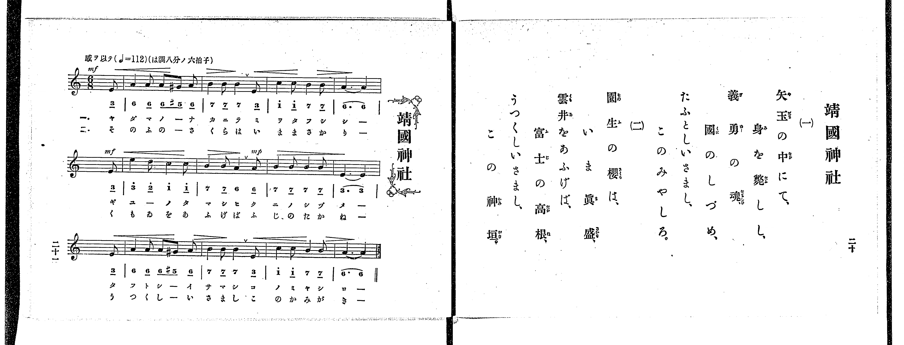

# 朝日の旗

> Re:Shoka 使用 AI 協助辨識與重建樂譜，可能會有錯誤。歡迎回報。

<audio controls src="asahi_no_hata.mp3"></audio>

- 出處：共益商社樂器店《唱歌教科書 教師用 巻四》第十八～十九頁（第二學期第三曲）
- NDL Digital Collections PID 854865（https://dl.ndl.go.jp/pid/854865）掃描 P015.jpg

## 說明

原書資訊與歌詞全文（NDL PID 854865《唱歌教科書 教師用 巻四》第十八～十九頁，掃描 P015.jpg）：
調性與拍號：は調四分ノ四拍子（C 大調 4/4 拍），♩=80，「Moderato maestoso. 威勢ヲ以テ重々シク」，弱起一拍
註記：單聲部，三節分節歌。開頭 f，第十四小節第四拍弱起 ff，第十五小節後半標有「rit.」。第一小節第三拍五線譜為兩個八分音符 G4–F4（5 4），下方簡譜漏印八分音符底線，本檔依五線譜記為八分音符。原譜於第二、六、十、十四小節第三拍後印有換氣記號「V」。右頁僅印歌詞，未附演奏注意與語釋。

## 歌詞

```text
一、
廣き世界の、津々浦々、
めぐる軍艦の、マストの上、
潮風に、ひらめきて、
國光あぐる、朝日のはた。

二、
千軍萬馬の、戰の場、
たゝかふ兵士が、つるぎの前、
腥風に、ひらめきて、
國威かゝぐる、朝日のはた。

三、
わが日本の、果てよりはて、
つらなる家居の、軒べ門べ、
朝風に、ひらめきて、
泰平しめす、朝日のはた。
```

## ABC

```abc
X:1
T:朝日の旗
M:4/4
L:1/16
Q:1/4=80
K:C
V:V1 name="Voice" snm="Voi"
[V:V1]
!f! z4 z4 z4 G4 | G6 A2 G2 F2 E2 C2 | G6 A2 G4 G4 | c6 c2 B4 A4 |
G12 G4 | G6 G2 E2 C2 E2 F2 | G6 A2 G4 F4 | E6 E2 D4 G4 |
C12 G4 | c6 c2 B2 c2 d2 B2 | c8 G4 G4 | F6 E2 D2 E2 F2 D2 |
E12 G4 | c6 d2 c2 B2 A2 G2 | !ff! c6 d2 e4 c4 | G6 c2 e4 d4 |
c12 z4 | !f! z4 z4 z4 G4 | G6 A2 G2 F2 E2 C2 | G6 A2 G4 G4 |
c6 c2 B4 A4 | G12 G4 | G6 G2 E2 C2 E2 F2 | G6 A2 G4 F4 |
E6 E2 D4 G4 | C12 G4 | c6 c2 B2 c2 d2 B2 | c8 G4 G4 |
F6 E2 D2 E2 F2 D2 | E12 G4 | c6 d2 c2 B2 A2 G2 | !ff! c6 d2 e4 c4 |
G6 c2 e4 d4 | c12 z4 | !f! z4 z4 z4 G4 | G6 A2 G2 F2 E2 C2 |
G6 A2 G4 G4 | c6 c2 B4 A4 | G12 G4 | G6 G2 E2 C2 E2 F2 |
G6 A2 G4 F4 | E6 E2 D4 G4 | C12 G4 | c6 c2 B2 c2 d2 B2 |
c8 G4 G4 | F6 E2 D2 E2 F2 D2 | E12 G4 | c6 d2 c2 B2 A2 G2 |
!ff! c6 d2 e4 c4 | G6 c2 e4 d4 | c12 z4 |
```

## TMD 檔案連結

- [主旋律 TMD 檔案](asahi_no_hata.tmd) [[在 TMD Studio 編輯](https://tmdlang.github.io/Tmd-TS/#tmd=s7IKdvYPcrWy4qpTUCpJTLdSSM7PyUlNLsnMz7PKrsxPzc6ML87Iz05Ugisoy88pzU21yk7MizeJtzA1sTAzRUgW55cWJadaFSdn5OfnxJekVpQk5edno8vHFySmp1oFGBgi6Swoyi9LzUvMA-ouKMrMK0lNAWtHKEgty0xJBUkXJwOtLkstykzLTE1BcldqUTHI1VArSooS84qTizILQF5BqEpPzSsC2pBYUpSZX5KZjJBIyy_KtSouKcovyEAWLslIBXo2NzMnsySxqBJdPDO3AOiOxBwlLi0thWdz5j6bvvRx47pn06craGlxKdoqWBhw2dsqOHPZmOib2IH0Pm3f9WLm1Pd7Zj1t3fh8dtfTqW3Pl-x7tqLp6cwVT3dNf9zQ9XTKxmdre55Nnfl8-cRns3coAFlPd6x-PmWFwtPtu5_Onv24ofv5mjVPexuftq5-v3cekPFk59yXCxrf7-kAij_Z1fN07Y5nc-aD2Ds6n83e9H5PJ9jRfi4-Ci6Z6UBf5Cg4w6O4WCHA00UBEolAEzJKSgqKrfT1U3L08oA4PV8vq0C_IDNFH6ai81lf87P-fgVQ1AHl0pW4uPS1FGypBbgUFBSe9s0H-vvF5vYXK7pedLQDA-PFynlPW1c8m9YOdCHIGwgnUxRePWh-AfoOGC8gJ7xYtf9Zw3KQ5d29L2bOB4o-blwPFAQa97Sj7XFzH5ABlHq6dgLQRc4KT5csB0oqAKNYASgKNqbn0cyVthYGQMbjhh7f_JTUosSSfIXcxNTikvzifD2Fpysan3Yvety86cnupY-b21629z5uaH3ctP1x0_rHDUAjep7u2fhi6_YnOxqAJoKdtGL3ixUzQOlm2roXjZteNq8AKgLG8PP1DUAnAUlgIDxuaHo5rfvlgrUKaUBJqK-BTt7QD5QHcSGuBpuskIZQ82TXFIiap_t6nvZ2PVsx89mcTqC7izJL9ICuARoLTk0NcINAKau7F6jt-fZZL9bOed6062nryqcN3cAgBjrm5fzNz9csU3A3edQw2c0EGEKmCkASFChPdnQ_m7bz-YaFQE3P9vQ_7d2ArOPprqlA80DxMmfNs1VTnuybC7cB6HWwJQjFQEcBEwrInGl7IOn-cQMwiteCyN5GCInsd4iTwR7cAPTds_7ZzzYsBhoLjF6gT8Mg3nzavxmYMp42t4IUgdMd2DWrXs5sebZnytOl_c82r3jW0g9MGC9WzXvZ3g3UwgWKHGDYAG0EJ97dix839j7ZMe351B5gQQAUfbZlKTBqn20FurgVquhxU-PjxgmPm7pf7O590bkMou5x87zHTTsfN3cAuU92dEGVPtu77uWiFY8bV4NUNG563NQJ1tz7uBFoHsTGOcBg73zc2AQxEmQjrBgCJtrHjUDvQR0JDiKwlt5mkM0T1rxctgbqyI4NQMbTBVtgLgRqa5r7uLH7cePWp61bny5e_bgRpPtx4xKQHY19INWdwCADq37RupQIR64ACnWDTSXgzh3AtAcNp36gtUA1wAQBdee8OSBDmzoeN3WBdcEsADsMGAqrgEY_Xbft6cZWiIYXuyc9btz5cloDkIQF6Zy5BFz7bPOGpzs3P26cDpaYid2pQHWUl3dQoKClz8XlWJyYkemX75FYkmgVlp-ZnOpQY1CjUA2ySMHGQssOzKhOqwXTwEJXA5KRNYF-36RQAwysXiALhGcrPG7eA6S7wTRQprEFKrIOFE5gkaVA3AbU0wmmQbqBrKZGkENAxtcoGCjowrEpENeASV0FMyBtomCsYIgiAlNjGAcWAlLmYBmEPggEq4J5AJgQgHYCXQmiQe5rmgx3MVAUxAO5uHkeSAQsvxNId0D9AXZ14w4gBta1MFdD7DIFu88Y6E5UN5qA3WMMFjFWMEK4GrcLd6OE5ePGOXAXroaIgEUh4Q8MQbArG6GiwLiAql0GxJMRrkQOJSBhBKLhohAnQBwGcjDEqSDPGMEdj9Wpi8GWIBzVBLceFrygoG4Ci0wFOxoSkOvBIvMxnAd0FtiFoLBDFjQGsarT0mohYrAgBnLAMkAVSCkBAkGJqIarlotL104BKZkrEOQqcwEA)]

## 分析

```text
================================================================================
📊 TMD Song Profile: [ 朝日の旗 ]
================================================================================
⏱  Duration:       2:33 (153.0s), 51 measures total
🎼 Key & Tempo:    首調基準 C, != 80.0 BPM, <4/4>
   - 分析範圍：      由實際發聲的音符與和弦推測調性；播放脈絡另行呈現
🎤 人聲音域:    C4 (MIDI 60) – E5 (MIDI 76) [跨度: 16 個半音 / 1.3 個八度, 難度: moderate]
   - 最低音:  C4 in [AsahiNoHata #1 @ m.2, 0:05]
   - 最高音: E5 in [AsahiNoHata #1 @ m.15, 0:43]
   - 適合: soprano, mezzo-soprano, contralto, tenor, baritone, bass
🏛  結構:      AsahiNoHata (51.0s) -> AsahiNoHata (51.0s) -> AsahiNoHata (51.0s)
⚡ 編曲密度:        Peak 1 軌道同時演奏
🗝  調性診斷：       C 大調（純淨自然大調，未偵測到可信轉調）
   - 風格氣質:    純淨自然大調（陽光明朗、易唱易記，無明顯調外色彩）
   - 轉調歷程:    全曲維持單一推測調性（未偵測到可信轉調）
   - 核心骨幹音:  G, C, E, D, F
   - 調性數值:    C 大調 [相關度: 0.92, 穩定度: High, 自然音純度: 100.0%]
   - 候選調性 (K-S): C 大調 (0.92), G 大調 (0.74), E 小調 (0.63)
   - 五度圈歷程:   +0 -> +0 -> +0
   - 各段落調性細節:
     • [AsahiNoHata #1]: C 大調 (r: 0.92, 自然音純度: 100.0%)
     • [AsahiNoHata #2]: C 大調 (r: 0.92, 自然音純度: 100.0%)
     • [AsahiNoHata #3]: C 大調 (r: 0.92, 自然音純度: 100.0%)

  [ 五度圈游移軌跡 ]
              [C ]*
         F            G  
      Bb               D  
      Eb               A  
         Ab           E  
            Db       B  
               F# 
     (* = active key center)

  [ 十二半音累積音高分佈 ]
     C  : ████████████████████      28.9%
     C# :                            0.0%
     D  : █████                      7.0%
     D# :                            0.0%
     E  : ██████████                14.8%
     F  : ████                       6.2%
     F# :                            0.0%
     G  : ████████████████████████  34.4%
     G# :                            0.0%
     A  : ███                        4.7%
     A# :                            0.0%
     B  : ███                        3.9%
--------------------------------------------------------------------------------
Assignment 軌道音域：
  - Voice         : C4 – E5 (16 個半音 / 1.3 個八度, 195 個音符)
================================================================================
```


## 原書掃描頁





