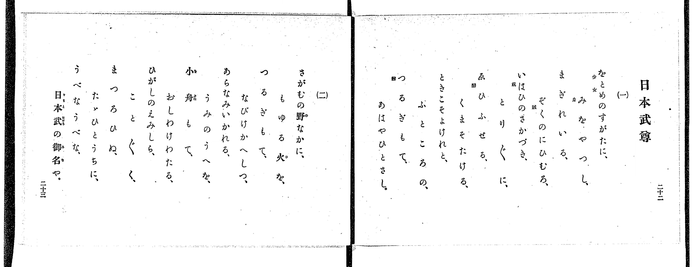

# 靖國神社

> Re:Shōka 使用 AI 協助辨識與重建樂譜，可能會有錯誤。歡迎回報。

- **鋼琴伴奏版**：<br><audio controls src="yasukuni_jinja.mp3"></audio>
- **NEUTRINO 歌聲合成版**：<br><audio controls src="yasukuni_jinja_neutrino.mp3"></audio>

- 出處：共益商社樂器店《唱歌教科書 教師用 巻四》第二十～二十一頁（第二學期第四曲）
- NDL Digital Collections PID 854865（https://dl.ndl.go.jp/pid/854865）掃描 P016.jpg

## 說明

原書資訊與歌詞全文（NDL PID 854865《唱歌教科書 教師用 巻四》第二十～二十一頁，掃描 P016.jpg）：
調性與拍號：は調八分ノ六拍子（關係小調 A 小調 6/8 拍），♩=112，「感ヲ以テ」，弱起一拍（八分音符）
註記：單聲部，二節分節歌，共十二小節。開頭 mf，第二段（第四小節第六拍弱起）mf，第六小節第六拍弱起 mp。第一、九小節第五拍出現升 G4（#5，TMD 記為 5'）。原譜於第二、六、十小節第五拍後印有換氣記號「V」。右頁僅印歌詞，未附演奏注意與語釋。


## 歌詞

```text
一、
矢玉の中にて、身を斃しし、
義勇の魂、國のしづめ、
たふとしいさまし、このみやしろ。

二、
園生の櫻は、いま眞盛、
雲井をあふげば、富士の高根、
うつくしいさまし、この神垣。
```

## ABC

<div class="abc-score" data-abc-src="yasukuni_jinja.abc" aria-label="五線譜載入中"></div>

[下載 ABC 原始檔](yasukuni_jinja.abc)

## TMD 檔案連結

- [主旋律 TMD 檔案](yasukuni_jinja.tmd) [[在 TMD Studio 編輯](https://tmdlang.github.io/Tmd-TS/#tmd=s7IKdvYPcrWy4qpTUCpJTLdSSM7PyUlNLsnMz7PKrsxPzc6ML87Iz05Ugisoy88pzU21yk7MizeJtzA1sTAzRUgW55cWJadaFSdn5OfnxJekVpQk5edno8vHFySmp1oFGBiaIWQKivLLUvMS84C6C4oy80pSU8DaEQpSyzJTUkHSxclAq8tSizLTMlNTkNyVWlQMcjXUipKixLzi5KLMApBXEKrSU_OKUq2SU4tSc_PzMhNzEDJp-UW5VsUlRfkFGZnJCOGSjFSgb4tSczLTUQyCiOdm5mSWJBZVoosX5CQmpyIE84uAuvOsclMzszKRQkVLS-Hl3GlP53Q_Xzrv-ZJ9ClpaXIq2CoaGRlz2tgrOXNmplbYKjrlcNmb6FnYgs56273oxc-r7PbOetm58Prvr6dQ2oK5nK5qezlzxdNf0xw1dT6dsfLa259nUmc-XT3w2e4cCkPV0x-rnU1YoPN2---ns2Y8bup-vWfNkV8_T3sb3e-dBGE92NLxc0Ph-TwdUau2OZ3PmA9lA9c9mb3q_pxPsDz8XHwUXoC9KEnMUnOFppFghwNNFAZIKgCZklJQUFFvp66fk6OUBcXq-XlaBfkFmij5MReezvuZn_f0KoLgHyqUrcXHpaynYUgtwKSgoPO2bD_T6i83tL1Z0vehoB4bHi5XznraueDatHehCkDcQTqY0yHrQvAP0IDB2QK54sWr_s4blIPu7e1_MnA8Ufdy4Hij4tHX10462x819T1vXAqWerp0AdNTL6XOe7G96uqEfqEDBUQHKAMa6AlAJ2MyeRzNX2gITBpD1uKHnWcv8x82bnuxe-ri57XEDUEXP0z0bX2zdDnQWWEMHxJaX8zc_X7MMqB_soBW7X6yYAUo709a9aNz0snkFUBvQN8_XNwCVAklgKIAMat0I8h_Qlxv6gYKPG5peTut-uWCtQm4aUBYSEs_WbYWkFmDwQJSB2BD_gN0BtBKmHCiMVYlCbgHQbJB5O4CWND7ZOReu7MmuKSBl7bue9-972tuu4G4CtE0ZmHh6QnxdgP6Y8bxpl4KpOtASoAnA2H6xds6zaXsgTgMaBbQFRPY2ohu4DxhzG57N6XzWP_vZhsVAc4DxAgzMMGAIggzq3wyM0qfNrSBF4DQDit45q17ObHm2Z8rTpf3PNq941tIPjNEXq-a9bO8GauEChSvE_SDW8_mLnvd1Pm5c92TH2seNqx83LgNKvNi1-nHTpGfTmh83TgchqNJ9K592twOVvlzbBHLsnG4gG6xi6eOmRqiix43zHzdufdy4AizR8rhx6uPGfRAzHjdOBmvY_7gJKD79cRPIBxDngMMAnA_mTHo-BWjCumerdwPTHlgXUPG-53PmPQcla7Cil7M3Pdk1FejCx41NYMuAjA0gF63veboY6IV1L1fPeLZgJ9xFbY8blzxu7MflImA59nTeYpBbgKopz85QoKClz8UVmVhcml2al-mVmZeVaBWWn5mc6lCja1hTDbJKwcZCyw7MqM5NqwUzgMWKBiSpaSoAQ0mhBuj6BUC8D4jXKTxu3gOkV4FFu4F4NRAvA-L9IJGmSaCwB-KtQDwdrGY6VEcfyC0g42sUDODQGMgzU9AFYjNgugQSNQrmQK45mARJGsYBGUACIgpRDIEg54KUgM30MaxRiIdDhKN14c4GsWCOBrEhzgaxYA4HsSFOB7FgjodZB_IA1C4jFLsa54JVQmwAeRvCmgoW7QexmzqBrPVgUYi79sHdNRXM6ga7oAvJrn6oXcCoeNzUBg1BYNgDHQgxAByujZsgSqHeAcmDRJeCjWuE6pqPCHdjUGAaxcEDFRbYoECtzi2oRQt_UHgbwx2FHNQgN4GcCXQZ1Lswd0GCDuQyqDfAbgOxIa4DsWDuQ3gXqBsetI-bmsCBNgEeKU1gUyDRAkpfG6BBDRKdATd7PiIoG9cimd2GFJTg-FmBlCgh8TEVKUgnQ2MTlC5A6QiaEpp6wTrgQUlmojVADkSolyDuQaQOSJqAuAfEgrkIklZBboKnT6CrYCbHIwdh4xJo8BNvMigr7wezesCiqCbXcnHp2imgFCQKQAFlLgA)]
- [鋼琴伴奏 TMD 檔案](yasukuni_jinja_piano.tmd) [[在 TMD Studio 編輯](https://tmdlang.github.io/Tmd-TS/#tmd=s7IKdvYPcrWy4tLSUng5d9rTOd3Pl857vmTf-z0dL7v3PJ-w5cmeLU-X9j_v7Hi_p1NBS4tL0VbB0NCIy95WwZnLxkzfwo6rTkHpafuuFzOnvt8z62nrxuezu55ObQMa8WxF09OZK57umv64oevplI3P1vY8mzrz-fKJz2bvUACynu5Y_XzKCoWn23c_nT37cUP38zVrnuzqedrb-H7vPAjjyY6GlwsagS6BSq3d8WzOfCAbqP7Z7E1A9yiB7PZz8VFwyUzPLEnMUXDOz8lJTS7JzM8rVgjwdFGwMDWxMDMFmpBRUlJQbKWvn5KjlwfE6fl6WQX6BZkp-jAVnc_6mp_19ysEGBiaAeXSlbi4IhOLS7NL8zK9MvOyEq0CMhPz8oM8HGp0DWuquRSAwMZCyw7MqM5NqwUz9LUUNJ7u2fhi63ZNhcdNLQo1Co8bFwDxPiBep_C4eQ-QXgUW7Qbi1UC8DIj3g0SaJgFZ84F4KxBPB6uZDtXRp6ClDza-RsEADo2BPDMFXSA2UzBVBxI1CuZArjmYBEkaxgEZQAIiClEMgSDngpSAzfQxrFGIh0OEo3XhzgaxYI4GsSHOBrFgDgexIU4HsWCOh1kH8gDULiMUuxrnglVCbAB5G8KaChbtB7GbOoGs9WBRiLv2wd01FczqBrugC8mufqhdwKh43NQGDUFg2AMdCDEAHK6NmyBKod4ByYNEl4KNa4Tqmo8Id2NQYBrFwQMVFtigQK3OLahFC39QeBvDHYUc1CA3gZwJdBnUuzB3QYIO5DKoN8BuA7EhrgOxYO5DeBeoGx60j5uawIE2AR4pTWBTINECSl8boEENEp0BN3s-Iigb1yKZ3YYUlOD4WYGUKCHxMRUpSCdDYxOULkDpCJoSmnrBOuBBSWaiNUAORKiXIO5BpA5ImoC4B8SCuQiSVkFugqdPoKtgJscjB2HjEmjwE28yKCvvB7N6wKKoJtdiLUd8sJYjwIB-0df1sr33aeuOl7NbISUvIuQM4xVM4xWiDWORWDVAaBKvYKgQbYIiDNViGh-vYAQUMo1FZoI04ZCB6sNmJEFN5FpGR3-hWGUAjCJwBOnaKaDEUbQPUAGmoBFYUJkLAA)]

## 分析

```text
================================================================================
📊 TMD Song Profile: [ 靖國神社 ]
================================================================================
⏱  Duration:       0:19 (19.3s), 12 measures total
🎼 Key & Tempo:    首調基準 C, != 112.0 BPM, <6/8>
   - 分析範圍：      由實際發聲的音符與和弦推測調性；播放脈絡另行呈現
🎤 人聲音域:    E4 (MIDI 64) – E5 (MIDI 76) [跨度: 12 個半音 / 1.0 個八度, 難度: easy]
   - 最低音:  E4 in [YasukuniJinja #1 @ m.1, 0:01]
   - 最高音: E5 in [YasukuniJinja #1 @ m.6, 0:08]
   - 適合: soprano, mezzo-soprano, contralto, tenor, baritone, bass
🏛  結構:      YasukuniJinja (19.3s)
⚡ 編曲密度:        Peak 1 軌道同時演奏
🗝  調性診斷：       A 小調（純淨自然小調，未偵測到可信轉調）
   - 風格氣質:    純淨自然小調（陰鬱抒情、旋律集中，無明顯調外色彩）
   - 轉調歷程:    全曲維持單一推測調性（未偵測到可信轉調）
   - 核心骨幹音:  B, A, E, C, G#
   - 調性數值:    A 小調 [相關度: 0.66, 穩定度: Moderate, 自然音純度: 97.2%]
   - 候選調性 (K-S): A 小調 (0.66), E 大調 (0.61), A 大調 (0.56)
   - 五度圈歷程:   +4
   - 各段落調性細節:
     • [YasukuniJinja #1]: E 調性不明確 (r: 0.63, 自然音純度: 85.1%, 調外音: C, D)

  [ 五度圈游移軌跡 ]
               C  
         F            G  
      Bb               D  
      Eb               A  
         Ab          [E ]*
            Db       B  
               F# 
     (* = active key center)

  [ 十二半音累積音高分佈 ]
     C  : █████████                 12.5%
     C# :                            0.0%
     D  : █                          1.4%
     D# :                            0.0%
     E  : ████████████              16.7%
     F  :                            0.0%
     F# :                            0.0%
     G  :                            0.0%
     G# : ██                         2.8%
     A  : ██████████████████████    31.9%
     A# :                            0.0%
     B  : ████████████████████████  34.7%
--------------------------------------------------------------------------------
Assignment 軌道音域：
  - Voice         : E4 – E5 (12 個半音 / 1.0 個八度, 44 個音符)
================================================================================
```


## 原書掃描頁




