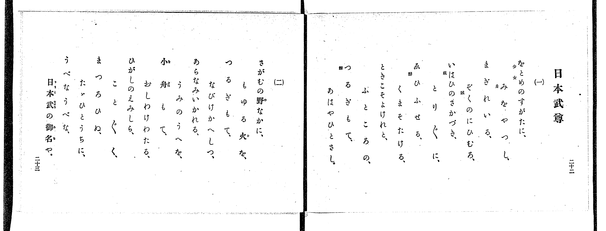

# 靖國神社

> Re:Shoka 使用 AI 協助辨識與重建樂譜，可能會有錯誤。歡迎回報。

<audio controls src="yasukuni_jinja.mp3"></audio>

- 出處：共益商社樂器店《唱歌教科書 教師用 巻四》第二十～二十一頁（第二學期第四曲）
- NDL Digital Collections PID 854865（https://dl.ndl.go.jp/pid/854865）掃描 P016.jpg

## 說明

原書資訊與歌詞全文（NDL PID 854865《唱歌教科書 教師用 巻四》第二十～二十一頁，掃描 P016.jpg）：
調性與拍號：は調八分ノ六拍子（關係小調 A 小調 6/8 拍），♩=112，「感ヲ以テ」，弱起一拍（八分音符）
註記：單聲部，二節分節歌，共十二小節。開頭 mf，第二段（第四小節第六拍弱起）mf，第六小節第六拍弱起 mp。第一、九小節第五拍出現升 G4（#5，TMD 記為 5'）。原譜於第二、六、十小節第五拍後印有換氣記號「V」。右頁僅印歌詞，未附演奏注意與語釋。

## 歌詞

```text
一、
矢玉の中にて、身を斃しし、
義勇の魂、國のしづめ、
たふとしいさまし、このみやしろ。

二、
園生の櫻は、いま眞盛、
雲井をあふげば、富士の高根、
うつくしいさまし、この神垣。
```

## ABC

```abc
X:1
T:靖國神社
M:6/8
L:1/16
Q:3/8=75
K:Am
V:V1 name="Voice" snm="Voi"
[V:V1]
!mf! z2 z2 z2 z2 z2 E2 | A4 A2 A2 ^G2 A2 | B4 B2 B4 E2 | c4 c2 B4 B2 |
!mf! A10 E2 | e4 d2 c4 c2 | !mp! B4 B2 A4 A2 | B4 B2 B4 B2 |
E10 E2 | A4 A2 A2 ^G2 A2 | B4 B2 B4 E2 | c4 c2 B4 B2 |
A10 z2 |
```

## TMD 檔案連結

- [主旋律 TMD 檔案](yasukuni_jinja.tmd) [[在 TMD Studio 編輯](https://tmdlang.github.io/Tmd-TS/#tmd=s7IKdvYPcrWy4qpTUCpJTLdSSM7PyUlNLsnMz7PKrsxPzc6ML87Iz05Ugisoy88pzU21yk7MizeJtzA1sTAzRUgW55cWJadaFSdn5OfnxJekVpQk5edno8vHFySmp1oFGBiaIWQKivLLUvMS84C6C4oy80pSU8DaEQpSyzJTUkHSxclAq8tSizLTMlNTkNyVWlQMcjXUipKixLzi5KLMApBXEKrSU_OKUq2SU4tSc_PzMhNzEDJp-UW5VsUlRfkFGZnJCOGSjFSgb4tSczLTUQyCiOdm5mSWJBZVoosX5CQmpypxaWkpvJw77emc7udL5z1fsk9BS4tL0VbB0NCIy95WwZkrO7XSVsExl8vGTN_CDmTC0_ZdL2ZOfb9n1tPWjc9ndz2d2gbU9WxF09OZK57umv64oevplI3P1vY8mzrz-fKJz2bvUACynu5Y_XzKCoWn23c_nT37cUP38zVrnuzqedrb-H7vPAjjyY6Glwsa3-_pgEqt3fFsznwgG6j-2exN7_d0gl3v5-Kj4AL0ZElijoIzPBEUKwR4uihAohloQkZJSUGxlb5-So5eHhCn5-tlFegXZKbow1R0PutrftbfrwCKXKBcuhIXl76Wgi21AJeCgsLTvvlAr7_Y3P5iRdeLjnZgeLxYOe9p64pn09qBLgR5A-FkSoOsB807QA8CYwfkiher9j9rWA6yv7v3xcz5QNHHjeuBgk9bVz_taHvc3Pe0dS1Q6unaCUBHvZw-58n-pqcb-oEKFBwVoAxgrCsAlYDN7Hk0c6UtMGEAWY8bep61zH_cvOnJ7qWPm9seNwBV9Dzds_HF1u1AZ4E1dEBseTl_8_M1y4D6wQ5asfvFihmgtDNt3YvGTS-bVwC1AX3zfH0DUCmQBIYCyKDWjSD_AX25oR8o-Lih6eW07pcL1irkpgFlISHxbN1WSGoBBg9EGYgN8Q_YHUArYcqBwliVKOQWAM0GmbcDaEnjk51z4cqe7JoCUta-63n_vqe97QruJkDblIGJpyfE1wXojxnPm3YpmKoDLQGaAIztF2vnPJu2B-I0oFFAW0BkbyO6gfuAMbfh2ZzOZ_2zn21YDDQHGC_AwAwDhiDIoP7NwCh92twKUgROM6DonbPq5cyWZ3umPF3a_2zzimct_cAYfbFq3sv2bqAWLlC4QtwPYj2fv-h5X-fjxnVPdqx93Lj6ceMyoMSLXasfN016Nq35ceN0EIIq3bfyaXc7UOnLtU0gx87pBrLBKpY-bmqEKnrcOP9x49bHjSvAEi2PG6c-btwHMeNx42Swhv2Pm4Di0x83gXwAcQ44DMD5YM6k51OAJqx7tno3MO2BdQEV73s-Z95zULIGK3o5e9OTXVOBLnzc2AS2DMjYAHLR-p6ni4FeWPdy9YxnC3bCXdT2uHHJ48Z-XC4ClmNP5y0GuQWomvLsDAUKWvpcXJGJxaXZpXmZXpl5WYlWYfmZyakONQY1CtUgqxRsLLTswIzq3LRaMANYrGhAkpqmAjCUFGqArl8AxPuAeJ3C4-Y9QHoVWLQbiFcD8TIg3g8SaZoECnsg3grE08FqpkN19IHcAjK-RsEADo2BPDMFXSA2A6ZLIFGjYA7kmoNJkKRhHJABJCCiEMUQCHIuSAnMyY-b2qA2Ad0IdAPIbpCLgfY3bgLifrAIyLUgeZDoUrCLG6G65iPcZwyy1CgObjnMUSDLq3MLatHcCXKXMdxdyE4CB8MKpECABOZUJKdNBouAnLQfHNjQYGvqBeuAO4nMQDIAOqaWi0vXTgElESgABZS5AA)]
- [鋼琴伴奏 TMD 檔案](yasukuni_jinja_piano.tmd) [[在 TMD Studio 編輯](https://tmdlang.github.io/Tmd-TS/#tmd=s7IKdvYPcrWy4tLSUng5d9rTOd3Pl857vmTf-z0dL7v3PJ-w5cmeLU-X9j_v7Hi_p1NBS4tL0VbB0NCIy95WwZnLxkzfwo6rTkHpafuuFzOnvt8z62nrxuezu55ObQMa8WxF09OZK57umv64oevplI3P1vY8mzrz-fKJz2bvUACynu5Y_XzKCoWn23c_nT37cUP38zVrnuzqedrb-H7vPAjjyY6GlwsagS6BSq3d8WzOfCAbqP7Z7E1A9yiB7PZz8VFwyUzPLEnMUXDOz8lJTS7JzM8rVgjwdFGwMDWxMDMFmpBRUlJQbKWvn5KjlwfE6fl6WQX6BZkp-jAVnc_6mp_19ysEGBiaAeXSlbi4IhOLS7NL8zK9MvOyEq0CMhPz8oM8HGoMahSquWwstOy4FICgOjetFszQ11LQeLpn44ut2zUVHje1KNQoPG5cAMT7gHidwuPmPUB6FVi0G4hXA_EyIN4PEmmaBGTNB-KtQDwdrGY6VEefgpY-2PgaBQM4NAbyzBR0gdhMwVQdSNQomAO55mASJGkYB2QACYgoRDEEgpwLUgJz8uOmNqhNQDcC3QCyG-RioP2Nm4C4HywCci1IHiS6FOziRqiu-Qj3GYMsNYqDWw5zFMjy6tyCWjR3gtxlDHcXspPAwbACKRAggTkVyWmTwSIgJ-0HBzY02Jp6wTrgTiIzkAyAjqnFGv8-sPgHmQ9PA0BHv-jretne-7R1x8vZrZAcg3CFYbyCabxCtGEsEqsGCE3iFQwVok1QhKFaTOPjFYyAQqaxyEyQJhwyUH3YjCSoiVzL6OgvFKsMgFEEjiBdOwWUOFIACihzAQA)]

## 分析

```text
================================================================================
📊 TMD Song Profile: [ 靖國神社 ]
================================================================================
⏱  Duration:       0:20 (20.9s), 13 measures total
🎼 Key & Tempo:    首調基準 C, != 112.0 BPM, <6/8>
   - 分析範圍：      由實際發聲的音符與和弦推測調性；播放脈絡另行呈現
🎤 人聲音域:    E4 (MIDI 64) – E5 (MIDI 76) [跨度: 12 個半音 / 1.0 個八度, 難度: easy]
   - 最低音:  E4 in [YasukuniJinja #1 @ m.1, 0:01]
   - 最高音: E5 in [YasukuniJinja #1 @ m.6, 0:08]
   - 適合: soprano, mezzo-soprano, contralto, tenor, baritone, bass
🏛  結構:      YasukuniJinja (20.9s)
⚡ 編曲密度:        Peak 1 軌道同時演奏
🗝  調性診斷：       A 小調（純淨自然小調，未偵測到可信轉調）
   - 風格氣質:    純淨自然小調（陰鬱抒情、旋律集中，無明顯調外色彩）
   - 轉調歷程:    全曲維持單一推測調性（未偵測到可信轉調）
   - 核心骨幹音:  B, A, E, C, G#
   - 調性數值:    A 小調 [相關度: 0.66, 穩定度: Moderate, 自然音純度: 97.2%]
   - 候選調性 (K-S): A 小調 (0.66), E 大調 (0.61), A 大調 (0.56)
   - 五度圈歷程:   +3
   - 各段落調性細節:
     • [YasukuniJinja #1]: A 小調 (r: 0.66, 自然音純度: 97.2%, 調外音: G#)

  [ 五度圈游移軌跡 ]
               C  
         F            G  
      Bb               D  
      Eb              [A ]*
         Ab           E  
            Db       B  
               F# 
     (* = active key center)

  [ 十二半音累積音高分佈 ]
     C  : █████████                 12.5%
     C# :                            0.0%
     D  : █                          1.4%
     D# :                            0.0%
     E  : ████████████              16.7%
     F  :                            0.0%
     F# :                            0.0%
     G  :                            0.0%
     G# : ██                         2.8%
     A  : ██████████████████████    31.9%
     A# :                            0.0%
     B  : ████████████████████████  34.7%
--------------------------------------------------------------------------------
Assignment 軌道音域：
  - Voice         : E4 – E5 (12 個半音 / 1.0 個八度, 44 個音符)
================================================================================
```


## 原書掃描頁




