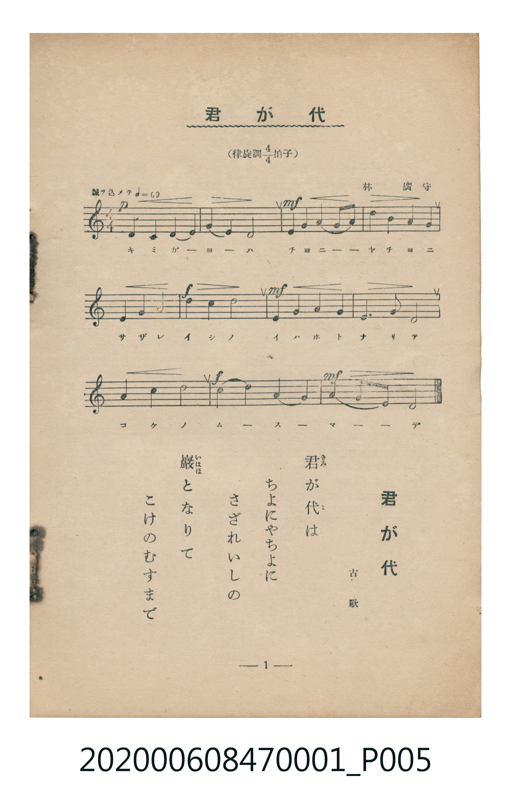

# 君が代

<audio controls src="kimigayo.mp3"></audio>

- 詞：古歌
- 曲：林廣守
- 臺灣教育會公認《新定兒童唱歌》尋常科第一學年用（2020.006.0847.0001）

## 說明

原書資訊與歌詞全文（對應 P005.jpg，儀式歌 p. 1，第 1 首）：
調性與拍號：律旋調 4/4 拍子，「誠ヲ込メテ」

## 歌詞

```text
君（きみ）が代（よ）は
ちよにやちよに
さざれいしの
巖（いはほ）となりて
こけのむすまで
```

## ABC

```abc
X:1
T:君が代
C:曲：林廣守
M:4/4
L:1/16
Q:1/4=69
K:C
V:V1 name="Piano" snm="Pia"
[V:V1]
D4 C4 D4 E4 | G4 E4 D8 | E4 G4 A4 G2 A2 | d4 B4 A4 G4 |
E4 G4 A8 | c4 d4 c8 | E4 G4 A4 G4 | E6 D2 D8 |
A4 c4 d8 | c4 d4 A4 G4 | A4 G2 E2 D8 |
```

## TMD 檔案連結

- [主旋律 TMD 檔案](kimigayo.tmd) [[在 TMD Studio 編輯](https://tmdlang.github.io/Tmd-TS/#tmd=s7IKdvYPcrWy4tLSUng6Yfbjxp4nuxcraGlxKdoqmFly2dsqOHPZmOib2HHVKSi9WDnv_Z5ZT_uXPFvbowQSeDZ7E1Dg2bzpT3cvfrquAyz2on3X88bFz6bOfNG06dmc5qeta16s6n3c0PVs2oan62Y9bZ30fPXSp1M2Ao143ND9dEP30x07ni-f-HzNmic7Gp6u3fF055bnU1a839NhZGBkoGdgYKZnYGFiDmQYGL7f06nExaWvpWBLLcCloKDwtG_-s9k7Xmxuf7Gi60VHO9BdQG8-bV3xbFo70BVPN_Q-a-9UCDAwMNXLKkh_v6fnaUvD0z39QGUKBXoKQDf1AJ2uYKjwctk0oPuAoQEy88Wq_c8aloNM6-59MXM-KND2dT-b3g0UVwAGpgJQ-OnaCUC9jxt6Xqxa8Lh504t9ex43L3zc3Pa4oZcL7KwJs4HWP27sfdy4H2gwJGJAIk0dYO56kKLHjQuB_MeNqx83tcDZEImpjxunPW7qedwIlJj-uHEd2MztQDcClQCF1j9u3A02Z8XjxlWPm7oeNy6D6Jv8uHEiUPnjpobHjTMfN-573LgcJEF5WEOBgpY-F5d3Zm5memJlvlVAZmJevkONQY1CNcgWBRsLLTswA1ssK0ASyYuFPQoaJgpPN_Q_X9-gA48aTSwagHaBDKtRMFLQBcaRLpg2BuIaBVMoCyQCgjVgHkjUDEybgXTFAZnmcCGgInDU4Hbcrh5yHIdsMcQphiCLwbaDWdjcBxMB-QDuBwLO29EJdp4xac4D2YdwELoDEa6BsIyRXFPLxaVrpwCLbAUgW5mLCwA)]
- [鋼琴伴奏 TMD 檔案](kimigayo_piano.tmd) [[在 TMD Studio 編輯](https://tmdlang.github.io/Tmd-TS/#tmd=s7IKdvYPcrWy4tLSUng6Yfbjxp4nuxe_39PxsnvP8wlbnuzZ8nRp__POjvd7OhW0tLgUbRXMLLnsbRWcuWxM9E3suOoUlF6snPd-z6yn_Uuere1RAgk8m70JKPBs3vSnuxc_XdcBFnvRvut54-JnU2e-aNr0bE7z09Y1L1b1Pm7oejZtw9N1s562Tnq-eunTKRuBRjxu6H66ofvpjh3Pl098vmbNkx0NT9fueLpzy_MpK4DOMjIwMtAzMDDTM7AwMQcyDAyBLlPi4vLOzM1MT6zMtwrITMzLD_JwqDGoUajmUgACGwstOzBDX0vBFh0oQKx4sbBHQcNE4emG_ufrG3QUAgwMTPWyCtI1sWjQ0gcbVqNgpKCrYAjEINoYiGsUTKEskAgI1oB5IFEzMG0G0hUHZJrDhYCKuPA7blcPOY5DthjiFEOQxWDbwSxs7oOJgHwA9wMB5-3oBDvPmDTngexDOAjdgQjXQFjGSK6pRY9rH5S4NkHE9Yu-rpftvS9ntz5b0fRy0YpnC_Y82TXl6a5lLzran07qebpnGSRxI0VoPMhVIAIYlfEgGiwCdAWYAyGhyiDyNTDvoCgAGwE1ByJmjKQTYiaKRqg1YC0otkDVAv2sa6cA87YCkK3MxQUA)]

## 分析

```text
================================================================================
📊 TMD Song Profile: [ 君が代 ]
================================================================================
⏱  Duration:       0:38 (38.3s), 11 measures total
🎼 Key & Tempo:    首調基準 C, != 69.0 BPM, <4/4>
   - 分析範圍：      由實際發聲的音符與和弦推測調性；播放脈絡另行呈現
🎤 人聲音域:    C4 (MIDI 60) – D5 (MIDI 74) [跨度: 14 個半音 / 1.2 個八度, 難度: moderate]
   - 最低音:  C4 in [Kimigayo #1 @ m.1, 0:00]
   - 最高音: D5 in [Kimigayo #1 @ m.4, 0:10]
   - 適合: soprano, mezzo-soprano, contralto, tenor, baritone, bass
🏛  結構:      Kimigayo (38.3s)
⚡ 編曲密度:        Peak 1 軌道同時演奏
🗝  調性診斷：       G 調性不明確（純淨自然大調，未偵測到可信轉調）
   - 風格氣質:    純淨自然大調（陽光明朗、易唱易記，無明顯調外色彩）
   - 轉調歷程:    全曲維持單一推測調性（未偵測到可信轉調）
   - 核心骨幹音:  D, A, G, E, C
   - 調性數值:    G 調性不明確 [相關度: 0.76, 穩定度: Ambiguous, 自然音純度: 100.0%]
   - 候選調性 (K-S): G 大調 (0.76), D 大調 (0.75), D 小調 (0.61)
   - 五度圈歷程:   +1
   - 各段落調性細節:
     • [Kimigayo #1]: G 調性不明確 (r: 0.76, 自然音純度: 100.0%)

  [ 五度圈游移軌跡 ]
               C  
         F           [G ]*
      Bb               D  
      Eb               A  
         Ab           E  
            Db       B  
               F# 
     (* = active key center)

  [ 十二半音累積音高分佈 ]
     C  : ███████████               13.6%
     C# :                            0.0%
     D  : ████████████████████████  30.7%
     D# :                            0.0%
     E  : ████████████              15.9%
     F  :                            0.0%
     F# :                            0.0%
     G  : ██████████████            18.2%
     G# :                            0.0%
     A  : ███████████████           19.3%
     A# :                            0.0%
     B  : ██                         2.3%
--------------------------------------------------------------------------------
Assignment 軌道音域：
  - Piano         : C4 – D5 (14 個半音 / 1.2 個八度, 40 個音符)
================================================================================
```


## 原書掃描頁




