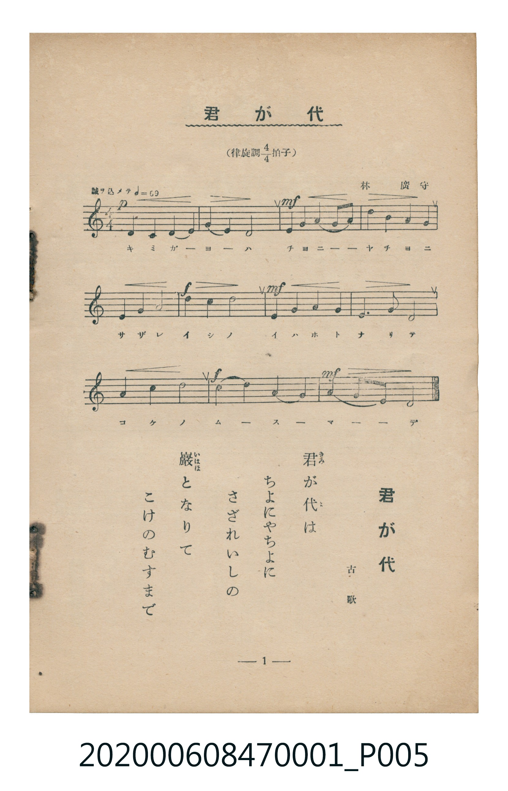

# 君が代

> Re:Shōka 使用 AI 協助辨識與重建樂譜，可能會有錯誤。歡迎回報。

- **鋼琴伴奏版**：<br><audio controls src="kimigayo.mp3"></audio>
- **NEUTRINO 歌聲合成版**：<br><audio controls src="kimigayo_neutrino.mp3"></audio>

- 詞：古歌
- 曲：林廣守
- 臺灣教育會公認《新定兒童唱歌》尋常科第一學年用（2020.006.0847.0001）

## 說明

原書資訊與歌詞全文（對應 P005.jpg，儀式歌 p. 1，第 1 首）：
調性與拍號：律旋調 4/4 拍子，「誠ヲ込メテ」


## 歌詞

```text
君（きみ）が代（よ）は
ちよにやちよに
さざれいしの
巖（いはほ）となりて
こけのむすまで
```

## ABC

<div class="abc-score" data-abc-src="kimigayo.abc" aria-label="五線譜載入中"></div>

[下載 ABC 原始檔](kimigayo.abc)

## TMD 檔案連結

- [主旋律 TMD 檔案](kimigayo.tmd) [[在 TMD Studio 編輯](https://tmdlang.github.io/Tmd-TS/#tmd=s7IKdvYPcrWy4qpTUCpJTLdSSM7PyUlNLsnMz7MqzsjMK0nNjM_KTMmPL87Iz05Ugisry88pzU21Si9KTEmNN4w3MjAyiDcwMIs3sDAxBzIMDBFKi_NLi5JTrYqTM_Lzc-JLUitKkvLzsxHyBUX5Zal5iXlANQVFIBtTwIoQClLLMlNSQdKpKZkl-UWZiTlI7kgtKga7FWxJfElRYl5xclFmAcgDCFUlGalAx2bmFqSi6oaIJ6cWpebm56HIAK1Jz8yzAgonlQK9jixRkpEP9HZBRqVVRmYxyD3JiTnx2Yl5SKEDdU1BYnqqVYCBgakSl5aWwtMJsx839jzZvVhBS4tL0VbBzJLL3lbBmcvGRN_EDqT1xcp57_fMetq_5NnaHrBZz2ZvAgo8mzf96e7FT9d1gMVetO963rj42dSZL5o2PZvT_LR1zYtVvY8bup5N2_B03aynrZOer176dMpGoBGPG7qfbuh-umPH8-UTn69Z82RHw9O1O57u3PJ8yor3ezpAMaYHjDE9UIwBGQaG7_d0KnFx6Wsp2FILcCkoKDztm_9s9o4Xm9tfrOh60dEOdBfQm09bVzyb1g50xdMNvc_aOxVAYaSXVZD-fk_P05aGp3v6gcoUCvQUgG7qATpdwVDh5bJpQPcBQwNk5otV-581LAeZ1t37YuZ8UKDt6342vRsorgAMTAWg8NO1E4B6Hzf0vFi14HHzphf79jxuXvi4ue1xQy8X2FkTZgOtf9zY-7hxP9BgSMSARJo6wNz1IEWPGxcC-Y8bVz9uaoGzIRJTHzdOe9zU87gRKDH9ceM6sJnbgW4EKgEKrX_cuBtszorHjaseN3U9blwG0Tf5ceNEoPLHTQ2PG2c-btz3uHE5SILysIYCBS19Li7vzNzM9MTKfKuAzMS8fIcag5pqkCUKNhZadmAGtkhWgKSRFwt7FDRMFJ5u6H--vkEHHjOaWDQArQIZVqNgpKALjCJdMG0MxDUKplAWSAQEa8A8kKgZmDYD6YoDMs3hQkBFYON8ahQeN60Fch83zweRTWvgZjxuXgFlP27uRxJtBIuA5B43dyOJLwGLoMvWgBMA7jDY1UNOGCD7D2K_Ich_YE-CWdiCASYCCih4UCFCYSvY_9vALkcKhSawv5q2g8X70MXBIfO4eTaY7ICGRBc01FYBcRvcIgJpoRMcDsakhQPIYwifo4cEwtsQljE2b28Ge28juveaF0DZj5t2IonOg4k2t8ONquXi0rVTgGUDBSBbmQsA)]
- [鋼琴伴奏 TMD 檔案](kimigayo_piano.tmd) [[在 TMD Studio 編輯](https://tmdlang.github.io/Tmd-TS/#tmd=s7IKdvYPcrWy4qpTUCpJTLdSyC8qychPL0osyKi0ysgsLskvykxOzInPTsxLVIIrKs4vLUpOjS9ITE-1CjAwMFXi0tJSeDph9uPGnie7F7_f0_Gye8_zCVue7NnydGn_886O93s6FbS0uBRtFcwsuextFZy5bEz0TexA5r1YOe_9nllP-5c8W9sDtuDZ7E1AgWfzpj_dvfjpug6w2Iv2Xc8bFz-bOvNF06Znc5qftq55sar3cUPXs2kbnq6b9bR10vPVS59O2Qg04nFD99MN3U937Hi-fOLzNWue7Gh4unbH051bnk9ZAXSWkYGRgZ6BgZmegYWJOZBhYAh0mRIXl3dmbmZ6YmW-VUBmYl5-kIdDjUFNNZcCENhYaNmBGfpaCrboQAFiw4uFPQoaJgpPN_Q_X9-gowAKEL2sgnRNLBq09MGG1SgYKegqGAIxiDYG4hoFUygLJAKCNWAeSNQMTJuBdMUBmeZwIaAisHE-NQqPm9YCuY-b54PIpjVwMx43r4CyHzf3I4k2gkVAco-bu5HEl4BF0GVruPCHwa4ecsIA2X8Q-w1B_gN7EszCFgwwEVBAwYMKEQpbwf7fBnY5Uig0gf3VtB0s3ocuDg6Zx82zwWQHNCS6oKG2Cojb4BYRSAud4HAwJi0cQB5D-Bw9JBDehrCMsXl7M9h7G9G917wAyn7ctBNJdB5MtLkdblQtei7wQc4FRohc8KKv62V778vZrc9WNL1ctOLZgj1Pdk15umvZi472p5N6nu5ZBsn1SEk9XsEwHpTA4-NBbKA_gAwQBkuBRCEeQZYAagDrAfGMoSpBepEUgo0CKoKbBJYHekPXTgHmEwUgW5kLAA)]

## 分析

```text
================================================================================
📊 TMD Song Profile: [ 君が代 ]
================================================================================
⏱  Duration:       0:38 (38.3s), 11 measures total
🎼 Key & Tempo:    首調基準 C, != 69.0 BPM, <4/4>
   - 分析範圍：      由實際發聲的音符與和弦推測調性；播放脈絡另行呈現
🎤 人聲音域:    C4 (MIDI 60) – D5 (MIDI 74) [跨度: 14 個半音 / 1.2 個八度, 難度: moderate]
   - 最低音:  C4 in [Kimigayo #1 @ m.1, 0:00]
   - 最高音: D5 in [Kimigayo #1 @ m.4, 0:10]
   - 適合: soprano, mezzo-soprano, contralto, tenor, baritone, bass
🏛  結構:      Kimigayo (38.3s)
⚡ 編曲密度:        Peak 1 軌道同時演奏
🗝  調性診斷：       G 調性不明確（純淨自然大調，未偵測到可信轉調）
   - 風格氣質:    純淨自然大調（陽光明朗、易唱易記，無明顯調外色彩）
   - 轉調歷程:    全曲維持單一推測調性（未偵測到可信轉調）
   - 核心骨幹音:  D, A, G, E, C
   - 調性數值:    G 調性不明確 [相關度: 0.76, 穩定度: Ambiguous, 自然音純度: 100.0%]
   - 候選調性 (K-S): G 大調 (0.76), D 大調 (0.75), D 小調 (0.61)
   - 五度圈歷程:   +1
   - 各段落調性細節:
     • [Kimigayo #1]: G 調性不明確 (r: 0.76, 自然音純度: 100.0%)

  [ 五度圈游移軌跡 ]
               C  
         F           [G ]*
      Bb               D  
      Eb               A  
         Ab           E  
            Db       B  
               F# 
     (* = active key center)

  [ 十二半音累積音高分佈 ]
     C  : ███████████               13.6%
     C# :                            0.0%
     D  : ████████████████████████  30.7%
     D# :                            0.0%
     E  : ████████████              15.9%
     F  :                            0.0%
     F# :                            0.0%
     G  : ██████████████            18.2%
     G# :                            0.0%
     A  : ███████████████           19.3%
     A# :                            0.0%
     B  : ██                         2.3%
--------------------------------------------------------------------------------
Assignment 軌道音域：
  - Piano         : C4 – D5 (14 個半音 / 1.2 個八度, 40 個音符)
================================================================================
```


## 原書掃描頁




