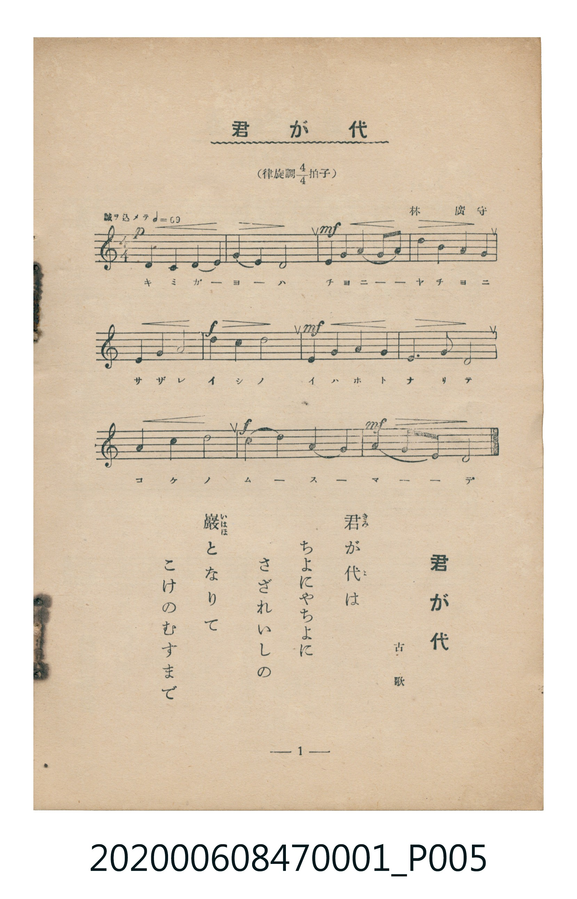

# 君が代

> Re:Shōka 使用 AI 協助辨識與重建樂譜，可能會有錯誤。歡迎回報。

- **鋼琴伴奏版**：<br><audio controls src="kimigayo.mp3"></audio>
- **NEUTRINO 歌聲合成版**：<br><audio controls src="kimigayo_neutrino.mp3"></audio>

- 詞：古歌
- 曲：林廣守
- 臺灣教育會公認《新定兒童唱歌》尋常科第一學年用（2020.006.0847.0001）

## 說明

原書資訊與歌詞全文（對應 P005.jpg，儀式歌 p. 1，第 1 首）：
調性與拍號：律旋調 4/4 拍子，「誠ヲ込メテ」


## 歌詞

```text
君（きみ）が代（よ）は
ちよにやちよに
さざれいしの
巖（いはほ）となりて
こけのむすまで
```

## ABC

<div class="abc-score" data-abc-src="kimigayo.abc" aria-label="五線譜載入中"></div>

[下載 ABC 原始檔](kimigayo.abc)

## TMD 檔案連結

- [主旋律 TMD 檔案](kimigayo.tmd) [[在 TMD Studio 編輯](https://tmdlang.github.io/Tmd-TS/#tmd=s7IKdvYPcrWy4qpTUCpJTLdSSM7PyUlNLsnMz7MqzsjMK0nNjM_KTMmPL87Iz05Ugisry88pzU21Si9KTEmNN4w3MjAyiDcwMIs3sDAxBzIMDBFKi_NLi5JTrYqTM_Lzc-JLUitKkvLzsxHyBUX5Zal5iXlANQVFIBtTwIoQClLLMlNSQdKpKZkl-UWZiTlI7kgtKga7FWxJfElRYl5xclFmAcgDCFUlGalAx2bmFqSi6oaIJ6cWpebm56HIAK1Jz8yzAgonlQK9rsSlpaXwdMLsx409T3YvVtDS4lK0VTCz5LK3VXDmsjHRN7ED6Xyxct77PbOe9i95trYHbNSz2ZuAAs_mTX-6e_HTdR1gsRftu543Ln42deaLpk3P5jQ_bV3zYlXv44auZ9M2PF0362nrpOerlz6dshFoxOOG7qcbup_u2PF8-cTna9Y82dHwdO2Opzu3PJ-y4v2eDlCQ6wGDXA8U5ECGgeH7PZ1KXFz6Wgq21AJcCgoKT_vmP5u948Xm9hcrul50tAPdBfTm09YVz6a1A13xdEPvs_ZOhQADA1O9rIL093t6nrY0PN3TD1SmUKCnAHRTD9DpCoYKL5dNA7oPGBogM1-s2v-sYTnItO7eFzPngwJtX_ez6d1AcQVgYCoAhZ-unQDU-7ih58WqBY-bN73Yt-dx88LHzW2PG3q5wM6aMBto_ePG3seN-4EGQyIGJNLUAeauByl63LgQyH_cuPpxUwucDZGY-rhx2uOmnseNQInpjxvXgc3cDnQjUAlQaP3jxt1gc1Y8blz1uKnrceMyiL7JjxsnApU_bmp43DjzceO-x43LQRKUhzUUKGjpc3F5Z-ZmpidW5lsFZCbm5TvUGNRUgyxRsLHQsgMzsEWyAiSNvFjYo6BhovB0Q__z9Q068JjRxKIBaBXIsBoFIwVdYBTpgmljIK5RMIWyQCIgWAPmgUTNwLQZSFcckGkOFwIqAhvnU6PwuGktkPu4eT6IbFoDN-Nx8woo-3FzP5JoI1gEJPe4uRtJfAlYBF22BpwAcIfBrh5ywgDZfxD7DUH-A3sSzMIWDDARUEDBgwoRClvB_t8GdjlSKDSB_dW0HSzehy4ODpnHzbPBZAc0JLqgobYKiNvgFhFIC53gcDAmLRxAHkP4HD0kEN6GsIyxeXsz2Hsb0b3XvADKfty0E0l0Hky0uR1uVC0Xl66dAiwbKADZylwA)]
- [鋼琴伴奏 TMD 檔案](kimigayo_piano.tmd) [[在 TMD Studio 編輯](https://tmdlang.github.io/Tmd-TS/#tmd=s7IKdvYPcrWy4tLSUng6Yfbjxp4nuxe_39PxsnvP8wlbnuzZ8nRp__POjvd7OhW0tLgUbRXMLLnsbRWcuWxM9E3suOoUlF6snPd-z6yn_Uuere1RAgk8m70JKPBs3vSnuxc_XdcBFnvRvut54-JnU2e-aNr0bE7z09Y1L1b1Pm7oejZtw9N1s562Tnq-eunTKRuBRjxu6H66ofvpjh3Pl098vmbNkx0NT9fueLpzy_MpK4DOMjIwMtAzMDDTM7AwMQcyDAyBLlPi4vLOzM1MT6zMtwrITMzLD_JwqDGoqeZSAAIbCy07MENfS8EWHShAbHixsEdBw0Th6Yb-5-sbdBQCDAxM9bIK0jWxaNDSBxtWo2CkoKtgCMQg2hiIaxRMoSyQCAjWgHkgUTMwbQbSFQdkmsOFgIrAxvnUKDxuWgvkPm6eDyKb1sDNeNy8Asp-3NyPJNoIFgHJPW7uRhJfAhZBl63hwh8Gu3rICQNk_0HsNwT5D-xJMAtbMMBEQAEFDypEKGwF-38b2OVIodAE9lfTdrB4H7o4OGQeN88Gkx3QkOiChtoqIG6DW0QgLXSCw8GYtHAAeQzhc_SQQHgbwjLG5u3NYO9tRPde8wIo-3HTTiTReTDR5na4UbXoucAHOReYIHLBi76ul-29L2e3PlvR9HLRimcL9jzZNeXprmUvOtqfTup5umcZJNcjJfV4kP9ABDCRx4NosAjQP2AOhIQqg8hDPIauAGwE1ByImDGSToiZKBqh1oC1oNgCVQv0sq6dAszXCkC2MhcA)]

## 分析

```text
================================================================================
📊 TMD Song Profile: [ 君が代 ]
================================================================================
⏱  Duration:       0:38 (38.3s), 11 measures total
🎼 Key & Tempo:    首調基準 C, != 69.0 BPM, <4/4>
   - 分析範圍：      由實際發聲的音符與和弦推測調性；播放脈絡另行呈現
🎤 人聲音域:    C4 (MIDI 60) – D5 (MIDI 74) [跨度: 14 個半音 / 1.2 個八度, 難度: moderate]
   - 最低音:  C4 in [Kimigayo #1 @ m.1, 0:00]
   - 最高音: D5 in [Kimigayo #1 @ m.4, 0:10]
   - 適合: soprano, mezzo-soprano, contralto, tenor, baritone, bass
🏛  結構:      Kimigayo (38.3s)
⚡ 編曲密度:        Peak 1 軌道同時演奏
🗝  調性診斷：       G 調性不明確（純淨自然大調，未偵測到可信轉調）
   - 風格氣質:    純淨自然大調（陽光明朗、易唱易記，無明顯調外色彩）
   - 轉調歷程:    全曲維持單一推測調性（未偵測到可信轉調）
   - 核心骨幹音:  D, A, G, E, C
   - 調性數值:    G 調性不明確 [相關度: 0.76, 穩定度: Ambiguous, 自然音純度: 100.0%]
   - 候選調性 (K-S): G 大調 (0.76), D 大調 (0.75), D 小調 (0.61)
   - 五度圈歷程:   +1
   - 各段落調性細節:
     • [Kimigayo #1]: G 調性不明確 (r: 0.76, 自然音純度: 100.0%)

  [ 五度圈游移軌跡 ]
               C  
         F           [G ]*
      Bb               D  
      Eb               A  
         Ab           E  
            Db       B  
               F# 
     (* = active key center)

  [ 十二半音累積音高分佈 ]
     C  : ███████████               13.6%
     C# :                            0.0%
     D  : ████████████████████████  30.7%
     D# :                            0.0%
     E  : ████████████              15.9%
     F  :                            0.0%
     F# :                            0.0%
     G  : ██████████████            18.2%
     G# :                            0.0%
     A  : ███████████████           19.3%
     A# :                            0.0%
     B  : ██                         2.3%
--------------------------------------------------------------------------------
Assignment 軌道音域：
  - Piano         : C4 – D5 (14 個半音 / 1.2 個八度, 40 個音符)
================================================================================
```


## 原書掃描頁




