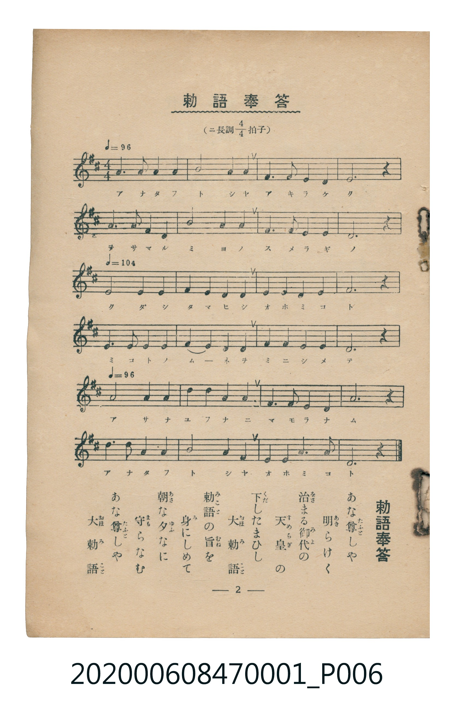

# 勅語奉答

<audio controls src="chokugo_hoto.mp3"></audio>

- 臺灣教育會公認《新定兒童唱歌》尋常科第一學年用（2020.006.0847.0001）

## 說明

原書資訊與歌詞全文（對應 P006.jpg，儀式歌 p. 2，第 2 首）：
調性與拍號：ニ長調 4/4 拍子

## 歌詞

```text
あな尊（たふと）しや　明（あき）らけく
治（をさ）まる御代（みよ）の　天皇（すめらぎ）の
下（くだ）したまひし　大勅語（おほみこと）
勅語（みこと）の旨（むね）を　身（み）にしめて
朝（あさ）な夕（ゆふ）なに　守（まも）らなむ
あな尊（たふと）しや　大勅語（おほみこと）
```

## ABC

```abc
X:1
T:勅語奉答
C:TMD (Chen, Chih-Han / aguai)
M:4/4
L:1/16
Q:1/4=96
K:D
V:V1 name="Piano" snm="Pia"
[V:V1]
f6 a2 g4 f4 | b8 a4 g4 | f6 a2 g4 e4 | d12 z4 |
f6 a2 g4 f4 | b8 a4 b4 | f6 a2 g4 e4 | d12 z4 |
Q:1/4=104 e8 e4 e4 | f4 e4 d4 e4 | f4 f4 f4 f4 | a12 z4 |
f4 f4 a4 f4 | b4 a4 f4 e4 | f4 f4 a4 b4 | e12 z4 |
Q:1/4=96 f8 f4 f4 | b4 b4 a4 f4 | f6 a2 g4 e4 | a12 z4 |
b6 b2 a4 f4 | b8 a4 b4 | f4 f4 a6 e2 | d12 z4 |
```

## TMD 檔案連結

- [主旋律 TMD 檔案](chokugo_hoto.tmd)
- [鋼琴伴奏 TMD 檔案](chokugo_hoto_piano.tmd)

## 分析

```text
================================================================================
📊 TMD Song Profile: [ 勅語奉答 ]
================================================================================
⏱  Duration:       0:58 (58.5s), 24 measures total
🎼 Key & Tempo:    首調基準 D, != 96.0 BPM, <4/4>
   - 分析範圍：      由實際發聲的音符與和弦推測調性；播放脈絡另行呈現
🎤 人聲音域:    D4 (MIDI 62) – B4 (MIDI 71) [跨度: 9 個半音 / 0.8 個八度, 難度: easy]
   - 最低音:  D4 in [ChokugoHoto #1 @ m.4, 0:07]
   - 最高音: B4 in [ChokugoHoto #1 @ m.2, 0:02]
   - 適合: soprano, mezzo-soprano, contralto, tenor, baritone, bass
🏛  結構:      ChokugoHoto (58.5s)
⚡ 編曲密度:        Peak 1 軌道同時演奏
🗝  調性診斷：       F# 小調（流行色彩小調，未偵測到可信轉調）
   - 風格氣質:    流行小調（略帶和弦色彩音與裝飾副屬和弦）
   - 轉調歷程:    全曲維持單一推測調性（未偵測到可信轉調）
   - 核心骨幹音:  F#, A, B, E, D
   - 調性數值:    F# 小調 [相關度: 0.75, 穩定度: Moderate, 自然音純度: 93.3%]
   - 候選調性 (K-S): F# 小調 (0.75), D 大調 (0.67), B 小調 (0.61)
   - 五度圈歷程:   +6
   - 各段落調性細節:
     • [ChokugoHoto #1]: F# 小調 (r: 0.75, 自然音純度: 93.3%, 調外音: G)

  [ 五度圈游移軌跡 ]
               C  
         F            G  
      Bb               D  
      Eb               A  
         Ab           E  
            Db       B  
              [F#]*
     (* = active key center)

  [ 十二半音累積音高分佈 ]
     C  :                            0.0%
     C# :                            0.0%
     D  : ████████                  11.1%
     D# :                            0.0%
     E  : ███████████               15.0%
     F  :                            0.0%
     F# : ████████████████████████  31.7%
     G  : █████                      6.7%
     G# :                            0.0%
     A  : ███████████████           20.0%
     A# :                            0.0%
     B  : ████████████              15.6%
--------------------------------------------------------------------------------
Assignment 軌道音域：
  - Piano         : D4 – B4 (9 個半音 / 0.8 個八度, 73 個音符)
================================================================================
```


## 原書掃描頁




