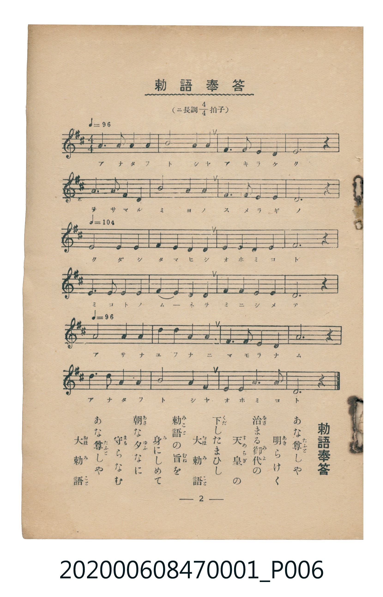

# 勅語奉答

> Re:Shōka 使用 AI 協助辨識與重建樂譜，可能會有錯誤。歡迎回報。

- **鋼琴伴奏版**：<br><audio controls src="chokugo_hoto.mp3"></audio>
- **NEUTRINO 歌聲合成版**：<br><audio controls src="chokugo_hoto_neutrino.mp3"></audio>

- 臺灣教育會公認《新定兒童唱歌》尋常科第一學年用（2020.006.0847.0001）

## 說明

原書資訊與歌詞全文（對應 P006.jpg，儀式歌 p. 2，第 2 首）：
調性與拍號：ニ長調 4/4 拍子


## 歌詞

```text
あな尊（たふと）しや　明（あき）らけく
治（をさ）まる御代（みよ）の　天皇（すめらぎ）の
下（くだ）したまひし　大勅語（おほみこと）
勅語（みこと）の旨（むね）を　身（み）にしめて
朝（あさ）な夕（ゆふ）なに　守（まも）らなむ
あな尊（たふと）しや　大勅語（おほみこと）
```

## ABC

<div class="abc-score" data-abc-src="chokugo_hoto.abc" aria-label="五線譜載入中"></div>

[下載 ABC 原始檔](chokugo_hoto.abc)

## TMD 檔案連結

- [主旋律 TMD 檔案](chokugo_hoto.tmd) [[在 TMD Studio 編輯](https://tmdlang.github.io/Tmd-TS/#tmd=s7IKdvYPcrWy4qpTUCpJTLdSSM7PyUlNLsnMz7MqzsjMK0nNjM_KTMmPL87Iz05Ugisry88pzU21Si9KTEmNN4w3MjAyiDcwMIs3sDAxBzIMDBFKi_NLi5JTrYqTM_Lzc-JLUitKkvLzsxHyBUX5Zal5iXlANQVFIBtTwIoQClLLMlNSQdKpKZkl-UWZiTlI7kgtKga7FWxJfElRYl5xclFmAcgDCFUlGalAx2bmFqSi6oaIJ6cWpebm56HIAK1Jz8yzKknMLE_Mi89PS8tMBstraSk87W59sWre06Wdz9dOUdDS4lK0VbA047K3VXDhsjHRN7EDmfGifdfzxsXPps580bTp2Zzmp61rXqzqfdzQ9WzahqfrZj1tnfR89dKnUzY-W9vzuKH76Ybupzt2PF8-8fmaNU92NDxdu-Ppzi3Pp6x4v6cDFK56wHDVA4UrkGFg-H5PpxIXl76Wgi21AJeCgsLTvvnPZu94sbn9xYquFx3tQHe9WDnvaeuKZ9Paga54uqH3WXunQgDIIVkF6e_39DxtaXi6px-oTKFAT8EIKAB0uoKRwstl04Due79nFsjMF6v2P2tYDjKtu_fFzPlA0cfN3S-nbgeKKwDDSQEo_HTtBC6Q0seNTY8bVz3d0AW07HHj_MeNWx83Ar3f-bhx-uOmlscNDc9m9IGlgMp6QeJNQKmJjxv7QZqfbdoNkmua9LhxKljPvsdN3U_3LXyyezFYz_7HTR1g8XVAg54uWfl8FshPjxtnPm5qBBsENBokCzLryY5usFz_48YFUPtBztn3uHETiA3SvxwS_2BlXY8bd4MsaJwMcS84KBHSCAmg8c-mgyL0cVPD48a1YC9MAhr3YtdqiEqwmtVg_zY-blwG9tecuTA_Q_y16ukSIANoRBswgCAiID1AR60DehCoEujxJljorALaRFTQEvYR5UkMChS09Lm4nIEFSWl6vkd-Sb5VWH5yYo5DjUFNNcgeBRsLLTswA1vyVoDkjhcLexQ0TBSebuh_vr5BB54mNbFoANoGMqxGwVRBFwhNwTQI1yiYgUUgPIiIMZhvDEzEugqGYBEQCwYNQCJg03xqFB43LQILPm7uArL3g1lTwVoeN3dANTxu2g4WXwIRh-loWgsUWwlmbYTKrEeyJh5sDf4g2NVDSRCAvAnxHv4gAOEasErsQdC8CeqhrUD2PLBXV0ODYD4sCJpXgMk-qEd3QkUXwoNgHVQHSAUpQbCjk5wgqFa0NTQwqYXHK8KbII_D4h0R9zARhBocqQEWg4-bG8DeAsU8SBySMiCBMwlFZhVYbDaYBAXX46bN0KCApR8ig-Lp7NnkBAUkCIzwBgFIBCZKMDVA4hzkDYgX4LHevAAeOL1gEpRuYDqA9QE8WEDpAiLTRloQPNk1hczUYGlWC80XyLnAMA4UBCACX-EA04ezcIDkDUghAfHXMjAPVFBAxCC-B8mAkgiIvwiWM-B6YKFHbHJoXUtOWIB9C_Y09hIS5H1EnoAVJfgSBBklJHqegCQn7HmilotL104BqSZRAHKVuQA)]
- [鋼琴伴奏 TMD 檔案](chokugo_hoto_piano.tmd) [[在 TMD Studio 編輯](https://tmdlang.github.io/Tmd-TS/#tmd=s7IKdvYPcrWy4tLSUnja3fpi1bynSzufr53yfk_Hy-49zydsebJny9Ol_c87O97v6VTQ0uJStFWwNOOyt1Vw4bIx0Tex46pTUHrRvut54-JnU2e-aNr0bE7z09Y1L1b1Pm7oejZtw9N1s562Tnq-eunTKRufre153ND9dEP30x07ni-f-HzNmic7Gp6u3fF055bnU1YAbTQyMDLQMzAw0zOwMDEHMgwMgZYqcXE5Z-Rnl6bne-SX5FsFZCbm5Qd5ONQY1FRzKQCBjYWWHZihr6Vgiw4UIJa8WNijoGGi8HRD__P1DToKASA7sgrSNbFo0NIHG1ajYKqgC4SmYBqEaxTMwCIQHkTEGMw3VjACkoZgERALBg1AImDTfGoUHjctAgs-bu4CsveDWVPBWh43d0A1PG7aDhZfAhGH6WhaCxRbCWZthMqsR7ImHmwN_iDY1UNJEIC8CfEe_iAA4RqwSuxB0LwJ6qGtQPY8sFdXQ4NgPiwImleAyT6oR3dCRRfCg2AdVAdIBSlBsKOTnCCoVrQ1NDCphccrwpsgj8PiHRH3MBGEGhypARaDj5sbwN4CxTxIHJIyIIEzCUVmFVhsNpgEBdfjps3QoIClHyKD4uns2eQEBSQIjPAGAUgEJkowNUDiHOQNiBfgsd68AB44vWASlG5gOh43d8ODBZQuIDJtpAXBk11TyEwNlma10HyBnAsM40BBACLwFQ4wfTgLB0jegBQSEH8tA_NABQVEDOJ7kAwoiYD4i2A5A64HFnrEJofWteSEBdi3YE9jLyFB3kfkCVhRgi9BkFFCoucJSHLCnidqsVQkPsgViQmiInnR1_WyvReYUZ519z5dO-HppJ4XjZsgVSFSCMQrRBvGwqgaBRMgwyRWwTQeSJvGg0SgUpgiQMoA6nOc5kApYk2BlVRwZUS6A2Inii6CTsM0yAwkYhafi8csaObBYSScD2UYASkjvOahayQ12IDpQddOASlJKAC5ylwA)]

## 分析

```text
================================================================================
📊 TMD Song Profile: [ 勅語奉答 ]
================================================================================
⏱  Duration:       0:58 (58.5s), 24 measures total
🎼 Key & Tempo:    首調基準 D, != 96.0 BPM, <4/4>
   - 分析範圍：      由實際發聲的音符與和弦推測調性；播放脈絡另行呈現
🎤 人聲音域:    D4 (MIDI 62) – D5 (MIDI 74) [跨度: 12 個半音 / 1.0 個八度, 難度: easy]
   - 最低音:  D4 in [ChokugoHoto #1 @ m.3, 0:06]
   - 最高音: D5 in [ChokugoHoto #1 @ m.18, 0:40]
   - 適合: soprano, mezzo-soprano, contralto, tenor, baritone, bass
🏛  結構:      ChokugoHoto (58.5s)
⚡ 編曲密度:        Peak 1 軌道同時演奏
🗝  調性診斷：       A 大調（純淨自然大調，未偵測到可信轉調）
   - 風格氣質:    純淨自然大調（陽光明朗、易唱易記，無明顯調外色彩）
   - 轉調歷程:    全曲維持單一推測調性（未偵測到可信轉調）
   - 核心骨幹音:  E, A, D, F#, B
   - 調性數值:    A 大調 [相關度: 0.83, 穩定度: Moderate, 自然音純度: 100.0%]
   - 候選調性 (K-S): A 大調 (0.83), D 大調 (0.77), F# 小調 (0.55)
   - 五度圈歷程:   +3
   - 各段落調性細節:
     • [ChokugoHoto #1]: A 大調 (r: 0.83, 自然音純度: 100.0%)

  [ 五度圈游移軌跡 ]
               C  
         F            G  
      Bb               D  
      Eb              [A ]*
         Ab           E  
            Db       B  
               F# 
     (* = active key center)

  [ 十二半音累積音高分佈 ]
     C  :                            0.0%
     C# :                            0.0%
     D  : █████████████████████     23.3%
     D# :                            0.0%
     E  : ████████████████████████  26.7%
     F  :                            0.0%
     F# : ███████████████           16.7%
     G  :                            0.0%
     G# :                            0.0%
     A  : ████████████████████████  26.7%
     A# :                            0.0%
     B  : ██████                     6.7%
--------------------------------------------------------------------------------
Assignment 軌道音域：
  - Vocal         : D4 – D5 (12 個半音 / 1.0 個八度, 73 個音符)
================================================================================
```


## 原書掃描頁




