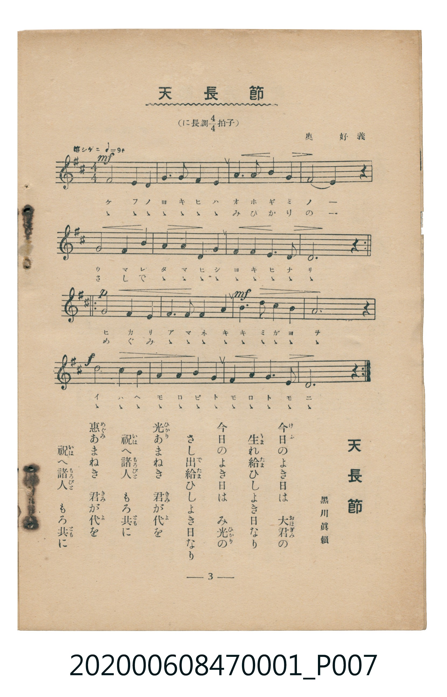

# 天長節

> Re:Shōka 使用 AI 協助辨識與重建樂譜，可能會有錯誤。歡迎回報。

- **鋼琴伴奏版**：<br><audio controls src="tenchosetsu.mp3"></audio>
- **NEUTRINO 歌聲合成版**：<br><audio controls src="tenchosetsu_neutrino.mp3"></audio>

- 詞：黒川眞頼
- 曲：奥好義
- 臺灣教育會公認《新定兒童唱歌》尋常科第一學年用（2020.006.0847.0001）

## 說明

原書資訊與歌詞全文（對應 P007.jpg，儀式歌 p. 3，第 3 首）：
調性與拍號：ニ長調 4/4 拍子，「嬉シゲニ」（原譜前兩行與後兩行各有反覆記號）


## 歌詞

```text
今日（けふ）のよき日は　大君（おほぎみ）の
生（うま）れ給（たま）ひしよき日なり
今日のよき日は　み光（ひかり）の
さし出（で）給（たま）ひしよき日なり
光（ひかり）あまねき　君（きみ）が代（よ）を
祝（いは）へ諸人（もろびと）　もろ共（とも）に
恵（めぐみ）あまねき　君（きみ）が代（よ）を
祝（いは）へ諸人（もろびと）　もろ共（とも）に
```

## ABC

<div class="abc-score" data-abc-src="tenchosetsu.abc" aria-label="五線譜載入中"></div>

[下載 ABC 原始檔](tenchosetsu.abc)

## TMD 檔案連結

- [主旋律 TMD 檔案](tenchosetsu.tmd) [[在 TMD Studio 編輯](https://tmdlang.github.io/Tmd-TS/#tmd=s7IKdvYPcrWy4qpTUCpJTLdSSM7PyUlNLsnMz7MqzsjMK0nNjM_KTMmPL87Iz05Ugisry88pzU21Si9KTEmNN4w3MjAyiDcwMIs3sDAxBzIMDBFKi_NLi5JTrYqTM_Lzc-JLUitKkvLzsxHyBUX5Zal5iXlANQVFIBtTwIoQClLLMlNSQdKpKZkl-UWZiTlI7kgtKga7FWxJfElRYl5xclFmAcgDCFUlGalAx2bmFqSi6gYalp6ZZ5Wbn5dUCvQgpkRqZlYmFifnF5Vk5AP9XpBRaZWRWQxyVHJiTnx2Yh5SEEGdVJCYnmoVYGBgrsSlpaXwdMnKl1O3P1_foKClxaVoq2BpxmVvq-DCZWOib2IH0vpi5bz3e2a93D3p6fa5z-fMe7lgD9jEZ7M3AYWfLl36dOne5_tWgsVetO963rj42dSZL5o2PZvT_LR1zYtVvY8bup5N2_B03aynrZOer176dMrGZ2t7Hjd0P93Q_XTHjufLJz5fs-bJjoana3c83bnl-ZQV7_d0gCJPDxh5eqDIAzIMDN_v6VTi4tLXUrClFuBSUFB42jf_2ewdLza3v1jR9aKjHeguoGeftq54Nq0d6IqnG3qftXcqgEJKL6sg_f2enqctDU_39AOVKRToKRgDBYBOVzBWeLlsGtB9wNAAmfli1f5nDctBpnX3vpg5Hyj6uLkbGMJAcQVgkCoAhZ-unQDU-7ih5-mazsdN2x83bQIqedzQC7Kzb_6LtXOedvY-bV35YmEP0Jin-3og7KcTWp7N6Xza3_tiWduLFTPAZndygax8srvr2fSlQN2PGyc-btwKFH7cuO5xE5DbCxR_3Lj-cUPD0yXLn06YDVbT9bhx9-PGvseN-yEqQUY8nwI0DSjX9rhxH0i0qef51mVgkflQkcZNjxunIxm66nFTF8JyTAuBxj9tBQYKUBCosxuoGmHb48apQMOetu8CSy8HShBrGzYjm4B6HjeuBSoF-RPqyV6Y93qe7F4MEmnqAPtrEti3S-eCFbUAnQpWtOPF6h1PdoGd09T0uAmoefPjRmBK7AR5BCzytHUjWMsKIBesZTXIoGeg0AbqaXzcOAFm4QA6h_JcAQUKWvpcXCHAIi4jvzi1pLjUKiwfWJw41BjUVIPsUbCx0LIDM7DlSAVIhgYmWQUNE4WnG_qBhYsOPBtpYtEAtA1kWI1CdW5aLTBD6YKhERAbAnGNggmYbwKWAYnWKJiCRUwVzMDiIBFkXQYgEbCRPoY1Co-bNkLlHjdPBZN9YB2Pm1dARJvWAtmTwDL9EJmmVVD1s4HsdWDWfKgekF4YjEfYYwSUa5wIs6dxK5gE6QSZ1gEV7QXiTWDWeohM436ozCYg7ga7pQsqA9KLag_-AN_VQ06AQ0JWFxx6oLCEhCwIg0IeEbKwkAeJ14DlYBA9rJfBw3oemFwDDQOQT2Fi4LBu2o4UC6A4gMmA6C6wDCQWsIc1KCYhYTcdTC6HhhsonoA5EBqqMHlYLIDiACYDoleBZUBhTkpY7-gkK3EX1KKENyQlQ9KtMZgGhTs0E4AiAxjYcQrmQAoRMzhCHRpuoHBcDQ4_UMiBfLYIHhePm8E-B4czSAZEQ9L14yZQHEHiAWQWJGywhnpTIzzUJ4BJUKyCQr0JKroPiMExCQ5nkAyIhqgEFn5gF4DiAWQWzM1EhvrT2bPJCnVgYAKDEWINamCCMGoBAhKBRJERgWS-BBYQ4CLjcfMMaOCBAvxxMyQxTwaTUO-iyEALBKAYSAaU8XEl8xZ4gIOKDGDVAA08UIAD6wGw2GYwCY0-FBlYAdcEjgpQ0kC1p5aLS9dOAamgVwBylbkA)]
- [鋼琴伴奏 TMD 檔案](tenchosetsu_piano.tmd) [[在 TMD Studio 編輯](https://tmdlang.github.io/Tmd-TS/#tmd=s7IKdvYPcrWy4qpTUCpJTLdSyC8qychPL0osyKi0ysgsLskvykxOzInPTsxLVIIrKs4vLUpOjS9ITE-1CjAwMFfi0tJSeLpk5cup25-vb3i_p-Nl957nE7Y82bPl6dL-550d7_d0KmhpcSnaKliacdnbKrhw2Zjom9iBzHuxct77PbNe7p70dPvc53PmvVywB2zNs9mbgMJPly59unTv830rwWIv2nc9b1z8bOrMF02bns1pftq65sWq3scNXc-mbXi6btbT1knPVy99OmXjs7U9jxu6n27ofrpjx_PlE5-vWfNkR8PTtTue7tzyfMoKoOOMDIwM9AwMzPQMLEzMgQwDQ6D7lLi4QlLzkjPyi1NLikutAjIT8_KDPBxqDGqquRSAwMZCyw7M0NdSsEUHChBLXizsUdAwUXi6oR8YCjoKoJDRyypI18SiQUsfbFiNQnVuWq2CsYIuGBoBsSEQ1yiYgPkmYBmQaI2CKVjEVMEMLA4SQdZlABIBG-ljWKPwuGkjVO5x81Qw2QfW8bh5BUS0aS2QPQks0w-RaVoFVT8byF4HZs2H6gHphcF4hD1GQLnGiTB7GreCSZBOkGkdUNFeIN4EZq2HyDTuh8psAuJusFu6oDIgvaj24A_wXT3kBDgkZHXBoQcKS0jIgjAo5BEhCwt5kHgNWA4G0cN6GTys54HJNdAwAPkUJgYO66btSLEAigOYDIjuAstAYgF7WINiEhJ208Hkcmi4geLpceM-aKjC5GGxAIoDmAyIXgWWAYU5KWG9o5OsxF1QixLekJQMSbfGYBoU7tBMAIoMYGDHKZgDKUTM4Ah1aLiBwnE1OPxAIQfy2SJ4XDxuBvscHM4gGRANSdePm0BxBIkHkFmQsMEa6k2N8FCfACZBsQoK9Sao6D4gBsckOJxBMiAaovJxYw_YBaB4AJkFczORof509myyQh0YmMBghFiDGpggjFqAgEQgUWREIJkvgQUEuMh43DwDGnigAH_cDEnMk8Ek1LsoMtACASgGkgFlfFzJvAUe4KAi43HjDmjggQL8cRMkMW8Gk9DoQ5GBFXBN4KgAJQ1Ue2qxlPM-yOW8CaKcf9q64-Xs1met24AMYFw86-59unYCpFJDhLZhvEK0YSyMAgZzPJBlGo8kAmWYACkTFBUghgHU75gGQRlmINVm8bkYOsEMZG24jYJajZOP30Vwh-P1CFbnAENb104BKcCjfYCS6EJGYCFlLgA)]

## 分析

```text
================================================================================
📊 TMD Song Profile: [ 天長節 ]
================================================================================
⏱  Duration:       0:40 (40.0s), 16 measures total
🎼 Key & Tempo:    首調基準 D, != 96.0 BPM, <4/4>
   - 分析範圍：      由實際發聲的音符與和弦推測調性；播放脈絡另行呈現
🎤 人聲音域:    D4 (MIDI 62) – D5 (MIDI 74) [跨度: 12 個半音 / 1.0 個八度, 難度: easy]
   - 最低音:  D4 in [Tenchosetsu #1 @ m.1, 0:01]
   - 最高音: D5 in [Tenchosetsu #1 @ m.11, 0:25]
   - 適合: soprano, mezzo-soprano, contralto, tenor, baritone, bass
🏛  結構:      Tenchosetsu (40.0s)
⚡ 編曲密度:        Peak 1 軌道同時演奏
🗝  調性診斷：       D 大調（純淨自然大調，未偵測到可信轉調）
   - 風格氣質:    純淨自然大調（陽光明朗、易唱易記，無明顯調外色彩）
   - 轉調歷程:    全曲維持單一推測調性（未偵測到可信轉調）
   - 核心骨幹音:  F#, D, A, G, B
   - 調性數值:    D 大調 [相關度: 0.90, 穩定度: High, 自然音純度: 100.0%]
   - 候選調性 (K-S): D 大調 (0.90), B 小調 (0.66), F# 小調 (0.62)
   - 五度圈歷程:   +2
   - 各段落調性細節:
     • [Tenchosetsu #1]: D 大調 (r: 0.90, 自然音純度: 100.0%)

  [ 五度圈游移軌跡 ]
               C  
         F            G  
      Bb              [D ]*
      Eb               A  
         Ab           E  
            Db       B  
               F# 
     (* = active key center)

  [ 十二半音累積音高分佈 ]
     C  :                            0.0%
     C# : ████                       3.3%
     D  : ████████████████████      18.3%
     D# :                            0.0%
     E  : ███████████               10.0%
     F  :                            0.0%
     F# : ████████████████████████  21.7%
     G  : ███████████████████       17.5%
     G# :                            0.0%
     A  : ████████████████████      18.3%
     A# :                            0.0%
     B  : ████████████              10.8%
--------------------------------------------------------------------------------
Assignment 軌道音域：
  - Vocal         : D4 – D5 (12 個半音 / 1.0 個八度, 49 個音符)
================================================================================
```


## 原書掃描頁




