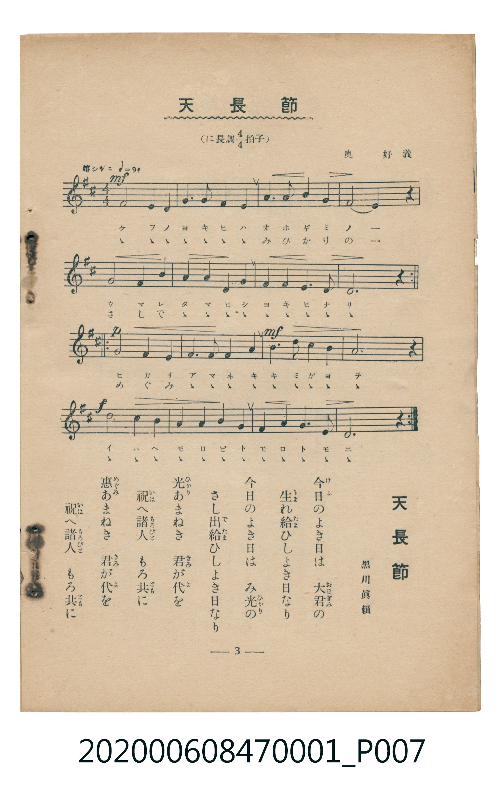

# 天長節

> Re:Shōka 使用 AI 協助辨識與重建樂譜，可能會有錯誤。歡迎回報。

- **鋼琴伴奏版**：<br><audio controls src="tenchosetsu.mp3"></audio>
- **NEUTRINO 歌聲合成版**：<br><audio controls src="tenchosetsu_neutrino.mp3"></audio>

- 詞：黒川眞頼
- 曲：奥好義
- 臺灣教育會公認《新定兒童唱歌》尋常科第一學年用（2020.006.0847.0001）

## 說明

原書資訊與歌詞全文（對應 P007.jpg，儀式歌 p. 3，第 3 首）：
調性與拍號：ニ長調 4/4 拍子，「嬉シゲニ」（原譜前兩行與後兩行各有反覆記號）


## 歌詞

```text
今日（けふ）のよき日は　大君（おほぎみ）の
生（うま）れ給（たま）ひしよき日なり
今日のよき日は　み光（ひかり）の
さし出（で）給（たま）ひしよき日なり
光（ひかり）あまねき　君（きみ）が代（よ）を
祝（いは）へ諸人（もろびと）　もろ共（とも）に
恵（めぐみ）あまねき　君（きみ）が代（よ）を
祝（いは）へ諸人（もろびと）　もろ共（とも）に
```

## ABC

```abc
X:1
T:天長節
C:曲：奥好義
M:4/4
L:1/16
Q:1/4=96
K:D
V:V1 name="Vocal" snm="Voc"
[V:V1]
!mf! F8 E4 D4 | G6 G2 F4 E4 | A6 A2 B4 G4 | F8 E4 z4 |
w: 1.~ケ フ ノ | ヨ キ ヒ ハ | オ ホ ギ ミ | ノ _
w: 2.~け ふ の | よ き ひ は | み ひ か り | の _
G8 F4 B4 | A4 A4 D4 G4 | F4 F4 E6 D2 | D12 z4 |
w: 1.~ウ マ レ | タ マ ヒ シ | ヨ キ ヒ ナ | リ
w: 2.~さ し で | た ま ひ し | よ き ひ な | り
!p! G8 F4 E4 | F6 F2 F4 A4 | !mf! B6 d2 c4 B4 | A12 z4 |
w: 1.~ヒ カ リ | ア マ ネ キ | キ ミ ガ ヨ | ヲ
w: 2.~め ぐ み | あ ま ね き | き み が よ | を
!f! d8 c4 B4 | A4 A4 B4 G4 | F4 A4 G6 E2 | D12 z4 |
w: 1.~イ ハ ヘ | モ ロ ビ ト | モ ロ ト モ | ニ
w: 2.~い は へ | も ろ び と | も ろ と も | に
```

## TMD 檔案連結

- [主旋律 TMD 檔案](tenchosetsu.tmd) [[在 TMD Studio 編輯](https://tmdlang.github.io/Tmd-TS/#tmd=s7IKdvYPcrWy4qpTUCpJTLdSSM7PyUlNLsnMz7MqzsjMK0nNjM_KTMmPL87Iz05Ugisry88pzU21Si9KTEmNN4w3MjAyiDcwMIs3sDAxBzIMDBFKi_NLi5JTrYqTM_Lzc-JLUitKkvLzsxHyBUX5Zal5iXlANQVFIBtTwIoQClLLMlNSQdKpKZkl-UWZiTlI7kgtKga7FWxJfElRYl5xclFmAcgDCFUlGalAx2bmFqSi6gYalp6ZZ5Wbn5dUCvQgpkRqZlYmkpO1tBSeLln5cur25-sbFLS0uBRtFSzNuOxtFVy4bEz0TexA-l-snPd-z6yXuyc93T73-Zx5LxfsARv7bPYmoPDTpUufLt37fN9KsNiL9l3PGxc_mzrzRdOmZ3Oan7auebGq93FD17NpG56um_W0ddLz1UufTtn4bG3P44bupxu6n-7Y8Xz5xOdr1jzZ0fB07Y6nO7c8n7Li_Z4OUOjrAUNfDxT6QIaB4fs9nUpcXPpaCrbUAlwKCgpP--Y_m73jxeb2Fyu6XnS0A90F9OzT1hXPprUDXfF0Q--z9k6FAAMDc72sgvT3e3qetjQ83dMPVKZQoKdgDBQAOl3BWOHlsmlA9wFDA2Tmi1X7nzUsB5nW3fti5nyg6OPmbmAIA8UVgEGqABR-unYCUO_jhp6nazofN21_3LQJqORxQy_Izr75L9bOedrZ-7R15YuFPUBjnu7rgbCfTmh5NqfzaX_vi2VtL1bMAJvdyQWy8snurmfTlwJ1P26c-LhxK1D4ceO6x01Abi9Q_HHj-scNDU-XLH86YTZYTdfjxt2PG_seN-6HqAQZ8XwK0DSgXNvjxn0g0aae51uXgUXmQ0UaNz1unI5k6KrHTV0IyzEtBBr_tBUYKEBBoM5uoGqEbY8bpwINe9q-Cyy9HChBrG3YjGwC6nncuBaoFORPqCd7Yd7rebJ7MUikqQPsr0lg3y6dC1bUAnQqWNGOF6t3PNkFdk5T0-MmoObNjxuBKbET5BGwyNPWjWAtK4BcsJbVIIOegUIbqKfxceMEmIUD6BzKcwUUKGjpc3GFAMuojPzi1JLiUquw_OTEHIcag5pqkD0KNhZadmAGthypAMnQwCSroGGi8HRDP7Bw0YFnI00sGoC2gQyrUajOTasFZihdMDQCYkMgrlEwAfNNwDIg0RoFU7CIqYIZWBwkgqzLACQCNtLHsEbhcdNGqNzj5qlgsg-s43HzCoho01ogexJYph8i07QKqn42kL0OzJoP1QPSC4PxCHuMgHKNE2H2NG4FkyCdINM6oKK9QLwJzFoPkWncD5XZBMTdYLd0QWVAelHtwR_gu3rICXBIyOqCQw8UlpCQBWFQyCNCFhbyIPEasBwMoof1MnhYzwOTa6BhAPIpTAwc1k3bkWIBFAcwGRDdBZaBxAL2sAbFJCTspoPJ5dBwA8UTMAdCQxUmD4sFUBzAZED0KrAMKMxJCesdnWQl7oJalPCGpGRIujUG06Bwh2YCUGQAAztOwRxIIWIGR6hDww0UjqvB4QcKOZDPFsHj4nEz2OfgcAbJgGhIun7cBIojSDyAzIKEDdZQb2qEh_oEMAmKVVCoN0FF9wExOCbB4QySAdEQlcDCD-wCUDyAzIK5mchQfzp7NlmhDgxMYDBCrEENTBBGLUBAIpAoMiKQzJfAAgJcZDxungENPFCAP26GJObJYBLqXRQZaIEAFAPJgDI-rmTeAg9wUJEBrBqggQcKcGA9ABbbDCah0YciAyvgmsBRAUoaqPbUcnHp2ikgFfQKQK4yFwA)]
- [鋼琴伴奏 TMD 檔案](tenchosetsu_piano.tmd) [[在 TMD Studio 編輯](https://tmdlang.github.io/Tmd-TS/#tmd=s7IKdvYPcrWy4tLSUni6ZOXLqdufr294v6fjZfee5xO2PNmz5enS_uedHe_3dCpoaXEp2ipYmnHZ2yq4cNmY6JvYcdUpKL1YOe_9nlkvd096un3u8znzXi7YowQSfjZ7E1D46dKlT5fufb5vJVjsRfuu542Ln02d-aJp07M5zU9b17xY1fu4oevZtA1P18162jrp-eqlT6dsfLa253FD99MN3U937Hi-fOLzNWue7Gh4unbH051bnk9ZAXSckYGRgZ6BgZmegYWJOZBhYAh0nxIXV0hqXnJGfnFqSXGpVUBmYl5-kIdDjUFNNZcCENhYaNmBGfpaCrboQAFiyYuFPQoaJgpPN_QDQ0FHIcDAwFwvqyBdE4sGLX2wYTUK1blptQrGCrpgaATEhkBco2AC5puAZUCiNQqmYBFTBTOwOEgEWZcBSARspI9hjcLjpo1QucfNU8FkH1jH4-YVENGmtUD2JLBMP0SmaRVU_Wwgex2YNR-qB6QXBuMR9hgB5Ronwuxp3AomQTpBpnVARXuBeBOYtR4i07gfKrMJiLvBbumCyoD0otqDP8B39ZAT4JCQ1QWHHigsISELwqCQR4QsLORB4jVgORhED-tl8LCeBybXQMMA5FOYGDism7YjxQIoDmAyILoLLAOJBexhDYpJSNhNB5PLoeEGiqfHjfugoQqTh8UCKA5gMiB6FVgGFOakhPWOTrISd0EtSnhDUjIk3RqDaVC4QzMBKDKAgR2nYA6kEDGDI9Sh4QYKx9Xg8AOFHMhni-Bx8bgZ7HNwOINkQDQkXT9uAsURJB5AZkHCBmuoNzXCQ30CmATFKijUm6Ci-4AYHJPgcAbJgGiIyseNPWAXgOIBZBbMzUSG-tPZs8kKdWBgAoMRYg1qYIIwagECEoFEkRGBZL4EFhDgIuNx8wxo4IEC_HEzJDFPBpNQ76LIQAsEoBhIBpTxcSXzFniAg4qMx407oIEHCvDHTZDEvBlMQqMPRQZWwDWBowKUNFDtqcVSzvsgl_MmiHL-aeuOl7Nbn7VuAzKAcfGsu_fp2gmQSg0R2obxCtGGsTAKGMzxQJZpPJIIlGECpExQVIAYBlC_YxoEZZiBVJvF52LoBDOQteE2Cmo1Tj5-F8EdjtcjWJ0DDG1dOwWkAI_2AUqiCxmBhZS5AA)]

## 分析

```text
================================================================================
📊 TMD Song Profile: [ 天長節 ]
================================================================================
⏱  Duration:       0:40 (40.0s), 16 measures total
🎼 Key & Tempo:    首調基準 D, != 96.0 BPM, <4/4>
   - 分析範圍：      由實際發聲的音符與和弦推測調性；播放脈絡另行呈現
🎤 人聲音域:    D4 (MIDI 62) – D5 (MIDI 74) [跨度: 12 個半音 / 1.0 個八度, 難度: easy]
   - 最低音:  D4 in [Tenchosetsu #1 @ m.1, 0:01]
   - 最高音: D5 in [Tenchosetsu #1 @ m.11, 0:25]
   - 適合: soprano, mezzo-soprano, contralto, tenor, baritone, bass
🏛  結構:      Tenchosetsu (40.0s)
⚡ 編曲密度:        Peak 1 軌道同時演奏
🗝  調性診斷：       D 大調（純淨自然大調，未偵測到可信轉調）
   - 風格氣質:    純淨自然大調（陽光明朗、易唱易記，無明顯調外色彩）
   - 轉調歷程:    全曲維持單一推測調性（未偵測到可信轉調）
   - 核心骨幹音:  F#, D, A, G, B
   - 調性數值:    D 大調 [相關度: 0.90, 穩定度: High, 自然音純度: 100.0%]
   - 候選調性 (K-S): D 大調 (0.90), B 小調 (0.66), F# 小調 (0.62)
   - 五度圈歷程:   +2
   - 各段落調性細節:
     • [Tenchosetsu #1]: D 大調 (r: 0.90, 自然音純度: 100.0%)

  [ 五度圈游移軌跡 ]
               C  
         F            G  
      Bb              [D ]*
      Eb               A  
         Ab           E  
            Db       B  
               F# 
     (* = active key center)

  [ 十二半音累積音高分佈 ]
     C  :                            0.0%
     C# : ████                       3.3%
     D  : ████████████████████      18.3%
     D# :                            0.0%
     E  : ███████████               10.0%
     F  :                            0.0%
     F# : ████████████████████████  21.7%
     G  : ███████████████████       17.5%
     G# :                            0.0%
     A  : ████████████████████      18.3%
     A# :                            0.0%
     B  : ████████████              10.8%
--------------------------------------------------------------------------------
Assignment 軌道音域：
  - Vocal         : D4 – D5 (12 個半音 / 1.0 個八度, 49 個音符)
================================================================================
```


## 原書掃描頁




