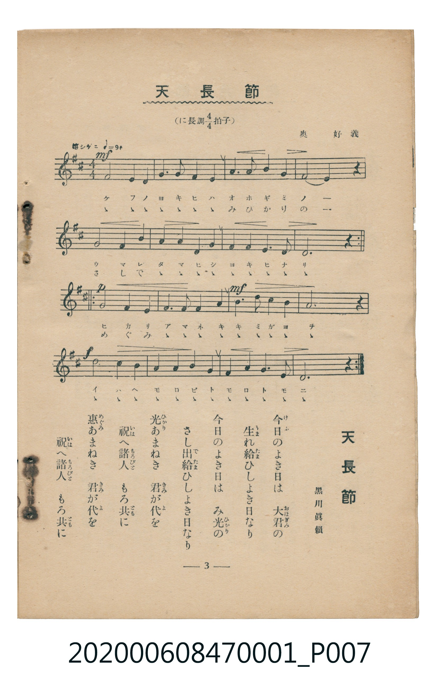

# 天長節

<audio controls src="tenchosetsu.mp3"></audio>

- 詞：黒川眞頼
- 曲：奥好義
- 臺灣教育會公認《新定兒童唱歌》尋常科第一學年用（2020.006.0847.0001）

## 說明

原書資訊與歌詞全文（對應 P007.jpg，儀式歌 p. 3，第 3 首）：
調性與拍號：ニ長調 4/4 拍子，「嬉シゲニ」（原譜前兩行與後兩行各有反覆記號）

## 歌詞

```text
今日（けふ）のよき日は　大君（おほぎみ）の
生（うま）れ給（たま）ひしよき日なり
今日のよき日は　み光（ひかり）の
さし出（で）給（たま）ひしよき日なり
光（ひかり）あまねき　君（きみ）が代（よ）を
祝（いは）へ諸人（もろびと）　もろ共（とも）に
恵（めぐみ）あまねき　君（きみ）が代（よ）を
祝（いは）へ諸人（もろびと）　もろ共（とも）に
```

## 原書掃描頁



## 分析

```text
================================================================================
📊 TMD Song Profile: [ 天長節 ]
================================================================================
⏱  Duration:       0:40 (40.0s), 16 measures total
🎼 Key & Tempo:    首調基準 D, != 96.0 BPM, <4/4>
   - 分析範圍：      由實際發聲的音符與和弦推測調性；播放脈絡另行呈現
🎤 人聲音域:    D4 (MIDI 62) – D5 (MIDI 74) [跨度: 12 個半音 / 1.0 個八度, 難度: easy]
   - 最低音:  D4 in [Tenchosetsu #1 @ m.1, 0:01]
   - 最高音: D5 in [Tenchosetsu #1 @ m.3, 0:06]
   - 適合: soprano, mezzo-soprano, contralto, tenor, baritone, bass
🏛  結構:      Tenchosetsu (40.0s)
⚡ 編曲密度:        Peak 1 軌道同時演奏
🗝  調性診斷：       D 大調（純淨自然大調，未偵測到可信轉調）
   - 風格氣質:    純淨自然大調（陽光明朗、易唱易記，無明顯調外色彩）
   - 轉調歷程:    全曲維持單一推測調性（未偵測到可信轉調）
   - 核心骨幹音:  D, F#, A, E, B
   - 調性數值:    D 大調 [相關度: 0.84, 穩定度: Moderate, 自然音純度: 100.0%]
   - 候選調性 (K-S): D 大調 (0.84), A 大調 (0.74), F# 小調 (0.69)
   - 五度圈歷程:   +2
   - 各段落調性細節:
     • [Tenchosetsu #1]: D 大調 (r: 0.84, 自然音純度: 100.0%)

  [ 五度圈游移軌跡 ]
               C  
         F            G  
      Bb              [D ]*
      Eb               A  
         Ab           E  
            Db       B  
               F# 
     (* = active key center)

  [ 十二半音累積音高分佈 ]
     C  :                            0.0%
     C# :                            0.0%
     D  : ████████████████████████  24.2%
     D# :                            0.0%
     E  : █████████████████         17.5%
     F  :                            0.0%
     F# : ███████████████████████   23.3%
     G  :                            0.0%
     G# :                            0.0%
     A  : ███████████████████████   23.3%
     A# :                            0.0%
     B  : ████████████              11.7%
--------------------------------------------------------------------------------
Assignment 軌道音域：
  - Piano         : D4 – D5 (12 個半音 / 1.0 個八度, 49 個音符)
================================================================================
```

## ABC

```abc
X:1
T:天長節
C:曲：奥好義
M:4/4
L:1/16
Q:1/4=96
K:D
V:V1 name="Piano" snm="Pia"
[V:V1]
f8 e4 d4 | e6 f2 e4 d4 | a4 a4 b4 d4 | f8 e4 z4 |
f8 e4 d4 | a4 f4 e4 d4 | e4 f4 e6 d2 | d12 z4 |
a8 f4 a4 | b6 b2 a4 f4 | b6 b2 a4 d4 | a12 z4 |
d8 b4 a4 | f4 a4 b4 a4 | f4 e4 f6 e2 | d12 z4 |
```

- [主旋律 TMD 檔案](tenchosetsu.tmd)
- [鋼琴伴奏 TMD 檔案](tenchosetsu_piano.tmd)
