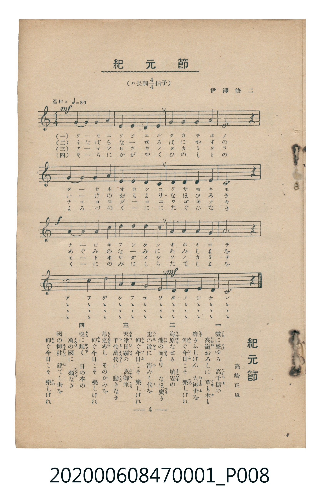

# 紀元節

> Re:Shōka 使用 AI 協助辨識與重建樂譜，可能會有錯誤。歡迎回報。

- **NEUTRINO 歌聲合成版**：<br><audio controls src="kigensetsu_neutrino.mp3"></audio>
- **鋼琴伴奏版**：<br><audio controls src="kigensetsu.mp3"></audio>


- 詞：高崎正風
- 曲：伊澤修二
- 臺灣教育會公認《新定兒童唱歌》尋常科第一學年用（2020.006.0847.0001）

## 說明

原書資訊與歌詞全文（對應 P008.jpg，儀式歌 p. 4，第 4 首）：
調性與拍號：ハ長調 4/4 拍子，「温和ニ」


## 歌詞

```text
一　雲（くも）に聳（そび）ゆる　高千穂（たかちほ）の
高嶺（たかね）おろしに　草（くさ）も木（き）も
靡（なび）きふしけん　大御世（おほみよ）を
仰（あふ）ぐ今日（けふ）こそ　樂（たの）しけれ

二　海原（うなばら）なせる　埴安（はにやす）の
池（いけ）の面（おも）より　なほ廣（ひろ）き
恵（めぐみ）の波（なみ）に　浴（あ）みし代（よ）を
仰（あふ）ぐ今日（けふ）こそ　樂（たの）しけれ

三　天津日嗣（あまつひつぎ）の　高御座（たかみくら）
千代萬代（ちよよろづよ）に　動（うご）きなき
基（もとい）定めし　そのかみを
仰（あふ）ぐ今日（けふ）こそ　樂（たの）しけれ

四　空（そら）に輝（かゞや）く　日の本の
萬（よろづ）の國（くに）に　類（たぐひ）なき
國（くに）の御柱（みはしら）　建（た）てし世（よ）を
仰（あふ）ぐ今日（けふ）こそ　樂（たの）しけれ
```

## ABC

```abc
X:1
T:紀元節
C:曲：伊澤修二
M:4/4
L:1/16
Q:1/4=80
K:C
V:V1 name="Vocal" snm="Voc"
[V:V1]
G4 G4 G4 A4 | E4 E4 D4 E4 | G4 G4 G4 A4 | E12 z4 |
w: 1.~ク _ モ ニ | ソ ビ ユ ル | タ カ チ ホ | ノ
w: 2.~う な ば ら | な _ せ る | は に や す | の
w: 3.~ア _ マ ツ | ヒ ツ ギ ノ | タ カ ミ ク | ラ
w: 4.~そ _ ら に | か が や く | ひ の も と | の
G4 G4 G4 A4 | E4 E4 D4 C4 | D4 D4 D4 E4 | C12 z4 |
w: 1.~タ _ カ ネ | オ ロ シ ニ | ク サ モ キ | モ
w: 2.~い _ け の | お も よ り | な ほ ひ ろ | き
w: 3.~チ ヨ ヨ ロ | ヅ _ ヨ ニ | ウ ゴ キ ナ | キ
w: 4.~よ ろ づ の | く _ に に | た ぐ ひ な | き
A4 A4 A4 c4 | d4 d4 d4 c4 | A4 A4 A4 G4 | A12 z4 |
w: 1.~ナ _ ビ キ | フ シ ケ ン | オ ホ ミ ヨ | ヲ
w: 2.~め ぐ み の | な _ み に | あ み し よ | を
w: 3.~モ _ ト ヰ | サ ダ メ シ | ソ ノ カ ミ | ヲ
w: 4.~く _ に の | み は し ら | た て し よ | を
c8 c4 d4 | A4 A4 G4 E4 | D4 D4 E4 D4 | C12 z4 |
w: 1.~ア フ グ | ケ フ コ ソ | タ ノ シ ケ | レ
w: 2.~あ ふ ぐ | け ふ こ そ | た の し け | れ
w: 3.~ア フ グ | ケ フ コ ソ | タ ノ シ ケ | レ
w: 4.~あ ふ ぐ | け ふ こ そ | た の し け | れ
```

## TMD 檔案連結

- [主旋律 TMD 檔案](kigensetsu.tmd) [[在 TMD Studio 編輯](https://tmdlang.github.io/Tmd-TS/#tmd=s7IKdvYPcrWy4qpTUCpJTLdSSM7PyUlNLsnMz7MqzsjMK0nNjM_KTMmPL87Iz05Ugisry88pzU21Si9KTEmNN4w3MjAyiDcwMIs3sDAxBzIMDBFKi_NLi5JTrYqTM_Lzc-JLUitKkvLzsxHyBUX5Zal5iXlANQVFIBtTwIoQClLLMlNSQdKpKZkl-UWZiTlI7kgtKga7FWxJfElRYl5xclFmAcgDCFUlGalAx2bmFqSi6gYalp6ZZ5Wbn5dUCvQgpkRqZlYmkpO1tBSeb2l42tr8fH2DgpYWl6KtgoUBl72tgjOXjYm-iR1I_4uV897vmfVy9YynW_qerV38ctEKsLHPZm8CCj_Z0_Vs35In-9c92dUDFn7Rvut54-JnU2e-aNr0bE7z09Y1L1b1Pm7oejZtw9N1s562Tnq-eunTKRufre153ND9dEP30x07ni-f-HzNmic7Gp6u3fF055bnU1a839MBigA9YATogSIAyDAwfL-nU4mLS19LwZZagEtBQeFp3_xns3e82Nz-YkXXi452oLuA_n3auuLZtHagK55u6H3W3qkQYGBgoZdVkP5-T8_Tloane_qByhQK9BRMgAJApyuYKLxcNg3oPmCAgMx8sWr_s4blINO6e1_MnA8Ufdzc_3LqdqC4AjBUFYDCT9dOAOp93NDzbMfKp5N6Hjd3P27o5QJpBobD44aGl6DQ7Xjc2P-4qQlo8OPG1S8aN4NF5j4GMTofN7U9bgJqagBFTG_z85VAZUDZ-Y8bux83LnzcuBusax3IRJCKbbuQpNeC5boeN_U-bpwONBpoyoteoOPB9jVOBZve9GwOKBoeN_ZCuGCD5i4EC62COqERqH8r2IiJj5smA015umT5030Ln-wAhgVQWRfQFY8b9z9u6gAbMQnsu90bwHJNQJ1gIyY82d31bPpSsOBEmOBkkDcbGp6tgHtqHVgcYlMPJJx2AYOv4dnW7cAYBKtqAztsw-MmoE-AaoHs2ZAQejp_y9N1EO-tB_m2qeVx40xE8DzbuAAsBxSdCBF9OXcR1AOQwG_qeNzUBTQIbOjup7sXg2U3AcMPEgpgU0BOB6prBHoJ6GmIQc82QwwCaoOIgIL62dYtkCAAi-wH-uoJxEQahdOOTnDMrHy2ZSnQgKfTIa4HGrzvceMSkDdAZB_EwdD0tG_h013LkRIM0JHAhAgKV3CW6W0GuvjFhDVQdwOTGyiEgAiYHpZCvQH26tNuYGKCRM0UWIIBhgU4wJ7OByfJJqBDVgADHygNLB_A4TcdHNTAdL4Oajm1g-Tp7NlAJc9XQvLEXFiKWf1iz1ywSPfjpnnAVAIW7AcZNn0pKDLnrIGmGKDXIfEF8TEk6J7O6YbloNXwAHi5EFh2QpwBTBXALA1JmJAAQNewDhjuz-ZvBAsCQxyYVqdDnQYMyd3QDAxWuQyUaCC5jPqJBmgQ5UUrFCho6XNxeWemp-YVp5YUl1qF5Scn5jjUGNRUg6xRsLHQsgMzsJXqCpBK4cXCHgUNE4WnG_qBdZQOvCjWxKIBaBnIsBoFUwVdODYD4hoFYyAJwkZQGpcaGDQAiYBN8zGsUXjctB4q_rh5EZjsBut43LQXzJsMJpeBydVQmf0gXhOI97i5EUzOhsg09yHZE4-wxwgo19gGUtm4CkxuAJvQCdEFFgO7oBFkDrBkg4qDXAZMQWCxFjB7JlRmHXZ7jEGuA_kC4p95YBKkE-S2SXDe4yaQfohr0f0zH8wG2QzSsxK7PSYgN8yF2QP2B8SdIHGQ6x839iC5uh8qswnMA9vd1ARmr8DpH_xpZ1cP9dOOIVgExIJhSGoCieNKO6CQg4QBJPR6oSEKjuXmtWCZ7WA2LFWB47RpK1gMnN6aQKpAYQ2LN2xpBxSOkBQyER6GIPEuRFg2dYBJkAgsTQFrNDAJDvcmqNsaQTSOtANNzaBYgZEw17XCXAAVh_kHnDOatsB98rgZ6gIwD0fagboV5BJgIYviI1BagfgUHKLwVAVOl40TEP4B-xC7fwiUO53kpB1QeoFhwziw1UYgCkFARZEVghIaRARHAgIHFiRYwQUNPDFMBfPASadpI1h-MzRYIUkLXFBAMis4QkB6QMGCIwE1gSMWGnzg7A4PcEThAxGHBTgkg0LEpoPdAYo0kFmgggRXAkIUPuAobgYVdCA9kATfACYXwv2GKGZBRRFyEYTHP-DCBz2ZwHwDcS-k4IS4GlbIQhIQOLkS9A_eBARsYpCTgMDJAwTBDHCKQSQWUEKBlDbIZQ-Ixl_-IIIbkmBgwQ1JMhAxUMKBBDO8rIcGNyJ5gYJ7DfbgBpc_oMQACW5wRIITEkgcUhpBxMAJGFwrIIIbXNZDghusFuQCUM2AI_nQwz_g5ENb_9RycenaKSDaRgpAnjIXAA)]
- [鋼琴伴奏 TMD 檔案](kigensetsu_piano.tmd) [[在 TMD Studio 編輯](https://tmdlang.github.io/Tmd-TS/#tmd=s7IKdvYPcrWy4tLSUni-peFpa_Pz9Q3v93S87N7zfMKWJ3u2PF3a_7yz4_2eTgUtLS5FWwULAy57WwVnLhsTfRM7rjoFpRcr573fM-vl6hlPt_Q9W7v45aIVSiDhZ7M3AYWf7Ol6tm_Jk_3rnuzqAQu_aN_1vHHxs6kzXzRtejan-Wnrmhereh83dD2btuHpullPWyc9X7306ZSNz9b2PG7ofrqh--mOHc-XT3y-Zs2THQ1P1-54unPL8ykrgO4zMjAy0DMwMNMzsDAxBzIMDIFOVOLi8s5MT80rTi0pLrUKyEzMyw_ycKgxqKnmUgACGwstOzBDX0vBFh0oQOx4sbBHQcNE4emGfmA46CgEGBhY6GUVpGti0aClDzasRsFUQReOzYC4RsEYSIKwEZTGpQYGDUAiYNN8DGsUHjeth4o_bl4EJrvBOh437QXzJoPJZWByNVRmP4jXBOI9bm4Ek7MhMs19SPbEI-wxAso1toFUNq4CkxvAJnRCdIHFwC5oBJnzuAnqgkaQyx43gu1pagGzZ0Jl1mG3xxjkOpAvIP6ZByZBOkFumwTnPW4C6Ye4Ft0_88FskM0gPSux22MCcsNcmD1gf0DcCRIHuf5xYw-Sq_uhMpvAPLDdTU1g9gqc_sGfdnb1UD_tGIJFQCwYhqQmkDiutAMKOUgYQEKvFxqi4FhuXguW2Q5mw1IVOE6btoLFwOmtCaQKFNaweMOWdkDhCEkhE-FhCBLvQoRlUweYBInA0tTjxt1gEhzuTVC3NYJoHGkHmppBsQIjYa5rhbkAKg7zDzhnNG2B--RxM9QFYB6OtAN1K8gljxuXovgIlFYgPgWHKDxVgdNl4wSEf8A-xO4fAuVOJzlpB5ReYNgwDmy1EYhCEFBRZIWghAYRwZGAwIEFCVZwQQNPDFPBPHDSadoIlt8MDVZI0gIXFJDMCo4QkB5QsOBIQE3giIUGHzi7wwMcUfhAxGEBDsmgELHpYHeAIg1kFqggwZWAEIUPOIqbQQUdSA8kwTeAyYVwvyGKWVBRhFwE4fEPuPBBTyYw30DcCyk4Ia6GFbKQBAROrgT9gzcBPZ09m5wEBE4eIAhmgFMMIrGAEgqktEEue0A0_vIHEdyQBAMLbkiSgYiBEg4kmOFlPTS4EckLFNxrsAc3uPwBJQZIcIMjEpyQQOKQ0ggiBk7A4FoBEdzgsh4S3GC1IBeAagYcyYce_gEnH9r6pxazaeSD3DQyQTSNXvR1vWzvBSapZ929T9dOeDqp50XjJkhLECnpxCtEG8bCKDjfLB5Im8XngoRMgEwTJCWmIDnT-FgwwwDqd7hOuCxcBKofTSOqGiCFMAmqAa7PCMgwArkFLoLuavxOgmvD6xOsDgIGt66dAiLEo32AcmgiRhgixhgiQFuBIspcAA)]

## 分析

```text
================================================================================
📊 TMD Song Profile: [ 紀元節 ]
================================================================================
⏱  Duration:       0:48 (48.0s), 16 measures total
🎼 Key & Tempo:    首調基準 C, != 80.0 BPM, <4/4>
   - 分析範圍：      由實際發聲的音符與和弦推測調性；播放脈絡另行呈現
🎤 人聲音域:    C4 (MIDI 60) – D5 (MIDI 74) [跨度: 14 個半音 / 1.2 個八度, 難度: moderate]
   - 最低音:  C4 in [Kigensetsu #1 @ m.6, 0:17]
   - 最高音: D5 in [Kigensetsu #1 @ m.10, 0:27]
   - 適合: soprano, mezzo-soprano, contralto, tenor, baritone, bass
🏛  結構:      Kigensetsu (48.0s)
⚡ 編曲密度:        Peak 1 軌道同時演奏
🗝  調性診斷：       A 調性不明確（純淨自然大調，未偵測到可信轉調）
   - 風格氣質:    純淨自然大調（陽光明朗、易唱易記，無明顯調外色彩）
   - 轉調歷程:    全曲維持單一推測調性（未偵測到可信轉調）
   - 核心骨幹音:  A, C, D, E, G
   - 調性數值:    A 調性不明確 [相關度: 0.75, 穩定度: Ambiguous, 自然音純度: 100.0%]
   - 候選調性 (K-S): A 小調 (0.75), C 大調 (0.73), G 大調 (0.68)
   - 五度圈歷程:   +3
   - 各段落調性細節:
     • [Kigensetsu #1]: A 調性不明確 (r: 0.75, 自然音純度: 100.0%)

  [ 五度圈游移軌跡 ]
               C  
         F            G  
      Bb               D  
      Eb              [A ]*
         Ab           E  
            Db       B  
               F# 
     (* = active key center)

  [ 十二半音累積音高分佈 ]
     C  : █████████████████████     20.0%
     C# :                            0.0%
     D  : █████████████████████     20.0%
     D# :                            0.0%
     E  : ███████████████████       18.3%
     F  :                            0.0%
     F# :                            0.0%
     G  : ███████████████████       18.3%
     G# :                            0.0%
     A  : ████████████████████████  23.3%
     A# :                            0.0%
     B  :                            0.0%
--------------------------------------------------------------------------------
Assignment 軌道音域：
  - Vocal         : C4 – D5 (14 個半音 / 1.2 個八度, 51 個音符)
================================================================================
```


## 原書掃描頁




