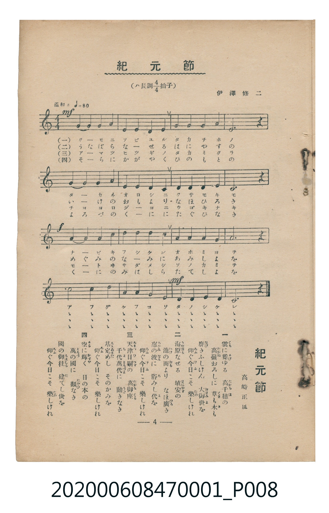

# 紀元節

<audio controls src="kigensetsu.mp3"></audio>

- 詞：高崎正風
- 曲：伊澤修二
- 臺灣教育會公認《新定兒童唱歌》尋常科第一學年用（2020.006.0847.0001）

## 說明

原書資訊與歌詞全文（對應 P008.jpg，儀式歌 p. 4，第 4 首）：
調性與拍號：ハ長調 4/4 拍子，「温和ニ」

## 跨冊／重複收錄參照

> 同曲（儀式歌〈紀元節〉；收錄於《新定兒童唱歌》卷首與《唱歌帖》P124）

- **[同曲]** 楊金土手抄《唱歌帖》第 1 冊（2020.006.0843）：[**〈紀元節〉**](../../../shokacho/vol_01/p124_kigensetsu/index.md)（`C` / `4/4` — [原始 TMD](../../../shokacho/vol_01/p124_kigensetsu/kigensetsu.tmd)）
- 總表：[跨冊重複與同名歌曲總索引](../../../duplicate_songs.md)

## 歌詞

```text
一　雲（くも）に聳（そび）ゆる　高千穂（たかちほ）の
高嶺（たかね）おろしに　草（くさ）も木（き）も
靡（なび）きふしけん　大御世（おほみよ）を
仰（あふ）ぐ今日（けふ）こそ　樂（たの）しけれ

二　海原（うなばら）なせる　埴安（はにやす）の
池（いけ）の面（おも）より　なほ廣（ひろ）き
恵（めぐみ）の波（なみ）に　浴（あ）みし代（よ）を
仰（あふ）ぐ今日（けふ）こそ　樂（たの）しけれ

三　天津日嗣（あまつひつぎ）の　高御座（たかみくら）
千代萬代（ちよよろづよ）に　動（うご）きなき
基（もとい）定めし　そのかみを
仰（あふ）ぐ今日（けふ）こそ　樂（たの）しけれ

四　空（そら）に輝（かゞや）く　日の本の
萬（よろづ）の國（くに）に　類（たぐひ）なき
國（くに）の御柱（みはしら）　建（た）てし世（よ）を
仰（あふ）ぐ今日（けふ）こそ　樂（たの）しけれ
```

## ABC

```abc
X:1
T:紀元節
C:曲：伊澤修二
M:4/4
L:1/16
Q:1/4=80
K:C
V:V1 name="Vocal" snm="Voc"
[V:V1]
G4 G4 G4 A4 | E4 E4 D4 E4 | G4 G4 G4 A4 | E12 z4 |
G4 G4 G4 A4 | E4 E4 D4 C4 | D4 D4 D4 E4 | C12 z4 |
A4 A4 A4 c4 | d4 d4 d4 c4 | A4 A4 A4 G4 | A12 z4 |
c8 c4 d4 | A4 A4 G4 E4 | D4 D4 E4 D4 | C12 z4 |
```

## TMD 檔案連結

- [主旋律 TMD 檔案](kigensetsu.tmd) [[在 TMD Studio 編輯](https://tmdlang.github.io/Tmd-TS/#tmd=s7IKdvYPcrWy4qpTUCpJTLdSSM7PyUlNLsnMz7MqzsjMK0nNjM_KTMmPL87Iz05Ugisry88pzU21Si9KTEmNN4w3MjAyiDcwMIs3sDAxBzIMDBFKi_NLi5JTrYqTM_Lzc-JLUitKkvLzsxHyBUX5Zal5iXlANQVFIBtTwIoQClLLMlNSQdKpKZkl-UWZiTlI7kgtKga7FWxJfElRYl5xclFmAcgDCFUlGalAx2bmFqRCdGtpKTzf0vC0tfn5-gYFLS0uRVsFCwMue1sFZy4bE30TO5DGFyvnvd8z6-XqGU-39D1bu_jlohVg857N3gQUfrKn69m-JU_2r3uyqwcs_KJ91_PGxc-mznzRtOnZnOanrWterOp93ND1bNqGp-tmPW2d9Hz10qdTNj5b2_O4ofvphu6nO3Y8Xz7x-Zo1T3Y0PF274-nOLc-nrHi_pwMUkHrAgNQDBSSQYWD4fk-nEheXvpaCLbUAl4KCwtO--c9m73ixuf3Fiq4XHe1AdwH9-7R1xbNp7UBXPN3Q-6y9UyHAwMBCL6sg_f2enqctDU_39AOVKRToKZgABYBOVzBReLlsGtB9wAABmfli1f5nDctBpnX3vpg5Hyj6uLn_5dTtQHEFYKgqAIWfrp0A1Pu4oefZjpVPJ_U8bu5-3NDLBdIMDIfHDQ0vQaHb8bix_3FTE9Dgx42rXzRuBovMfQxidD5uanvcBNTUAIqY3ubnK4HKgLLzHzd2P25c-LhxN1jXOpCJIBXbdiFJrwXLdT1u6n3cOB1oNNCUF71Ax4Pta5wKNr3p2RxQNDxu7IVwwQbNXQgWWgV1QiNQ_1awERMfN00GmvJ0yfKn-xY-2QEMC6CyLqArHjfuf9zUATZiEth3uzeA5ZqAOsFGTHiyu-vZ9KVgwYkwwckgbzY0PFsB99Q6sDjEph5IOO0CBl_Ds63bgTEIVtUGdtiGx01AnwDVAtmzISH0dP6Wp-sg3lsP8m1Ty-PGmYjgebZxAVgOKDoRIvpy7iKoByCB39TxuKkLaBDY0N1Pdy8Gy24Chh8kFMCmgJwOVNcI9BLQ0xCDnm2GGATUBhEBBfWzrVsgQQAW2Q_01ROIiTQKpx2d4JhZ-WzLUqABT6dDXA80eN_jxiUgb4DIPoiDoelp38Knu5YjJRigI4EJERSu4CzT2wx08YsJa6DuBiY3UAgBETA9LIV6A-zVp93AxASJmimwBAMMC3CAPZ0PTpJNQIesAAY-UBpYPoDDbzo4qIHpfB3UcmoHydPZs4FKnq-E5Im5sBSz-sWeuWCR7sdN84CpBCzYDzJs-lJQZM5ZA00xQK9D4gviY0jQPZ3TDctBq-EB8HIhsOyEOAOYKoBZGpIwIQGArmEdMNyfzd8IFgSGODCtToc6DRiSu6EZGKxyGSjRQHIZ9RMN0CDKi1YoUNDS5-LyzkxPzStOLSkutQrLT07McagxqFGoBtmjYGOhZQdmYCvWFSC1wouFPQoaJgpPN_QDKykdeFmsiUUD0DaQYTUKpgq6cGwGxDUKxkAShI2gNC41MGgAEgGnFtxu29VDfbcZgkVALBiGuBYkTorbdnSS4zaQe2DYMA7iFBCFIKCiyApBHoGIkOBAYB4kx4Fg60EQzAC7COEYkEMgoYUcdiAaW_jVcnHp2ikgEqcCkKfMxQUA)]
- [鋼琴伴奏 TMD 檔案](kigensetsu_piano.tmd) [[在 TMD Studio 編輯](https://tmdlang.github.io/Tmd-TS/#tmd=s7IKdvYPcrWy4tLSUni-peFpa_Pz9Q3v93S87N7zfMKWJ3u2PF3a_7yz4_2eTgUtLS5FWwULAy57WwVnLhsTfRM7rjoFpRcr573fM-vl6hlPt_Q9W7v45aIVSiDhZ7M3AYWf7Ol6tm_Jk_3rnuzqAQu_aN_1vHHxs6kzXzRtejan-Wnrmhereh83dD2btuHpullPWyc9X7306ZSNz9b2PG7ofrqh--mOHc-XT3y-Zs2THQ1P1-54unPL8ykrgO4zMjAy0DMwMNMzsDAxBzIMDIFOVOLi8s5MT80rTi0pLrUKyEzMyw_ycKgxqFGo5lIAAhsLLTswQ19LwRYdKEAsebGwR0HDROHphn5gQOgoBBgYWOhlFaRrYtGgpQ82rEbBVEEXjs2AuEbBGEiCsBGUxqUGBg1AIlz43barh_puMwSLgFgwDHEtSJwUt-3oJMdtIPfAsGEcxCkgCkFARZEVgjwCESHBgU9nzybHgWDrQRDMALsI4RiQQyChhRx2IBpb-NVipk0flLRpgkibL_q6Xrb3At38rLv36doJTyf1vGjcBMmLSG6LV4g2jIVRcL5ZPJA2i88FCZkAmSZISkxBcqbxsWCGAdBRKCbBZeEiUP1oGlHVACmESVANcH1GQIYRyC1wEXRX43cSXBten2B1EDC8de0UEEGuAOQpc3EBAA)]

## 分析

```text
================================================================================
📊 TMD Song Profile: [ 紀元節 ]
================================================================================
⏱  Duration:       0:48 (48.0s), 16 measures total
🎼 Key & Tempo:    首調基準 C, != 80.0 BPM, <4/4>
   - 分析範圍：      由實際發聲的音符與和弦推測調性；播放脈絡另行呈現
🎤 人聲音域:    C4 (MIDI 60) – D5 (MIDI 74) [跨度: 14 個半音 / 1.2 個八度, 難度: moderate]
   - 最低音:  C4 in [Kigensetsu #1 @ m.6, 0:17]
   - 最高音: D5 in [Kigensetsu #1 @ m.10, 0:27]
   - 適合: soprano, mezzo-soprano, contralto, tenor, baritone, bass
🏛  結構:      Kigensetsu (48.0s)
⚡ 編曲密度:        Peak 1 軌道同時演奏
🗝  調性診斷：       A 調性不明確（純淨自然大調，未偵測到可信轉調）
   - 風格氣質:    純淨自然大調（陽光明朗、易唱易記，無明顯調外色彩）
   - 轉調歷程:    全曲維持單一推測調性（未偵測到可信轉調）
   - 核心骨幹音:  A, C, D, E, G
   - 調性數值:    A 調性不明確 [相關度: 0.75, 穩定度: Ambiguous, 自然音純度: 100.0%]
   - 候選調性 (K-S): A 小調 (0.75), C 大調 (0.73), G 大調 (0.68)
   - 五度圈歷程:   +3
   - 各段落調性細節:
     • [Kigensetsu #1]: A 調性不明確 (r: 0.75, 自然音純度: 100.0%)

  [ 五度圈游移軌跡 ]
               C  
         F            G  
      Bb               D  
      Eb              [A ]*
         Ab           E  
            Db       B  
               F# 
     (* = active key center)

  [ 十二半音累積音高分佈 ]
     C  : █████████████████████     20.0%
     C# :                            0.0%
     D  : █████████████████████     20.0%
     D# :                            0.0%
     E  : ███████████████████       18.3%
     F  :                            0.0%
     F# :                            0.0%
     G  : ███████████████████       18.3%
     G# :                            0.0%
     A  : ████████████████████████  23.3%
     A# :                            0.0%
     B  :                            0.0%
--------------------------------------------------------------------------------
Assignment 軌道音域：
  - Vocal         : C4 – D5 (14 個半音 / 1.2 個八度, 51 個音符)
================================================================================
```


## 原書掃描頁




