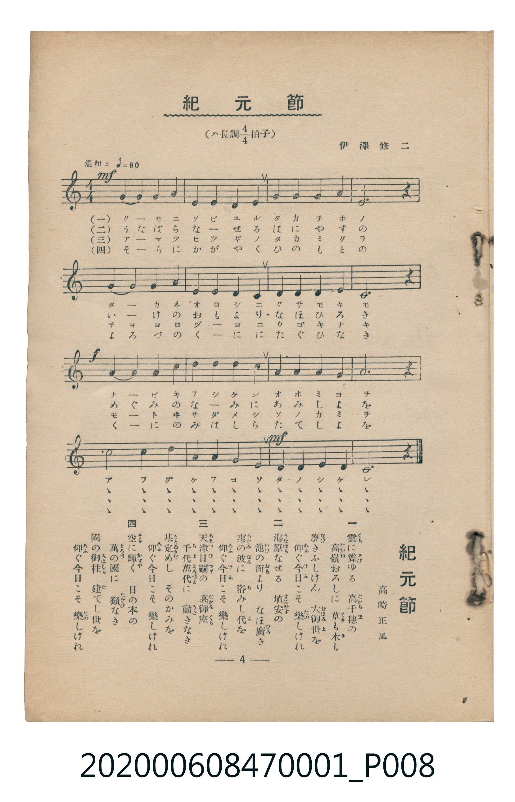

# 紀元節

> Re:Shōka 使用 AI 協助辨識與重建樂譜，可能會有錯誤。歡迎[回報](https://github.com/TMDLang/reshoka/issues)。

- **鋼琴伴奏版**：<br><audio controls src="kigensetsu.mp3"></audio>
- **NEUTRINO 歌聲合成版**：<br><audio controls src="kigensetsu_neutrino.mp3"></audio>

- 詞：高崎正風
- 曲：伊澤修二
- 臺灣教育會公認《新定兒童唱歌》尋常科第一學年用（2020.006.0847.0001）

## 說明

原書資訊與歌詞全文（對應 P008.jpg，儀式歌 p. 4，第 4 首）：
調性與拍號：ハ長調 4/4 拍子，「温和ニ」


## 歌詞

```text
一　雲（くも）に聳（そび）ゆる　高千穂（たかちほ）の
高嶺（たかね）おろしに　草（くさ）も木（き）も
靡（なび）きふしけん　大御世（おほみよ）を
仰（あふ）ぐ今日（けふ）こそ　樂（たの）しけれ

二　海原（うなばら）なせる　埴安（はにやす）の
池（いけ）の面（おも）より　なほ廣（ひろ）き
恵（めぐみ）の波（なみ）に　浴（あ）みし代（よ）を
仰（あふ）ぐ今日（けふ）こそ　樂（たの）しけれ

三　天津日嗣（あまつひつぎ）の　高御座（たかみくら）
千代萬代（ちよよろづよ）に　動（うご）きなき
基（もとい）定めし　そのかみを
仰（あふ）ぐ今日（けふ）こそ　樂（たの）しけれ

四　空（そら）に輝（かゞや）く　日の本の
萬（よろづ）の國（くに）に　類（たぐひ）なき
國（くに）の御柱（みはしら）　建（た）てし世（よ）を
仰（あふ）ぐ今日（けふ）こそ　樂（たの）しけれ
```

## ABC

<div class="abc-score" data-abc-src="kigensetsu.abc" aria-label="五線譜載入中"></div>

[下載 ABC 原始檔](kigensetsu.abc)

## TMD 檔案連結

- [主旋律 TMD 檔案](kigensetsu.tmd) [[在 TMD Studio 編輯](https://tmdlang.github.io/Tmd-TS/#tmd=s7IKdvYPcrWy4qpTUCpJTLdSSM7PyUlNLsnMz7MqzsjMK0nNjM_KTMmPL87Iz05Ugisry88pzU21Si9KTEmNN4w3MjAyiDcwMIs3sDAxBzIMDBFKi_NLi5JTrYqTM_Lzc-JLUitKkvLzsxHyBUX5Zal5iXlANQVFIBtTwIoQClLLMlNSQdKpKZkl-UWZiTlI7kgtKga7FWxJfElRYl5xclFmAcgDCFUlGalAx2bmFqSi6gYalp6ZZ5Wbn5dUCvQgpkRqZlYmFifnF5Vk5AP9XpBRaZWRWQxyVHJiTnx2Yh5SEEGdVJCYnmoVYGBgocSlpaXwfEvD09bm5-sbFLS0uBRtFSwMuOxtFZy5bEz0TexAWl-snPd-z6yXq2c83dL3bO3il4tWgE18NnsTUPjJnq5n-5Y82b_uya4esPCL9l3PGxc_mzrzRdOmZ3Oan7auebGq93FD17NpG56um_W0ddLz1UufTtn4bG3P44bupxu6n-7Y8Xz5xOdr1jzZ0fB07Y6nO7c8n7Li_Z4OUPzpAeNPDxR_QIaB4fs9nUpcXPpaCrbUAlwKCgpP--Y_m73jxeb2Fyu6XnS0A90F9O_T1hXPprUDXfF0Q--z9k4FUGDpZRWkv9_T87Sl4emefqAyhQI9BROgANDpCiYKL5dNA7oPGCAgM1-s2v-sYTnItO7eFzPnA0UfN_e_nLodKK4ADFUFoPDTtROAeh839DzbsfLppJ7Hzd2PG3q5QJqB4fC4oeElKHQ7Hjf2P25qAhr8uHH1i8bNYJG5j0GMzsdNbY-bgJoaQBHT2_x8JVAZUHb-48bux40LHzfuButaBzIRpGLbLiTptWC5rsdNvY8bpwONBpryohfoeLB9jVPBpjc9mwOKhseNvRAu2KC5C8FCq6BOaATq3wo2YuLjpslAU54uWf5038InO4BhAVTWBXTF48b9j5s6wEZMAvtu9wawXBNQJ9iICU92dz2bvhQsOBEmOBnkzYaGZyvgnloHFofY1AMJp13A4Gt4tnU7MAbBqtrADtvwuAnoE6BaIHs2JISezt_ydB3Ee-tBvm1qedw4ExE8zzYuAMsBRSdCRF_OXQT1ACTwmzoeN3UBDQIbuvvp7sVg2U3A8IOEAtgUkNOB6hqBXgJ6GmLQs80Qg4DaICKgoH62dQskCMAi-4G-egIxkUbhtKMTHDMrn21ZCjTg6XSI64EG73vcuATkDRDZB3EwND3tW_h013KkBAN0JDAhgsIVnGV6m4EufjFhDdTdwOQGCiEgAqaHpVBvgL36tBuYmCBRMwWWYIBhAQ6wp_PBSbIJ6JAVwMAHSgPLB3D4TQcHNTCdr4NaTu0geTp7NlDJ85WQPDEXlmJWv9gzFyzS_bhpHjCVgAX7QYZNXwqKzDlroCkG6HVIfEF8DAm6p3O6YTloNTwAXi4Elp0QZwBTBTBLQxImJADQNawDhvuz-RvBgsAQB6bV6VCnAUNyNzQDg1UuAyUaSC6jfqIBGkR50QoFClr6XFzemempecWpJcWlVmH5wFrJocagphpkjYKNiZYdmIGtVFeAVAovFvYoaJgoPN3QD6yjdOBFsSYWDUDLQIbVKJiCoRmQZQyERkCMKqYLhAYKNWDVPoY1Co-b1gNFHjcvAuJuoIrHTXuBrMlAvAyIV4NF9gPxaiCvEYhng0Sa-8DmxMPMMQKKNbYB8Sog3gBU3QlSBeQBTW6cDeSDTW5cD8RAc5pagPRMsMg6VHOMQbYtArtnHhC3gO2aBGY9bloHthfZPfPBrgepWYlqjgnI7Lkgc4AuAdkJ4ncDcQ_U9n6wyCawC4D5EEivQHMP_rjZ1UONuDEEsozAEBRLhljiZj_YDyC_9oJ9Dgzf5rVAejs8toBh2rQVEn9Na8FhAQo_9LhpAcfERLAPQfwuiK-bOoC4CxpXwPIdEiZNYLsaezHjBpwCVkAxxLZWcGyB-BD3AFNN0xawWx43g00GsjDiBmxvL9COpXAX9YNdCPQpNLaAcds4ARpHq9DcQyDfdJITN2ZgaBgHipI4KALzIBKmYBZGBAG9CPI-MLtAA38qJHKaNgLZm-FRBswCoMQKDCaQmk2YEdQEDFiwd4FJGxogkMwD4kMCBJRIQbzp4OAD6ZmEJYIgmQcYvM0bwGpASaMBiBeC3QXL3n3wDITFPeDMg4gOiGtANoOyL8h2SOYGRRAwsrG6B28EAasgciIIGBm6IAIYL5BIMQXnGkjuMcKRfyDBAYoUSHCAogXE2wwOCGhZAg4OSKSBgmMNlvzTBA4OYGACIwnEB-UkEA8Y8cByBhYcwLIEFBxAWZDJPTjLNorcA44eytxTy8Wla6eAqJsUgDxlLgA)]
- [鋼琴伴奏 TMD 檔案](kigensetsu_piano.tmd) [[在 TMD Studio 編輯](https://tmdlang.github.io/Tmd-TS/#tmd=s7IKdvYPcrWy4qpTUCpJTLdSyC8qychPL0osyKi0ysgsLskvykxOzInPTsxLVIIrKs4vLUpOjS9ITE-1CjAwsFDi0tJSeL6l4Wlr8_P1De_3dLzs3vN8wpYne7Y8Xdr_vLPj_Z5OBS0tLkVbBQsDLntbBWcuGxN9EzuQeS9Wznu_Z9bL1TOebul7tnbxy0UrwNY8m70JKPxkT9ezfUue7F_3ZFcPWPhF-67njYufTZ35omnTsznNT1vXvFjV-7ih69m0DU_XzXraOun56qVPp2x8trbncUP30w3dT3fseL584vM1a57saHi6dsfTnVueT1kBdJ-RgZGBnoGBmZ6BhYk5kGFgCHSiEheXd2Z6al5xaklxqVVAZmJefpCHQ41BTTWXAhDYmGjZgRn6Wgq26EABYseLhT0KGiYKTzf0A8NBRwEUNnpZBemaWDRo6YMNq1EwBUMzIMsYCI2AGFVMFwgNFGrAqn0MaxQeN60HijxuXgTE3UAVj5v2AlmTgXgZEK8Gi-wH4tVAXiMQzwaJNPeBzYmHmWMEFGtsA-JVQLwBqLoTpArIA5rcOBvIB5vcuB6IgeY0tQDpmWCRdajmGINsWwR2zzwgbgHbNQnMety0Dmwvsnvmg10PUrMS1RwTkNlzQeYAXQKyE8TvBuIeqO39YJFNYBc8bmoC0ivQ3IM_bnb1UCNuDIEsIzAExZIhlrjZD_YDyK-9YJ8Dw7d5LZDeDo8tYJg2bYXEX9NacFiAwg89blrAMTER7EMQvwvi66YOIO6CxtXjxt2QMGkC29XYixk34BSwAorBtjXtAscWiA9xDzDVNG0Bu-VxM9hkIAsjbsD29gLtmAV3UT_YhUCfQmMLGLeNE6BxtArNPQTyTSc5cWMGhoZxoCiJgyIwDyJhCmZhRBDQiyDvA7MLNPCnQiKnaSOQvRkeZcAsAEqswGACqdmEGUFNwIAFexeYtKEBAsk8ID4kQECJFMSbDg4-kJ5JWCIIknlAwbsErAaUNBqAeCHYXbDs3QfPQFjcA848iOiAuAZkMyj7gmyHZG5QBAEjG6t78EbQ09mzyYkgYGTogghgvEAixRScayC5xwhH_oEEByhSNoCdCIoWEG8zOCCgZQk4OCCRBgqONVjyTxM4OICBCYwkEB-Uk0A8YMQDyxlYcADLElBwAGVBJvfgLNsocg84eihzTy1m1eSDo2p60df1sr0XGGXPunufrp3wdFLPi8ZNkJoYKWriFaINY2EUnG8WD6TN4nNBQiZApgmSElOQnGl8LJgBizO4TrgsXASqH00jqhoghTAJqgGuzwjIMAK5BS6C7mr8ToJrw-sTrA4CBreunQIixKN9gHJoIkYYIsYYIkBbgSLKXAA)]

## 分析

```text
================================================================================
📊 TMD Song Profile: [ 紀元節 ]
================================================================================
⏱  Duration:       0:48 (48.0s), 16 measures total
🎼 Key & Tempo:    首調基準 C, != 80.0 BPM, <4/4>
   - 分析範圍：      由實際發聲的音符與和弦推測調性；播放脈絡另行呈現
🎤 人聲音域:    C4 (MIDI 60) – D5 (MIDI 74) [跨度: 14 個半音 / 1.2 個八度, 難度: moderate]
   - 最低音:  C4 in [Kigensetsu #1 @ m.6, 0:17]
   - 最高音: D5 in [Kigensetsu #1 @ m.10, 0:27]
   - 適合: soprano, mezzo-soprano, contralto, tenor, baritone, bass
🏛  結構:      Kigensetsu (48.0s)
⚡ 編曲密度:        Peak 1 軌道同時演奏
🗝  調性診斷：       A 調性不明確（純淨自然大調，未偵測到可信轉調）
   - 風格氣質:    純淨自然大調（陽光明朗、易唱易記，無明顯調外色彩）
   - 轉調歷程:    全曲維持單一推測調性（未偵測到可信轉調）
   - 核心骨幹音:  A, C, D, E, G
   - 調性數值:    A 調性不明確 [相關度: 0.75, 穩定度: Ambiguous, 自然音純度: 100.0%]
   - 候選調性 (K-S): A 小調 (0.75), C 大調 (0.73), G 大調 (0.68)
   - 五度圈歷程:   +3
   - 各段落調性細節:
     • [Kigensetsu #1]: A 調性不明確 (r: 0.75, 自然音純度: 100.0%)

  [ 五度圈游移軌跡 ]
               C  
         F            G  
      Bb               D  
      Eb              [A ]*
         Ab           E  
            Db       B  
               F# 
     (* = active key center)

  [ 十二半音累積音高分佈 ]
     C  : █████████████████████     20.0%
     C# :                            0.0%
     D  : █████████████████████     20.0%
     D# :                            0.0%
     E  : ███████████████████       18.3%
     F  :                            0.0%
     F# :                            0.0%
     G  : ███████████████████       18.3%
     G# :                            0.0%
     A  : ████████████████████████  23.3%
     A# :                            0.0%
     B  :                            0.0%
--------------------------------------------------------------------------------
Assignment 軌道音域：
  - Vocal         : C4 – D5 (14 個半音 / 1.2 個八度, 51 個音符)
================================================================================
```


## 原書掃描頁




