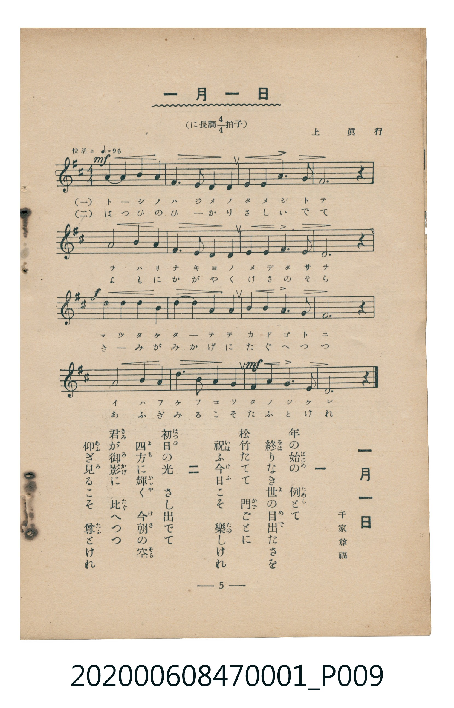

# 一月一日

> Re:Shōka 使用 AI 協助辨識與重建樂譜，可能會有錯誤。歡迎回報。

- **鋼琴伴奏版**：<br><audio controls src="ichigatsu_ichijitsu.mp3"></audio>
- **NEUTRINO 歌聲合成版**：<br><audio controls src="ichigatsu_ichijitsu_neutrino.mp3"></audio>

- 詞：千家尊福
- 曲：上眞行
- 臺灣教育會公認《新定兒童唱歌》尋常科第一學年用（2020.006.0847.0001）

## 說明

原書資訊與歌詞全文（對應 P009.jpg，儀式歌 p. 5，第 5 首）：
調性與拍號：ニ長調 4/4 拍子，「快活ニ」


## 歌詞

```text
一　年（とし）の始（はじめ）の　例（ためし）とて
終（をは）りなき世（よ）の目出（めで）たさを
松竹（まつたけ）たてて　門（かど）ごとに
祝（いは）ふ今日（けふ）こそ　樂（たの）しけれ

二　初日（はつひ）の光（ひかり）　さし出（い）でて
四方（よも）に輝（かゞや）く　今朝（けさ）の空（そら）
君（きみ）が御影（みかげ）に　比（たぐ）へつつ
仰（あふ）ぎ見（み）るこそ　尊（たふと）けれ
```

## ABC

<div class="abc-score" data-abc-src="ichigatsu_ichijitsu.abc" aria-label="五線譜載入中"></div>

[下載 ABC 原始檔](ichigatsu_ichijitsu.abc)

## TMD 檔案連結

- [主旋律 TMD 檔案](ichigatsu_ichijitsu.tmd) [[在 TMD Studio 編輯](https://tmdlang.github.io/Tmd-TS/#tmd=s7IKdvYPcrWy4qpTUCpJTLdSSM7PyUlNLsnMz7MqzsjMK0nNjM_KTMmPL87Iz05Ugisry88pzU21Si9KTEmNN4w3MjAyiDcwMIs3sDAxBzIMDBFKi_NLi5JTrYqTM_Lzc-JLUitKkvLzsxHyBUX5Zal5iXlANQVFIBtTwIoQClLLMlNSQdKpKZkl-UWZiTlI7kgtKga7FWxJfElRYl5xclFmAcgDCFUlGalAxxanJhbn5xUjhIFmpWfmWeXm5yWVAv2HKZGamZWJ5GItLYUnOxqezekAkdOXKmhpcSnaKliacdnbKrhw2Zjom9iBjHixct77PbOe9jY_Xbft6Yau58v6wSY_m70JKPxkR9fzOfNeLOwBi71o3_W8cfGzqTNfNG16Nqf5aeuaF6t6Hzd0PZu24em6WU9bJz1fvfTplI3P1vY8buh-uqH76Y4dz5dPfL5mDdAFT9fueLpzy_MpK97v6QCFvx4w_PVA4Q9kGBi-39OpxMWlr6VgSy3ApaCg8LRv_rPZO15sbn-xoutFRzvQXUDPPm1d8WxaO9AVTzf0PmvvVAgwMLDUyypIf7-n52lLw9M9_UBlCgV6CqZAAaDTFUwVXi6bBnQfMDRAZr5Ytf9Zw3KQad29L2bOB4o-bu5-OXU7UFwBGKQKQOGnaycA9T5u6Hm6f_WzLbuB8o8berlAmoHh8LihARgOQOsfN6543DgdaPDjxnVPl3eDRdY_bpzxuKkRIghU-WQfRHw-UBCmGKhrGcis51ubQHJNk4DaQBJNXY8bVz1u7H2yA-haoHgHxJTns9c9bd8FFgEasRwsOP9x41SgRpApz-bue756J9iSfY8bl4DlJsIULQOhhoaX0xrACrofN64ES00Bu2I12BVL54LlWqCuaNz6ZHcXMLWBBScCuWDByY8b5wINerYC7GSQ0evA4tNBapp6IGGzCxhkDU875sJ0AwMD6B5gKgSHUCswAoCCm0DOaOoCCTY0gLzROB3qvcYWsMrl0OB5Onv2s2lgjzUBEdBeoNzqF3sgrgUaMe9xE0RDPyicgW6eA5ECunkqNORWQsyd-7gJaHcn2NAJs8FCvY8b94MV9Tzdt_Dp3o1gwf3gEJoEsQnk2_VTYL4Fpgeg4A6wh5aAPbt7A1iuCRZCfS-WQaIabG4T0CBomAGzJMyUrcBgBysGhxnQFMpzCRQoaOlzcXkmZ2SmJ5YUl4IYWZlAhlVYfnJijkONQU01yDoFGwstOzADW0ZVgORzYFmhoGGi8HRD__P1DTrw3KWJRQPQUpBhNcAspguGZkAMYtcoGIP5RgqGQBKEa4BsEB8ir6tgAlcDgQYgNWDTfAxrFB43d0DFHzdtB5HNfWAzHjf3Q0V3ANkLkWWa9oN5YDGwHhCvA6ynDcmeeIQ9RkC5xvUgdY1LwOQmMLkOYh6YBzalsRtsZhdUfCpYbDqYbIGqWA6WWYZhD_6w3tVD67CGydSAxXGFNdyn4NB93LwKGtYgH4N8vhbIXoESC5CQbwfLgsIdRG8Fy8DMwhLWTYg4bQKH2mpoiILCF8TvAcqAQhSYpaEyE8E8SIiD4gVEzwXHdieJYb2jk5ywNowDBSmcAAU5VBAEQaEPiQGQBCw-CKfteeDQA_sUkmqbNkL8Cw1LkCwozUJIkDgopB43g_z8uGkLVAUkbUPCDnva7oWZ1gi2BRi-kFCF8MCpunESSkzMB_MmgMkdUL1LwDKgHEJCeAMLb-qkbXi4g7gmYCFQ0MJ4BBN3E8zhsMQNSkwgcVCQQ3iPmzaDyb1IkQBJ6vCCBKgaFNhr8AQ2KElDAmwrmIRmFUhgN0ECezKYnIsS2BDVoOwFoieCXQCKKFR7arm4dO0UMAt4BaCoMhcA)]
- [鋼琴伴奏 TMD 檔案](ichigatsu_ichijitsu_piano.tmd) [[在 TMD Studio 編輯](https://tmdlang.github.io/Tmd-TS/#tmd=s7IKdvYPcrWy4tLSUniyo-HZnA4QOX3p-z0dL7v3PJ-w5cmeLU-X9j_v7Hi_p1NBS4tL0VbB0ozL3lbBhcvGRN_EjqtOQenFynnv98x62tv8dN22pxu6ni_rVwIJP5u9CSj8ZEfX8znzXizsAYu9aN_1vHHxs6kzXzRtejan-Wnrmhereh83dD2btuHpullPWyc9X7306ZSNz9b2PG7ofrqh--mOHc-XT3y-Zg3QWU_X7ni6c8vzKSuAjjMyMDLQMzAw0zOwMDEHMgwMge5T4uLyTM7ITE8sKS4FMbIygQyrgMzEvPwgD4cag5pqLgUgsLHQsgMz9LUUbNGBAsQuoHsVNEwUnm7of76-QUchwMDAUi-rIF0TiwYtfbBhNQqmCrpgaAbEIHaNgjGYb6RgCCRBuAbIBvEh8roKJnA1EGgAUgM2zcewRuFxcwdU_HHTdhDZ3Ac243FzP1R0B5C9EFmmaT-YBxYD6wHxOsB62pDsiUfYYwSUa1wPUte4BExuApPrIOaBeWBTGrvBZnZBxaeCxaaDyRaoiuVgmWUY9uAP6109tA5rmEwNWBxXWMN9Cg7dx82roGEN8jHI52uB7BUosQAJ-XawLCjcQfRWsAzMLCxh3YSI0yZwqK2GhigofEH8HqAMKEQfN4LcAZKZCOZBQhwULyB6Lji2O0kM6x2d5IS1YRwoSOEEKMihgiAICn1IDIAkYPFBOG3PA4ce2KeQVNu0EeJfaFiCZEFpFkKCxEEh9bgZ5OfHTVugKiBpGxJ22NN2L8y0RrAtwPCFhCqEB07VjZNQYmI-mDcBTO6A6l0ClgHlEBLC--ns2dRJ2_BwB3FNwEKgoIXxCCbuJpjDYYkblJhA4qAgh_AeN20Gk3uRIgGS1OEFCVA1KLDX4AlsUJKGBNhWMAnNKpDAboIE9mQwORclsCGqQdkLRE8EuwAUUaj21OIu332Qy3cTRPn-dNqcZ63bns3oe7JrHTA6nnX3Pl07AVKnISXweIVow1gYBYyAeCDLND4WwSCgxgAaCHBlJkDKBEkbnI_faIQ5UA1w6wjx8TuHOG1YnQMMc107Bcxgj_YBqsEhYwSWUeYCAA)]

## 分析

```text
================================================================================
📊 TMD Song Profile: [ 一月一日 ]
================================================================================
⏱  Duration:       0:40 (40.0s), 16 measures total
🎼 Key & Tempo:    首調基準 D, != 96.0 BPM, <4/4>
   - 分析範圍：      由實際發聲的音符與和弦推測調性；播放脈絡另行呈現
🎤 人聲音域:    D4 (MIDI 62) – D5 (MIDI 74) [跨度: 12 個半音 / 1.0 個八度, 難度: easy]
   - 最低音:  D4 in [IchigatsuIchijitsu #1 @ m.2, 0:03]
   - 最高音: D5 in [IchigatsuIchijitsu #1 @ m.9, 0:20]
   - 適合: soprano, mezzo-soprano, contralto, tenor, baritone, bass
🏛  結構:      IchigatsuIchijitsu (40.0s)
⚡ 編曲密度:        Peak 1 軌道同時演奏
🗝  調性診斷：       D 大調（純淨自然大調，未偵測到可信轉調）
   - 風格氣質:    純淨自然大調（陽光明朗、易唱易記，無明顯調外色彩）
   - 轉調歷程:    全曲維持單一推測調性（未偵測到可信轉調）
   - 核心骨幹音:  D, A, F#, B, E
   - 調性數值:    D 大調 [相關度: 0.94, 穩定度: High, 自然音純度: 100.0%]
   - 候選調性 (K-S): D 大調 (0.94), A 大調 (0.69), F# 小調 (0.64)
   - 五度圈歷程:   +2
   - 各段落調性細節:
     • [IchigatsuIchijitsu #1]: D 大調 (r: 0.94, 自然音純度: 100.0%)

  [ 五度圈游移軌跡 ]
               C  
         F            G  
      Bb              [D ]*
      Eb               A  
         Ab           E  
            Db       B  
               F# 
     (* = active key center)

  [ 十二半音累積音高分佈 ]
     C  :                            0.0%
     C# :                            0.0%
     D  : ████████████████████████  26.7%
     D# :                            0.0%
     E  : █████████                 10.0%
     F  :                            0.0%
     F# : █████████████████         19.2%
     G  : █████                      5.8%
     G# :                            0.0%
     A  : ████████████████████████  26.7%
     A# :                            0.0%
     B  : ███████████               11.7%
--------------------------------------------------------------------------------
Assignment 軌道音域：
  - Vocal         : D4 – D5 (12 個半音 / 1.0 個八度, 48 個音符)
================================================================================
```


## 原書掃描頁




