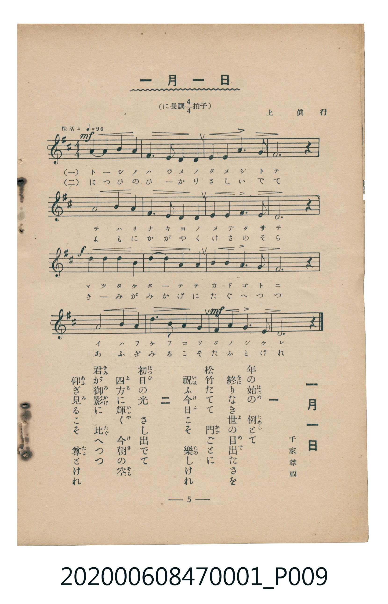

# 一月一日

<audio controls src="ichigatsu_ichijitsu.mp3"></audio>

- 詞：千家尊福
- 曲：上眞行
- 臺灣教育會公認《新定兒童唱歌》尋常科第一學年用（2020.006.0847.0001）

## 說明

原書資訊與歌詞全文（對應 P009.jpg，儀式歌 p. 5，第 5 首）：
調性與拍號：ニ長調 4/4 拍子，「快活ニ」

## 跨冊／重複收錄參照

> 同曲（儀式歌〈一月一日〉；收錄於《新定兒童唱歌》卷首與《唱歌帖》P123）

- **[同曲]** 楊金土手抄《唱歌帖》第 1 冊（2020.006.0843）：[**〈一月一日〉**](../../../shokacho/vol_01/p123_ichigatsu_ichijitsu/index.md)（`D` / `4/4` — [原始 TMD](../../../shokacho/vol_01/p123_ichigatsu_ichijitsu/ichigatsu_ichijitsu.tmd)）
- 總表：[跨冊重複與同名歌曲總索引](../../../duplicate_songs.md)

## 歌詞

```text
一　年（とし）の始（はじめ）の　例（ためし）とて
終（をは）りなき世（よ）の目出（めで）たさを
松竹（まつたけ）たてて　門（かど）ごとに
祝（いは）ふ今日（けふ）こそ　樂（たの）しけれ

二　初日（はつひ）の光（ひかり）　さし出（い）でて
四方（よも）に輝（かゞや）く　今朝（けさ）の空（そら）
君（きみ）が御影（みかげ）に　比（たぐ）へつつ
仰（あふ）ぎ見（み）るこそ　尊（たふと）けれ
```

## ABC

```abc
X:1
T:一月一日
C:曲：上眞行
M:4/4
L:1/16
Q:1/4=96
K:D
V:V1 name="Piano" snm="Pia"
[V:V1]
D4 E4 F4 A4 | E6 D2 E4 F4 | A4 B4 A6 F2 | E12 z4 |
F8 B4 A4 | F6 A2 B4 A4 | F4 E4 F6 E2 | D12 z4 |
B4 B4 A4 F4 | B4 d4 B4 A4 | B4 A4 F6 E2 | E12 z4 |
F8 A4 A4 | B6 A2 F4 E4 | A6 B2 A4 F4 | D12 z4 |
```

## TMD 檔案連結

- [主旋律 TMD 檔案](ichigatsu_ichijitsu.tmd) [[在 TMD Studio 編輯](https://tmdlang.github.io/Tmd-TS/#tmd=s7IKdvYPcrWy4tLSUniyo-HZnA4QOX2pgpYWl6KtgqUZl72tgguXjYm-iR1XnYLSi5Xz3u-Z9bS3-em6bU83dD1f1q8EEn42exNQ-MmOrudz5r1Y2AMWe9G-63nj4mdTZ75o2vRsTvPT1jUvVvU-buh6Nm3D03WznrZOer566dMpG5-t7Xnc0P10Q_fTHTueL5_4fM0aoAuert3xdOeW51NWvN_TYWRgZKBnYGCmZ2BhYg5kGBi-39OpxMWlr6VgSy3ApaCg8LRv_rPZO15sbn-xoutFRzvQXUDPPm1d8WxaO9AVTzf0PmvvVAgwMLDUyypIf7-n52lLw9M9_UBlCgV6CqZAAaDTFUwVXi6bBnQfMDRAZr5Ytf9Zw3KQad29L2bOB4o-bu5-OXU7UFwBGKQKQOGnaycA9T5u6Hm6f_WzLbuB8o8berlAmoHh8LihARgOQOsfN6543DgdaPDjxnVPl3eDRdY_bpzxuKkRIghU-WQfRHw-UBCmGKhrGcis51ubQHJNk4DaQBJNXY8bVz1u7H2yA-haoHgHxJTns9c9bd8FFgEasRwsOP9x41SgRpApz-bue756J9iSfY8bl4DlJsIULQOhhoaX0xrACrofN64ES00Bu2I12BVL54LlWqCuaNz6ZHcXMLWBBScCuWDByY8b5wINerYC7GSQ0evA4tNBapp6IGGzCxhkDU875sJ0AwMD6B5gKgSHUCswAoCCm0DOaOoCCTY0gLzROB3qvcYWsMrl0OB5Onv2s2lgjzUBEdBeoNzqF3sgrgUaMe9xE0RDPyicgW6eA5ECunkqNORWQsyd-7gJaHcn2NAJs8FCvY8b94MV9Tzdt_Dp3o1gwf3gEJoEsQnk2_VTYL4Fpgeg4A6wh5aAPbt7A1iuCRZCfS-WQaIabG4T0CBomAGzJMyUrcBgBysGhxnQFMpzCRQoaOlzcXkmZ2SmJ5YUl4IYWZlAhlVAZmJevkONQY1CNcg-BRsLLTswA1tOVYBkdGBhoaBhovB0Q__z9Q068OyliUUD0FaQYTUKhgq6CkZAbAzEpkBcA-bpAsVhojVgcTOoPEgMpgYCDUBqwOkIt9t29ZDjNpDtIAizGyZiiiYCcymIBfERKW7b0UmO20AugLkCEkognmEcinORFUAcR2LAAbMSJQEHshvhEhAbFlyQSAW5FeEBzICr5eLStVPATJ0KQFFlLi4A)]
- [鋼琴伴奏 TMD 檔案](ichigatsu_ichijitsu_piano.tmd) [[在 TMD Studio 編輯](https://tmdlang.github.io/Tmd-TS/#tmd=s7IKdvYPcrWy4tLSUniyo-HZnA4QOX3p-z0dL7v3PJ-w5cmeLU-X9j_v7Hi_p1NBS4tL0VbB0ozL3lbBhcvGRN_EjqtOQenFynnv98x62tv8dN22pxu6ni_rVwIJP5u9CSj8ZEfX8znzXizsAYu9aN_1vHHxs6kzXzRtejan-Wnrmhereh83dD2btuHpullPWyc9X7306ZSNz9b2PG7ofrqh--mOHc-XT3y-Zg3QWU_X7ni6c8vzKSuAjjMyMDLQMzAw0zOwMDEHMgwMge5T4uLyTM7ITE8sKS4FMbIygQyrgMzEvPwgD4cagxqFai4FILCx0LIDM_S1FGzRgQLEMqCDFTRMFJ5u6H--vkFHIcDAwFIvqyBdE4sGLX2wYTUKhgq6CkZAbAzEpkBcA-bpAsVhojVgcTOoPEgMpgYCDUBquPC7bVcPOW4D2Q6CMLthIqZoIjCXglgQH5Hith2d5LgN5AKYKyChBOIZxqE4F1kBxHEkBtzT2bMpCTiQ3QiXgNiw4IJEKsitCA9gBlwt7sTpg5I4TRCJ8-m0Oc9atz2b0fdk1zqg85919z5dOwGSI5FSXbxCtGEsjAI6Jh7IMo2PRTAIqDEAug7FKBMgZYKkDc7HbzTCHKgGuHWE-PidQ5w2rM4BBrqunQJmuCsARZW5uAA)]

## 分析

```text
================================================================================
📊 TMD Song Profile: [ 一月一日 ]
================================================================================
⏱  Duration:       0:40 (40.0s), 16 measures total
🎼 Key & Tempo:    首調基準 D, != 96.0 BPM, <4/4>
   - 分析範圍：      由實際發聲的音符與和弦推測調性；播放脈絡另行呈現
🎤 人聲音域:    D4 (MIDI 62) – D5 (MIDI 74) [跨度: 12 個半音 / 1.0 個八度, 難度: easy]
   - 最低音:  D4 in [IchigatsuIchijitsu #1 @ m.1, 0:00]
   - 最高音: D5 in [IchigatsuIchijitsu #1 @ m.10, 0:23]
   - 適合: soprano, mezzo-soprano, contralto, tenor, baritone, bass
🏛  結構:      IchigatsuIchijitsu (40.0s)
⚡ 編曲密度:        Peak 1 軌道同時演奏
🗝  調性診斷：       A 大調（純淨自然大調，未偵測到可信轉調）
   - 風格氣質:    純淨自然大調（陽光明朗、易唱易記，無明顯調外色彩）
   - 轉調歷程:    全曲維持單一推測調性（未偵測到可信轉調）
   - 核心骨幹音:  F#, A, E, B, D
   - 調性數值:    A 大調 [相關度: 0.75, 穩定度: Moderate, 自然音純度: 100.0%]
   - 候選調性 (K-S): A 大調 (0.75), F# 小調 (0.69), D 大調 (0.68)
   - 五度圈歷程:   +3
   - 各段落調性細節:
     • [IchigatsuIchijitsu #1]: A 大調 (r: 0.75, 自然音純度: 100.0%)

  [ 五度圈游移軌跡 ]
               C  
         F            G  
      Bb               D  
      Eb              [A ]*
         Ab           E  
            Db       B  
               F# 
     (* = active key center)

  [ 十二半音累積音高分佈 ]
     C  :                            0.0%
     C# :                            0.0%
     D  : ██████████████            14.2%
     D# :                            0.0%
     E  : ████████████████████      20.8%
     F  :                            0.0%
     F# : ████████████████████████  25.0%
     G  :                            0.0%
     G# :                            0.0%
     A  : ██████████████████████    23.3%
     A# :                            0.0%
     B  : ████████████████          16.7%
--------------------------------------------------------------------------------
Assignment 軌道音域：
  - Piano         : D4 – D5 (12 個半音 / 1.0 個八度, 50 個音符)
================================================================================
```


## 原書掃描頁




