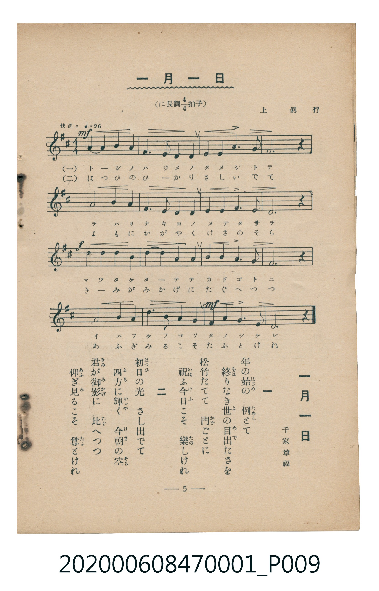

# 一月一日

> Re:Shōka 使用 AI 協助辨識與重建樂譜，可能會有錯誤。歡迎回報。

- **鋼琴伴奏版**：<br><audio controls src="ichigatsu_ichijitsu.mp3"></audio>
- **NEUTRINO 歌聲合成版**：<br><audio controls src="ichigatsu_ichijitsu_neutrino.mp3"></audio>

- 詞：千家尊福
- 曲：上眞行
- 臺灣教育會公認《新定兒童唱歌》尋常科第一學年用（2020.006.0847.0001）

## 說明

原書資訊與歌詞全文（對應 P009.jpg，儀式歌 p. 5，第 5 首）：
調性與拍號：ニ長調 4/4 拍子，「快活ニ」


## 歌詞

```text
一　年（とし）の始（はじめ）の　例（ためし）とて
終（をは）りなき世（よ）の目出（めで）たさを
松竹（まつたけ）たてて　門（かど）ごとに
祝（いは）ふ今日（けふ）こそ　樂（たの）しけれ

二　初日（はつひ）の光（ひかり）　さし出（い）でて
四方（よも）に輝（かゞや）く　今朝（けさ）の空（そら）
君（きみ）が御影（みかげ）に　比（たぐ）へつつ
仰（あふ）ぎ見（み）るこそ　尊（たふと）けれ
```

## ABC

<div class="abc-score" data-abc-src="ichigatsu_ichijitsu.abc" aria-label="五線譜載入中"></div>

[下載 ABC 原始檔](ichigatsu_ichijitsu.abc)

## TMD 檔案連結

- [主旋律 TMD 檔案](ichigatsu_ichijitsu.tmd) [[在 TMD Studio 編輯](https://tmdlang.github.io/Tmd-TS/#tmd=s7IKdvYPcrWy4qpTUCpJTLdSSM7PyUlNLsnMz7MqzsjMK0nNjM_KTMmPL87Iz05Ugisry88pzU21Si9KTEmNN4w3MjAyiDcwMIs3sDAxBzIMDBFKi_NLi5JTrYqTM_Lzc-JLUitKkvLzsxHyBUX5Zal5iXlANQVFIBtTwIoQClLLMlNSQdKpKZkl-UWZiTlI7kgtKga7FWxJfElRYl5xclFmAcgDCFUlGalAxxanJhbn5xUjhIFmpWfmWeXm5yWVAv2HKZGamZWJxcX5RSUZ-UCvF2RUWmVkFoPclJyYE5-dmIcUQlAXFSSmp1oFGBhYKnFpaSk82dHwbE4HiJy-VEFLi0vRVsHSjMveVsGFy8ZE38QOpPvFynnv98x62tv8dN22pxu6ni_rBxv6bPYmoPCTHV3P58x7sbAHLPaifdfzxsXPps580bTp2Zzmp61rXqzqfdzQ9WzahqfrZj1tnfR89dKnUzY-W9vzuKH76Ybupzt2PF8-8fmaNUAXPF274-nOLc-nrHi_pwMUfXrA6NMDRR-QYWD4fk-nEheXvpaCLbUAl4KCwtO--c9m73ixuf3Fiq4XHe1AdwE9-7R1xbNp7UBXPN3Q-6y9UwEUWHpZBenv9_Q8bWl4uqcfqEyhQE_BFCgAdLqCqcLLZdOA7gOGBsjMF6v2P2tYDjKtu_fFzPlA0cfN3S-nbgeKKwCDVAEo_HTtBKDexw09T_evfrZlN1D-cUMvF0gzMBweNzQAwwFo_ePGFY8bpwMNfty47unybrDI-seNMx43NUIEgSqf7IOIzwcKwhQDdS0DmfV8axNIrmkSUBtIoqnrceOqx429T3YAXQsU74CY8nz2uqftu8AiQCOWgwXnP26cCtQIMuXZ3H3PV-8EW7LvceMSsNxEmKJlINTQ8HJaA1hB9-PGlWCpKWBXrAa7YulcsFwL1BWNW5_s7gKmNrDgRCAXLDj5ceNcoEHPVoCdDDJ6HVh8OkhNUw8kbHYBg6zhacdcmG5gYADdA0yF4BBqBUYAUHATyBlNXSDBhgaQNxqnQ73X2AJWuRwaPE9nz342DeyxJiAC2guUW_1iD8S1QCPmPW6CaOgHhTPQzXMgUkA3T4WG3EqIuXMfNwHt7gQbOmE2WKj3ceN-sKKep_sWPt27ESy4HxxCkyA2gXy7fgrMt8D0ABTcAfbQErBnd28AyzXBQqjvxTJIVIPNbQIaBA0zYJaEmbIVGOxgxeAwA5pCeS6BAgUtfS4uz-SMzPTEkuJSECMrE8iwCssHFjQONQY11SDrFGwstOzADGwZVQGSz4FlhYKGicLTDf3P1zfowHOXJhYNQEtBhtUAs5guGJoBMYhdo2AM5hspGAJJEK4BskF8iLyugglcDQQagNSATfMxrFF43NwBFX_ctB1ENveBzXjc3A8V3QFkL0SWadoP5oHFwHpAvA6wnjYke-IR9hgB5RrXg9Q1LgGTm8DkOoh5YB7YlMZusJldUPGpYLHpYLIFqmI5WGYZhj34w3pXD63DGiZTAxbHFdZwn4JD93HzKmhYg3wM8vlaIHsFSixAQr4dLAsKdxC9FSwDMwtLWDch4rQJHGqroSEKCl8QvwcoAwpRYJaGykwE8yAhDooXED0XHNudJIb1jk5ywtowDhSkcAIU5FBBEASFPiQGQBKw-CCctueBQw_sU0iqbdoI8S80LEGyoDQLIUHioJB63Azy8-OmLVAVkLQNCTvsabsXZloj2BZg-EJCFcIDp-rGSSgxMR_MmwAmd0D1LgHLgHIICeENLLypk7bh4Q7imoCFQEEL4xFM3E0wh8MSNygxgcRBQQ7hPW7aDCb3IkUCJKnDCxKgalBgr8ET2KAkDQmwrWASmlUggd0ECezJYHIuSmBDVIOyF4ieCHYBKKJQ7anl4tK1U8As4BWAospcAA)]
- [鋼琴伴奏 TMD 檔案](ichigatsu_ichijitsu_piano.tmd) [[在 TMD Studio 編輯](https://tmdlang.github.io/Tmd-TS/#tmd=s7IKdvYPcrWy4qpTUCpJTLdSyC8qychPL0osyKi0ysgsLskvykxOzInPTsxLVIIrKs4vLUpOjS9ITE-1CjAwsFTi0tJSeLKj4dmcDhA5fen7PR0vu_c8n7DlyZ4tT5f2P-_seL-nU0FLi0vRVsHSjMveVsGFy8ZE38QOZOSLlfPe75n1tLf56bptTzd0PV_WD7bp2exNQOEnO7qez5n3YmEPWOxF-67njYufTZ35omnTsznNT1vXvFjV-7ih69m0DU_XzXraOun56qVPp2x8trbncUP30w3dT3fseL584vM1a4DOerp2x9OdW55PWQF0nJGBkYGegYGZnoGFiTmQYWAIdJ8SF5dnckZmemJJcSmIkZUJZFgFZCbm5Qd5ONQY1FRzKQCBjYWWHZihr6Vgiw4UIHYB3augYaLwdEP_8_UNOgqgMNLLKkjXxKJBSx9sWI2CqYIuGJoBMYhdo2AM5hspGAJJEK4BskF8iLyugglcDQQagNSATfMxrFF43NwBFX_ctB1ENveBzXjc3A8V3QFkL0SWadoP5oHFwHpAvA6wnjYke-IR9hgB5RrXg9Q1LgGTm8DkOoh5YB7YlMZusJldUPGpYLHpYLIFqmI5WGYZhj34w3pXD63DGiZTAxbHFdZwn4JD93HzKmhYg3wM8vlaIHsFSixAQr4dLAsKdxC9FSwDMwtLWDch4rQJHGqroSEKCl8QvwcoAwrRx40gd4BkJoJ5kBAHxQuInguO7U4Sw3pHJzlhbRgHClI4AQpyqCAIgkIfEgMgCVh8EE7b88ChB_YpJNU2bYT4FxqWIFlQmoWQIHFQSD1uBvn5cdMWqApI2oaEHfa03QszrRFsCzB8IaEK4YFTdeMklJiYD-ZNAJM7oHqXgGVAOYSE8H46ezZ10jY83EFcE7AQKGhhPIKJuwnmcFjiBiUmkDgoyCG8x02bweRepEiAJHV4QQJUDQrsNXgCG5SkIQG2FUxCswoksJsggT0ZTM5FCWyIalD2AtETwS4ARRSqPbW4y3cf5PLdBFG-P50251nrtmcz-p7sWgeMjmfdvU_XToDUaUgJPF4h2jAWRgEjIB7IMo2PRTAIqDGABgJcmQmQMkHSBufjNxphDlQD3DpCfPzOIU4bVucAw1zXTgEz2KN9gGpwyBiBZZS5AA)]

## 分析

```text
================================================================================
📊 TMD Song Profile: [ 一月一日 ]
================================================================================
⏱  Duration:       0:40 (40.0s), 16 measures total
🎼 Key & Tempo:    首調基準 D, != 96.0 BPM, <4/4>
   - 分析範圍：      由實際發聲的音符與和弦推測調性；播放脈絡另行呈現
🎤 人聲音域:    D4 (MIDI 62) – D5 (MIDI 74) [跨度: 12 個半音 / 1.0 個八度, 難度: easy]
   - 最低音:  D4 in [IchigatsuIchijitsu #1 @ m.2, 0:03]
   - 最高音: D5 in [IchigatsuIchijitsu #1 @ m.9, 0:20]
   - 適合: soprano, mezzo-soprano, contralto, tenor, baritone, bass
🏛  結構:      IchigatsuIchijitsu (40.0s)
⚡ 編曲密度:        Peak 1 軌道同時演奏
🗝  調性診斷：       D 大調（純淨自然大調，未偵測到可信轉調）
   - 風格氣質:    純淨自然大調（陽光明朗、易唱易記，無明顯調外色彩）
   - 轉調歷程:    全曲維持單一推測調性（未偵測到可信轉調）
   - 核心骨幹音:  D, A, F#, B, E
   - 調性數值:    D 大調 [相關度: 0.94, 穩定度: High, 自然音純度: 100.0%]
   - 候選調性 (K-S): D 大調 (0.94), A 大調 (0.69), F# 小調 (0.64)
   - 五度圈歷程:   +2
   - 各段落調性細節:
     • [IchigatsuIchijitsu #1]: D 大調 (r: 0.94, 自然音純度: 100.0%)

  [ 五度圈游移軌跡 ]
               C  
         F            G  
      Bb              [D ]*
      Eb               A  
         Ab           E  
            Db       B  
               F# 
     (* = active key center)

  [ 十二半音累積音高分佈 ]
     C  :                            0.0%
     C# :                            0.0%
     D  : ████████████████████████  26.7%
     D# :                            0.0%
     E  : █████████                 10.0%
     F  :                            0.0%
     F# : █████████████████         19.2%
     G  : █████                      5.8%
     G# :                            0.0%
     A  : ████████████████████████  26.7%
     A# :                            0.0%
     B  : ███████████               11.7%
--------------------------------------------------------------------------------
Assignment 軌道音域：
  - Vocal         : D4 – D5 (12 個半音 / 1.0 個八度, 48 個音符)
================================================================================
```


## 原書掃描頁




